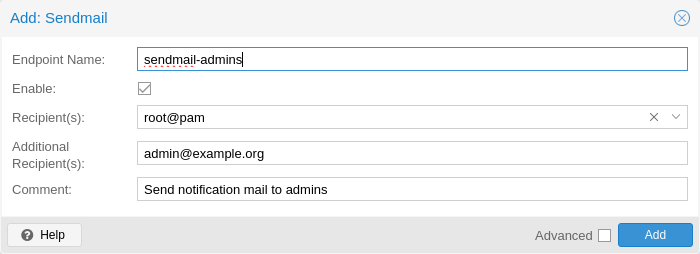
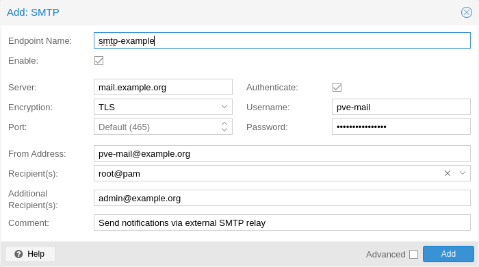
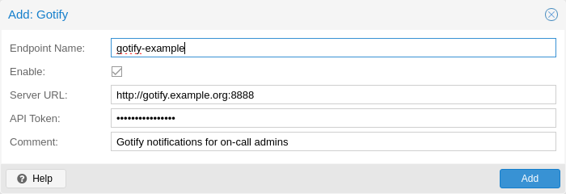
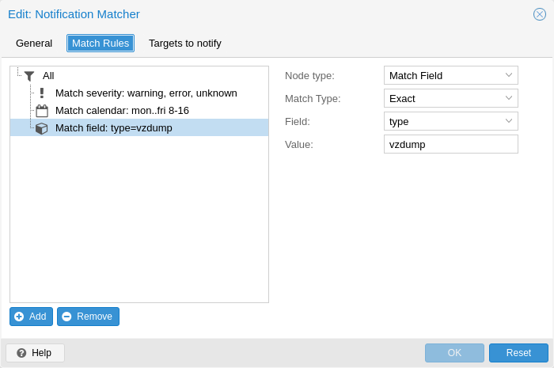

# 17\. 通知 <a href="#chapter_notifications" id="chapter_notifications"></a>

## 17.1. 概述 <a href="#overview" id="overview"></a>

- Proxmox VE 会在存储复制失败、节点隔离、备份完成/失败等事件发生时发出[通知事件](#notification_events)。这些事件根据全局通知设置进行处理。每个通知事件都包含元数据，例如时间戳、严重性级别、类型以及其他事件特定字段。
- [通知匹配器](#notification_matchers)将通知事件路由到一个或多个通知目标。匹配器可以具有匹配规则，根据通知事件的元数据进行选择性路由。
- [通知目标](#notification_targets)是匹配器将通知事件路由到的目的地。目标有多种类型，包括基于邮件的目标（Sendmail 和 SMTP）以及 Gotify。

可以在 GUI 的“数据中心 → 通知”下配置全局通知设置。配置保存在 `/etc/pve/notifications.cfg` 和 `/etc/pve/priv/notifications.cfg` 中，后者包含敏感配置选项，例如通知目标的密码或认证令牌，并且仅允许 `root` 读取。

## 17.2. 通知目标 <a href="#notification_targets" id="notification_targets"></a>

Proxmox VE 提供多种类型的通知目标。

### 17.2.1. Sendmail <a href="#notification_targets_sendmail" id="notification_targets_sendmail"></a>

[](https://pve.proxmox.com/pve-docs/images/screenshot/gui-datacenter-notification-sendmail.png)

sendmail 二进制程序是类 Unix 操作系统上常见的程序，负责发送电子邮件。它是一个命令行实用程序，允许用户和应用程序直接从命令行或脚本中发送电子邮件。

sendmail 通知目标使用 `sendmail` 二进制程序，向配置的用户或电子邮件地址列表发送邮件。如果选择用户作为收件人，将使用该用户设置中配置的电子邮件地址。对于 `root@pam` 用户，这是安装期间输入的电子邮件地址。可以在 `Datacenter → Permissions → Users` 中配置用户的电子邮件地址。如果用户没有关联的电子邮件地址，则不会发送邮件。


在标准 Proxmox VE 安装中，`sendmail` 二进制程序由 Postfix 提供。可能需要配置 Postfix 才能正确投递邮件，例如设置外部邮件中继（智能主机）。如果投递失败，请查看系统日志中 Postfix 守护进程记录的消息。


Sendmail 目标插件的配置包含以下选项：

- `mailto`：接收通知的电子邮件地址。可以多次设置，以指定多个收件人。
- `mailto-user`：接收电子邮件的用户。将从 `users.cfg` 中查找用户的电子邮件地址。可以多次设置，以指定多个收件人。
- `author`：设置电子邮件的作者。默认为 `Proxmox VE`。
- `from-address`：设置电子邮件的发件地址。如果未设置此参数，插件将回退到 `email_from` 设置，该设置来自 `datacenter.cfg`。如果该设置也未设置，插件将默认使用 `root@$hostname`，其中 `$hostname` 为节点的主机名。邮件中的 `From` 标头将设置为 `$author <$from-address>`。
- `comment`：此目标的注释

配置示例（`/etc/pve/notifications.cfg`）：

```text
sendmail: example
        mailto-user root@pam
        mailto-user admin@pve
        mailto max@example.com
        from-address pve1@example.com
        comment Send to multiple users/addresses
```

### 17.2.2. SMTP <a href="#notification_targets_smtp" id="notification_targets_smtp"></a>

[](https://pve.proxmox.com/pve-docs/images/screenshot/gui-datacenter-notification-smtp.png)

SMTP 通知目标可以直接向 SMTP 邮件中继发送电子邮件。此目标不使用系统的 MTA 投递邮件。与 sendmail 目标类似，如果选择用户作为收件人，则使用该用户配置的电子邮件地址。


与 sendmail 目标不同，SMTP 目标在邮件投递失败时没有任何排队/重试机制。


SMTP 目标插件的配置包含以下选项：

- `mailto`：接收通知的电子邮件地址。可以多次设置，以指定多个收件人。
- `mailto-user`：接收电子邮件的用户。将从 `users.cfg` 中查找用户的电子邮件地址。可以多次设置，以指定多个收件人。
- `author`：设置电子邮件的作者。默认为 `Proxmox VE`。
- `from-address`：设置电子邮件的发件地址。为防止伪造，SMTP 中继可能要求此地址属于该用户。邮件中的 `From` 标头将设置为 `$author <$from-address>`。
- `username`：认证时使用的用户名。如果未设置用户名，则不进行认证。支持 PLAIN 和 LOGIN 认证方式。
- `password`：认证时使用的密码。
- `mode`：设置加密模式（`insecure`、`starttls` 或 `tls`）。默认为 `tls`。
- `server`：SMTP 中继的地址/IP。
- `port`：要连接的端口。如果未设置，使用的端口默认为 25（`insecure`）、465（`tls`）或 587（`starttls`），具体取决于 `mode` 的值。
- `comment`：此目标的注释

配置示例（`/etc/pve/notifications.cfg`）：

```text
smtp: example
        mailto-user root@pam
        mailto-user admin@pve
        mailto max@example.com
        from-address pve1@example.com
        username pve1
        server mail.example.com
        mode starttls
```

`/etc/pve/priv/notifications.cfg` 中包含密码的对应条目：

```text
smtp: example
        password somepassword
```

### 17.2.3. Gotify <a href="#notification_targets_gotify" id="notification_targets_gotify"></a>

[](https://pve.proxmox.com/pve-docs/images/screenshot/gui-datacenter-notification-gotify.png)

[Gotify](http://gotify.net) 是一个开源的自托管通知服务器，可用于向各种设备和应用程序发送及接收推送通知。它提供简单的 API 和 Web 界面，便于与不同平台和服务集成。

Gotify 目标插件的配置包含以下选项：

- `server`：Gotify 服务器的基本 URL，例如 `http://<ip>:8888`
- `token`：认证令牌。可以在 Gotify Web 界面中生成令牌。
- `comment`：此目标的注释


Gotify 目标插件会遵循[数据中心配置](../24-configuration-files-2/README.md#datacenter_configuration_file)中的 HTTP 代理设置


配置示例（`/etc/pve/notifications.cfg`）：

```text
gotify: example
        server http://gotify.example.com:8888
        comment Send to multiple users/addresses
```

`/etc/pve/priv/notifications.cfg` 中包含秘密令牌的对应条目：

```text
gotify: example
        token somesecrettoken
```

### 17.2.4. Webhook <a href="#notification_targets_webhook" id="notification_targets_webhook"></a>

Webhook 通知目标向可配置的 URL 发出 HTTP 请求。

可用的配置选项如下：

- `url`：执行 HTTP 请求的目标 URL。支持使用模板注入消息内容、元数据和秘密信息。
- `method`：使用的 HTTP 方法（POST/PUT/GET）
- `header`：为请求设置的 HTTP 标头数组。支持使用模板注入消息内容、元数据和秘密信息。
- `body`：要发送的 HTTP 正文。支持使用模板注入消息内容、元数据和秘密信息。
- `secret`：秘密键值对数组。这些内容将保存在只有 root 可以读取的受保护配置文件中。可以通过 `secrets` 命名空间在正文/标头/URL 模板中访问秘密信息。
- `comment`：此目标的注释。

对于支持模板的配置选项，可以使用 [Handlebars](https://handlebarsjs.com/) 语法访问以下属性：

- `{{ title }}`：渲染后的通知标题
- `{{ message }}`：渲染后的通知正文
- `{{ severity }}`：通知的严重性（`info`、`notice`、`warning`、`error`、`unknown`）
- `{{ timestamp }}`：以 UNIX 纪元时间表示的通知时间戳（秒）。
- `{{ fields.<name> }}`：通知各个元数据字段的子命名空间。例如，`fields.type` 包含通知类型；所有可用字段请参阅[通知事件](#notification_events)。
- `{{ secrets.<name> }}`：秘密信息的子命名空间。例如，名为 `token` 的秘密信息可以通过 `secrets.token` 访问。

为方便使用，提供以下辅助函数：

- `{{ url-encode <value/property> }}`：对属性/字面量进行 URL 编码。
- `{{ escape <value/property> }}`：转义无法安全地表示为 JSON 字符串的控制字符。
- `{{ json <value/property> }}`：将值渲染为 JSON。这适合将整个子命名空间（例如 `fields`）作为 JSON 载荷的一部分（例如 `{{ json fields }}`）传递。

#### 示例 <a href="#examples_11" id="examples_11"></a>

##### `ntfy.sh` <a href="#span_class_monospaced_ntfy_sh_span" id="span_class_monospaced_ntfy_sh_span"></a>

- 方法：`POST`
- URL：`https://ntfy.sh/{{ secrets.channel }}`
- 标头：

  - `Markdown`: `Yes`
- 正文：

````text
```
{{ message }}
```
````

- 秘密信息：

  - `channel`: `<your ntfy.sh channel>`

##### Discord <a href="#discord" id="discord"></a>

- 方法：`POST`
- URL：`https://discord.com/api/webhooks/{{ secrets.token }}`
- 标头：

  - `Content-Type`: `application/json`
- 正文：

````text
{
  "content": "``` {{ escape message }}```"
}
````

- 秘密信息：

  - `token`: `<token>`

##### Slack <a href="#slack" id="slack"></a>

- 方法：`POST`
- URL：`https://hooks.slack.com/services/{{ secrets.token }}`
- 标头：

  - `Content-Type`: `application/json`
- 正文：

````text
{
  "text": "``` {{escape message}}```",
  "type": "mrkdwn"
}
````

- 秘密信息：

  - `token`: `<token>`

## 17.3. 通知匹配器 <a href="#notification_matchers" id="notification_matchers"></a>

[](https://pve.proxmox.com/pve-docs/images/screenshot/gui-datacenter-notification-matcher.png)

通知匹配器根据其匹配规则将通知路由到通知目标。这些规则可以匹配通知的某些属性，例如时间戳（`match-calendar`）、通知的严重性（`match-severity`）或元数据字段（`match-field`）。如果通知被某个匹配器匹配，为该匹配器配置的所有目标都会收到通知。

可以创建任意数量的匹配器，每个匹配器都有自己的匹配规则和通知目标。即使同一目标用于多个匹配器，每个通知也最多向该目标发送一次。

没有任何匹配规则的匹配器始终为真；配置的目标始终会收到通知。

```text
matcher: always-matches
        target admin
        comment This matcher always matches
```

### 17.3.1. 匹配器选项 <a href="#matcher_options" id="matcher_options"></a>

- `target`：确定匹配器匹配时应通知哪个目标。可以多次使用，以通知多个目标。
- `invert-match`：反转整个匹配器的结果
- `mode`：确定如何求值各个匹配规则，以计算整个匹配器的结果。如果设置为 `all`，则所有匹配规则都必须匹配。如果设置为 `any`，则至少一个规则必须匹配。默认为 `all`。
- `match-calendar`：将通知的时间戳与时间计划匹配。
- `match-field`：匹配通知的元数据字段。
- `match-severity`：匹配通知的严重性。
- `comment`：此匹配器的注释。

### 17.3.2. 日历匹配规则 <a href="#notification_matchers_calendar" id="notification_matchers_calendar"></a>

日历匹配器将通知发送的时间与可配置的时间计划进行匹配。

- `match-calendar 8-12`
- `match-calendar 8:00-15:30`
- `match-calendar mon..fri 9:00-17:00`
- `match-calendar sun,tue..wed,fri 9-17`

### 17.3.3. 字段匹配规则 <a href="#notification_matchers_field" id="notification_matchers_field"></a>

通知具有一些可供匹配的元数据字段。使用 `exact` 作为匹配模式时，可以使用 `,` 作为分隔符。只要元数据字段具有指定值中的<strong>任意一个</strong>，匹配规则就会匹配。

- `match-field exact:type=vzdump` 仅匹配与备份有关的通知。
- `match-field exact:type=replication,fencing` 匹配 `replication` 和 `fencing` 通知。
- `match-field regex:hostname=^.+\.example\.com$` 匹配节点的主机名。

如果要匹配的元数据字段不存在，通知将不会被匹配。例如，`match-field regex:hostname=.*` 指令只会匹配具有任意 `hostname` 元数据字段的通知，如果该字段不存在，则不会匹配。

### 17.3.4. 严重性匹配规则 <a href="#notification_matchers_severity" id="notification_matchers_severity"></a>

通知具有关联的严重性，可用于匹配。

- `match-severity error`：仅匹配错误
- `match-severity warning,error`：匹配警告和错误

使用以下严重性：`info`、`notice`、`warning`、`error`、`unknown`。

### 17.3.5. 示例 <a href="#examples_12" id="examples_12"></a>

```text
matcher: workday
        match-calendar mon..fri 9-17
        target admin
        comment Notify admins during working hours

matcher: night-and-weekend
        match-calendar mon..fri 9-17
        invert-match true
        target on-call-admins
        comment Separate target for non-working hours
```

```text
matcher: backup-failures
        match-field exact:type=vzdump
        match-severity error
        target backup-admins
        comment Send notifications about backup failures to one group of admins

matcher: cluster-failures
        match-field exact:type=replication,fencing
        target cluster-admins
        comment Send cluster-related notifications to other group of admins
```

## 17.4. 通知事件 <a href="#notification_events" id="notification_events"></a>

<table>


<thead>
<tr>
<th>事件</th>
<th> <code>type</code> </th>
<th>严重性</th>
<th>元数据字段（除 <code>type</code> 之外）</th>
</tr>
</thead>
<tbody>
<tr>
<td><p>有可用的系统更新</p></td>
<td><p><code>package-updates</code></p></td>
<td><p><code>info</code></p></td>
<td><p><code>hostname</code></p></td>
</tr>
<tr>
<td><p>集群节点被隔离</p></td>
<td><p><code>fencing</code></p></td>
<td><p><code>error</code></p></td>
<td><p><code>hostname</code></p></td>
</tr>
<tr>
<td><p>存储复制任务失败</p></td>
<td><p><code>replication</code></p></td>
<td><p><code>error</code></p></td>
<td><p><code>hostname</code>, <code>job-id</code></p></td>
</tr>
<tr>
<td><p>备份成功</p></td>
<td><p><code>vzdump</code></p></td>
<td><p><code>info</code></p></td>
<td><p><code>hostname</code>、<code>job-id</code>（仅适用于备份任务）</p></td>
</tr>
<tr>
<td><p>备份失败</p></td>
<td><p><code>vzdump</code></p></td>
<td><p><code>error</code></p></td>
<td><p><code>hostname</code>、<code>job-id</code>（仅适用于备份任务）</p></td>
</tr>
<tr>
<td><p>发给 root 的邮件</p></td>
<td><p><code>system-mail</code></p></td>
<td><p><code>unknown</code></p></td>
<td><p><code>hostname</code></p></td>
</tr>
</tbody>
</table>

<table>


<thead>
<tr>
<th>字段名</th>
<th>描述</th>
</tr>
</thead>
<tbody>
<tr>
<td><p><code>type</code></p></td>
<td><p>通知类型</p></td>
</tr>
<tr>
<td><p><code>hostname</code></p></td>
<td><p>不含域名的主机名（例如 <code>pve1</code>）</p></td>
</tr>
<tr>
<td><p><code>job-id</code></p></td>
<td><p>任务 ID</p></td>
</tr>
</tbody>
</table>


备份任务通知仅在备份任务按计划自动执行时才会设置 `job-id`；如果通过界面中的<em>立即运行</em>按钮手动触发，则不会设置。


## 17.5. 系统邮件转发 <a href="#system_mail_forwarding" id="system_mail_forwarding"></a>

某些本地系统守护进程（例如 `smartd`）会生成通知邮件，最初发送给本地 `root` 用户。这些邮件会转换为类型为 `system-mail`、严重性为 `unknown` 的通知事件，并根据全局通知设置进行处理。

将电子邮件转发到 sendmail 目标时，邮件内容和标头会原样转发。对于所有其他目标，系统会尝试从电子邮件内容中提取主题行和主要正文。如果电子邮件只包含 HTML 内容，则会在此过程中转换为纯文本格式。

## 17.6. 权限 <a href="#permissions_3" id="permissions_3"></a>

要修改/查看通知目标的配置，需要拥有 `Mapping.Modify/Mapping.Audit` 权限，权限路径为 `/mapping/notifications` ACL 节点。

测试目标需要拥有 `Mapping.Use`、`Mapping.Audit` 或 `Mapping.Modify` 权限，权限路径为 `/mapping/notifications`

## 17.7. 通知模式 <a href="#notification_mode" id="notification_mode"></a>

备份任务允许在两种模式之间选择，用于发送备份相关通知。这由 `notification-mode` 选项控制，该选项位于[备份任务配置](../16-vzdump/README.md#vzdump_configuration)中。

- 根据全局通知设置发送通知（`notification-system`）。
- 通过系统的 `sendmail` 命令，将通知邮件发送到备份任务中配置的电子邮件地址（`legacy-sendmail`）。此模式还允许选择始终发送邮件，或仅在备份失败时发送。全局通知设置中的所有目标或匹配器均会被忽略。此模式等同于 Proxmox VE 8.1 之前版本的通知行为。此模式可能在 Proxmox VE 的后续版本中移除。

## 17.8. 覆盖通知模板 <a href="#overriding_notification_templates" id="overriding_notification_templates"></a>

Proxmox VE 使用 Handlebars 模板渲染通知。Proxmox VE 提供的原始模板保存在 `/usr/share/pve-manager/templates/default/`。

可以在 `/etc/pve/notification-templates/default/` 覆盖目录中提供自定义模板文件，以覆盖通知模板。渲染指定类型的通知时，Proxmox VE 会先尝试从覆盖目录加载模板。如果模板不存在或渲染失败，则使用原始模板。

模板文件遵循 `<type>-<body|subject>.<html|txt>.hbs` 命名约定。例如，文件 `vzdump-body.html.hbs` 包含用于渲染 HTML 版备份通知的模板，而 `package-updates-subject.txt.hbs` 用于渲染可用软件包更新通知的主题行。

基于电子邮件的通知目标（例如 `sendmail` 和 `smtp`）始终发送包含 HTML 部分和纯文本部分的多部分消息。因此，在渲染邮件消息时，`<type>-body.html.hbs` 和 `<type>-body.txt.hbs` 模板都会使用。所有其他通知目标类型只使用 `<type>-body.txt.hbs` 模板。

---

来源：[Proxmox VE 官方文档](https://pve.proxmox.com/pve-docs/pve-admin-guide.html) · 版本 9.2.13 · 非官方中文翻译。
