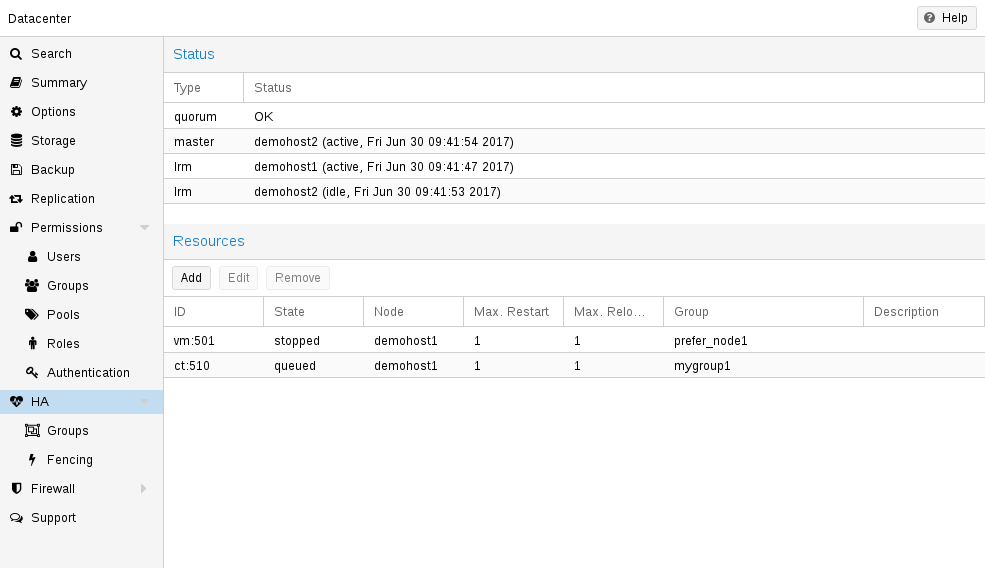
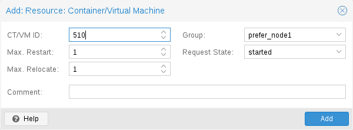
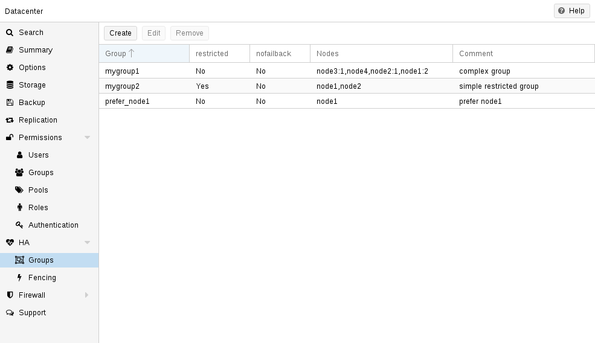
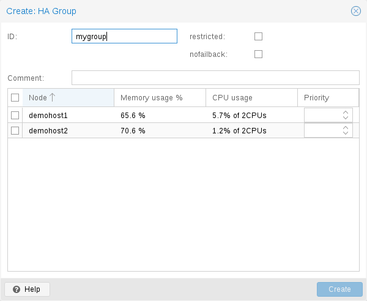
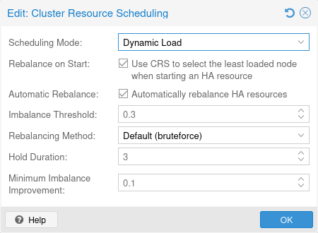

# ha-manager(1)

## 名称 <a href="#chapter_ha_manager" id="chapter_ha_manager"></a>

ha-manager \- Proxmox VE HA 管理器

## 概要 <a href="#synopsis" id="synopsis"></a>

### <strong>ha-manager</strong> `<COMMAND> [ARGS] [OPTIONS]` <a href="#cli_ha-manager" id="cli_ha-manager"></a>

### <strong>ha-manager add</strong> `<sid>` `[OPTIONS]` <a href="#cli_ha-manager_add" id="cli_ha-manager_add"></a>

创建新的 HA 资源。

**`<sid>`: `<type>:<name>`**

HA 资源 ID。由资源类型和特定于资源的名称组成，二者以冒号分隔（示例：vm:100 / ct:100）。对于虚拟机和容器，可以直接使用 VM 或 CT ID 作为简写（示例：100）。

**`--auto-rebalance` `<boolean>` (<em>默认 \=</em> `1`)**

自动重新平衡期间可以迁移 HA 资源

**`--comment` `<string>`**

描述。

**`--failback` `<boolean>` (<em>默认 \=</em> `1`)**

如果优先级高于当前节点的节点上线，则根据其节点亲和性规则，自动将 HA 资源迁移到优先级最高的节点。

**`--group` `<string>`**

HA 组标识符。

**`--max_relocate` `<integer> (0 - N)` (<em>默认 \=</em> `1`)**

资源启动失败时，尝试重定位资源的最大次数。

**`--max_restart` `<integer> (0 - N)` (<em>默认 \=</em> `1`)**

资源启动失败后，在节点上重启该资源的最大尝试次数。达到该次数后，HA 管理器将尝试把资源重定位到符合条件的节点。

**`--state` `<disabled | enabled | ignored | started | stopped>` (<em>默认 \=</em> `started`)**

请求的资源状态。

**`--type` `<ct | vm>`**

资源类型。

### <strong>ha-manager config</strong> `[OPTIONS]` <a href="#cli_ha-manager_config" id="cli_ha-manager_config"></a>

列出 HA 资源。

**`--type` `<ct | vm>`**

仅列出特定类型的资源

### <strong>ha-manager crm-command arm-ha</strong> <a href="#cli_ha-manager_crm-command_arm-ha" id="cli_ha-manager_crm-command_arm-ha"></a>

请求在 HA 堆栈解除布防后重新布防。

### <strong>ha-manager crm-command disarm-ha</strong> `<resource-mode>` <a href="#cli_ha-manager_crm-command_disarm-ha" id="cli_ha-manager_crm-command_disarm-ha"></a>

请求解除 HA 堆栈的布防，并释放整个集群范围内的所有看门狗。

**`<resource-mode>`: `<freeze | ignore>`**

控制解除布防期间如何处理 HA 管理的资源。资源的当前状态不受影响。<em>freeze</em>：不应用新命令和状态更改。<em>ignore</em>：从 HA 跟踪中移除资源，并可将其当作非 HA 管理的资源进行管理。

### <strong>ha-manager crm-command migrate</strong> `<sid> <node>` <a href="#cli_ha-manager_crm-command_migrate" id="cli_ha-manager_crm-command_migrate"></a>

请求将资源在线迁移到另一个节点。

**`<sid>`: `<type>:<name>`**

HA 资源 ID。由资源类型和特定于资源的名称组成，二者以冒号分隔（示例：vm:100 / ct:100）。对于虚拟机和容器，可以直接使用 VM 或 CT ID 作为简写（示例：100）。

**`<node>`: `<string>`**

目标节点。

### <strong>ha-manager crm-command node-maintenance disable</strong> `<node>` <a href="#cli_ha-manager_crm-command_node-maintenance_disable" id="cli_ha-manager_crm-command_node-maintenance_disable"></a>

更改 node-maintenance 请求状态。

**`<node>`: `<string>`**

集群节点名称。

### <strong>ha-manager crm-command node-maintenance enable</strong> `<node>` <a href="#cli_ha-manager_crm-command_node-maintenance_enable" id="cli_ha-manager_crm-command_node-maintenance_enable"></a>

更改 node-maintenance 请求状态。

**`<node>`: `<string>`**

集群节点名称。

### <strong>ha-manager crm-command relocate</strong> `<sid> <node>` <a href="#cli_ha-manager_crm-command_relocate" id="cli_ha-manager_crm-command_relocate"></a>

请求将资源重定位到另一个节点。这会停止旧节点上的服务，并在目标节点上重新启动该服务。

**`<sid>`: `<type>:<name>`**

HA 资源 ID。由资源类型和特定于资源的名称组成，二者以冒号分隔（示例：vm:100 / ct:100）。对于虚拟机和容器，可以直接使用 VM 或 CT ID 作为简写（示例：100）。

**`<node>`: `<string>`**

目标节点。

### <strong>ha-manager crm-command stop</strong> `<sid> <timeout>` <a href="#cli_ha-manager_crm-command_stop" id="cli_ha-manager_crm-command_stop"></a>

请求停止服务。

**`<sid>`: `<type>:<name>`**

HA 资源 ID。由资源类型和特定于资源的名称组成，二者以冒号分隔（示例：vm:100 / ct:100）。对于虚拟机和容器，可以直接使用 VM 或 CT ID 作为简写（示例：100）。

**`<timeout>`: `<integer> (0 - N)`**

超时时间（秒）。如果设置为 0，将执行强制停止。

### <strong>ha-manager groupadd</strong> `<group> --nodes <string>` `[OPTIONS]` <a href="#cli_ha-manager_groupadd" id="cli_ha-manager_groupadd"></a>

创建新的 HA 组。（已弃用，建议使用 HA 规则）

**`<group>`: `<string>`**

HA 组标识符。

**`--comment` `<string>`**

描述。

**`--nodes` `<node>[:<pri>]{,<node>[:<pri>]}*`**

带有可选优先级的集群节点名称列表。

**`--nofailback` `<boolean>` (<em>默认 \=</em> `0`)**

CRM 会尝试在优先级最高的节点上运行服务。如果优先级更高的节点上线，CRM 会将服务迁移到该节点。启用 nofailback 可阻止此行为。

**`--restricted` `<boolean>` (<em>默认 \=</em> `0`)**

绑定到受限组的资源只能在该组定义的节点上运行。

**`--type` `<group>`**

组类型。

### <strong>ha-manager groupconfig</strong> <a href="#cli_ha-manager_groupconfig" id="cli_ha-manager_groupconfig"></a>

获取 HA 组。（已弃用，建议使用 HA 规则）

### <strong>ha-manager groupremove</strong> `<group>` <a href="#cli_ha-manager_groupremove" id="cli_ha-manager_groupremove"></a>

删除 HA 组配置。（已弃用，建议使用 HA 规则）

**`<group>`: `<string>`**

HA 组标识符。

### <strong>ha-manager groupset</strong> `<group>` `[OPTIONS]` <a href="#cli_ha-manager_groupset" id="cli_ha-manager_groupset"></a>

更新 HA 组配置。（已弃用，建议使用 HA 规则）

**`<group>`: `<string>`**

HA 组标识符。

**`--comment` `<string>`**

描述。

**`--delete` `<string>`**

要删除的设置列表。

**`--digest` `<string>`**

如果当前配置文件的摘要不同，则阻止更改。这可用于防止并发修改。

**`--nodes` `<node>[:<pri>]{,<node>[:<pri>]}*`**

带有可选优先级的集群节点名称列表。

**`--nofailback` `<boolean>` (<em>默认 \=</em> `0`)**

CRM 会尝试在优先级最高的节点上运行服务。如果优先级更高的节点上线，CRM 会将服务迁移到该节点。启用 nofailback 可阻止此行为。

**`--restricted` `<boolean>` (<em>默认 \=</em> `0`)**

绑定到受限组的资源只能在该组定义的节点上运行。

### <strong>ha-manager help</strong> `[OPTIONS]` <a href="#cli_ha-manager_help" id="cli_ha-manager_help"></a>

获取指定命令的帮助。

**`--extra-args` `<array>`**

显示特定命令的帮助

**`--verbose` `<boolean>`**

详细输出格式。

### <strong>ha-manager migrate</strong> <a href="#cli_ha-manager_migrate" id="cli_ha-manager_migrate"></a>

<em>ha-manager crm-command migrate</em> 的别名。

### <strong>ha-manager relocate</strong> <a href="#cli_ha-manager_relocate" id="cli_ha-manager_relocate"></a>

<em>ha-manager crm-command relocate</em> 的别名。

### <strong>ha-manager remove</strong> `<sid>` `[OPTIONS]` <a href="#cli_ha-manager_remove" id="cli_ha-manager_remove"></a>

删除资源配置。

**`<sid>`: `<type>:<name>`**

HA 资源 ID。由资源类型和特定于资源的名称组成，二者以冒号分隔（示例：vm:100 / ct:100）。对于虚拟机和容器，可以直接使用 VM 或 CT ID 作为简写（示例：100）。

**`--purge` `<boolean>` (<em>默认 \=</em> `1`)**

从引用此资源的规则中移除此资源；如果此资源是规则中的唯一资源，则删除该规则

### <strong>ha-manager rules add</strong> `<type> <rule>` `[OPTIONS]` <a href="#cli_ha-manager_rules_add" id="cli_ha-manager_rules_add"></a>

创建 HA 规则。

**`<type>`: `<node-affinity | resource-affinity>`**

HA 规则类型。

**`<rule>`: `<string>`**

HA 规则标识符。

`Conditional options:`

**`[type=node-affinity]`**

**`--affinity` `<negative | positive>` (<em>默认 \=</em> `positive`)**

描述 HA 资源应放置在指定节点上（<em>positive</em>），还是应放置在指定节点以外的任何节点上（<em>negative</em>）。

**`--comment` `<string>`**

HA 规则描述。

**`--disable` `<boolean>`**

HA 规则是否已禁用。

**`--nodes` `<node>[:<pri>]{,<node>[:<pri>]}*`**

带有可选优先级的集群节点名称列表。

**`--resources` `<type>:<name>{,<type>:<name>}*`**

HA 资源 ID 列表。每个 ID 由资源类型和后随的特定于资源的名称组成，二者以冒号分隔（示例：vm:100,ct:101）。

**`--strict` `<boolean>` (<em>默认 \=</em> `0`)**

描述节点亲和性规则是严格的还是非严格的。

**`[type=resource-affinity]`**

**`--affinity` `<negative | positive>`**

描述 HA 资源是否应保留在同一节点上（<em>positive</em>），还是应保留在不同节点上（<em>negative</em>）。

**`--comment` `<string>`**

HA 规则描述。

**`--disable` `<boolean>`**

HA 规则是否已禁用。

**`--resources` `<type>:<name>{,<type>:<name>}*`**

HA 资源 ID 列表。每个 ID 由资源类型和后随的特定于资源的名称组成，二者以冒号分隔（示例：vm:100,ct:101）。

### <strong>ha-manager rules config</strong> `[OPTIONS]` `[FORMAT_OPTIONS]` <a href="#cli_ha-manager_rules_config" id="cli_ha-manager_rules_config"></a>

获取 HA 规则。

**`--resource` `<string>`**

将返回的列表限制为影响指定资源的规则。

**`--type` `<node-affinity | resource-affinity>`**

将返回的列表限制为指定的规则类型。

### <strong>ha-manager rules list</strong> `[OPTIONS]` `[FORMAT_OPTIONS]` <a href="#cli_ha-manager_rules_list" id="cli_ha-manager_rules_list"></a>

获取 HA 规则。

**`--resource` `<string>`**

将返回的列表限制为影响指定资源的规则。

**`--type` `<node-affinity | resource-affinity>`**

将返回的列表限制为指定的规则类型。

### <strong>ha-manager rules remove</strong> `<rule>` <a href="#cli_ha-manager_rules_remove" id="cli_ha-manager_rules_remove"></a>

删除 HA 规则。

**`<rule>`: `<string>`**

HA 规则标识符。

### <strong>ha-manager rules set</strong> `<type> <rule>` `[OPTIONS]` <a href="#cli_ha-manager_rules_set" id="cli_ha-manager_rules_set"></a>

更新 HA 规则。

**`<type>`: `<node-affinity | resource-affinity>`**

HA 规则类型。

**`<rule>`: `<string>`**

HA 规则标识符。

**`--delete` `<string>`**

要删除的设置列表。

**`--digest` `<string>`**

如果当前配置文件的摘要不同，则阻止更改。这可用于防止并发修改。

`Conditional options:`

**`[type=node-affinity]`**

**`--affinity` `<negative | positive>` (<em>默认 \=</em> `positive`)**

描述 HA 资源应放置在指定节点上（<em>positive</em>），还是应放置在指定节点以外的任何节点上（<em>negative</em>）。

**`--comment` `<string>`**

HA 规则描述。

**`--disable` `<boolean>`**

HA 规则是否已禁用。

**`--nodes` `<node>[:<pri>]{,<node>[:<pri>]}*`**

带有可选优先级的集群节点名称列表。

**`--resources` `<type>:<name>{,<type>:<name>}*`**

HA 资源 ID 列表。每个 ID 由资源类型和后随的特定于资源的名称组成，二者以冒号分隔（示例：vm:100,ct:101）。

**`--strict` `<boolean>` (<em>默认 \=</em> `0`)**

描述节点亲和性规则是严格的还是非严格的。

**`[type=resource-affinity]`**

**`--affinity` `<negative | positive>`**

描述 HA 资源是否应保留在同一节点上（<em>positive</em>），还是应保留在不同节点上（<em>negative</em>）。

**`--comment` `<string>`**

HA 规则描述。

**`--disable` `<boolean>`**

HA 规则是否已禁用。

**`--resources` `<type>:<name>{,<type>:<name>}*`**

HA 资源 ID 列表。每个 ID 由资源类型和后随的特定于资源的名称组成，二者以冒号分隔（示例：vm:100,ct:101）。

### <strong>ha-manager set</strong> `<sid>` `[OPTIONS]` <a href="#cli_ha-manager_set" id="cli_ha-manager_set"></a>

更新资源配置。

**`<sid>`: `<type>:<name>`**

HA 资源 ID。由资源类型和特定于资源的名称组成，二者以冒号分隔（示例：vm:100 / ct:100）。对于虚拟机和容器，可以直接使用 VM 或 CT ID 作为简写（示例：100）。

**`--auto-rebalance` `<boolean>` (<em>默认 \=</em> `1`)**

自动重新平衡期间可以迁移 HA 资源

**`--comment` `<string>`**

描述。

**`--delete` `<string>`**

要删除的设置列表。

**`--digest` `<string>`**

如果当前配置文件的摘要不同，则阻止更改。这可用于防止并发修改。

**`--failback` `<boolean>` (<em>默认 \=</em> `1`)**

如果优先级高于当前节点的节点上线，则根据其节点亲和性规则，自动将 HA 资源迁移到优先级最高的节点。

**`--group` `<string>`**

HA 组标识符。

**`--max_relocate` `<integer> (0 - N)` (<em>默认 \=</em> `1`)**

资源启动失败时，尝试重定位资源的最大次数。

**`--max_restart` `<integer> (0 - N)` (<em>默认 \=</em> `1`)**

资源启动失败后，在节点上重启该资源的最大尝试次数。达到该次数后，HA 管理器将尝试把资源重定位到符合条件的节点。

**`--state` `<disabled | enabled | ignored | started | stopped>` (<em>默认 \=</em> `started`)**

请求的资源状态。

### <strong>ha-manager status</strong> `[OPTIONS]` <a href="#cli_ha-manager_status" id="cli_ha-manager_status"></a>

显示 HA 管理器状态。

**`--verbose` `<boolean>`（<em>默认值 \=</em> `0`）**

详细输出。包含完整的 CRM 和 LRM 状态（JSON）。

## 描述 <a href="#description" id="description"></a>

我们的现代社会高度依赖计算机通过网络提供的信息。移动设备加剧了这种依赖，因为人们可以随时随地访问网络。如果您提供此类服务，那么确保它们在绝大多数时间内可用就非常重要。

我们可以从数学上将可用性定义为 (A)（在给定时间间隔内服务能够被使用的总时间）与 (B)（该时间间隔的长度）之比。通常以给定年份内正常运行时间的百分比表示。

<table>
<caption>表 1. 可用性 - 每年的停机时间</caption>


<thead>
<tr>
<th>可用性 %</th>
<th>每年停机时间</th>
</tr>
</thead>
<tbody>
<tr>
<td><p>99</p></td>
<td><p>3.65 days</p></td>
</tr>
<tr>
<td><p>99.9</p></td>
<td><p>8.76 hours</p></td>
</tr>
<tr>
<td><p>99.99</p></td>
<td><p>52.56 minutes</p></td>
</tr>
<tr>
<td><p>99.999</p></td>
<td><p>5.26 minutes</p></td>
</tr>
<tr>
<td><p>99.9999</p></td>
<td><p>31.5 seconds</p></td>
</tr>
<tr>
<td><p>99.99999</p></td>
<td><p>3.15 seconds</p></td>
</tr>
</tbody>
</table>

提高可用性有多种方法。最优雅的解决方案是重写您的软件，以便您可以同时在多台宿主机上运行它。软件本身需要具备检测错误和执行故障转移的方法。如果您只想提供只读网页，那么这相对简单。然而，这通常很复杂，有时甚至不可能，因为您无法自行修改软件。以下解决方案无需修改软件即可工作：

- 使用可靠的“服务器”组件

  
  具有相同功能的计算机组件，其可靠性指标可能因组件质量而异。大多数供应商将可靠性更高的组件作为“服务器”组件出售——通常价格也更高。
  
- 消除单点故障（冗余组件）

  - 使用不间断电源（UPS）
  - 在服务器中使用冗余电源
  - 使用 ECC-RAM
  - 使用冗余网络硬件
  - 为本地存储使用 RAID
  - 为 VM 数据使用分布式冗余存储
- 减少停机时间

  - 可快速联系到的管理员（24/7）
  - 备件的可用性（Proxmox VE 集群中的其他节点）
  - 自动错误检测（由`ha-manager`提供）
  - 自动故障转移（由`ha-manager`提供）

像 Proxmox VE 这样的虚拟化环境消除了对“硬件”的依赖，因此更容易实现高可用性。它们还支持配置和使用冗余存储及网络设备，因此，如果一台宿主机发生故障，您只需在集群中的另一台宿主机上启动这些服务即可。

更棒的是，Proxmox VE 提供了一个名为`ha-manager`的软件栈，它可以自动为您完成这些操作。它能够自动检测错误并执行自动故障转移。

Proxmox VE `ha-manager`的工作方式就像一位“自动化”管理员。首先，您要配置它应管理哪些资源（VM、容器……）。然后，`ha-manager`会监视其是否正常运行，并在发生错误时将服务故障转移到另一个节点。`ha-manager`还可以处理可能启动、停止、重新定位和迁移服务的普通用户请求。

但高可用性是有代价的。高质量组件价格更高，而使其冗余至少会使成本翻倍。额外的备件会进一步增加成本。因此，您应仔细计算收益，并与这些额外成本进行比较。


将可用性从 99% 提高到 99.9% 相对简单。但将可用性从 99.9999% 提高到 99.99999% 则非常困难且成本高昂。`ha-manager`的典型错误检测和故障转移时间约为 2 minutes，因此您最多只能获得 99.999% 的可用性。


## 要求 <a href="#requirements" id="requirements"></a>

在开始使用 HA 之前，您必须满足以下要求：

- 至少三个集群节点（以获得可靠的仲裁）
- VM 和容器的共享存储
- 硬件冗余（所有环节）
- 使用可靠的“服务器”组件

可选地，可以使用硬件看门狗——如果不可用，我们将回退到 Linux 内核软件看门狗（`softdog`）。

## 资源 <a href="#ha_manager_resources" id="ha_manager_resources"></a>

HA 管理器的主要管理单元称为 HA 资源（或“HA 服务”）。目前，HA 资源可以是虚拟机（VM）或 Linux 容器（CT）。

每个 HA 资源都由服务 ID（`sid`）唯一标识，服务 ID 由资源类型和特定于类型的 ID 组成，对于 VM 和容器，该 ID 为 VMID。例如，对于 VMID 为`100`的 VM，其服务 ID 为`vm:100`。

HA 资源只能在其所有依赖项均可用的节点上运行。默认情况下，HA 管理器将每个集群节点都视为合格节点。要保持此默认行为，VM 或容器应：

- 使用与所有集群节点兼容的选项
- 仅使用所有集群节点均可访问的共享存储
- 仅使用所有集群节点上都存在的网络接口
- 仅使用所有集群节点上都存在的设备直通

如果其中任何依赖项仅在部分节点上可用，请使用严格的[节点亲和性规则](#ha_manager_node_affinity_rules)将 HA 资源限制在该部分节点上。随后，HA 管理器会将放置、恢复和迁移限制在规则的节点上。

## 管理任务 <a href="#management_tasks" id="management_tasks"></a>

本节简要介绍常见的管理任务。第一步是为资源启用 HA。这通过将资源添加到 HA 资源配置中来完成。您可以使用 GUI 执行此操作，也可以直接使用命令行工具，例如：

```text
# ha-manager add vm:100
```

HA 软件栈现在会尝试启动资源并使其保持运行。请注意，您可以配置资源的“请求”状态。例如，您可能希望 HA 软件栈停止资源：

```text
# ha-manager set vm:100 --state stopped
```

并在稍后再次启动它：

```text
# ha-manager set vm:100 --state started
```

您还可以使用常规的 VM 和容器管理命令。它们会自动将命令转发给 HA 软件栈，因此

```text
# qm start 100
```

只是将请求的状态设置为`started`。`qm
stop`也是如此，它会将请求的状态设置为`stopped`。


HA 软件栈以完全异步的方式工作，并且需要与其他集群成员通信。因此，您需要等待几秒钟才能看到此类操作的结果。


要查看当前 HA 资源配置，请使用：

```text
# ha-manager config
vm:100
        state stopped
```

您还可以使用以下命令查看 HA 管理器和资源的实际状态：

```text
# ha-manager status
quorum OK
master node1 (active, Wed Nov 23 11:07:23 2016)
lrm elsa (active, Wed Nov 23 11:07:19 2016)
service vm:100 (node1, started)
```

您还可以发起将资源迁移到其他节点的操作：

```text
# ha-manager migrate vm:100 node2
```

这使用在线迁移，并尝试让 VM 保持运行。在线迁移需要通过网络传输所有已使用的内存，因此有时先停止 VM，然后在新节点上重新启动它会更快。这可以使用`relocate`命令完成：

```text
# ha-manager relocate vm:100 node2
```

最后，您可以使用以下命令将资源从 HA 配置中移除：

```text
# ha-manager remove vm:100
```

默认情况下，这还会从引用该资源的任何规则中移除该资源，并删除仅引用此资源的规则。您可以使用<em>--purge 0</em>覆盖此行为。


这不会启动或停止资源。


但所有与 HA 相关的任务都可以在 GUI 中完成，因此完全不需要使用命令行。

## 工作原理 <a href="#how_it_works" id="how_it_works"></a>

本节详细介绍 Proxmox VE HA 管理器的内部机制。它描述了所有涉及的守护进程以及它们如何协同工作。为提供 HA，每个节点上运行两个守护进程：

**`pve-ha-lrm`**

本地资源管理器（LRM），控制本地节点上运行的服务。它从当前管理器状态文件中读取其服务的请求状态，并执行相应的命令。

**`pve-ha-crm`**

集群资源管理器（CRM），负责制定集群范围的决策。它向 LRM 发送命令、处理结果，并在发生故障时将资源移动到其他节点。CRM 还负责节点隔离。


**LRM 和 CRM 中的锁**

锁由我们的分布式配置文件系统（pmxcfs）提供。它们用于确保每个 LRM 只有一个活动实例并正常工作。由于 LRM 只有持有自己的锁时才会执行操作，因此，如果我们能够获取其锁，就可以将故障节点标记为已隔离。随后，这让我们能够安全地恢复任何发生故障的 HA 服务，而不会受到当前状态未知的故障节点的任何干扰。这一切都由当前持有管理器主锁的 CRM 监督。


### 服务状态 <a href="#ha_manager_service_states" id="ha_manager_service_states"></a>

CRM 使用服务状态枚举来记录当前服务状态。此状态显示在 GUI 中，并且可以使用`ha-manager`命令行工具查询：

```text
# ha-manager status
quorum OK
master elsa (active, Mon Nov 21 07:23:29 2016)
lrm elsa (active, Mon Nov 21 07:23:22 2016)
service ct:100 (elsa, stopped)
service ct:102 (elsa, started)
service vm:501 (elsa, started)
```

以下是可能状态的列表：

**stopped**

服务已停止（由 LRM 确认）。如果 LRM 检测到已停止的服务仍在运行，它会再次停止该服务。

**request\_stop**

服务应被停止。CRM 等待 LRM 的确认。

**stopping**

停止请求待处理。但 CRM 到目前为止尚未收到该请求。

**started**

服务处于活动状态，如果尚未运行，LRM 应尽快启动它。如果服务发生故障且被检测到未在运行，LRM 会重新启动它（请参阅[启动失败策略](#ha_manager_start_failure_policy)）。

**starting**

启动请求待处理。但 CRM 尚未收到 LRM 关于服务正在运行的任何确认。

**fence**

等待节点隔离，因为服务所在节点不在具有仲裁的集群分区内（请参阅[隔离](#ha_manager_fencing)）。节点成功隔离后，服务将立即进入恢复状态。

**recovery**

等待服务恢复。HA 管理器会尝试寻找一个可以运行该服务的新节点。此搜索取决于在线且具有仲裁的节点列表，以及服务所属的亲和性规则（如果有）。一旦找到新的可用节点，服务就会被移动到该节点，并首先置于 stopped 状态。如果它被配置为运行，新节点就会运行它。

**freeze**

不要更改服务状态。我们在重启节点或重启 LRM 守护进程时使用此状态（参见 [软件包更新](#ha_manager_package_updates)）。

**ignored**

就像服务完全不受 HA 管理一样运行。适用于需要暂时完全控制服务，但又不想将其从 HA 配置中移除的情况。

**migrate**

将服务（在线）迁移到其他节点。

**error**

服务因 LRM 错误而被禁用。需要手动干预（参见 [错误恢复](#ha_manager_error_recovery)）。

**queued**

服务是新添加的，CRM 尚未发现它。

**disabled**

服务已停止并标记为 `disabled`

### 本地资源管理器 <a href="#ha_manager_lrm" id="ha_manager_lrm"></a>

本地资源管理器（`pve-ha-lrm`）在启动时作为守护进程启动，并等待 HA 集群达到仲裁，从而使集群范围的锁能够正常工作。

它可以处于三种状态：

**等待代理锁**

LRM 等待其排他锁。如果未配置任何服务，此状态也用作空闲状态。

**active**

LRM 持有其排他锁，并且已配置服务。

**丢失代理锁**

LRM 丢失了锁，这意味着发生了故障并且失去了仲裁。

LRM 进入活动状态后，会读取 `/etc/pve/ha/manager_status` 中的管理器状态文件，并确定必须为其拥有的服务执行的命令。每个命令都会启动一个工作进程，这些工作进程并行运行，默认最多限制为 4 个。可以通过数据中心配置键 `max_worker` 更改此默认设置。工作进程完成后会被回收，其结果会被保存以供 CRM 使用。


**最大并发工作进程数调整提示**

默认的最多 4 个并发工作进程可能不适合特定环境。例如，可能同时发生 4 次在线迁移，在网络较慢和/或服务（内存方面）较大时，这可能导致网络拥塞。此外，即使在最坏情况下，也要确保将拥塞降至最低，即使这意味着降低 `max_worker` 的值。相反，如果您拥有性能特别强大的高端环境，可能还希望提高该值。


CRM 请求的每个命令都可以通过 UID 唯一标识。工作进程完成后，其结果会被处理并写入 LRM 状态文件 `/etc/pve/nodes/<nodename>/lrm_status`。CRM 可以在该文件中收集结果，并根据命令输出让其状态机执行相应操作。

CRM 和 LRM 之间针对每个服务的操作通常始终保持同步。这意味着 CRM 请求一个由 UID 唯一标记的状态，然后 LRM 执行此操作<strong>一次</strong>并写回结果，该结果同样可以通过相同的 UID 标识。这样做是为了确保 LRM 不会执行过时的命令。此行为的唯一例外是 `stop` 和 `error` 命令；这两个命令不依赖于生成的结果，在停止状态下总是执行，在错误状态下执行一次。


**阅读日志**

HA 栈会记录其执行的每个操作。这有助于了解集群中发生了什么以及为什么会发生。此处重要的是查看 LRM 和 CRM 这两个守护进程分别做了什么。您可以在服务所在的节点上使用 `journalctl -u pve-ha-lrm`，并在当前主节点上对 pve-ha-crm 使用相同的命令。


### 集群资源管理器 <a href="#ha_manager_crm" id="ha_manager_crm"></a>

集群资源管理器（`pve-ha-crm`）在每个节点上启动，并在该节点等待管理器锁，该锁同一时间只能由一个节点持有。成功获取管理器锁的节点会提升为 CRM 主节点。

它可以处于三种状态：

**等待代理锁**

CRM 等待其排他锁。如果未配置任何服务，此状态也用作空闲状态

**active**

CRM 持有其排他锁，并且已配置服务

**丢失代理锁**

CRM 丢失了锁，这意味着发生了故障并且失去了仲裁。

它的主要任务是管理配置为高可用性的服务，并始终尝试强制执行请求的状态。例如，如果请求状态为 <em>started</em> 的服务尚未运行，则会启动该服务。如果它崩溃，会自动再次启动。因此，CRM 决定 LRM 需要执行的操作。

当节点离开集群仲裁时，其状态变为 unknown。如果当前 CRM 随后能够获取故障节点的锁，服务将被<em>接管</em>并在另一个节点上重启。

当集群成员确定自己已不再处于集群仲裁中时，LRM 会等待新的仲裁形成。在形成集群仲裁之前，该节点无法重置看门狗。如果节点上有活动服务，或者 LRM 或 CRM 进程未被调度或被终止，这将在看门狗超时后触发重启（这发生在 60 秒后）。

请注意，如果节点上有活动的 CRM 但 LRM 处于空闲状态，失去仲裁不会触发自我隔离重置。原因是 CRM 访问的所有状态文件和配置都由[集群配置文件系统](pmxcfs-8.md#chapter_pmxcfs)提供支持，而失去仲裁时该文件系统会变为只读。这意味着 CRM 只需防止其进程被调度时间过长，否则另一个 CRM 可能在不知情的情况下接管，导致 HA 状态损坏。处于打开状态的看门狗可确保这种情况不会发生。

如果超过 15 分钟未配置任何服务，CRM 会自动返回空闲状态并完全关闭看门狗。

## HA 模拟器 <a href="#ha_simulator" id="ha_simulator"></a>

[](https://pve.proxmox.com/pve-docs/images/screenshot/gui-ha-manager-status.png)

通过使用 HA 模拟器，您可以测试和学习 Proxmox VE HA 解决方案的所有功能。

默认情况下，模拟器允许您观察和测试一个包含 6 个 VM 的真实 3 节点集群的行为。您还可以添加或移除其他 VM 或容器。

您无需搭建或配置真实集群，HA 模拟器开箱即用。

使用 apt 安装：

```text
apt install pve-ha-simulator
```

您甚至可以在没有任何其他 Proxmox VE 软件包的任何基于 Debian 的系统上安装该软件包。为此，您需要下载该软件包，并将其复制到要运行它的系统上进行安装。当您使用 apt 从本地文件系统安装该软件包时，它还会为您解析所需的依赖关系。

要在远程机器上启动模拟器，您必须将 X11 重定向到当前系统。

如果您使用的是 Linux 机器，可以使用：

```text
ssh root@<IPofPVE> -Y
```

在 Windows 上，可以使用 [mobaxterm](https://mobaxterm.mobatek.net/)。

连接到已安装模拟器的现有 Proxmox VE，或在本地基于 Debian 的系统上手动安装模拟器后，您可以按如下方式试用。

首先，您需要创建一个工作目录，模拟器将在其中保存当前状态并写入默认配置：

```text
mkdir working
```

然后，只需将创建的目录作为参数传递给 <em>pve-ha-simulator</em>：

```text
pve-ha-simulator working/
```

然后，您可以启动、停止、迁移模拟的 HA 服务，甚至可以查看节点发生故障时的情况。

## 配置 <a href="#configuration" id="configuration"></a>

HA 栈已很好地集成到 Proxmox VE API 中。因此，例如，可以通过 `ha-manager` 命令行界面或 Proxmox VE Web 界面配置 HA——这两个界面都提供了管理 HA 的简便方法。自动化工具可以直接使用 API。

所有 HA 配置文件都位于 `/etc/pve/ha/` 中，因此它们会自动分发到集群节点，并且所有节点共享相同的 HA 配置。

### 资源 <a href="#ha_manager_resource_config" id="ha_manager_resource_config"></a>

[](https://pve.proxmox.com/pve-docs/images/screenshot/gui-ha-manager-status.png)

资源配置文件 `/etc/pve/ha/resources.cfg` 存储由 `ha-manager` 管理的资源列表。该列表中的资源配置如下所示：

```text
<type>: <name>
        <property> <value>
        ...
```

它以资源类型开头，后跟资源特定名称，两者之间用冒号分隔。它们共同构成 HA 资源 ID，所有 `ha-manager` 命令都使用该 ID 唯一标识资源（例如：`vm:100` 或 `ct:101`）。接下来的行包含其他属性：

**`auto-rebalance`：`<boolean>`（<em>默认值 \=</em> `1`）**

自动重新平衡期间可以迁移 HA 资源

**`comment`: `<string>`**

描述。

**`failback`：`<boolean>`（<em>默认值 \=</em> `1`）**

如果优先级高于当前节点的节点上线，则根据其节点亲和性规则，自动将 HA 资源迁移到优先级最高的节点。

**`group`: `<string>`**

HA 组标识符。

**`max_relocate`：`<integer> (0 - N)`（<em>默认值 \=</em> `1`）**

资源启动失败时，尝试重定位资源的最大次数。

**`max_restart`：`<integer> (0 - N)`（<em>默认值 \=</em> `1`）**

资源启动失败后，在节点上重启该资源的最大尝试次数。达到该次数后，HA 管理器将尝试把资源重定位到符合条件的节点。

**`state`：`<disabled | enabled | ignored | started | stopped>`（<em>默认值 \=</em> `started`）**

请求的资源状态。CRM 读取此状态并采取相应操作。请注意，`enabled` 只是 `started` 的别名。

**`started`**

CRM 尝试启动资源。成功启动后，服务状态设置为 `started`。在节点故障或启动失败时，它会尝试恢复资源。如果所有尝试都失败，服务状态将设置为 `error`。

**`stopped`**

CRM 尝试将资源保持在 `stopped` 状态，但在节点发生故障时仍会尝试重新定位资源。

**`disabled`**

CRM 尝试将资源置于 `stopped` 状态，但在节点发生故障时不会尝试重新定位资源。此状态的主要用途是错误恢复，因为这是将资源移出 `error` 状态的唯一方法。

**`ignored`**

资源会从管理器状态中移除，因此 CRM 和 LRM 不再操作该资源。影响此资源的所有 {pve} API 调用都将直接执行，绕过 HA 栈。资源处于此状态时，CRM 命令将被丢弃。节点发生故障时，资源不会被重新定位。

下面是一个包含一个 VM 和一个容器的真实示例。如您所见，这些文件的语法非常简单，因此甚至可以使用您喜欢的编辑器读取或编辑这些文件：

**配置示例（`/etc/pve/ha/resources.cfg`）**

```text
vm: 501
    state started
    max_relocate 2

ct: 102
    # Note: use default settings for everything
```

[](https://pve.proxmox.com/pve-docs/images/screenshot/gui-ha-manager-add-resource.png)

上述配置是使用 `ha-manager` 命令行工具生成的：

```text
# ha-manager add vm:501 --state started --max_relocate 2
# ha-manager add ct:102
```

### 组 <a href="#ha_manager_groups" id="ha_manager_groups"></a>


自 Proxmox VE 9.0 起，HA 组已弃用，并迁移到 HA 节点亲和性规则。


[](https://pve.proxmox.com/pve-docs/images/screenshot/gui-ha-manager-groups-view.png)

HA 组配置文件 `/etc/pve/ha/groups.cfg` 用于定义集群节点组。可以将资源限制为仅在此类组的成员上运行。组配置如下所示：

```text
group: <group>
       nodes <node_list>
       <property> <value>
       ...
```

**`comment`: `<string>`**

描述。

**`nodes`: `<node>[:<pri>]{,<node>[:<pri>]}*`**

集群节点成员列表，可以为每个节点指定优先级。资源将在具有最高优先级的可用节点上运行。如果最高优先级类别中有多个节点，资源将分布到这些节点上。优先级只有相对意义。数值越大，优先级越高。

**`nofailback`：`<boolean>`（<em>默认值 \=</em> `0`）**

CRM 会尝试在优先级最高的节点上运行服务。如果优先级更高的节点上线，CRM 会将服务迁移到该节点。启用 nofailback 可阻止此行为。

**`restricted`：`<boolean>`（<em>默认值 \=</em> `0`）**

绑定到受限组的资源只能在组定义的节点上运行。如果没有组节点成员在线，资源将被置于停止状态。非受限组上的资源可以在所有组成员离线时运行于任何集群节点，但一旦组成员上线，它们就会迁移回去。使用只有一个成员的非受限组，可以实现<em>首选节点</em>行为。

[](https://pve.proxmox.com/pve-docs/images/screenshot/gui-ha-manager-add-group.png)

一个常见需求是资源应在特定节点上运行。通常资源能够在其他节点上运行，因此您可以定义一个只有单个成员的非受限组：

```text
# ha-manager groupadd prefer_node1 --nodes node1
```

对于较大的集群，定义更详细的故障转移行为是有意义的。例如，您可能希望尽可能在 `node1` 上运行一组服务。如果 `node1` 不可用，您希望将它们平均分配到 `node2` 和 `node3` 上运行。如果这些节点也发生故障，服务应在 `node4` 上运行。为此，您可以将节点列表设置为：

```text
# ha-manager groupadd mygroup1 -nodes "node1:2,node2:1,node3:1,node4"
```

另一个用例是资源使用仅在特定节点上可用的其他资源，比如 `node1` 和 `node2`。我们需要确保 HA 管理器不使用其他节点，因此需要创建一个包含上述节点的受限组：

```text
# ha-manager groupadd mygroup2 -nodes "node1,node2" -restricted
```

上述命令创建了以下组配置文件：

**配置示例（`/etc/pve/ha/groups.cfg`）**

```text
group: prefer_node1
       nodes node1

group: mygroup1
       nodes node2:1,node4,node1:2,node3:1

group: mygroup2
       nodes node2,node1
       restricted 1
```

`nofailback` 选项主要用于避免在执行管理任务期间发生不必要的资源移动。例如，如果需要将服务迁移到组中优先级并非最高的节点，则需要通过设置 `nofailback` 选项，告知 HA 管理器不要立即将该服务移回。

另一种场景是，某个服务被隔离后，已在另一个节点上恢复。管理员尝试修复被隔离的节点，并使其重新上线，以调查故障原因并检查其是否能再次稳定运行。设置 `nofailback` 标志可防止已恢复的服务直接移回被隔离的节点。

### 规则 <a href="#ha_manager_rules" id="ha_manager_rules"></a>

HA 规则用于对 HA 管理的资源施加特定约束，这些规则在 HA 规则配置文件 `/etc/pve/ha/rules.cfg` 中定义。

```text
<type>: <rule>
        resources <resources_list>
        <property> <value>
        ...
```

**`comment`: `<string>`**

HA 规则描述。

**`disable`: `<boolean>`**

HA 规则是否已禁用。

**`resources`: `<type>:<name>{,<type>:<name>}*`**

HA 资源 ID 列表。每个 ID 由资源类型和后随的特定于资源的名称组成，二者以冒号分隔（示例：vm:100,ct:101）。

<table>
<caption>表 2. 可用的 HA 规则类型</caption>


<thead>
<tr>
<th>HA 规则类型</th>
<th>描述</th>
</tr>
</thead>
<tbody>
<tr>
<td><p><code>node-affinity</code></p></td>
<td><p>定义一个或多个 HA 资源与一个或多个节点之间的亲和性。</p>
<p>亲和性 <code>positive</code> 指定 HA 资源应或必须保留在指定节点之一上，而亲和性 <code>negative</code> 指定 HA 资源应或必须避开指定节点。</p>
<p>严格性属性 <code>strict</code> 指定这是软约束（“应”）还是硬约束（“必须”）。</p></td>
</tr>
<tr>
<td><p><code>resource-affinity</code></p></td>
<td><p>定义两个或更多 HA 资源之间的亲和性。</p>
<p>亲和性 <code>positive</code> 指定 HA 资源必须保留在同一节点上，而亲和性 <code>negative</code> 指定 HA 资源必须保留在不同节点上。</p></td>
</tr>
</tbody>
</table>

#### 节点亲和性规则 <a href="#ha_manager_node_affinity_rules" id="ha_manager_node_affinity_rules"></a>

默认情况下，HA 资源可以在任何集群节点上运行，但一个常见需求是 HA 资源应在特定节点上运行。可以通过定义 HA 节点亲和性规则，使 HA 资源 `vm:100` 优先选择节点 `node1` 来实现这一点：

```text
# ha-manager rules add node-affinity ha-rule-vm100 --resources vm:100 --nodes node1
```

默认情况下，节点亲和性规则不是严格的，也就是说，如果指定的节点均不可用，HA 资源也可以移动到其他节点。相反，如果必须将 HA 资源限制在指定节点上，则必须将节点亲和性规则设置为严格。

在前面的示例中，可以修改节点亲和性规则，将资源 `vm:100` 限制为只能在 `node1` 上运行：

```text
# ha-manager rules set node-affinity ha-rule-vm100 --strict 1
```

此外，节点亲和性规则默认使用正向亲和性，这意味着必须明确指定首选的集群节点。然而，在较大的集群中，采用排除方式定义节点亲和性通常更实用，以避免冗长繁琐的集群节点列表。例如，以下命令定义了一条 HA 节点亲和性规则，使 HA 资源 `ct:200` 和 `vm:300` 避开节点 `node3`：

```text
# ha-manager rules add node-affinity ha-rule-negative \
        --affinity negative --resources ct:200,vm:300 --nodes node3
```

此外，特定用例可能需要定义更详细的故障转移行为。例如，资源 `vm:400` 和 `ct:500` 应在 `node1` 上运行。如果 `node1` 不可用，这些资源应分布在 `node2` 和 `node3` 上。如果 `node2` 和 `node3` 也不可用，这些资源应在 `node4` 上运行。

要在节点亲和性规则中实现此行为，可以为节点设置优先级，以确定节点的优先顺序。如果两个或更多节点具有相同优先级，资源可以在其中任何一个节点上运行。对于上述示例，`node1` 获得最高优先级，`node2` 和 `node3` 获得相同优先级，最后 `node4` 获得最低优先级；最低优先级可以省略，默认为 `0`：

```text
# ha-manager rules add node-affinity priority-cascade \
        --resources vm:400,ct:500 --nodes "node1:2,node2:1,node3:1,node4"
```

上述命令会在规则配置文件中创建以下规则：

**节点亲和性规则配置示例（`/etc/pve/ha/rules.cfg`）**

```text
node-affinity: ha-rule-vm100
        nodes node1
        resources vm:100
        strict 1

node-affinity: ha-rule-negative
        nodes node3
        resources ct:200,vm:300
        affinity negative

node-affinity: priority-cascade
        nodes node1:2,node2:1,node3:1,node4
        resources vm:400,ct:500
```

##### 节点亲和性规则属性 <a href="#node_affinity_rule_properties" id="node_affinity_rule_properties"></a>

**`affinity`: `<negative | positive>` (<em>默认值 \=</em> `positive`)**

描述 HA 资源应放置在指定节点上（<em>positive</em>），还是应放置在指定节点以外的任何节点上（<em>negative</em>）。

**`nodes`: `<node>[:<pri>]{,<node>[:<pri>]}*`**

集群节点成员列表，可以为每个节点指定优先级。资源将在具有最高优先级的可用节点上运行。如果最高优先级类别中有多个节点，资源将分布到这些节点上。优先级只有相对意义。数值越大，优先级越高。

**`resources`: `<type>:<name>{,<type>:<name>}*`**

HA 资源 ID 列表。每个 ID 由资源类型和后随的特定于资源的名称组成，二者以冒号分隔（示例：vm:100,ct:101）。

**`strict`: `<boolean>` (<em>默认值 \=</em> `0`)**

描述节点亲和性规则是严格的还是非严格的。

非严格节点亲和性规则使资源优先在定义的节点上运行。如果定义的节点均不可用，资源可以在任何其他节点上运行。

严格节点亲和性规则将资源限制在定义的节点上。如果定义的节点均不可用，资源将被停止。

#### 资源亲和性规则 <a href="#ha_manager_resource_affinity_rules" id="ha_manager_resource_affinity_rules"></a>

另一个常见需求是，两个或更多 HA 资源应在同一节点上运行，或者应分布在不同节点上。这些通常也称为“亲和性/反亲和性约束”。

例如，假设 HA 资源 `vm:100` 和 `vm:200` 之间存在大量通信流量，例如 Web 服务器与数据库服务器通信。如果这些 HA 资源位于不同节点上，可能会导致更高的延迟和不必要的网络负载。采用亲和性 `positive` 的资源亲和性规则可实现将 HA 资源保持在同一节点上的约束：

```text
# ha-manager rules add resource-affinity keep-together \
    --affinity positive --resources vm:100,vm:200
```


如果存在两条或更多具有共同 HA 资源的正向资源亲和性规则，则这些规则会被视为一条正向资源亲和性规则。例如，如果 HA 资源 `vm:100` 和 `vm:101` 以及 HA 资源 `vm:101` 和 `vm:102` 分别位于一条正向资源亲和性规则中，那么其效果等同于将 `vm:100`、`vm:101` 和 `vm:102` 放在同一条正向资源亲和性规则中。



如果一条正向资源亲和性规则中的 HA 资源当前运行在不同节点上，CRS 会将这些 HA 资源移动到已有最多此类资源运行的节点。如果 HA 资源数量相同，则选择名称按字母顺序排在最前面的节点。


但是，假设 HA 资源 `vm:200` 和 `ct:300` 上运行着计算开销大的程序和/或分布式程序，例如分片数据库实例。在这种情况下，将它们运行在同一节点上可能会给节点的硬件资源带来压力，并降低这些 HA 资源的运行速度。采用亲和性 `negative` 的资源亲和性规则可实现将 HA 资源分散到不同节点上的约束：

```text
# ha-manager rules add resource-affinity keep-separate \
    --affinity negative --resources vm:200,ct:300
```

与节点亲和性规则不同，资源亲和性规则默认是严格的，也就是说，如果无法满足资源亲和性规则对某个 HA 资源施加的约束，HA 管理器将在故障转移时将该 HA 资源置于恢复状态，在其他情况下则置于错误状态。

上述命令在规则配置文件中创建了以下规则：

**资源亲和性规则配置示例（`/etc/pve/ha/rules.cfg`）**

```text
resource-affinity: keep-together
        affinity positive
        resources vm:100,vm:200

resource-affinity: keep-separate
        affinity negative
        resources vm:200,ct:300
```

##### 正向与负向资源亲和性规则之间的相互作用 <a href="#interactions_between_positive_and_negative_resource_affinity_rules" id="interactions_between_positive_and_negative_resource_affinity_rules"></a>

如果某些 HA 资源位于一条正向资源亲和性规则中，同时也属于一条负向资源亲和性规则，那么该正向资源亲和性规则中的所有其他 HA 资源，也与这些负向资源亲和性规则中的 HA 资源具有负向亲和性。

例如，如果 HA 资源 `vm:100`、`vm:101` 和 `vm:102` 位于一条正向资源亲和性规则中，而 `vm:100` 与 HA 资源 `ct:200` 位于一条负向资源亲和性规则中，那么 `vm:101` 和 `vm:102` 也分别与 `ct:200` 具有负向资源亲和性。

请注意，如果两个或更多 HA 资源同时位于一条正向资源亲和性规则和一条负向资源亲和性规则中，则这些规则将因造成冲突而被禁用：两个或更多 HA 资源不能同时被保持在同一节点上并分隔在不同节点上。有关这些情况的更多信息，请参阅下文[规则冲突和错误](#ha_manager_rule_conflicts)一节。

##### 节点亲和性规则与正向资源亲和性规则之间的相互作用 <a href="#interactions_between_node_and_positive_resource_affinity_rules" id="interactions_between_node_and_positive_resource_affinity_rules"></a>

如果节点亲和性规则中的某些 HA 资源同时属于一条正向资源亲和性规则，那么该正向资源亲和性规则中的所有其他 HA 资源也会继承该节点亲和性规则。

例如，如果 HA 资源 `vm:100`、`vm:101` 和 `vm:102` 位于一条正向资源亲和性规则中，而 `vm:102` 位于一条节点亲和性规则中，该规则将 `vm:102` 限制为只能在 `node3` 上运行，那么 `vm:100` 和 `vm:101` 也将被限制为只能在 `node3` 上运行。

请注意，如果两个或更多 HA 资源同时位于一条正向资源亲和性规则中，并且分别位于不同的节点亲和性规则中，那么这些规则将导致错误并被禁用，因为目前不支持这种情况。有关这些情况的更多信息，请参阅下文[规则冲突和错误](#ha_manager_rule_conflicts)一节。

##### 资源亲和性规则属性 <a href="#resource_affinity_rule_properties" id="resource_affinity_rule_properties"></a>

**`affinity`: `<negative | positive>`**

描述 HA 资源是否应保留在同一节点上（<em>positive</em>），还是应保留在不同节点上（<em>negative</em>）。

**`resources`: `<type>:<name>{,<type>:<name>}*`**

HA 资源 ID 列表。每个 ID 由资源类型和后随的特定于资源的名称组成，二者以冒号分隔（示例：vm:100,ct:101）。

### 规则冲突和错误 <a href="#ha_manager_rule_conflicts" id="ha_manager_rule_conflicts"></a>

HA 规则可以对 HA 资源施加相当复杂的约束。为确保新建或修改的 HA 规则不会给 HA 堆栈的 CRS 调度器引入不确定性，HA 规则会在应用前接受可行性测试。任何未通过这些测试的规则都将被禁用，直到冲突和错误得到解决。

目前，HA 规则会接受以下可行性检查：

- 一个 HA 资源只能属于一条 HA 节点亲和性规则。
- 负向 HA 节点亲和性规则不能指定节点优先级。
- 负向 HA 节点亲和性规则不能指定所有集群节点。
- 一条 HA 资源亲和性规则必须至少包含两个 HA 资源。
- 负向 HA 资源亲和性规则指定的 HA 资源数量不能超过集群中的节点数量。否则，HA 资源将没有足够的节点来彼此分离。
- 正向 HA 资源亲和性规则不能指定与负向 HA 资源亲和性规则相同的两个或更多 HA 资源。也就是说，两个或更多 HA 资源不能同时被保持在一起又彼此分离。
- 只有当 HA 节点亲和性规则具有单一优先级类别时，HA 资源才可以同时属于该 HA 节点亲和性规则和一条 HA 资源亲和性规则。
- 正向 HA 资源亲和性规则中的 HA 资源最多只能属于一条 HA 节点亲和性规则。
- 负向 HA 资源亲和性规则中的 HA 资源，不能被其节点亲和性规则限制到少于 HA 资源数量的节点上。否则，HA 资源将没有足够的节点来彼此分离。

## 隔离 <a href="#ha_manager_fencing" id="ha_manager_fencing"></a>

节点发生故障时，隔离可确保故障节点一定处于离线状态。这是必需的，以确保资源在另一个节点上恢复时不会重复运行。这是一项非常重要的任务，因为如果没有隔离，就无法在另一个节点上恢复资源。

如果某个节点未被隔离，它将处于未知状态，并且可能仍然可以访问共享资源。这非常危险！想象一下，除存储网络外，所有网络都中断了。此时，虽然无法从公共网络访问该 VM，但它仍在运行并写入共享存储。

如果随后我们直接在另一个节点上启动此 VM，就会产生危险的竞争条件，因为两个节点都会写入数据。这种情况可能会破坏所有 VM 数据，并导致整个 VM 无法使用。如果存储具有防止多重挂载的保护机制，恢复也可能失败。

### Proxmox VE 如何实施隔离 <a href="#how_proxmox_ve_fences" id="how_proxmox_ve_fences"></a>

有多种方法可以隔离节点，例如使用隔离设备切断节点电源或完全禁用其通信。这些设备通常相当昂贵，并且会给系统引入额外的关键组件，因为如果它们发生故障，您将无法恢复任何服务。

因此，我们希望集成一种更简单的隔离方法，不需要额外的外部硬件。这可以使用看门狗定时器来实现。

**可用的隔离方法**

- 外部电源开关
- 通过在交换机上禁用所有网络流量来隔离节点
- 使用看门狗定时器进行自我隔离

自微控制器出现以来，看门狗定时器就广泛应用于关键任务和高可靠性系统。它们通常是简单的独立集成电路，用于检测计算机故障并从故障中恢复。

在正常运行期间，`ha-manager` 会定期重置看门狗定时器，以防止其超时。如果计算机因硬件故障或程序错误而未能重置看门狗，定时器将超时并触发整台服务器重置（重新启动）。

近期的服务器主板通常包含此类硬件看门狗，但需要对其进行配置。如果没有可用或已配置的看门狗，我们会回退到 Linux 内核的 <em>softdog</em>。虽然它仍然可靠，但它并不独立于服务器硬件，因此可靠性低于硬件看门狗。

### 配置硬件看门狗 <a href="#configure_hardware_watchdog" id="configure_hardware_watchdog"></a>

默认情况下，出于安全原因，所有硬件看门狗模块均被阻止。如果未正确初始化，它们就像一把上了膛的枪。要启用硬件看门狗，需要在 <em>/etc/default/pve-ha-manager</em> 中指定要加载的模块，例如：

```text
# select watchdog module (default is softdog)
WATCHDOG_MODULE=iTCO_wdt
```

此配置由 <em>watchdog-mux</em> 服务读取，该服务会在启动时加载指定的模块。

### 恢复已隔离的服务 <a href="#recover_fenced_services" id="recover_fenced_services"></a>

节点发生故障且隔离成功后，CRM 会尝试将服务从故障节点移动到仍在线的节点。

恢复节点的选择受以下因素影响：当前活动节点列表、根据所用调度器确定的各自负载，以及服务所属的亲和性规则（如果有）。

首先，CRM 会构建一组可供该服务使用的节点。如果服务属于节点亲和性规则，则该集合会缩减为规则中优先级最高的节点。如果服务属于资源亲和性规则，则进一步缩减该集合以满足其约束，即让该服务与某些其他服务位于同一节点，或让该服务与某些其他服务位于不同节点。最后，CRM 根据所用调度器选择负载最低的节点，以最大限度降低节点过载的可能性。


发生节点故障时，CRM 会将服务分配给其余节点。这会增加这些节点上的服务数量，并可能导致高负载，尤其是在小型集群中。请合理设计集群，使其能够应对此类最坏情况。


### 隔离与看门狗状态 <a href="#ha_manager_fencing_status" id="ha_manager_fencing_status"></a>

`ha-manager status` 的输出包含一个 fencing 条目，其中显示 CRM 看门狗状态。每个 LRM 条目还会显示其自身的看门狗状态。

**armed**

CRM 正在主动管理服务，并已打开其看门狗。每个节点的 LRM 在持有其代理锁期间也会持有一个看门狗。失去仲裁或守护进程发生故障时，相应的看门狗会触发节点重置，以确保安全故障转移。

**standby**

HA 堆栈已就绪，但没有 CRM 正在作为主节点主动运行，例如尚未配置任何 HA 资源或集群刚刚启动时。CRM 看门狗未打开。一旦有 CRM 接管为主节点，隔离状态就会自动转换为 `armed`。

**disarming**

已发出 `disarm-ha` 命令。CRM 正在冻结服务或暂停对服务的跟踪，并等待所有 LRM 释放其看门狗。在此阶段，CRM 看门狗仍处于活动状态。每个 LRM 条目确认解除看门狗后，其看门狗状态会变为 `released`。

**disarmed**

整个集群中的所有看门狗均已释放。不会再发生自动隔离、故障转移或恢复。请参阅[为集群维护解除 HA](#ha_manager_disarm)。


`watchdog-mux` 服务在其整个生命周期内始终保持底层 `/dev/watchdog` 设备处于打开状态，即使没有 HA 客户端连接也是如此。这可防止其他进程占用该设备，并确保 HA 堆栈始终能够重新获取它。并非所有硬件看门狗驱动程序都支持 magic close，因此关闭设备可能会触发意外重置。


## 启动失败策略 <a href="#ha_manager_start_failure_policy" id="ha_manager_start_failure_policy"></a>

如果服务在一个节点上启动失败一次或多次，启动失败策略就会生效。该策略可用于配置应在同一节点上触发多少次重启，以及应重新定位服务多少次，以便尝试在另一个节点上启动它。此策略旨在绕过特定节点上共享资源的暂时不可用。例如，如果共享存储因网络问题等原因在某个具有仲裁的节点上不再可用，但在其他节点上仍然可用，则重新定位策略仍允许服务启动。

有两项服务启动恢复策略设置，可针对每个资源分别配置。

**max\_restart**

在当前节点上重启失败服务的最大尝试次数。默认为一次。

**max\_relocate**

将服务重新定位到不同节点的最大尝试次数。只有在当前节点上超过 max\_restart 值后，才会进行重新定位。默认为一次。


重新定位计数状态只有在服务至少成功启动一次后才会重置为零。这意味着，如果未修复错误就重新启动服务，则只会重复执行重启策略。


## 错误恢复 <a href="#ha_manager_error_recovery" id="ha_manager_error_recovery"></a>

如果在所有尝试之后仍无法恢复服务状态，服务将被置于错误状态。在此状态下，HA 堆栈将不再对该服务执行任何操作。唯一的退出方法是禁用该服务：

```text
# ha-manager set vm:100 --state disabled
```

这也可以在 Web 界面中完成。

要从错误状态中恢复，应执行以下操作：

- 使资源恢复到安全且一致的状态（例如：如果无法停止服务，则终止其进程）
- 禁用资源以清除错误标志
- 修复导致这些故障的错误
- <strong>在</strong>修复所有错误后，可以请求重新启动该服务

## 软件包更新 <a href="#ha_manager_package_updates" id="ha_manager_package_updates"></a>

更新 ha-manager 时，应逐个节点进行，切勿同时更新所有节点，原因有多个。首先，尽管我们对软件进行了全面测试，但仍无法完全排除影响你特定配置的错误。逐个节点更新并在每个节点更新完成后检查其功能，有助于从可能出现的问题中恢复；而同时更新所有节点可能导致集群损坏，通常也不是良好做法。

此外，Proxmox VE HA 堆栈使用请求确认协议在集群与本地资源管理器之间执行操作。重启时，LRM 会向 CRM 发出请求，以冻结其所有服务。这可防止集群在 LRM 短暂重启期间对这些服务执行操作。之后，LRM 可以在重启期间安全地关闭看门狗。此类重启通常发生在软件包更新期间，并且如前所述，需要一个处于活动状态的主 CRM 来确认来自 LRM 的请求。否则，更新过程可能耗时过长，在最坏情况下，可能导致看门狗触发重置。

## 节点维护 <a href="#ha_manager_node_maintenance" id="ha_manager_node_maintenance"></a>

有时需要对节点进行维护，例如更换硬件或只是安装新的内核映像。使用 HA 堆栈时也同样如此。

HA 堆栈主要可在以下两类维护中为你提供支持：

- 对于常规关机或重启，可以配置其行为，请参阅[关机策略](#ha_manager_shutdown_policy)。
- 对于不需要关机或重启的维护，或者不希望维护模式在仅重启一次后就自动关闭的情况，可以启用手动维护模式。

### 维护模式 <a href="#maintenance_mode" id="maintenance_mode"></a>

可以使用手动维护模式将节点标记为不可用于 HA 操作，从而促使所有由 HA 管理的服务迁移到其他节点。

这些迁移的目标节点从其他当前可用节点中选择，并由 HA 规则配置和已配置的集群资源调度器（CRS）模式决定。每次迁移期间，原始节点都会记录在 HA 管理器的状态中，以便在禁用维护模式且节点恢复在线后，服务可以自动移回。

目前，可以使用 ha-manager CLI 工具启用或禁用维护模式。

**为节点启用维护模式**

```text
# ha-manager crm-command node-maintenance enable NODENAME
```

这将使一个 CRM 命令进入队列；管理器处理该命令时，会在管理器状态中记录进入维护模式的请求。因此，可以在任何节点上提交该命令，而不必只在要置入或退出维护模式的节点上提交。

一旦相应节点上的 LRM 获取到该命令，它就会将自身标记为不可用，但仍会处理所有迁移命令。这意味着，LRM 自我隔离看门狗将保持活动状态，直到所有活动服务都已迁走，并且所有正在运行的 worker 都已结束。

请注意，LRM 一获取到请求的状态，其状态就会显示为 `maintenance` 模式，而不是等到所有服务都迁走后才显示；未来计划改进这一用户体验。目前，可以检查节点上是否仍有任何活动 HA 服务，或留意类似 `pve-ha-lrm[PID]: watchdog closed (disabled)` 的日志行，以了解节点何时完成向维护模式的转换。


手动维护模式不会在节点重启时自动删除，只有在使用 `ha-manager` CLI 手动停用，或手动清除 manager-status 时才会删除。


**为节点禁用维护模式**

```text
# ha-manager crm-command node-maintenance disable NODENAME
```

禁用手动维护模式的过程与启用过程类似。使用上面显示的 `ha-manager` CLI 命令会将一个 CRM 命令加入队列；该命令处理后，会将相应 LRM 节点重新标记为可用。

如果停用维护模式，启用维护模式时位于该节点上的所有服务都将移回。

### 关机策略 <a href="#ha_manager_shutdown_policy" id="ha_manager_shutdown_policy"></a>

下面介绍节点关机的不同 HA 策略。目前，由于向后兼容性，<em>Conditional</em> 是默认策略。一些用户可能会发现 <em>Migrate</em> 的行为更符合预期。

可以在 Web UI（`Datacenter` → `Options` → `HA Settings`）中配置关机策略，也可以直接在 `datacenter.cfg` 中配置：

```text
ha: shutdown_policy=<value>
```

#### Migrate <a href="#migrate" id="migrate"></a>

当本地资源管理器（LRM）收到关机请求且启用此策略后，它会将自身标记为对当前 HA 管理器不可用。这会触发当前位于此节点上的所有 HA 服务迁移。LRM 会尝试延迟关机过程，直到所有正在运行的服务都迁走。但这要求正在运行的服务<strong>能够</strong>迁移到另一个节点。换言之，服务不得绑定到本地，例如使用硬件直通。再比如，严格的节点亲和性规则会告知 HA 管理器，该服务不能在选定节点集之外运行。如果所有这些节点都不可用，关机将一直挂起，直到手动干预。当已关机的节点重新上线后，先前迁走的服务将移回，除非在此期间已手动迁移。


关机迁移过程中，看门狗仍处于活动状态。如果节点失去仲裁，它将被隔离，服务将得到恢复。


如果在正在维护的节点上启动（先前已停止的）服务，则需要隔离该节点，以确保服务能够迁移到另一个可用节点并在其上启动。

#### Failover <a href="#failover" id="failover"></a>

此模式可确保所有服务均会停止，但如果当前节点未能很快恢复在线，这些服务也会得到恢复。在进行集群规模的维护时，此模式可能很有用：如果同时关闭过多节点，可能无法对 VM 进行在线迁移，但你仍希望确保 HA 服务尽快恢复并重新启动。

#### Freeze <a href="#freeze" id="freeze"></a>

此模式可确保所有服务均停止并冻结，因此在当前节点重新上线之前，它们不会得到恢复。

#### Conditional <a href="#conditional" id="conditional"></a>

<em>Conditional</em> 关机策略会自动检测请求的是关机还是重启，并相应地更改行为。

**关机**

通常，如果计划让节点停机一段时间，就会执行关机（<em>poweroff</em>）。在这种情况下，LRM 会停止所有受管理的服务。这意味着其他节点随后将接管这些服务。


近年的硬件配备大量内存（RAM）。因此，我们会先停止所有资源，再重新启动它们，以避免在线迁移所有这些 RAM。如果要使用在线迁移，需要在关闭节点之前手动调用在线迁移。


**重启**

节点的重启通过 <em>reboot</em> 命令发起。通常在安装新内核后执行此操作。请注意，这与“关机”不同，因为节点会立即重新启动。

LRM 告知 CRM 它希望重启，并等待 CRM 将所有资源置于 `freeze` 状态（[Package Updates](#ha_manager_package_updates) 也使用相同的机制）。这可防止这些资源被移动到其他节点。相反，CRM 会在重启后在同一节点上启动这些资源。

#### 手动移动资源 <a href="#manual_resource_movement" id="manual_resource_movement"></a>

最后同样重要的是，您还可以在关闭或重启节点之前，手动将资源移动到其他节点。其优势在于您拥有完全的控制权，并且可以决定是否使用在线迁移。


请不要 <em>kill</em> `pve-ha-crm`、`pve-ha-lrm` 或 `watchdog-mux` 等服务。它们管理并使用看门狗，因此这样做可能导致节点立即重启，甚至复位。


## 为集群维护解除 HA 防护 <a href="#ha_manager_disarm" id="ha_manager_disarm"></a>

某些集群维护任务（例如重新配置网络或集群通信栈 corosync）可能导致暂时失去仲裁或出现网络分区。正常情况下，HA 会将其解释为节点故障并触发自我隔离，从而不必要地中断服务。

解除防护机制会在整个集群范围内释放所有 CRM 和 LRM 看门狗，使您能够安全地执行此类维护，而不会有节点被隔离的风险。


解除防护期间，HA 不会保护您的服务。此期间发生的故障不会自动恢复。请尽量缩短解除防护的时间窗口。


**资源模式**

解除 HA 防护时，必须选择一种资源模式，以控制解除防护期间如何处理由 HA 管理的资源。资源的当前状态不受影响。

**freeze**

不应用新的命令和状态更改。服务保持当前状态，但 HA 栈不会对故障作出反应，也不会处理新请求。如果预计所有节点都会保持运行，这是最安全的选项。

**ignore**

资源会暂停 HA 跟踪，并可按非 HA 管理资源的方式进行管理。这允许您在 HA 解除防护期间手动启动、停止或迁移服务。需要在维护期间手动重新安置服务时，请使用此模式。恢复防护时，CRM 会根据配置重新检查服务位置，以识别任何手动迁移。

**解除防护与恢复防护**

要使用所需的资源模式解除 HA 防护：

```text
# ha-manager crm-command disarm-ha freeze
```

或：

```text
# ha-manager crm-command disarm-ha ignore
```

维护完成后，要恢复 HA 防护：

```text
# ha-manager crm-command arm-ha
```

可以使用以下方式监控当前状态：

```text
# ha-manager status
```

隔离状态行显示隔离机制的当前状态（请参阅[隔离状态](#ha_manager_fencing_status)），其中包括 CRM 和 LRM 看门狗状态。

**解除防护过程**

请求解除防护后，将按以下顺序执行：

1. CRM 会根据所选的资源模式冻结所有服务，或暂停对这些服务的跟踪。
2. 每个 LRM 都会完成其活动工作进程，然后释放其代理锁和看门狗。
3. 所有在线 LRM 均空闲后，CRM 也会释放自己的看门狗。

在整个过程中，CRM 会一直持有管理器锁，因此能够接受并处理 `arm-ha` 命令来撤销此操作。

如果当前有任何服务正在被隔离、恢复或迁移，解除防护操作将推迟到这些操作完成。这样可确保处于转换过程中的服务不会最终处于不一致状态。

**解除防护期间节点离线**

如果在解除 HA 防护时某个节点处于离线状态，其 LRM 将无法处理解除防护请求。一旦所有<strong>在线</strong> LRM 完成各自的操作，CRM 就会进入已解除防护状态。离线节点不会阻止此过程。

当离线节点在 HA 仍处于解除防护状态时重新上线，其 LRM 会获取解除防护状态并释放看门狗，而不会尝试任何服务恢复。

恢复 HA 防护时，原位于离线节点上的所有服务都会按照正常的 HA 恢复规则处理：如果节点仍无法访问，则隔离并恢复这些服务；如果节点已重新上线，则在该节点上重新启动这些服务。

**与维护模式的交互**

如果在请求解除防护时节点已处于维护模式，维护迁移将继续，直到所有服务都已迁离该节点。当不再存在活动服务和工作进程后，LRM 会在解除防护过程中释放其锁和看门狗。

恢复 HA 防护后，维护模式状态会保留。节点仍处于维护模式，并且在明确禁用维护模式之前，服务不会迁回该节点。


HA 栈解除防护期间，不会进行自动恢复、故障转移或隔离。在此时间窗口内发生的节点故障不会被 HA 检测或处理。请尽量缩短解除防护的时间窗口，并确保集群在恢复防护前处于健康状态。


## 集群资源调度 <a href="#ha_manager_crs" id="ha_manager_crs"></a>

集群资源调度器（CRS）负责为 HA 资源选择新的节点安置位置，并确保 HA 资源位于其允许的节点上。

在每一轮 HA Manager 中，调度器都会遍历每个 HA 资源，检查该 HA 资源是否需要新的节点安置位置。不同的操作都可能导致需要新的节点安置位置，例如从已隔离的节点恢复 HA 资源，或新增 HA 亲和性规则。有关 CRS 会针对集群中的特定更改采取哪些操作的更详尽说明，请参阅[CRS 调度点](#ha_manager_crs_scheduling_points)一节。

### CRS 调度模式 <a href="#crs_scheduling_mode" id="crs_scheduling_mode"></a>

[](https://pve.proxmox.com/pve-docs/images/screenshot/gui-datacenter-options-crs.png)

CRS 调度模式控制 CRS 如何计算集群的使用情况信息。这些使用情况信息将作为调度决策的依据。可以在 Web 界面（`Datacenter` → `Options` → `Cluster Resource Scheduling`）中更改 CRS 模式。默认模式为 `basic`。更改将从下一轮 HA Manager 开始生效，这应不超过 10 秒。

#### 基本调度器 <a href="#ha_manager_crs_basic_scheduler" id="ha_manager_crs_basic_scheduler"></a>

根据每个节点上活动客户机的数量，为 HA 资源选择最合适的节点。

#### 静态负载调度器 <a href="#ha_manager_crs_static_scheduler" id="ha_manager_crs_static_scheduler"></a>

使用每个节点上活动客户机的静态使用情况信息，为 HA 资源选择最合适的节点。这包括为活动客户机配置的 CPU 和内存配额。

#### 动态负载调度器 <a href="#ha_manager_crs_dynamic_scheduler" id="ha_manager_crs_dynamic_scheduler"></a>

使用每个节点上活动客户机的动态使用情况信息，为 HA 资源选择最合适的节点。这包括活动客户机的平均 CPU 和内存使用量，以及为其配置的 CPU 和内存配额。

### CRS 调度点 <a href="#ha_manager_crs_scheduling_points" id="ha_manager_crs_scheduling_points"></a>

在每一轮 HA Manager 中，CRS 都会检查是否有 HA 资源需要新的节点安置位置，这可能由以下任一调度点触发：

#### HA 资源恢复（始终启用） <a href="#ha_resource_recovery_always_active" id="ha_resource_recovery_always_active"></a>

当具有活动 HA 资源的节点发生故障时，其所有 HA 资源都需要恢复到其他节点。此处将使用 CRS 算法，在其余节点之间均衡分配这些恢复任务。

#### HA 规则配置更改（始终启用） <a href="#ha_rule_config_changes_always_active" id="ha_rule_config_changes_always_active"></a>

如果规则对 HA 资源施加了不同的约束，HA 栈将根据新规则的类型，使用 CRS 算法为受这些规则影响的 HA 资源查找新的目标节点：

- 节点亲和性规则：如果创建了节点亲和性规则，或向现有节点亲和性规则添加了 HA 资源/节点，HA 栈将使用 CRS 算法，确保根据这些 HA 资源的节点和优先级约束为其分配节点。
- 正向资源亲和性规则：如果创建了正向资源亲和性规则，或向现有正向资源亲和性规则添加了 HA 资源，HA 栈将使用 CRS 算法，确保将这些 HA 资源移动到同一节点。
- 负向资源亲和性规则：如果创建了负向资源亲和性规则，或向现有负向资源亲和性规则添加了 HA 资源，HA 栈将使用 CRS 算法，确保将这些 HA 资源移动到不同节点。

#### 启动时重新均衡 HA 资源（需主动启用） <a href="#ha_resource_rebalance_on_start_opt_in" id="ha_resource_rebalance_on_start_opt_in"></a>

启动已启用“启动时重新均衡”的 HA 资源时，CRS 将选择最适合该 HA 资源的节点。如果所选节点不是当前节点，则将该 HA 资源迁移到所选节点。

对于[基本调度器模式](#ha_manager_crs_basic_scheduler)，活动客户机数量最少的节点被视为最合适的节点。

对于[静态负载](#ha_manager_crs_static_scheduler)和[动态负载](#ha_manager_crs_dynamic_scheduler)调度器模式，会依次将每个节点视为该 HA 资源已在其上运行，并使用相关客户机配置中的 CPU 和内存使用量。随后，针对每种此类备选方案，都会考虑所有节点的 CPU 和内存使用情况，其中内存的权重要高得多，因为它是真正有限的资源。对于 CPU 和内存两者，都会考虑各节点中的最高使用量（权重更高，因为理想情况下任何节点都不应超量分配）以及所有节点的平均使用量（以便在已经存在资源分配率较高的节点时仍能加以区分）。

此设置可通过 CRS 选项`ha-rebalance-on-start`启用，该选项位于 Web 界面的`Datacenter` → `Options` → `Cluster Resource Scheduling`下。


对于静态负载和动态负载调度器模式，此功能仍处于技术预览阶段。HA 资源越多，可能的组合就越多，因此，如果有数千个 HA 资源，目前不建议使用此功能。


### CRS 负载均衡器 <a href="#crs_load_balancer" id="crs_load_balancer"></a>

各个集群节点的利用率可能会因客户机当前的运行位置以及这些客户机在任意时刻产生的负载而有很大差异。这可能导致节点利用率随时间推移变得不均衡：一个节点上的 HA 资源因资源争用而成为瓶颈，而另一个节点几乎未得到利用。

HA Manager 的自动负载均衡器可以通过自动发起重新均衡迁移来降低集群的整体不均衡程度。目前，这些迁移仅针对 HA 资源发起，并按顺序执行。此外，这些迁移始终遵循当前的 HA 亲和性规则。

为 HA 资源禁用`auto-rebalance`可防止该资源参与自动发起的重新均衡迁移。


与禁用了`auto-rebalance`的 HA 资源具有正向亲和性的任何 HA 资源，也不会参与重新均衡迁移。


可以在 Web 界面的`Datacenter` → `Options` → `Cluster Resource Scheduling`下启用并配置自动负载均衡系统。这样可以针对不同的集群设置和要求，按照下一段所述对各种参数进行微调。负载均衡器要求使用[静态负载](#ha_manager_crs_static_scheduler)或[动态负载](#ha_manager_crs_dynamic_scheduler)调度器模式。

在每一轮 HA Manager 中（每轮持续约 10 秒），自动负载均衡器都会检查集群不均衡程度是否超过<em>不均衡阈值</em>。如果集群不均衡程度连续高于阈值的 HA Manager 轮数至少达到<em>保持时长</em>所指定的轮数，负载均衡器将为一项 HA 资源选择能够最大程度降低集群整体不均衡程度的重新均衡迁移。可以使用<em>重新均衡方法</em>选项设置选择最佳重新均衡迁移的方法。最后，如果所选迁移能够使当前集群不均衡程度至少降低<em>不均衡改善幅度</em>选项所指定的百分比，负载均衡器就会发起所选迁移。

集群不平衡度由各个节点负载的标准差和均值计算得出，并归一化到 0-100% 范围。<em>不平衡阈值</em>和<em>不平衡改善度</em>均以百分比配置。<em>不平衡阈值</em>默认为 30%，用于控制负载均衡器的灵敏度；值为 `0` 时，每当超过<em>保持时长</em>，它都会尝试选择一次再平衡迁移。<em>不平衡改善度</em>默认为 10%，用于筛选可接受的再平衡迁移；值为 `0` 时，即使预期不平衡度完全没有变化，它也总是会执行迁移。该值永远不能为负数，因此均衡器绝不会执行预期不平衡度比当前情况更糟的迁移。


未来计划将非 HA 资源也纳入负载均衡。


## 版权与免责声明 <a href="#copyright_and_disclaimer" id="copyright_and_disclaimer"></a>

版权所有 © 2007-2022 Proxmox Server Solutions GmbH

本程序是自由软件：您可以根据自由软件基金会发布的 GNU Affero General Public License 的条款重新分发和/或修改本程序，许可证版本可以是第 3 版，或（由您选择）任何更高版本。

本程序的分发是希望它能有用，但不提供任何担保；甚至没有适销性或特定用途适用性的默示担保。有关更多详情，请参阅 GNU Affero General Public License。

您应该已随本程序收到一份 GNU Affero General Public License 的副本。如果没有，请参阅 [https://www.gnu.org/licenses/](https://www.gnu.org/licenses/)

<a id="footnotes"></a>


---

---

来源：[Proxmox VE 官方文档](https://pve.proxmox.com/pve-docs/ha-manager.1.html) · 版本 9.2.13 · 非官方中文翻译。
