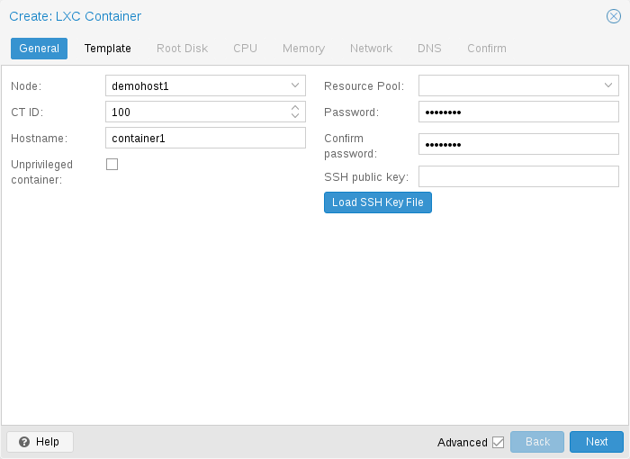
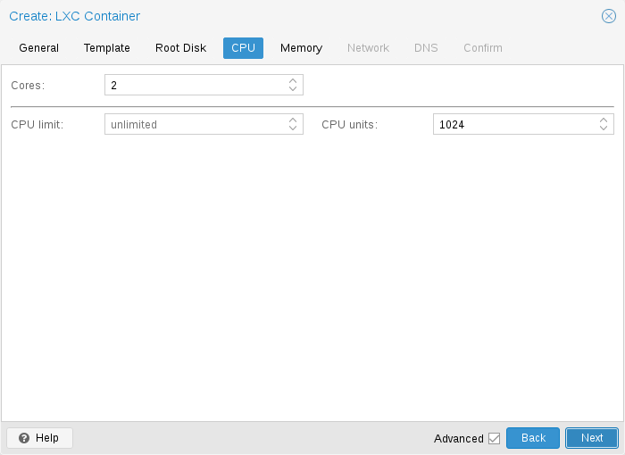
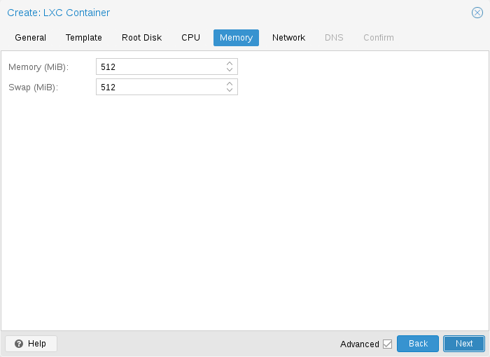
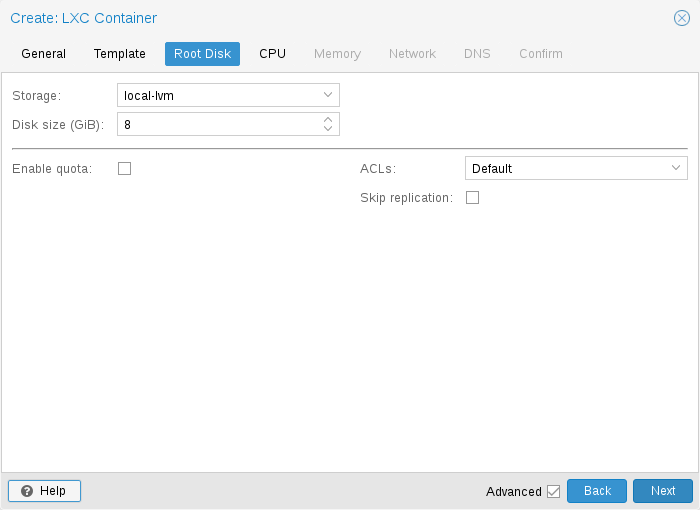
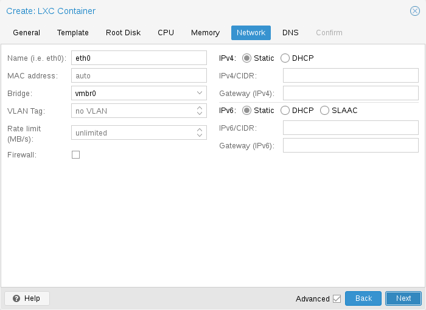
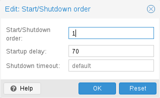

# pct(1)

## 名称 <a href="#chapter_pct" id="chapter_pct"></a>

pct \- 用于管理 Proxmox VE 上 Linux 容器（LXC）的工具

## 概要 <a href="#synopsis" id="synopsis"></a>

### <strong>pct</strong> `<COMMAND> [ARGS] [OPTIONS]` <a href="#cli_pct" id="cli_pct"></a>

### <strong>pct clone</strong> `<vmid> <newid>` `[OPTIONS]` <a href="#cli_pct_clone" id="cli_pct_clone"></a>

创建容器克隆/副本

**`<vmid>`: `<integer> (100 - 999999999)`**

VM 的唯一 ID。

**`<newid>`: `<integer> (100 - 999999999)`**

克隆的 VMID。

**`--bwlimit` `<number> (0 - N)`（<em>默认 \=</em> `clone limit from datacenter or storage config`）**

覆盖 I/O 带宽限制（单位为 KiB/s）。

**`--description` `<string>`**

新 CT 的描述。

**`--full` `<boolean>`**

创建所有磁盘的完整副本。克隆普通 CT 时始终会执行此操作。对于 CT 模板，默认会尝试创建链接克隆。

**`--hostname` `<string>`**

为新 CT 设置主机名。

**`--pool` `<string>`**

将新 CT 添加到指定池。

**`--snapname` `<string>`**

快照的名称。

**`--storage` `<storage ID>`**

完整克隆的目标存储。

**`--target` `<string>`**

目标节点。仅当原始 VM 位于共享存储上时才允许。

### <strong>pct config</strong> `<vmid>` `[OPTIONS]` <a href="#cli_pct_config" id="cli_pct_config"></a>

获取容器配置。

**`<vmid>`: `<integer> (100 - 999999999)`**

VM 的唯一 ID。

**`--current` `<boolean>`（<em>默认 \=</em> `0`）**

获取当前值（而非待生效值）。

**`--snapshot` `<string>`**

从指定快照获取配置值。

### <strong>pct console</strong> `<vmid>` `[OPTIONS]` <a href="#cli_pct_console" id="cli_pct_console"></a>

为指定容器启动控制台。

**`<vmid>`: `<integer> (100 - 999999999)`**

VM 的唯一 ID。

**`--escape` `\^?[a-z]`（<em>默认 \=</em> `^a`）**

转义序列前缀。例如，要将 \<Ctrl\+b q\> 用作转义序列，请传递 <em>^b</em>。

### <strong>pct cpusets</strong> <a href="#cli_pct_cpusets" id="cli_pct_cpusets"></a>

打印已分配的 CPU 集合列表。

### <strong>pct create</strong> `<vmid> <ostemplate>` `[OPTIONS]` <a href="#cli_pct_create" id="cli_pct_create"></a>

创建或恢复容器。

**`<vmid>`: `<integer> (100 - 999999999)`**

VM 的唯一 ID。

**`<ostemplate>`: `<string>`**

操作系统模板或备份文件。

**`--arch` `<amd64 | arm64 | armhf | i386 | riscv32 | riscv64>`（<em>默认 \=</em> `amd64`）**

操作系统架构类型。

**`--bwlimit` `<number> (0 - N)`（<em>默认 \=</em> `restore limit from datacenter or storage config`）**

覆盖 I/O 带宽限制（单位为 KiB/s）。

**`--cmode` `<console | shell | tty>`（<em>默认 \=</em> `tty`）**

控制台模式。默认情况下，console 命令会尝试连接到一个可用的 tty 设备。将 cmode 设置为 <em>console</em> 时，它会尝试改为连接到 /dev/console。如果将 cmode 设置为 <em>shell</em>，它只会在容器内调用一个 shell（无需登录）。

**`--console` `<boolean>`（<em>默认 \=</em> `1`）**

将控制台设备（/dev/console）连接到容器。

**`--cores` `<integer> (1 - 8192)`**

分配给容器的核心数。默认情况下，容器可以使用所有可用核心。

**`--cpulimit` `<number> (0 - 8192)`（<em>默认 \=</em> `0`）**

CPU 使用限制。


如果计算机有 2 个 CPU，则 CPU 时间总量为 <em>2</em>。值 <em>0</em> 表示不限制 CPU。


**`--cpuunits` `<integer> (0 - 500000)`（<em>默认 \=</em> `cgroup v1: 1024, cgroup v2: 100`）**

容器的 CPU 权重，在 cgroup v2 中会被限制在 \[1, 10000\] 范围内。

**`--debug` `<boolean>`（<em>默认 \=</em> `0`）**

尽量输出更详细的信息。目前仅在启动时启用调试日志级别。

**`--description` `<string>`**

容器的描述。显示在 Web 界面中 CT 的摘要里。这会作为注释保存在配置文件中。

**`--dev[n]` `[[path=]<Path>] [,deny-write=<1|0>] [,gid=<integer>] [,mode=<Octal access mode>] [,uid=<integer>]`**

要直通给容器的设备

**`--entrypoint` `(?^:[^\x00-\x08\x0a-\x1F\x7F]+)`（<em>默认 \=</em> `/sbin/init`）**

作为 init 运行的命令，可带参数；可以以绝对路径、相对路径或 $PATH 中的二进制文件开头。

**`--env` `(?^:(?:\w+=[^\x00-\x08\x0a-\x1F\x7F]*)(?:\0\w+=[^\x00-\x08\x0a-\x1F\x7F]*)*)`**

容器运行时环境，以 NUL 分隔的列表表示。替换配置中的所有 lxc.environment.runtime 条目。

**`--features` `[force_rw_sys=<1|0>] [,fuse=<1|0>] [,keyctl=<1|0>] [,mknod=<1|0>] [,mount=<fstype;fstype;...>] [,nesting=<1|0>]`**

允许容器访问高级功能。

**`--force` `<boolean>`**

允许覆盖现有容器。

**`--ha-managed` `<boolean>`（<em>默认 \=</em> `0`）**

创建后，将 CT 添加为 HA 资源。

**`--hookscript` `<string>`**

在容器生命周期的各个阶段执行的脚本。

**`--hostname` `<string>`**

为容器设置主机名。

**`--ignore-unpack-errors` `<boolean>`**

提取模板时忽略错误。

**`--lock` `<backup | create | destroyed | disk | fstrim | migrate | mounted | rollback | snapshot | snapshot-delete>`**

锁定/解锁容器。

**`--memory` `<integer> (16 - N)`（<em>默认 \=</em> `512`）**

容器的内存量，单位为 MB。

**`--mp[n]` `[volume=]<volume> ,mp=<Path> [,acl=<1|0>] [,backup=<1|0>] [,idmap=<type:container:disk:range-size[;type:container:disk:range-size;...]>] [,keepattrs=<1|0>] [,mountoptions=<opt[;opt...]>] [,quota=<1|0>] [,replicate=<1|0>] [,ro=<1|0>] [,shared=<1|0>] [,size=<DiskSize>]`**

将卷用作容器挂载点。使用特殊语法 STORAGE\_ID:SIZE\_IN\_GiB 可分配新卷。

**`--nameserver` `<string>`**

设置容器的 DNS 服务器 IP 地址。如果既未设置 searchdomain 也未设置 nameserver，创建时将自动使用宿主机的设置。

**`--net[n]` `name=<string> [,bridge=<bridge>] [,firewall=<1|0>] [,gw=<GatewayIPv4>] [,gw6=<GatewayIPv6>] [,host-managed=<1|0>] [,hwaddr=<XX:XX:XX:XX:XX:XX>] [,ip=<(IPv4/CIDR|dhcp|manual)>] [,ip6=<(IPv6/CIDR|auto|dhcp|manual)>] [,link_down=<1|0>] [,mtu=<integer>] [,rate=<mbps>] [,tag=<integer>] [,trunks=<vlanid[;vlanid...]>] [,type=<veth>]`**

指定容器的网络接口。

**`--onboot` `<boolean>`（<em>默认 \=</em> `0`）**

指定容器是否在系统启动时启动。

**`--ostype` `<alpine | archlinux | centos | debian | devuan | fedora | gentoo | nixos | opensuse | ubuntu | unmanaged>`**

操作系统类型。用于在容器内设置配置，并对应于 /usr/share/lxc/config/\<ostype\>.common.conf 中的 lxc 设置脚本。可使用值 <em>unmanaged</em> 跳过特定于操作系统的设置。

**`--password` `<password>`**

设置容器内的 root 密码。

**`--pool` `<string>`**

将 VM 添加到指定池。

**`--protection` `<boolean>`（<em>默认 \=</em> `0`）**

设置容器的保护标志。这将阻止对 CT 或 CT 磁盘执行删除/更新操作。

**`--restore` `<boolean>`**

将其标记为恢复任务。

**`--rootfs` `[volume=]<volume> [,acl=<1|0>] [,idmap=<type:container:disk:range-size[;type:container:disk:range-size;...]>] [,mountoptions=<opt[;opt...]>] [,quota=<1|0>] [,replicate=<1|0>] [,ro=<1|0>] [,shared=<1|0>] [,size=<DiskSize>]`**

将卷用作容器根目录。

**`--searchdomain` `<string>`**

设置容器的 DNS 搜索域。如果既未设置 searchdomain 也未设置 nameserver，创建时将自动使用宿主机的设置。

**`--ssh-public-keys` `<filepath>`**

设置 SSH 公钥（每行一个密钥，OpenSSH 格式）。

**`--start` `<boolean>`（<em>默认 \=</em> `0`）**

成功完成创建后启动 CT。

**`--startup` \`\[\[order\=\]\\d\+\] \[,up\=\\d\+\] \[,down\=\\d\+\] \`**

启动和关闭行为。Order 是一个非负数，用于定义总体启动顺序。关闭时按相反顺序执行。此外，还可以设置以秒为单位的 <em>up</em> 或 <em>down</em> 延迟，指定在启动或停止下一个 VM 之前等待的延迟时间。

**`--storage` `<storage ID>`（<em>默认 \=</em> `local`）**

默认存储。

**`--swap` `<integer> (0 - N)`（<em>默认 \=</em> `512`）**

容器的 SWAP 大小，单位为 MB。

**`--tags` `<string>`**

容器的标签。这只是元信息。

**`--template` `<boolean>`（<em>默认 \=</em> `0`）**

启用/禁用模板。

**`--timezone` `<string>`**

容器中使用的时区。如果未设置此选项，则不执行任何操作。可以设置为 <em>host</em> 以与宿主机时区匹配，也可以设置为 /usr/share/zoneinfo/zone.tab 中的任意时区选项。

**`--tty` `<integer> (0 - 6)`（<em>默认 \=</em> `2`）**

指定容器可用的 tty 数量

**`--unique` `<boolean>`**

分配唯一的随机以太网地址。


需要选项：`restore`


**`--unprivileged` `<boolean>`（<em>默认 \=</em> `0`）**

使容器以非特权用户身份运行。创建时，默认值为 1。恢复时，默认值为备份中的值。（不应手动修改。）

**`--unused[n]` `[volume=]<volume>`**

对未使用卷的引用。这供内部使用，不应手动修改。

### <strong>pct delsnapshot</strong> `<vmid> <snapname>` `[OPTIONS]` <a href="#cli_pct_delsnapshot" id="cli_pct_delsnapshot"></a>

删除 LXC 快照。

**`<vmid>`: `<integer> (100 - 999999999)`**

VM 的唯一 ID。

**`<snapname>`: `<string>`**

快照的名称。

**`--force` `<boolean>`**

即使删除磁盘快照失败，也从配置文件中移除。

### <strong>pct destroy</strong> `<vmid>` `[OPTIONS]` <a href="#cli_pct_destroy" id="cli_pct_destroy"></a>

销毁容器（同时删除所有相关文件）。

**`<vmid>`: `<integer> (100 - 999999999)`**

VM 的唯一 ID。

**`--destroy-unreferenced-disks` `<boolean>`**

如果设置，还会从所有已启用的存储中销毁具有该 VMID 但未在配置中引用的所有磁盘。

**`--force` `<boolean>`（<em>默认 \=</em> `0`）**

强制销毁，即使正在运行。

**`--purge` `<boolean>` (<em>默认 \=</em> `0`)**

从所有相关配置中移除容器。例如，备份任务、复制任务或 HA。相关 ACL 和防火墙条目<strong>始终</strong>会被移除。

### <strong>pct df</strong> `<vmid>` <a href="#cli_pct_df" id="cli_pct_df"></a>

获取容器当前的磁盘使用情况。

**`<vmid>`: `<integer> (100 - 999999999)`**

VM 的唯一 ID。

### <strong>pct enter</strong> `<vmid>` `[OPTIONS]` <a href="#cli_pct_enter" id="cli_pct_enter"></a>

为指定的容器启动 shell。

**`<vmid>`: `<integer> (100 - 999999999)`**

VM 的唯一 ID。

**`--keep-env` `<boolean>` (<em>默认 \=</em> `1`)**

保留当前环境。在 PVE 9 中，此选项将默认禁用。如果您依赖保留的环境，请使用此选项，以确保与未来版本兼容。

### <strong>pct exec</strong> `<vmid> [<extra-args>]` `[OPTIONS]` <a href="#cli_pct_exec" id="cli_pct_exec"></a>

在指定的容器内启动命令。

**`<vmid>`: `<integer> (100 - 999999999)`**

VM 的唯一 ID。

**`<extra-args>`: `<array>`**

以数组形式提供的额外参数

**`--keep-env` `<boolean>` (<em>默认 \=</em> `1`)**

保留当前环境。在 PVE 9 中，此选项将默认禁用。如果您依赖保留的环境，请使用此选项，以确保与未来版本兼容。

### <strong>pct fsck</strong> `<vmid>` `[OPTIONS]` <a href="#cli_pct_fsck" id="cli_pct_fsck"></a>

对容器卷运行文件系统检查（fsck）。

**`<vmid>`: `<integer> (100 - 999999999)`**

VM 的唯一 ID。

**`--device` `<mp0 | mp1 | mp10 | mp100 | mp101 | mp102 | mp103 | mp104 | mp105 | mp106 | mp107 | mp108 | mp109 | mp11 | mp110 | mp111 | mp112 | mp113 | mp114 | mp115 | mp116 | mp117 | mp118 | mp119 | mp12 | mp120 | mp121 | mp122 | mp123 | mp124 | mp125 | mp126 | mp127 | mp128 | mp129 | mp13 | mp130 | mp131 | mp132 | mp133 | mp134 | mp135 | mp136 | mp137 | mp138 | mp139 | mp14 | mp140 | mp141 | mp142 | mp143 | mp144 | mp145 | mp146 | mp147 | mp148 | mp149 | mp15 | mp150 | mp151 | mp152 | mp153 | mp154 | mp155 | mp156 | mp157 | mp158 | mp159 | mp16 | mp160 | mp161 | mp162 | mp163 | mp164 | mp165 | mp166 | mp167 | mp168 | mp169 | mp17 | mp170 | mp171 | mp172 | mp173 | mp174 | mp175 | mp176 | mp177 | mp178 | mp179 | mp18 | mp180 | mp181 | mp182 | mp183 | mp184 | mp185 | mp186 | mp187 | mp188 | mp189 | mp19 | mp190 | mp191 | mp192 | mp193 | mp194 | mp195 | mp196 | mp197 | mp198 | mp199 | mp2 | mp20 | mp200 | mp201 | mp202 | mp203 | mp204 | mp205 | mp206 | mp207 | mp208 | mp209 | mp21 | mp210 | mp211 | mp212 | mp213 | mp214 | mp215 | mp216 | mp217 | mp218 | mp219 | mp22 | mp220 | mp221 | mp222 | mp223 | mp224 | mp225 | mp226 | mp227 | mp228 | mp229 | mp23 | mp230 | mp231 | mp232 | mp233 | mp234 | mp235 | mp236 | mp237 | mp238 | mp239 | mp24 | mp240 | mp241 | mp242 | mp243 | mp244 | mp245 | mp246 | mp247 | mp248 | mp249 | mp25 | mp250 | mp251 | mp252 | mp253 | mp254 | mp255 | mp26 | mp27 | mp28 | mp29 | mp3 | mp30 | mp31 | mp32 | mp33 | mp34 | mp35 | mp36 | mp37 | mp38 | mp39 | mp4 | mp40 | mp41 | mp42 | mp43 | mp44 | mp45 | mp46 | mp47 | mp48 | mp49 | mp5 | mp50 | mp51 | mp52 | mp53 | mp54 | mp55 | mp56 | mp57 | mp58 | mp59 | mp6 | mp60 | mp61 | mp62 | mp63 | mp64 | mp65 | mp66 | mp67 | mp68 | mp69 | mp7 | mp70 | mp71 | mp72 | mp73 | mp74 | mp75 | mp76 | mp77 | mp78 | mp79 | mp8 | mp80 | mp81 | mp82 | mp83 | mp84 | mp85 | mp86 | mp87 | mp88 | mp89 | mp9 | mp90 | mp91 | mp92 | mp93 | mp94 | mp95 | mp96 | mp97 | mp98 | mp99 | rootfs>`**

要对其运行文件系统检查的卷

**`--force` `<boolean>`（<em>默认 \=</em> `0`）**

即使文件系统看起来干净，也强制检查

### <strong>pct fstrim</strong> `<vmid>` `[OPTIONS]` <a href="#cli_pct_fstrim" id="cli_pct_fstrim"></a>

对选定的容器及其挂载点运行 fstrim，绑定挂载点或只读挂载点除外。

**`<vmid>`: `<integer> (100 - 999999999)`**

VM 的唯一 ID。

**`--ignore-mountpoints` `<boolean>`**

跳过所有挂载点，仅对容器根目录执行 fstrim。

### <strong>pct help</strong> `[OPTIONS]` <a href="#cli_pct_help" id="cli_pct_help"></a>

获取指定命令的帮助。

**`--extra-args` `<array>`**

显示特定命令的帮助

**`--verbose` `<boolean>`**

详细输出格式。

### <strong>pct list</strong> <a href="#cli_pct_list" id="cli_pct_list"></a>

LXC 容器索引（按节点）。

### <strong>pct listsnapshot</strong> `<vmid>` <a href="#cli_pct_listsnapshot" id="cli_pct_listsnapshot"></a>

列出所有快照。

**`<vmid>`: `<integer> (100 - 999999999)`**

VM 的唯一 ID。

### <strong>pct migrate</strong> `<vmid> <target>` `[OPTIONS]` <a href="#cli_pct_migrate" id="cli_pct_migrate"></a>

将容器迁移到另一个节点。创建新的迁移任务。

**`<vmid>`: `<integer> (100 - 999999999)`**

VM 的唯一 ID。

**`<target>`: `<string>`**

目标节点。

**`--bwlimit` `<number> (0 - N)` (<em>默认 \=</em> `migrate limit from datacenter or storage config`)**

覆盖 I/O 带宽限制（单位为 KiB/s）。

**`--online` `<boolean>`**

使用在线迁移。

**`--restart` `<boolean>`**

使用重启迁移

**`--target-storage` `<string>`**

从源存储到目标存储的映射。仅提供一个存储 ID 会将所有源存储映射到该存储。提供特殊值 <em>1</em> 会将每个源存储映射到其自身。

**`--timeout` `<integer>` (<em>默认 \=</em> `180`)**

重启迁移时等待关机的超时时间（秒）

### <strong>pct mount</strong> `<vmid>` <a href="#cli_pct_mount" id="cli_pct_mount"></a>

将容器的文件系统挂载到宿主机。这会锁定容器，仅用于紧急维护，因为除了启动和停止之外，它将阻止对容器执行其他操作。

**`<vmid>`: `<integer> (100 - 999999999)`**

VM 的唯一 ID。

### <strong>pct move-volume</strong> `<vmid> <volume> [<storage>] [<target-vmid>] [<target-volume>]` `[OPTIONS]` <a href="#cli_pct_move-volume" id="cli_pct_move-volume"></a>

将 rootfs-/mp-volume 移动到其他存储或其他容器。

**`<vmid>`: `<integer> (100 - 999999999)`**

VM 的唯一 ID。

**`<volume>`: `<mp0 | mp1 | mp10 | mp100 | mp101 | mp102 | mp103 | mp104 | mp105 | mp106 | mp107 | mp108 | mp109 | mp11 | mp110 | mp111 | mp112 | mp113 | mp114 | mp115 | mp116 | mp117 | mp118 | mp119 | mp12 | mp120 | mp121 | mp122 | mp123 | mp124 | mp125 | mp126 | mp127 | mp128 | mp129 | mp13 | mp130 | mp131 | mp132 | mp133 | mp134 | mp135 | mp136 | mp137 | mp138 | mp139 | mp14 | mp140 | mp141 | mp142 | mp143 | mp144 | mp145 | mp146 | mp147 | mp148 | mp149 | mp15 | mp150 | mp151 | mp152 | mp153 | mp154 | mp155 | mp156 | mp157 | mp158 | mp159 | mp16 | mp160 | mp161 | mp162 | mp163 | mp164 | mp165 | mp166 | mp167 | mp168 | mp169 | mp17 | mp170 | mp171 | mp172 | mp173 | mp174 | mp175 | mp176 | mp177 | mp178 | mp179 | mp18 | mp180 | mp181 | mp182 | mp183 | mp184 | mp185 | mp186 | mp187 | mp188 | mp189 | mp19 | mp190 | mp191 | mp192 | mp193 | mp194 | mp195 | mp196 | mp197 | mp198 | mp199 | mp2 | mp20 | mp200 | mp201 | mp202 | mp203 | mp204 | mp205 | mp206 | mp207 | mp208 | mp209 | mp21 | mp210 | mp211 | mp212 | mp213 | mp214 | mp215 | mp216 | mp217 | mp218 | mp219 | mp22 | mp220 | mp221 | mp222 | mp223 | mp224 | mp225 | mp226 | mp227 | mp228 | mp229 | mp23 | mp230 | mp231 | mp232 | mp233 | mp234 | mp235 | mp236 | mp237 | mp238 | mp239 | mp24 | mp240 | mp241 | mp242 | mp243 | mp244 | mp245 | mp246 | mp247 | mp248 | mp249 | mp25 | mp250 | mp251 | mp252 | mp253 | mp254 | mp255 | mp26 | mp27 | mp28 | mp29 | mp3 | mp30 | mp31 | mp32 | mp33 | mp34 | mp35 | mp36 | mp37 | mp38 | mp39 | mp4 | mp40 | mp41 | mp42 | mp43 | mp44 | mp45 | mp46 | mp47 | mp48 | mp49 | mp5 | mp50 | mp51 | mp52 | mp53 | mp54 | mp55 | mp56 | mp57 | mp58 | mp59 | mp6 | mp60 | mp61 | mp62 | mp63 | mp64 | mp65 | mp66 | mp67 | mp68 | mp69 | mp7 | mp70 | mp71 | mp72 | mp73 | mp74 | mp75 | mp76 | mp77 | mp78 | mp79 | mp8 | mp80 | mp81 | mp82 | mp83 | mp84 | mp85 | mp86 | mp87 | mp88 | mp89 | mp9 | mp90 | mp91 | mp92 | mp93 | mp94 | mp95 | mp96 | mp97 | mp98 | mp99 | rootfs | unused0 | unused1 | unused10 | unused100 | unused101 | unused102 | unused103 | unused104 | unused105 | unused106 | unused107 | unused108 | unused109 | unused11 | unused110 | unused111 | unused112 | unused113 | unused114 | unused115 | unused116 | unused117 | unused118 | unused119 | unused12 | unused120 | unused121 | unused122 | unused123 | unused124 | unused125 | unused126 | unused127 | unused128 | unused129 | unused13 | unused130 | unused131 | unused132 | unused133 | unused134 | unused135 | unused136 | unused137 | unused138 | unused139 | unused14 | unused140 | unused141 | unused142 | unused143 | unused144 | unused145 | unused146 | unused147 | unused148 | unused149 | unused15 | unused150 | unused151 | unused152 | unused153 | unused154 | unused155 | unused156 | unused157 | unused158 | unused159 | unused16 | unused160 | unused161 | unused162 | unused163 | unused164 | unused165 | unused166 | unused167 | unused168 | unused169 | unused17 | unused170 | unused171 | unused172 | unused173 | unused174 | unused175 | unused176 | unused177 | unused178 | unused179 | unused18 | unused180 | unused181 | unused182 | unused183 | unused184 | unused185 | unused186 | unused187 | unused188 | unused189 | unused19 | unused190 | unused191 | unused192 | unused193 | unused194 | unused195 | unused196 | unused197 | unused198 | unused199 | unused2 | unused20 | unused200 | unused201 | unused202 | unused203 | unused204 | unused205 | unused206 | unused207 | unused208 | unused209 | unused21 | unused210 | unused211 | unused212 | unused213 | unused214 | unused215 | unused216 | unused217 | unused218 | unused219 | unused22 | unused220 | unused221 | unused222 | unused223 | unused224 | unused225 | unused226 | unused227 | unused228 | unused229 | unused23 | unused230 | unused231 | unused232 | unused233 | unused234 | unused235 | unused236 | unused237 | unused238 | unused239 | unused24 | unused240 | unused241 | unused242 | unused243 | unused244 | unused245 | unused246 | unused247 | unused248 | unused249 | unused25 | unused250 | unused251 | unused252 | unused253 | unused254 | unused255 | unused26 | unused27 | unused28 | unused29 | unused3 | unused30 | unused31 | unused32 | unused33 | unused34 | unused35 | unused36 | unused37 | unused38 | unused39 | unused4 | unused40 | unused41 | unused42 | unused43 | unused44 | unused45 | unused46 | unused47 | unused48 | unused49 | unused5 | unused50 | unused51 | unused52 | unused53 | unused54 | unused55 | unused56 | unused57 | unused58 | unused59 | unused6 | unused60 | unused61 | unused62 | unused63 | unused64 | unused65 | unused66 | unused67 | unused68 | unused69 | unused7 | unused70 | unused71 | unused72 | unused73 | unused74 | unused75 | unused76 | unused77 | unused78 | unused79 | unused8 | unused80 | unused81 | unused82 | unused83 | unused84 | unused85 | unused86 | unused87 | unused88 | unused89 | unused9 | unused90 | unused91 | unused92 | unused93 | unused94 | unused95 | unused96 | unused97 | unused98 | unused99>`**

将被移动的卷。

**`<storage>`: `<storage ID>`**

目标存储。

**`<target-vmid>`: `<integer> (100 - 999999999)`**

VM 的唯一 ID。

**`<target-volume>`: `<mp0 | mp1 | mp10 | mp100 | mp101 | mp102 | mp103 | mp104 | mp105 | mp106 | mp107 | mp108 | mp109 | mp11 | mp110 | mp111 | mp112 | mp113 | mp114 | mp115 | mp116 | mp117 | mp118 | mp119 | mp12 | mp120 | mp121 | mp122 | mp123 | mp124 | mp125 | mp126 | mp127 | mp128 | mp129 | mp13 | mp130 | mp131 | mp132 | mp133 | mp134 | mp135 | mp136 | mp137 | mp138 | mp139 | mp14 | mp140 | mp141 | mp142 | mp143 | mp144 | mp145 | mp146 | mp147 | mp148 | mp149 | mp15 | mp150 | mp151 | mp152 | mp153 | mp154 | mp155 | mp156 | mp157 | mp158 | mp159 | mp16 | mp160 | mp161 | mp162 | mp163 | mp164 | mp165 | mp166 | mp167 | mp168 | mp169 | mp17 | mp170 | mp171 | mp172 | mp173 | mp174 | mp175 | mp176 | mp177 | mp178 | mp179 | mp18 | mp180 | mp181 | mp182 | mp183 | mp184 | mp185 | mp186 | mp187 | mp188 | mp189 | mp19 | mp190 | mp191 | mp192 | mp193 | mp194 | mp195 | mp196 | mp197 | mp198 | mp199 | mp2 | mp20 | mp200 | mp201 | mp202 | mp203 | mp204 | mp205 | mp206 | mp207 | mp208 | mp209 | mp21 | mp210 | mp211 | mp212 | mp213 | mp214 | mp215 | mp216 | mp217 | mp218 | mp219 | mp22 | mp220 | mp221 | mp222 | mp223 | mp224 | mp225 | mp226 | mp227 | mp228 | mp229 | mp23 | mp230 | mp231 | mp232 | mp233 | mp234 | mp235 | mp236 | mp237 | mp238 | mp239 | mp24 | mp240 | mp241 | mp242 | mp243 | mp244 | mp245 | mp246 | mp247 | mp248 | mp249 | mp25 | mp250 | mp251 | mp252 | mp253 | mp254 | mp255 | mp26 | mp27 | mp28 | mp29 | mp3 | mp30 | mp31 | mp32 | mp33 | mp34 | mp35 | mp36 | mp37 | mp38 | mp39 | mp4 | mp40 | mp41 | mp42 | mp43 | mp44 | mp45 | mp46 | mp47 | mp48 | mp49 | mp5 | mp50 | mp51 | mp52 | mp53 | mp54 | mp55 | mp56 | mp57 | mp58 | mp59 | mp6 | mp60 | mp61 | mp62 | mp63 | mp64 | mp65 | mp66 | mp67 | mp68 | mp69 | mp7 | mp70 | mp71 | mp72 | mp73 | mp74 | mp75 | mp76 | mp77 | mp78 | mp79 | mp8 | mp80 | mp81 | mp82 | mp83 | mp84 | mp85 | mp86 | mp87 | mp88 | mp89 | mp9 | mp90 | mp91 | mp92 | mp93 | mp94 | mp95 | mp96 | mp97 | mp98 | mp99 | rootfs | unused0 | unused1 | unused10 | unused100 | unused101 | unused102 | unused103 | unused104 | unused105 | unused106 | unused107 | unused108 | unused109 | unused11 | unused110 | unused111 | unused112 | unused113 | unused114 | unused115 | unused116 | unused117 | unused118 | unused119 | unused12 | unused120 | unused121 | unused122 | unused123 | unused124 | unused125 | unused126 | unused127 | unused128 | unused129 | unused13 | unused130 | unused131 | unused132 | unused133 | unused134 | unused135 | unused136 | unused137 | unused138 | unused139 | unused14 | unused140 | unused141 | unused142 | unused143 | unused144 | unused145 | unused146 | unused147 | unused148 | unused149 | unused15 | unused150 | unused151 | unused152 | unused153 | unused154 | unused155 | unused156 | unused157 | unused158 | unused159 | unused16 | unused160 | unused161 | unused162 | unused163 | unused164 | unused165 | unused166 | unused167 | unused168 | unused169 | unused17 | unused170 | unused171 | unused172 | unused173 | unused174 | unused175 | unused176 | unused177 | unused178 | unused179 | unused18 | unused180 | unused181 | unused182 | unused183 | unused184 | unused185 | unused186 | unused187 | unused188 | unused189 | unused19 | unused190 | unused191 | unused192 | unused193 | unused194 | unused195 | unused196 | unused197 | unused198 | unused199 | unused2 | unused20 | unused200 | unused201 | unused202 | unused203 | unused204 | unused205 | unused206 | unused207 | unused208 | unused209 | unused21 | unused210 | unused211 | unused212 | unused213 | unused214 | unused215 | unused216 | unused217 | unused218 | unused219 | unused22 | unused220 | unused221 | unused222 | unused223 | unused224 | unused225 | unused226 | unused227 | unused228 | unused229 | unused23 | unused230 | unused231 | unused232 | unused233 | unused234 | unused235 | unused236 | unused237 | unused238 | unused239 | unused24 | unused240 | unused241 | unused242 | unused243 | unused244 | unused245 | unused246 | unused247 | unused248 | unused249 | unused25 | unused250 | unused251 | unused252 | unused253 | unused254 | unused255 | unused26 | unused27 | unused28 | unused29 | unused3 | unused30 | unused31 | unused32 | unused33 | unused34 | unused35 | unused36 | unused37 | unused38 | unused39 | unused4 | unused40 | unused41 | unused42 | unused43 | unused44 | unused45 | unused46 | unused47 | unused48 | unused49 | unused5 | unused50 | unused51 | unused52 | unused53 | unused54 | unused55 | unused56 | unused57 | unused58 | unused59 | unused6 | unused60 | unused61 | unused62 | unused63 | unused64 | unused65 | unused66 | unused67 | unused68 | unused69 | unused7 | unused70 | unused71 | unused72 | unused73 | unused74 | unused75 | unused76 | unused77 | unused78 | unused79 | unused8 | unused80 | unused81 | unused82 | unused83 | unused84 | unused85 | unused86 | unused87 | unused88 | unused89 | unused9 | unused90 | unused91 | unused92 | unused93 | unused94 | unused95 | unused96 | unused97 | unused98 | unused99>`**

卷将移动到的配置键。默认为源卷的配置键。

**`--bwlimit` `<number> (0 - N)`（<em>默认 \=</em> `clone limit from datacenter or storage config`）**

覆盖 I/O 带宽限制（单位为 KiB/s）。

**`--delete` `<boolean>` (<em>默认 \=</em> `0`)**

成功复制后删除原始卷。默认情况下，原始卷会作为未使用的卷条目保留。

**`--digest` `<string>`**

如果当前配置文件的 SHA1 摘要不同，则阻止更改。这可用于防止并发修改。

**`--target-digest` `<string>`**

如果目标容器的当前配置文件具有不同的 SHA1 摘要，则阻止更改。这可用于防止并发修改。

### <strong>pct move\_volume</strong> <a href="#cli_pct_move_volume" id="cli_pct_move_volume"></a>

<em>pct move-volume</em> 的别名。

### <strong>pct pending</strong> `<vmid>` <a href="#cli_pct_pending" id="cli_pct_pending"></a>

获取容器配置，包括待处理的更改。

**`<vmid>`: `<integer> (100 - 999999999)`**

VM 的唯一 ID。

### <strong>pct pull</strong> `<vmid> <path> <destination>` `[OPTIONS]` <a href="#cli_pct_pull" id="cli_pct_pull"></a>

将文件从容器复制到本地系统。

**`<vmid>`: `<integer> (100 - 999999999)`**

VM 的唯一 ID。

**`<path>`: `<string>`**

要提取的容器内文件的路径。

**`<destination>`: `<string>`**

目标位置

**`--group` `<string>`**

属组名称或 ID。

**`--perms` `<string>`**

要使用的文件权限（默认为八进制，使用十六进制时以 <em>0x</em> 为前缀）。

**`--user` `<string>`**

属主用户名或 ID。

### <strong>pct push</strong> `<vmid> <file> <destination>` `[OPTIONS]` <a href="#cli_pct_push" id="cli_pct_push"></a>

将本地文件复制到容器。

**`<vmid>`: `<integer> (100 - 999999999)`**

VM 的唯一 ID。

**`<file>`: `<string>`**

本地文件的路径。

**`<destination>`: `<string>`**

要写入的容器内目标位置。

**`--group` `<string>`**

属组名称或 ID。使用名称时，该名称必须存在于容器内。

**`--perms` `<string>`**

要使用的文件权限（默认为八进制，使用十六进制时以 <em>0x</em> 为前缀）。

**`--user` `<string>`**

属主用户名或 ID。使用名称时，该名称必须存在于容器内。

### <strong>pct reboot</strong> `<vmid>` `[OPTIONS]` <a href="#cli_pct_reboot" id="cli_pct_reboot"></a>

通过关机并重新启动来重启容器。应用待处理的更改。

**`<vmid>`: `<integer> (100 - 999999999)`**

VM 的唯一 ID。

**`--timeout` `<integer> (0 - N)`**

最多等待 timeout 秒以完成关机。

### <strong>pct remote-migrate</strong> `<vmid> [<target-vmid>] <target-endpoint> --target-bridge <string> --target-storage <string>` `[OPTIONS]` <a href="#cli_pct_remote-migrate" id="cli_pct_remote-migrate"></a>

将容器迁移到远程集群。创建新的迁移任务。实验性功能！

**`<vmid>`: `<integer> (100 - 999999999)`**

VM 的唯一 ID。

**`<target-vmid>`: `<integer> (100 - 999999999)`**

VM 的唯一 ID。

**`<target-endpoint>`: `apitoken=<PVEAPIToken=user@realm!token=SECRET> ,host=<ADDRESS> [,fingerprint=<FINGERPRINT>] [,port=<PORT>]`**

远程目标端点

**`--bwlimit` `<integer> (0 - N)` (<em>默认 \=</em> `migrate limit from datacenter or storage config`)**

覆盖 I/O 带宽限制（单位为 KiB/s）。

**`--delete` `<boolean>` (<em>默认 \=</em> `0`)**

成功迁移后删除原始 CT 及相关数据。默认情况下，原始 CT 会以停止状态保留在源集群上。

**`--online` `<boolean>`**

使用在线迁移。

**`--restart` `<boolean>`**

使用重启迁移

**`--target-bridge` `<string>`**

从源网桥到目标网桥的映射。仅提供一个网桥 ID 会将所有源网桥映射到该网桥。提供特殊值 <em>1</em> 会将每个源网桥映射到其自身。

**`--target-storage` `<string>`**

从源存储到目标存储的映射。仅提供一个存储 ID 会将所有源存储映射到该存储。提供特殊值 <em>1</em> 会将每个源存储映射到其自身。

**`--timeout` `<integer>` (<em>默认 \=</em> `180`)**

重启迁移时等待关机的超时时间（秒）

### <strong>pct rescan</strong> `[OPTIONS]` <a href="#cli_pct_rescan" id="cli_pct_rescan"></a>

重新扫描所有存储，并更新磁盘大小和未使用的磁盘映像。

**`--dryrun` `<boolean>` (<em>默认 \=</em> `0`)**

不实际将更改写入配置。

**`--vmid` `<integer> (100 - 999999999)`**

VM 的唯一 ID。

### <strong>pct resize</strong> `<vmid> <disk> <size>` `[OPTIONS]` <a href="#cli_pct_resize" id="cli_pct_resize"></a>

调整容器挂载点的大小。

**`<vmid>`: `<integer> (100 - 999999999)`**

VM 的唯一 ID。

**`<disk>`: `<mp0 | mp1 | mp10 | mp100 | mp101 | mp102 | mp103 | mp104 | mp105 | mp106 | mp107 | mp108 | mp109 | mp11 | mp110 | mp111 | mp112 | mp113 | mp114 | mp115 | mp116 | mp117 | mp118 | mp119 | mp12 | mp120 | mp121 | mp122 | mp123 | mp124 | mp125 | mp126 | mp127 | mp128 | mp129 | mp13 | mp130 | mp131 | mp132 | mp133 | mp134 | mp135 | mp136 | mp137 | mp138 | mp139 | mp14 | mp140 | mp141 | mp142 | mp143 | mp144 | mp145 | mp146 | mp147 | mp148 | mp149 | mp15 | mp150 | mp151 | mp152 | mp153 | mp154 | mp155 | mp156 | mp157 | mp158 | mp159 | mp16 | mp160 | mp161 | mp162 | mp163 | mp164 | mp165 | mp166 | mp167 | mp168 | mp169 | mp17 | mp170 | mp171 | mp172 | mp173 | mp174 | mp175 | mp176 | mp177 | mp178 | mp179 | mp18 | mp180 | mp181 | mp182 | mp183 | mp184 | mp185 | mp186 | mp187 | mp188 | mp189 | mp19 | mp190 | mp191 | mp192 | mp193 | mp194 | mp195 | mp196 | mp197 | mp198 | mp199 | mp2 | mp20 | mp200 | mp201 | mp202 | mp203 | mp204 | mp205 | mp206 | mp207 | mp208 | mp209 | mp21 | mp210 | mp211 | mp212 | mp213 | mp214 | mp215 | mp216 | mp217 | mp218 | mp219 | mp22 | mp220 | mp221 | mp222 | mp223 | mp224 | mp225 | mp226 | mp227 | mp228 | mp229 | mp23 | mp230 | mp231 | mp232 | mp233 | mp234 | mp235 | mp236 | mp237 | mp238 | mp239 | mp24 | mp240 | mp241 | mp242 | mp243 | mp244 | mp245 | mp246 | mp247 | mp248 | mp249 | mp25 | mp250 | mp251 | mp252 | mp253 | mp254 | mp255 | mp26 | mp27 | mp28 | mp29 | mp3 | mp30 | mp31 | mp32 | mp33 | mp34 | mp35 | mp36 | mp37 | mp38 | mp39 | mp4 | mp40 | mp41 | mp42 | mp43 | mp44 | mp45 | mp46 | mp47 | mp48 | mp49 | mp5 | mp50 | mp51 | mp52 | mp53 | mp54 | mp55 | mp56 | mp57 | mp58 | mp59 | mp6 | mp60 | mp61 | mp62 | mp63 | mp64 | mp65 | mp66 | mp67 | mp68 | mp69 | mp7 | mp70 | mp71 | mp72 | mp73 | mp74 | mp75 | mp76 | mp77 | mp78 | mp79 | mp8 | mp80 | mp81 | mp82 | mp83 | mp84 | mp85 | mp86 | mp87 | mp88 | mp89 | mp9 | mp90 | mp91 | mp92 | mp93 | mp94 | mp95 | mp96 | mp97 | mp98 | mp99 | rootfs>`**

要调整大小的磁盘。

**`<size>`: `\+?\d+(\.\d+)?[KMGT]?`**

新大小。带有 <em>\+</em> 符号时，该值会加到卷的实际大小上；不带该符号时，该值将被视为绝对大小。不支持缩小磁盘。

**`--digest` `<string>`**

如果当前配置文件的 SHA1 摘要不同，则阻止更改。这可用于防止并发修改。

### <strong>pct restore</strong> `<vmid> <ostemplate>` `[OPTIONS]` <a href="#cli_pct_restore" id="cli_pct_restore"></a>

创建或恢复容器。

**`<vmid>`: `<integer> (100 - 999999999)`**

VM 的唯一 ID。

**`<ostemplate>`: `<string>`**

操作系统模板或备份文件。

**`--arch` `<amd64 | arm64 | armhf | i386 | riscv32 | riscv64>`（<em>默认 \=</em> `amd64`）**

操作系统架构类型。

**`--bwlimit` `<number> (0 - N)`（<em>默认 \=</em> `restore limit from datacenter or storage config`）**

覆盖 I/O 带宽限制（单位为 KiB/s）。

**`--cmode` `<console | shell | tty>`（<em>默认 \=</em> `tty`）**

控制台模式。默认情况下，console 命令会尝试连接到一个可用的 tty 设备。将 cmode 设置为 <em>console</em> 时，它会尝试改为连接到 /dev/console。如果将 cmode 设置为 <em>shell</em>，它只会在容器内调用一个 shell（无需登录）。

**`--console` `<boolean>`（<em>默认 \=</em> `1`）**

将控制台设备（/dev/console）连接到容器。

**`--cores` `<integer> (1 - 8192)`**

分配给容器的核心数。默认情况下，容器可以使用所有可用核心。

**`--cpulimit` `<number> (0 - 8192)`（<em>默认 \=</em> `0`）**

CPU 使用限制。


如果计算机有 2 个 CPU，则 CPU 时间总量为 <em>2</em>。值 <em>0</em> 表示不限制 CPU。


**`--cpuunits` `<integer> (0 - 500000)`（<em>默认 \=</em> `cgroup v1: 1024, cgroup v2: 100`）**

容器的 CPU 权重，在 cgroup v2 中会被限制在 \[1, 10000\] 范围内。

**`--debug` `<boolean>`（<em>默认 \=</em> `0`）**

尽量输出更详细的信息。目前仅在启动时启用调试日志级别。

**`--description` `<string>`**

容器的描述。显示在 Web 界面中 CT 的摘要里。这会作为注释保存在配置文件中。

**`--dev[n]` `[[path=]<Path>] [,deny-write=<1|0>] [,gid=<integer>] [,mode=<Octal access mode>] [,uid=<integer>]`**

要直通给容器的设备

**`--entrypoint` `(?^:[^\x00-\x08\x0a-\x1F\x7F]+)`（<em>默认 \=</em> `/sbin/init`）**

作为 init 运行的命令，可带参数；可以以绝对路径、相对路径或 $PATH 中的二进制文件开头。

**`--env` `(?^:(?:\w+=[^\x00-\x08\x0a-\x1F\x7F]*)(?:\0\w+=[^\x00-\x08\x0a-\x1F\x7F]*)*)`**

容器运行时环境，以 NUL 分隔的列表表示。替换配置中的所有 lxc.environment.runtime 条目。

**`--features` `[force_rw_sys=<1|0>] [,fuse=<1|0>] [,keyctl=<1|0>] [,mknod=<1|0>] [,mount=<fstype;fstype;...>] [,nesting=<1|0>]`**

允许容器访问高级功能。

**`--force` `<boolean>`**

允许覆盖现有容器。

**`--ha-managed` `<boolean>`（<em>默认 \=</em> `0`）**

创建后，将 CT 添加为 HA 资源。

**`--hookscript` `<string>`**

在容器生命周期的各个阶段执行的脚本。

**`--hostname` `<string>`**

为容器设置主机名。

**`--ignore-unpack-errors` `<boolean>`**

提取模板时忽略错误。

**`--lock` `<backup | create | destroyed | disk | fstrim | migrate | mounted | rollback | snapshot | snapshot-delete>`**

锁定/解锁容器。

**`--memory` `<integer> (16 - N)`（<em>默认 \=</em> `512`）**

容器的内存量，单位为 MB。

**`--mp[n]` `[volume=]<volume> ,mp=<Path> [,acl=<1|0>] [,backup=<1|0>] [,idmap=<type:container:disk:range-size[;type:container:disk:range-size;...]>] [,keepattrs=<1|0>] [,mountoptions=<opt[;opt...]>] [,quota=<1|0>] [,replicate=<1|0>] [,ro=<1|0>] [,shared=<1|0>] [,size=<DiskSize>]`**

将卷用作容器挂载点。使用特殊语法 STORAGE\_ID:SIZE\_IN\_GiB 可分配新卷。

**`--nameserver` `<string>`**

设置容器的 DNS 服务器 IP 地址。如果既未设置 searchdomain 也未设置 nameserver，创建时将自动使用宿主机的设置。

**`--net[n]` `name=<string> [,bridge=<bridge>] [,firewall=<1|0>] [,gw=<GatewayIPv4>] [,gw6=<GatewayIPv6>] [,host-managed=<1|0>] [,hwaddr=<XX:XX:XX:XX:XX:XX>] [,ip=<(IPv4/CIDR|dhcp|manual)>] [,ip6=<(IPv6/CIDR|auto|dhcp|manual)>] [,link_down=<1|0>] [,mtu=<integer>] [,rate=<mbps>] [,tag=<integer>] [,trunks=<vlanid[;vlanid...]>] [,type=<veth>]`**

指定容器的网络接口。

**`--onboot` `<boolean>`（<em>默认 \=</em> `0`）**

指定容器是否在系统启动时启动。

**`--ostype` `<alpine | archlinux | centos | debian | devuan | fedora | gentoo | nixos | opensuse | ubuntu | unmanaged>`**

操作系统类型。用于在容器内设置配置，并对应于 /usr/share/lxc/config/\<ostype\>.common.conf 中的 lxc 设置脚本。可使用值 <em>unmanaged</em> 跳过特定于操作系统的设置。

**`--password` `<password>`**

设置容器内的 root 密码。

**`--pool` `<string>`**

将 VM 添加到指定池。

**`--protection` `<boolean>`（<em>默认 \=</em> `0`）**

设置容器的保护标志。这将阻止对 CT 或 CT 磁盘执行删除/更新操作。

**`--rootfs` `[volume=]<volume> [,acl=<1|0>] [,idmap=<type:container:disk:range-size[;type:container:disk:range-size;...]>] [,mountoptions=<opt[;opt...]>] [,quota=<1|0>] [,replicate=<1|0>] [,ro=<1|0>] [,shared=<1|0>] [,size=<DiskSize>]`**

将卷用作容器根目录。

**`--searchdomain` `<string>`**

设置容器的 DNS 搜索域。如果既未设置 searchdomain 也未设置 nameserver，创建时将自动使用宿主机的设置。

**`--ssh-public-keys` `<filepath>`**

设置 SSH 公钥（每行一个密钥，OpenSSH 格式）。

**`--start` `<boolean>`（<em>默认 \=</em> `0`）**

成功完成创建后启动 CT。

**`--startup` \`\[\[order\=\]\\d\+\] \[,up\=\\d\+\] \[,down\=\\d\+\] \`**

启动和关闭行为。Order 是一个非负数，用于定义总体启动顺序。关闭时按相反顺序执行。此外，还可以设置以秒为单位的 <em>up</em> 或 <em>down</em> 延迟，指定在启动或停止下一个 VM 之前等待的延迟时间。

**`--storage` `<storage ID>`（<em>默认 \=</em> `local`）**

默认存储。

**`--swap` `<integer> (0 - N)`（<em>默认 \=</em> `512`）**

容器的 SWAP 大小，单位为 MB。

**`--tags` `<string>`**

容器的标签。这只是元信息。

**`--template` `<boolean>`（<em>默认 \=</em> `0`）**

启用/禁用模板。

**`--timezone` `<string>`**

容器中使用的时区。如果未设置此选项，则不执行任何操作。可以设置为 <em>host</em> 以与宿主机时区匹配，也可以设置为 /usr/share/zoneinfo/zone.tab 中的任意时区选项。

**`--tty` `<integer> (0 - 6)`（<em>默认 \=</em> `2`）**

指定容器可用的 tty 数量

**`--unique` `<boolean>`**

分配唯一的随机以太网地址。


需要选项：`restore`


**`--unprivileged` `<boolean>`（<em>默认 \=</em> `0`）**

使容器以非特权用户身份运行。创建时，默认值为 1。恢复时，默认值为备份中的值。（不应手动修改。）

**`--unused[n]` `[volume=]<volume>`**

对未使用卷的引用。这供内部使用，不应手动修改。

### <strong>pct resume</strong> `<vmid>` <a href="#cli_pct_resume" id="cli_pct_resume"></a>

恢复容器运行。

**`<vmid>`: `<integer> (100 - 999999999)`**

VM 的唯一 ID。

### <strong>pct rollback</strong> `<vmid> <snapname>` `[OPTIONS]` <a href="#cli_pct_rollback" id="cli_pct_rollback"></a>

将 LXC 状态回滚到指定快照。

**`<vmid>`: `<integer> (100 - 999999999)`**

VM 的唯一 ID。

**`<snapname>`: `<string>`**

快照的名称。

**`--start` `<boolean>`（<em>默认 \=</em> `0`）**

成功回滚后是否应启动容器

### <strong>pct set</strong> `<vmid>` `[OPTIONS]` <a href="#cli_pct_set" id="cli_pct_set"></a>

设置容器选项。

**`<vmid>`: `<integer> (100 - 999999999)`**

VM 的唯一 ID。

**`--arch` `<amd64 | arm64 | armhf | i386 | riscv32 | riscv64>`（<em>默认 \=</em> `amd64`）**

操作系统架构类型。

**`--cmode` `<console | shell | tty>`（<em>默认 \=</em> `tty`）**

控制台模式。默认情况下，console 命令会尝试连接到一个可用的 tty 设备。将 cmode 设置为 <em>console</em> 时，它会尝试改为连接到 /dev/console。如果将 cmode 设置为 <em>shell</em>，它只会在容器内调用一个 shell（无需登录）。

**`--console` `<boolean>`（<em>默认 \=</em> `1`）**

将控制台设备（/dev/console）连接到容器。

**`--cores` `<integer> (1 - 8192)`**

分配给容器的核心数。默认情况下，容器可以使用所有可用核心。

**`--cpulimit` `<number> (0 - 8192)`（<em>默认 \=</em> `0`）**

CPU 使用限制。


如果计算机有 2 个 CPU，则 CPU 时间总量为 <em>2</em>。值 <em>0</em> 表示不限制 CPU。


**`--cpuunits` `<integer> (0 - 500000)`（<em>默认 \=</em> `cgroup v1: 1024, cgroup v2: 100`）**

容器的 CPU 权重，在 cgroup v2 中会被限制在 \[1, 10000\] 范围内。

**`--debug` `<boolean>`（<em>默认 \=</em> `0`）**

尽量输出更详细的信息。目前仅在启动时启用调试日志级别。

**`--delete` `<string>`**

要删除的设置列表。

**`--description` `<string>`**

容器的描述。显示在 Web 界面中 CT 的摘要里。这会作为注释保存在配置文件中。

**`--dev[n]` `[[path=]<Path>] [,deny-write=<1|0>] [,gid=<integer>] [,mode=<Octal access mode>] [,uid=<integer>]`**

要直通给容器的设备

**`--digest` `<string>`**

如果当前配置文件的 SHA1 摘要不同，则阻止更改。这可用于防止并发修改。

**`--entrypoint` `(?^:[^\x00-\x08\x0a-\x1F\x7F]+)`（<em>默认 \=</em> `/sbin/init`）**

作为 init 运行的命令，可带参数；可以以绝对路径、相对路径或 $PATH 中的二进制文件开头。

**`--env` `(?^:(?:\w+=[^\x00-\x08\x0a-\x1F\x7F]*)(?:\0\w+=[^\x00-\x08\x0a-\x1F\x7F]*)*)`**

容器运行时环境，以 NUL 分隔的列表表示。替换配置中的所有 lxc.environment.runtime 条目。

**`--features` `[force_rw_sys=<1|0>] [,fuse=<1|0>] [,keyctl=<1|0>] [,mknod=<1|0>] [,mount=<fstype;fstype;...>] [,nesting=<1|0>]`**

允许容器访问高级功能。

**`--hookscript` `<string>`**

在容器生命周期的各个阶段执行的脚本。

**`--hostname` `<string>`**

为容器设置主机名。

**`--lock` `<backup | create | destroyed | disk | fstrim | migrate | mounted | rollback | snapshot | snapshot-delete>`**

锁定/解锁容器。

**`--memory` `<integer> (16 - N)`（<em>默认 \=</em> `512`）**

容器的内存量，单位为 MB。

**`--mp[n]` `[volume=]<volume> ,mp=<Path> [,acl=<1|0>] [,backup=<1|0>] [,idmap=<type:container:disk:range-size[;type:container:disk:range-size;...]>] [,keepattrs=<1|0>] [,mountoptions=<opt[;opt...]>] [,quota=<1|0>] [,replicate=<1|0>] [,ro=<1|0>] [,shared=<1|0>] [,size=<DiskSize>]`**

将卷用作容器挂载点。使用特殊语法 STORAGE\_ID:SIZE\_IN\_GiB 可分配新卷。

**`--nameserver` `<string>`**

设置容器的 DNS 服务器 IP 地址。如果既未设置 searchdomain 也未设置 nameserver，创建时将自动使用宿主机的设置。

**`--net[n]` `name=<string> [,bridge=<bridge>] [,firewall=<1|0>] [,gw=<GatewayIPv4>] [,gw6=<GatewayIPv6>] [,host-managed=<1|0>] [,hwaddr=<XX:XX:XX:XX:XX:XX>] [,ip=<(IPv4/CIDR|dhcp|manual)>] [,ip6=<(IPv6/CIDR|auto|dhcp|manual)>] [,link_down=<1|0>] [,mtu=<integer>] [,rate=<mbps>] [,tag=<integer>] [,trunks=<vlanid[;vlanid...]>] [,type=<veth>]`**

指定容器的网络接口。

**`--onboot` `<boolean>`（<em>默认 \=</em> `0`）**

指定容器是否在系统启动时启动。

**`--ostype` `<alpine | archlinux | centos | debian | devuan | fedora | gentoo | nixos | opensuse | ubuntu | unmanaged>`**

操作系统类型。用于在容器内设置配置，并对应于 /usr/share/lxc/config/\<ostype\>.common.conf 中的 lxc 设置脚本。可使用值 <em>unmanaged</em> 跳过特定于操作系统的设置。

**`--protection` `<boolean>`（<em>默认 \=</em> `0`）**

设置容器的保护标志。这将阻止对 CT 或 CT 磁盘执行删除/更新操作。

**`--revert` `<string>`**

撤销待处理的更改。

**`--rootfs` `[volume=]<volume> [,acl=<1|0>] [,idmap=<type:container:disk:range-size[;type:container:disk:range-size;...]>] [,mountoptions=<opt[;opt...]>] [,quota=<1|0>] [,replicate=<1|0>] [,ro=<1|0>] [,shared=<1|0>] [,size=<DiskSize>]`**

将卷用作容器根目录。

**`--searchdomain` `<string>`**

设置容器的 DNS 搜索域。如果既未设置 searchdomain 也未设置 nameserver，创建时将自动使用宿主机的设置。

**`--startup` \`\[\[order\=\]\\d\+\] \[,up\=\\d\+\] \[,down\=\\d\+\] \`**

启动和关闭行为。Order 是一个非负数，用于定义总体启动顺序。关闭时按相反顺序执行。此外，还可以设置以秒为单位的 <em>up</em> 或 <em>down</em> 延迟，指定在启动或停止下一个 VM 之前等待的延迟时间。

**`--swap` `<integer> (0 - N)`（<em>默认 \=</em> `512`）**

容器的 SWAP 大小，单位为 MB。

**`--tags` `<string>`**

容器的标签。这只是元信息。

**`--template` `<boolean>`（<em>默认 \=</em> `0`）**

启用/禁用模板。

**`--timezone` `<string>`**

容器中使用的时区。如果未设置此选项，则不执行任何操作。可以设置为 <em>host</em> 以与宿主机时区匹配，也可以设置为 /usr/share/zoneinfo/zone.tab 中的任意时区选项。

**`--tty` `<integer> (0 - 6)`（<em>默认 \=</em> `2`）**

指定容器可用的 tty 数量

**`--unprivileged` `<boolean>`（<em>默认 \=</em> `0`）**

使容器以非特权用户身份运行。创建时，默认值为 1。恢复时，默认值为备份中的值。（不应手动修改。）

**`--unused[n]` `[volume=]<volume>`**

对未使用卷的引用。这供内部使用，不应手动修改。

### <strong>pct shutdown</strong> `<vmid>` `[OPTIONS]` <a href="#cli_pct_shutdown" id="cli_pct_shutdown"></a>

关闭容器。这会触发容器正常关机，详情请参阅 lxc-stop(1)。

**`<vmid>`: `<integer> (100 - 999999999)`**

VM 的唯一 ID。

**`--forceStop` `<boolean>` (<em>默认 \=</em> `0`)**

确保容器停止。

**`--timeout` `<integer> (0 - N)` (<em>默认 \=</em> `60`)**

最多等待 timeout 秒。

### <strong>pct snapshot</strong> `<vmid> <snapname>` `[OPTIONS]` <a href="#cli_pct_snapshot" id="cli_pct_snapshot"></a>

为容器创建快照。

**`<vmid>`: `<integer> (100 - 999999999)`**

VM 的唯一 ID。

**`<snapname>`: `<string>`**

快照的名称。

**`--description` `<string>`**

文本描述或注释。

### <strong>pct start</strong> `<vmid>` `[OPTIONS]` <a href="#cli_pct_start" id="cli_pct_start"></a>

启动容器。

**`<vmid>`: `<integer> (100 - 999999999)`**

VM 的唯一 ID。

**`--debug` `<boolean>`（<em>默认 \=</em> `0`）**

如果设置，启动时会启用非常详细的调试日志级别。

**`--skiplock` `<boolean>`**

忽略锁——仅允许 root 使用此选项。

### <strong>pct status</strong> `<vmid>` `[OPTIONS]` <a href="#cli_pct_status" id="cli_pct_status"></a>

显示 CT 状态。

**`<vmid>`: `<integer> (100 - 999999999)`**

VM 的唯一 ID。

**`--verbose` `<boolean>`**

详细输出格式

### <strong>pct stop</strong> `<vmid>` `[OPTIONS]` <a href="#cli_pct_stop" id="cli_pct_stop"></a>

停止容器。这将突然终止容器中运行的所有进程。

**`<vmid>`: `<integer> (100 - 999999999)`**

VM 的唯一 ID。

**`--overrule-shutdown` `<boolean>`（<em>默认值 \=</em> `0`）**

停止前尝试中止正在运行的 <em>vzshutdown</em> 任务。

**`--skiplock` `<boolean>`**

忽略锁——仅允许 root 使用此选项。

### <strong>pct suspend</strong> `<vmid>` <a href="#cli_pct_suspend" id="cli_pct_suspend"></a>

挂起容器。此功能处于实验阶段。

**`<vmid>`: `<integer> (100 - 999999999)`**

VM 的唯一 ID。

### <strong>pct template</strong> `<vmid>` <a href="#cli_pct_template" id="cli_pct_template"></a>

创建模板。

**`<vmid>`: `<integer> (100 - 999999999)`**

VM 的唯一 ID。

### <strong>pct unlock</strong> `<vmid>` <a href="#cli_pct_unlock" id="cli_pct_unlock"></a>

解锁 VM。

**`<vmid>`: `<integer> (100 - 999999999)`**

VM 的唯一 ID。

### <strong>pct unmount</strong> `<vmid>` <a href="#cli_pct_unmount" id="cli_pct_unmount"></a>

卸载容器的文件系统。

**`<vmid>`: `<integer> (100 - 999999999)`**

VM 的唯一 ID。

## 描述 <a href="#description" id="description"></a>

容器是完全虚拟机（VM）的轻量级替代方案。它们使用所运行宿主机系统的内核，而不是模拟完整的操作系统（OS）。这意味着容器可以直接访问宿主机系统上的资源。

容器的运行时开销很低，通常可以忽略不计。但是，有一些缺点需要考虑：

- Proxmox 容器中只能运行 Linux 发行版。无法在容器内运行其他操作系统，例如 FreeBSD 或 Microsoft Windows。
- 出于安全原因，需要限制对宿主机资源的访问。因此，容器在各自独立的命名空间中运行。此外，容器内不允许使用某些系统调用（用户空间对 Linux 内核的请求）。

Proxmox VE 使用 [Linux Containers (LXC)](https://linuxcontainers.org/lxc/introduction/) 作为其底层容器技术。“Proxmox Container Toolkit”（`pct`）通过提供抽象复杂任务的接口，简化了 LXC 的使用和管理。

容器与 Proxmox VE 紧密集成。这意味着它们可以感知集群配置，并且可以使用与虚拟机相同的网络和存储资源。您还可以使用 Proxmox VE 防火墙，或通过 HA 框架管理容器。

我们的主要目标传统上一直是提供一种既能获得使用 VM 的好处、又没有额外开销的环境。这意味着 Proxmox 容器主要被归类为“系统容器”。

随着对 OCI（<strong>O</strong>pen <strong>C</strong>ontainer <strong>I</strong>nitiative）镜像支持的引入，Proxmox VE 现在还将“应用容器”作为技术预览集成进来。从 OCI 镜像创建容器时，该镜像会自动转换为 Proxmox VE 使用的 LXC 技术栈。

这种方法使用户既能受益于广泛的预打包应用生态系统，又能保留 Proxmox VE 强大的管理功能。

尽管直接运行轻量级“应用容器”相比完整 VM 具有显著优势，但对于要求最大隔离性和在线迁移能力的用例，将容器嵌套在 Proxmox QEMU VM 内仍是推荐做法。

## 技术概述 <a href="#technology_overview" id="technology_overview"></a>

- LXC（[https://linuxcontainers.org/](https://linuxcontainers.org/)）
- 集成到 Proxmox VE 图形化 Web 用户界面（GUI）中
- 易于使用的命令行工具 `pct`
- 通过 Proxmox VE REST API 访问
- <em>lxcfs</em> 用于提供容器化的 /proc 文件系统
- 控制组（<em>cgroups</em>），用于资源隔离和限制
- <em>AppArmor</em> 和 <em>seccomp</em>，用于提高安全性
- 现代 Linux 内核
- 基于镜像的部署（[templates](#pct_supported_distributions)）
- 使用 Proxmox VE [storage library](pvesm-1.md#chapter_storage)
- 从宿主机配置容器（网络、DNS、存储等）

## 支持的发行版 <a href="#pct_supported_distributions" id="pct_supported_distributions"></a>

官方支持的发行版列表如下。

以下发行版的模板可通过我们的仓库获取。您可以使用 [pveam](#pct_container_images) 工具或图形用户界面下载它们。

### Alpine Linux <a href="#alpine_linux" id="alpine_linux"></a>

Alpine Linux 是一个注重安全的轻量级 Linux 发行版，基于 musl libc 和 busybox。

— [https://alpinelinux.org](https://alpinelinux.org)

有关当前支持的版本，请参阅：

[https://alpinelinux.org/releases/](https://alpinelinux.org/releases/)

### Arch Linux <a href="#arch_linux" id="arch_linux"></a>

Arch Linux 是一个轻量级且灵活的 Linux® 发行版，力求保持简单。

— [https://archlinux.org/](https://archlinux.org/)

Arch Linux 采用滚动发布模式，更多详细信息请参阅其 wiki：

[https://wiki.archlinux.org/title/Arch\_Linux](https://wiki.archlinux.org/title/Arch_Linux)

### CentOS, Almalinux, Rocky Linux <a href="#centos_almalinux_rocky_linux" id="centos_almalinux_rocky_linux"></a>

#### CentOS / CentOS Stream <a href="#centos_centos_stream" id="centos_centos_stream"></a>

CentOS Linux 发行版是一个稳定、可预测、可管理且可重现的平台，源自 Red Hat Enterprise Linux（RHEL）的源代码

— [https://centos.org](https://centos.org)

有关当前支持的版本，请参阅：

[https://en.wikipedia.org/wiki/CentOS#End-of-support\_schedule](https://en.wikipedia.org/wiki/CentOS#End-of-support_schedule)

#### Almalinux <a href="#almalinux" id="almalinux"></a>

一个开源、由社区拥有和治理、永久免费的企业级 Linux 发行版，专注于长期稳定性，提供稳健的生产级平台。AlmaLinux OS 与 RHEL® 和 CentOS Stream 之前的 CentOS 保持 1:1 二进制兼容。

— [https://almalinux.org](https://almalinux.org)

有关当前支持的版本，请参阅：

[https://en.wikipedia.org/wiki/AlmaLinux#Releases](https://en.wikipedia.org/wiki/AlmaLinux#Releases)

#### Rocky Linux <a href="#rocky_linux" id="rocky_linux"></a>

Rocky Linux 是一个社区企业级操作系统，旨在在其下游合作伙伴转变方向后，仍与美国顶级企业 Linux 发行版保持 100% 的逐缺陷兼容。

— [https://rockylinux.org](https://rockylinux.org)

有关当前支持的版本，请参阅：

[https://en.wikipedia.org/wiki/Rocky\_Linux#Releases](https://en.wikipedia.org/wiki/Rocky_Linux#Releases)

### Debian <a href="#debian" id="debian"></a>

Debian 是一个自由操作系统，由 Debian 项目开发和维护。它是一个自由的 Linux 发行版，包含数千款应用程序，可满足用户的需求。

— [https://www.debian.org/intro/index#software](https://www.debian.org/intro/index#software)

有关当前支持的版本，请参阅：

[https://www.debian.org/releases/stable/releasenotes](https://www.debian.org/releases/stable/releasenotes)

### Devuan <a href="#devuan" id="devuan"></a>

Devuan GNU\+Linux 是 Debian 的一个分支，不使用 systemd，使用户能够通过避免不必要的纠缠并确保初始化系统自由，重新掌控自己的系统。

— [https://www.devuan.org](https://www.devuan.org)

有关当前支持的版本，请参阅：

[https://www.devuan.org/os/releases](https://www.devuan.org/os/releases)

### Fedora <a href="#fedora" id="fedora"></a>

Fedora 为硬件、云和容器创造了一个创新、自由且开源的平台，使软件开发人员和社区成员能够为其用户构建量身定制的解决方案。

— [https://getfedora.org](https://getfedora.org)

有关当前支持的版本，请参阅：

[https://fedoraproject.org/wiki/Releases](https://fedoraproject.org/wiki/Releases)

### Gentoo <a href="#gentoo" id="gentoo"></a>

一个高度灵活、基于源代码的 Linux 发行版。

— [https://www.gentoo.org](https://www.gentoo.org)

Gentoo 采用滚动发布模式。

### OpenSUSE <a href="#opensuse" id="opensuse"></a>

系统管理员、开发人员和桌面用户的首选。

— [https://www.opensuse.org](https://www.opensuse.org)

有关当前支持的版本，请参阅：

[https://get.opensuse.org/leap/](https://get.opensuse.org/leap/)

### Ubuntu <a href="#ubuntu" id="ubuntu"></a>

Ubuntu 是面向企业服务器、桌面、云和 IoT 的现代化 Linux 开源操作系统。

— [https://ubuntu.com/](https://ubuntu.com/)

有关当前支持的版本，请参阅：

[https://wiki.ubuntu.com/Releases](https://wiki.ubuntu.com/Releases)

## 容器镜像 <a href="#pct_container_images" id="pct_container_images"></a>

容器镜像有时也称为“模板”或“应用设备”，是包含运行容器所需一切的 `tar` 归档文件。Proxmox VE 可以使用两种主要类型的镜像：用于创建完整虚拟环境的 <strong>System Container Templates</strong>，以及基于 OCI 标准、用于运行特定应用的 <strong>Application Container Images</strong>。

### System Container Templates <a href="#system_container_templates" id="system_container_templates"></a>

Proxmox VE 本身为 [most common Linux distributions](#pct_supported_distributions) 提供了多种基础模板。可以使用 GUI 或 `pveam`（Proxmox VE Appliance Manager 的缩写）命令行实用程序下载它们。此外，还可以下载 [TurnKey Linux](https://www.turnkeylinux.org/) 容器模板。

可用模板列表通过 <em>pve-daily-update</em> 定时器每天更新。您也可以通过执行以下命令手动触发更新：

```text
# pveam update
```

要查看可用镜像列表，请运行：

```text
# pveam available
```

您可以通过指定感兴趣的 `section` 来缩小这个大列表的范围，例如基础 `system` 镜像：

**列出可用的系统镜像**

```text
# pveam available --section system
system          alpine-3.12-default_20200823_amd64.tar.xz
system          alpine-3.13-default_20210419_amd64.tar.xz
system          alpine-3.14-default_20210623_amd64.tar.xz
system          archlinux-base_20210420-1_amd64.tar.gz
system          centos-7-default_20190926_amd64.tar.xz
system          centos-8-default_20201210_amd64.tar.xz
system          debian-9.0-standard_9.7-1_amd64.tar.gz
system          debian-10-standard_10.7-1_amd64.tar.gz
system          devuan-3.0-standard_3.0_amd64.tar.gz
system          fedora-33-default_20201115_amd64.tar.xz
system          fedora-34-default_20210427_amd64.tar.xz
system          gentoo-current-default_20200310_amd64.tar.xz
system          opensuse-15.2-default_20200824_amd64.tar.xz
system          ubuntu-16.04-standard_16.04.5-1_amd64.tar.gz
system          ubuntu-18.04-standard_18.04.1-1_amd64.tar.gz
system          ubuntu-20.04-standard_20.04-1_amd64.tar.gz
system          ubuntu-20.10-standard_20.10-1_amd64.tar.gz
system          ubuntu-21.04-standard_21.04-1_amd64.tar.gz
```

在使用此类模板之前，您需要将其下载到您的某个存储中。如果不确定下载到哪个存储，可以直接使用名为 `local` 的存储。对于集群部署，最好使用共享存储，以便所有节点都能访问这些镜像。

```text
# pveam download local debian-10.0-standard_10.0-1_amd64.tar.gz
```

现在，您已准备好使用该镜像创建容器，并可以使用以下命令列出存储 `local` 上所有已下载的镜像：

```text
# pveam list local
local:vztmpl/debian-10.0-standard_10.0-1_amd64.tar.gz  219.95MB
```


您还可以使用 Proxmox VE Web 图形用户界面（GUI）下载、列出和删除容器模板。


`pct` 使用它们创建新容器，例如：

```text
# pct create 999 local:vztmpl/debian-10.0-standard_10.0-1_amd64.tar.gz
```

上述命令会显示完整的 Proxmox VE 卷标识符。其中包含存储名称，大多数其他 Proxmox VE 命令都可以使用这些标识符。例如，您可以稍后使用以下命令删除该镜像：

```text
# pveam remove local:vztmpl/debian-10.0-standard_10.0-1_amd64.tar.gz
```

### Open Container Initiative (OCI) Images <a href="#open_container_initiative_oci_images" id="open_container_initiative_oci_images"></a>

Proxmox VE 还可以使用 OCI 镜像创建容器，包括系统容器和应用容器。请注意，目前在 Proxmox VE 中运行应用容器仍被视为技术预览。

从 OCI 镜像创建的容器仍使用现有的 LXC 框架。

### Obtaining OCI Images <a href="#obtaining_oci_images" id="obtaining_oci_images"></a>

在 Web 界面中，可以手动上传 OCI 镜像，也可以通过存储的容器模板视图中的 <strong>Pull from OCI registry</strong> 按钮从镜像仓库拉取镜像。

模板位于存储中后，您可以使用 `pct create` 创建容器，或使用 Web 界面中的向导。

## 容器设置 <a href="#pct_settings" id="pct_settings"></a>

### General Settings <a href="#pct_general" id="pct_general"></a>

[](https://pve.proxmox.com/pve-docs/images/screenshot/gui-create-ct-general.png)

容器的常规设置包括

- <strong>Node</strong>：容器将在其上运行的物理服务器
- <strong>CT ID</strong>：此 Proxmox VE 安装中用于标识容器的唯一编号
- <strong>Hostname</strong>：容器的主机名
- <strong>Resource Pool</strong>：容器和 VM 的逻辑组
- <strong>Password</strong>：容器的 root 密码
- <strong>SSH Public Key</strong>：用于通过 SSH 连接 root 账户的公钥
- <strong>Unprivileged container</strong>：此选项允许您在创建时选择要创建特权容器还是非特权容器。
- <strong>Nesting</strong>：暴露 procfs 和 sysfs 以允许嵌套容器。请注意，systemd 也使用此功能来隔离服务。

#### 非特权容器 <a href="#unprivileged_containers" id="unprivileged_containers"></a>

非特权容器使用一种称为用户命名空间的新内核功能。容器内的 root UID 0 会映射到容器外的非特权用户。这意味着，这些容器中的大多数安全问题（容器逃逸、资源滥用等）将影响某个随机的非特权用户，并且属于通用内核安全漏洞，而不是 LXC 问题。LXC 团队认为，非特权容器在设计上就是安全的。

这是创建新容器时的默认选项。


如果容器使用 systemd 作为 init 系统，请注意，容器内运行的 systemd 版本应等于或高于 220。


#### 特权容器 <a href="#privileged_containers" id="privileged_containers"></a>

容器中的安全性通过使用强制访问控制 <em>AppArmor</em> 限制、<em>seccomp</em> 过滤器和 Linux 内核命名空间来实现。LXC 团队认为这种容器不安全，并且不会将新的容器逃逸漏洞视为值得分配 CVE 并快速修复的安全问题。因此，特权容器只应在受信任的环境中使用。

### CPU <a href="#pct_cpu" id="pct_cpu"></a>

[](https://pve.proxmox.com/pve-docs/images/screenshot/gui-create-ct-cpu.png)

可以使用 `cores` 选项限制容器内可见的 CPU 数量。这是通过 Linux <em>cpuset</em> cgroup（<strong>c</strong>ontrol <strong>group</strong>）实现的。`pvestatd` 中的一个特殊任务会定期尝试在可用 CPU 之间分配正在运行的容器。要查看分配的 CPU，请运行以下命令：

```text
# pct cpusets
 ---------------------
 102:              6 7
 105:      2 3 4 5
 108:  0 1
 ---------------------
```

容器直接使用宿主机内核。容器内的所有任务均由宿主机 CPU 调度器处理。Proxmox VE 默认使用 Linux <em>CFS</em>（<strong>C</strong>ompletely <strong>F</strong>air <strong>S</strong>cheduler）调度器，该调度器还提供额外的带宽控制选项。

<table>
<tr>
<td>
<code>cpulimit</code>: 
<br/>
</td>
<td>
<p>可以使用此选项进一步限制分配的 CPU 时间。请注意，这是一个浮点数，因此，为容器分配两个核心，同时将总体 CPU 消耗限制为半个核心，是完全有效的。</p>
<div>
<div>
<pre>cores: 2
cpulimit: 0.5</pre>
</div></div>
</td>
</tr>
<tr>
<td>
<code>cpuunits</code>: 
<br/>
</td>
<td>
<p>这是传递给内核调度器的相对权重。数值越大，此容器获得的 CPU 时间就越多。该数值是相对于所有其他正在运行的容器的权重而言的。默认值为 <code>100</code>（如果宿主机使用旧版 cgroup v1，则为 <code>1024</code>）。您可以使用此设置来确定某些容器的优先级。</p>
</td>
</tr>
</table>

### 内存 <a href="#pct_memory" id="pct_memory"></a>

[](https://pve.proxmox.com/pve-docs/images/screenshot/gui-create-ct-memory.png)

容器内存通过 cgroup 内存控制器进行控制。

<table>
<tr>
<td>
<code>memory</code>: 
<br/>
</td>
<td>
<p>限制总体内存使用量。对应于 <code>memory.limit_in_bytes</code> cgroup 设置。</p>
</td>
</tr>
<tr>
<td>
<code>swap</code>: 
<br/>
</td>
<td>
<p>允许容器使用宿主机交换空间中的额外交换内存。对应于 <code>memory.memsw.limit_in_bytes</code> cgroup 设置，该设置被设为两个值之和（<code>memory + swap</code>）。</p>
</td>
</tr>
</table>

### 挂载点 <a href="#pct_mount_points" id="pct_mount_points"></a>

[](https://pve.proxmox.com/pve-docs/images/screenshot/gui-create-ct-root-disk.png)

根挂载点通过 `rootfs` 属性配置。您最多可以配置 256 个额外的挂载点。相应选项称为 `mp0` 至 `mp255`。它们可以包含以下设置：

**`rootfs`: `[volume=]<volume> [,acl=<1|0>] [,idmap=<type:container:disk:range-size[;type:container:disk:range-size;...]>] [,mountoptions=<opt[;opt...]>] [,quota=<1|0>] [,replicate=<1|0>] [,ro=<1|0>] [,shared=<1|0>] [,size=<DiskSize>]`**

将卷用作容器根目录。所有选项的详细说明见下文。

**`mp[n]`: `[volume=]<volume> ,mp=<Path> [,acl=<1|0>] [,backup=<1|0>] [,idmap=<type:container:disk:range-size[;type:container:disk:range-size;...]>] [,keepattrs=<1|0>] [,mountoptions=<opt[;opt...]>] [,quota=<1|0>] [,replicate=<1|0>] [,ro=<1|0>] [,shared=<1|0>] [,size=<DiskSize>]`**

将卷用作容器挂载点。使用特殊语法 STORAGE\_ID:SIZE\_IN\_GiB 可分配新卷。

**`acl`\=`<boolean>`**

显式启用或禁用 ACL 支持。

**`backup`\=`<boolean>`**

是否将挂载点包含在备份中（仅用于卷挂载点）。

**`idmap`\=`<type:container:disk:range-size[;type:container:disk:range-size;...]>`**

自定义 UID/GID 映射，针对此挂载点覆盖容器的 `lxc.idmap`。接受以分号分隔的 `type:container:disk:range-size` 条目列表。

`type` 对于 UID 为 `u`，对于 GID 为 `g`。

`container` 是容器内看到的第一个 ID。

`disk` 是底层文件系统上对应的第一个 ID。

`range-size` 是要映射的连续 ID 数量。

未映射的 ID 回退到容器的 `lxc.idmap`。

示例 1：`u:123:456:1` 将容器内的 UID 123 映射到磁盘上的 UID 456。磁盘上由 UID 456 拥有的文件在容器内将显示为由 UID 123 拥有。

示例 2：`g:100:50:5` 映射 5 个连续的 GID，使容器内的 GID 100-104 映射到磁盘上的 GID 50-54。

示例 3：`passthrough` 对所有 UID 和 GID 进行恒等映射，这意味着容器内的 ID 将与磁盘上的 ID 一致。

**`keepattrs`\=`<boolean>`（<em>默认 \=</em> `0`）**

如果挂载点目录已存在，则继承该目录的 UID、GID 和访问模式。

**`mountoptions`\=`<opt[;opt...]>`**

rootfs/mps 的额外挂载选项。

**`mp`\=`<Path>`**

从容器内部看到的挂载点路径。


出于安全原因，不得包含任何符号链接。


**`quota`\=`<boolean>`**

启用容器内的用户配额（zfs 子卷不支持）

**`replicate`\=`<boolean>`（<em>默认 \=</em> `1`）**

会将此卷包含到存储复制作业中。

**`ro`\=`<boolean>`**

只读挂载点

**`shared`\=`<boolean>`（<em>默认 \=</em> `0`）**

将此非卷挂载点标记为在所有节点上可用。


此选项不会自动共享挂载点，它假定挂载点已被共享！


**`size`\=`<DiskSize>`**

卷大小（只读值）。

**`volume`\=`<volume>`**

要挂载到容器中的卷、设备或目录。

目前有三种类型的挂载点：存储支持的挂载点、绑定挂载和设备挂载。

**典型容器 `rootfs` 配置**

```text
rootfs: thin1:base-100-disk-1,size=8G
```

#### 存储支持的挂载点 <a href="#storage_backed_mount_points" id="storage_backed_mount_points"></a>

存储支持的挂载点由 Proxmox VE 存储子系统管理，并有三种不同形式：

- 基于镜像：这些是包含单个 ext4 文件系统的 raw 镜像。
- ZFS 子卷：从技术上说，这些是绑定挂载，但使用托管存储，因此允许调整大小和创建快照。
- 目录：传递 `size=0` 会触发一种特殊情况，此时将创建目录而不是 raw 镜像。


存储支持的挂载点卷的特殊选项语法 `STORAGE_ID:SIZE_IN_GB` 会在指定存储上自动分配指定大小的卷。例如，调用


```text
pct set 100 -mp0 thin1:10,mp=/path/in/container
```

将在存储 `thin1` 上分配一个 10GB 的卷，用分配的卷 ID 替换卷 ID 占位符 `10`，并在容器中的 `/path/in/container` 处设置挂载点

#### 绑定挂载点 <a href="#bind_mount_points" id="bind_mount_points"></a>

绑定挂载允许您在容器内访问 Proxmox VE 宿主机上的任意目录。一些潜在的用例包括：

- 在客户机中访问您的主目录
- 在客户机中访问 USB 设备目录
- 在客户机中访问来自宿主机的 NFS 挂载

绑定挂载被视为不受存储子系统管理，因此您无法创建快照，也无法在容器内处理配额。使用非特权容器时，您可能会遇到由用户映射导致的权限问题，并且无法使用 ACL。


使用 `vzdump` 时，不会备份绑定挂载点的内容。



出于安全原因，绑定挂载应仅使用专门为此目的预留的源目录，例如 `/mnt/bindmounts` 下的目录层次结构。切勿将 `/`、`/var` 或 `/etc` 等系统目录绑定挂载到容器中——这会带来巨大的安全风险。



绑定挂载源路径不得包含任何符号链接。


例如，要使目录 `/mnt/bindmounts/shared` 可在 ID 为 `100` 的容器内的路径 `/shared` 下访问，请添加如下配置行：

```text
mp0: /mnt/bindmounts/shared,mp=/shared
```

添加到 `/etc/pve/lxc/100.conf`。

或者，也可以使用 `pct` 工具：

```text
pct set 100 -mp0 /mnt/bindmounts/shared,mp=/shared
```

以达到相同的结果。

#### 设备挂载点 <a href="#device_mount_points" id="device_mount_points"></a>

设备挂载点允许将宿主机的块设备直接挂载到容器中。与绑定挂载类似，设备挂载不受 Proxmox VE 存储子系统管理，但 `quota` 和 `acl` 选项会生效。


设备挂载点只应在特殊情况下使用。在大多数情况下，存储支持的挂载点可以提供相同的性能和更多功能。



使用 `vzdump` 时，不会备份设备挂载点的内容。


### 网络 <a href="#pct_container_network" id="pct_container_network"></a>

[](https://pve.proxmox.com/pve-docs/images/screenshot/gui-create-ct-network.png)

您可以为单个容器配置多达 10 个网络接口。相应选项称为 `net0` 至 `net9`，它们可以包含以下设置：

**`net[n]`: `name=<string> [,bridge=<bridge>] [,firewall=<1|0>] [,gw=<GatewayIPv4>] [,gw6=<GatewayIPv6>] [,host-managed=<1|0>] [,hwaddr=<XX:XX:XX:XX:XX:XX>] [,ip=<(IPv4/CIDR|dhcp|manual)>] [,ip6=<(IPv6/CIDR|auto|dhcp|manual)>] [,link_down=<1|0>] [,mtu=<integer>] [,rate=<mbps>] [,tag=<integer>] [,trunks=<vlanid[;vlanid...]>] [,type=<veth>]`**

指定容器的网络接口。

**`bridge`\=`<bridge>`**

网络设备要连接到的网桥。

**`firewall`\=`<boolean>`**

控制是否应使用此接口的防火墙规则。

**`gw`\=`<GatewayIPv4>`**

IPv4 流量的默认网关。

**`gw6`\=`<GatewayIPv6>`**

IPv6 流量的默认网关。

**`host-managed`\=`<boolean>`**

此接口的 IP 配置是否应由宿主机管理。启用后，由宿主机（而非容器）负责该接口的 IP 配置。容器不应在此接口上运行自己的 DHCP 客户端或网络管理器。这对于缺少内部网络管理堆栈的容器（例如许多应用程序容器）非常有用。

**`hwaddr`\=`<XX:XX:XX:XX:XX:XX>`**

I/G（Individual/Group，个体/组）位未设置的常见 MAC 地址。

**`ip`\=`<(IPv4/CIDR|dhcp|manual)>`**

CIDR 格式的 IPv4 地址。

**`ip6`\=`<(IPv6/CIDR|auto|dhcp|manual)>`**

CIDR 格式的 IPv6 地址。

**`link_down`\=`<boolean>`**

是否应断开此接口的连接（类似拔掉插头）。

**`mtu`\=`<integer> (64 - 65535)`**

接口的最大传输单元。（lxc.network.mtu）

**`name`\=`<string>`**

从容器内部看到的网络设备名称。（lxc.network.name）

**`rate`\=`<mbps>`**

对接口应用速率限制

**`tag`\=`<integer> (1 - 4094)`**

此接口的 VLAN 标签。

**`trunks`\=`<vlanid[;vlanid...]>`**

允许通过此接口的 VLAN ID

**`type`\=`<veth>`**

网络接口类型。

### 容器的自动启动和关闭 <a href="#pct_startup_and_shutdown" id="pct_startup_and_shutdown"></a>

要在宿主机系统启动时自动启动容器，请选择 <em>启动时启动</em> 选项，该选项位于 Web 界面的容器 <em>选项</em> 面板中，也可以运行以下命令：

```text
# pct set CTID -onboot 1
```

[](https://pve.proxmox.com/pve-docs/images/screenshot/gui-qemu-edit-start-order.png)

**启动和关闭顺序**

如果您想微调容器的启动顺序，可以使用以下参数：

- <strong>启动/关闭顺序</strong>：定义启动顺序优先级。例如，如果希望 CT 最先启动，请将其设置为 1。（关闭时我们采用相反的启动顺序，因此启动顺序为 1 的容器将最后关闭）
- <strong>启动延迟</strong>：定义此容器启动与后续容器启动之间的间隔。例如，如果希望在启动其他容器之前等待 240 秒，请将其设置为 240。
- <strong>关闭超时</strong>：定义 Proxmox VE 在发出关闭命令后等待容器离线的时长（秒）。默认情况下，此值设置为 60，这意味着 Proxmox VE 将发出关闭请求，等待 60s 让机器离线；如果 60s 后机器仍在线，则会通知关闭操作失败。

请注意，未设置启动/关闭顺序参数的容器将始终在设置了该参数的容器之后启动，并且此参数仅对宿主机上本地运行的机器之间有意义，在整个集群范围内没有意义。

如果需要在宿主机启动与第一个容器启动之间设置延迟，请参阅“Proxmox VE 节点管理”一节。

### 钩子脚本 <a href="#hookscripts" id="hookscripts"></a>

您可以通过配置属性 `hookscript` 为 CT 添加钩子脚本。

```text
# pct set 100 -hookscript local:snippets/hookscript.pl
```

它将在客户机生命周期的各个阶段被调用。有关示例和文档，请参阅 `/usr/share/pve-docs/examples/guest-example-hookscript.pl` 下的示例脚本。

## 安全注意事项 <a href="#security_considerations" id="security_considerations"></a>

容器使用宿主机系统的内核。这会为恶意用户暴露攻击面。一般来说，完整的虚拟机可以提供更好的隔离性。如果向未知或不受信任的人员提供容器，应考虑这一点。

为了减少攻击面，LXC 使用了 AppArmor、CGroups 和内核命名空间等许多安全功能。

### AppArmor <a href="#apparmor" id="apparmor"></a>

AppArmor 配置文件用于限制对可能危险的操作的访问。某些系统调用（即 `mount`）会被禁止执行。

要跟踪 AppArmor 活动，请使用：

```text
# dmesg | grep apparmor
```

尽管不建议这样做，但可以为容器禁用 AppArmor。这会带来安全风险。如果系统配置不当，或者 LXC 或 Linux Kernel 存在漏洞，在容器内执行的某些系统调用可能会导致权限提升。

要为容器禁用 AppArmor，请将以下行添加到位于 `/etc/pve/lxc/CTID.conf` 的容器配置文件中：

```text
lxc.apparmor.profile = unconfined
```


请注意，不建议在生产环境中这样做。


### 控制组（<em>cgroup</em>） <a href="#pct_cgroup" id="pct_cgroup"></a>

<em>cgroup</em> 是一种内核机制，用于按层次组织进程并分配系统资源。

通过 <em>cgroups</em> 控制的主要资源包括 CPU 时间、内存和交换空间限制，以及对设备节点的访问。<em>cgroups</em> 还用于在创建快照之前“冻结”容器。

<em>cgroups</em> 的当前版本是 [<em>cgroupv2</em>](https://www.kernel.org/doc/html/v6.14/admin-guide/cgroup-v2.html)。随着 Proxmox VE 7.0 的发布，cgroup 子系统的 [v1 版本](https://www.kernel.org/doc/html/v6.14/admin-guide/cgroup-v1/index.html)已被弃用，并在 Proxmox VE 9.0 中被完全移除。在 Proxmox VE 7.0 之前，默认使用“混合”模式。

#### CGroup 版本兼容性 <a href="#pct_cgroup_compat" id="pct_cgroup_compat"></a>

就 Proxmox VE 而言，纯 <em>cgroupv2</em> 与旧混合环境的主要区别在于，使用 <em>cgroupv2</em> 时，内存和交换空间现在可以独立控制。容器的内存和交换空间设置可以直接映射到这些值，而以前只能限制内存上限以及内存与交换空间<strong>总和</strong>的上限。

另一个重要区别是 <em>devices</em> 控制器的配置方式完全不同。因此，纯 <em>cgroupv2</em> 环境目前不支持文件系统配额。

容器操作系统需要支持 <em>cgroupv2</em>，才能在纯 <em>cgroupv2</em> 环境中运行。运行 <em>systemd</em> 231 或更新版本的容器支持 <em>cgroupv2</em> [\[1\]](#note-265637e0-1)，不使用 <em>systemd</em> 作为 init 系统的容器也支持 [\[2\]](#note-265637e0-2)。


CentOS 7 和 Ubuntu 16.10 是两个知名的 Linux 发行版版本，其 <em>systemd</em> 版本太旧，无法在 <em>cgroupv2</em> 环境中运行。您可以：

- 将整个发行版升级到较新的版本。对于上述示例，可以升级到 Ubuntu 18.04 或 20.04，以及 CentOS 8（或 AlmaLinux、Rocky Linux 等 RHEL/CentOS 衍生版本）。这样做的好处是可以获得最新的缺陷修复和安全修复，通常还能获得新功能，并将 EOL 日期延后。
- 升级容器中的 systemd 版本。如果发行版提供 backports 软件仓库，这可以是一种简单快捷的临时措施。
- 将容器或其服务迁移到虚拟机。虚拟机与宿主机的交互要少得多，因此可以在其中顺利安装几十年前的操作系统版本。


#### 更改 CGroup 版本 <a href="#pct_cgroup_change_version" id="pct_cgroup_change_version"></a>

在 Proxmox VE 9.0 之前，您可以使用以下内核命令行参数切换回以前的版本：

```text
systemd.unified_cgroup_hierarchy=0
```

有关应在何处添加该参数，请参阅编辑内核启动命令行一节。

## 客户机操作系统配置 <a href="#guest_operating_system_configuration" id="guest_operating_system_configuration"></a>

Proxmox VE 会尝试检测容器中的 Linux 发行版，并修改一些文件。以下是容器启动时所执行操作的简要列表：

**设置 /etc/hostname**

以设置容器名称

**修改 /etc/hosts**

以允许查询本地主机名

**网络配置**

将完整的网络配置传递给容器

**配置 DNS**

传递有关 DNS 服务器的信息

**调整 init 系统**

例如，修正生成的 getty 进程数量

**设置 root 密码**

在创建新容器时

**重写 ssh\_host\_keys**

使每个容器都有唯一的密钥

**随机化 crontab**

使 cron 不会在所有容器中同时启动

Proxmox VE 所做的更改会用注释标记括起来：

```text
# --- BEGIN PVE ---
<data>
# --- END PVE ---
```

这些标记会插入文件中的合理位置。如果这样的节已经存在，则会就地更新，不会移动。

可以通过为相应文件添加一个 `.pve-ignore.` 文件来阻止修改该文件。例如，如果存在 `/etc/.pve-ignore.hosts` 文件，则不会改动 `/etc/hosts` 文件。该文件可以是通过以下命令创建的简单空文件：

```text
# touch /etc/.pve-ignore.hosts
```

大多数修改取决于操作系统，因此会因发行版和版本而异。您可以通过手动将 `ostype` 设置为 `unmanaged` 来完全禁用这些修改。

操作系统类型检测通过测试容器内的特定文件来完成。Proxmox VE 首先检查 `/etc/os-release` 文件[\[3\]](#note-265637e0-3)。如果该文件不存在，或者其中不包含清晰可辨的发行版标识符，则会检查以下发行版专用的版本文件。

**Ubuntu**

检查 /etc/lsb-release（`DISTRIB_ID=Ubuntu`）

**Debian**

检查 /etc/debian\_version

**Fedora**

检查 /etc/fedora-release

**RedHat 或 CentOS**

检查 /etc/redhat-release

**ArchLinux**

检查 /etc/arch-release

**Alpine**

检查 /etc/alpine-release

**Gentoo**

检查 /etc/gentoo-release


如果配置的 `ostype` 与自动检测到的类型不同，容器将无法启动。


## 容器存储 <a href="#pct_container_storage" id="pct_container_storage"></a>

Proxmox VE LXC 容器存储模型比传统的容器存储模型更灵活。一个容器可以有多个挂载点。这样就可以为每个应用程序使用最合适的存储。

例如，容器的根文件系统可以位于速度较慢且成本低廉的存储上，而数据库可以通过第二个挂载点位于高速分布式存储上。有关更多详细信息，请参阅[挂载点](#pct_mount_points)一节。

可以使用 Proxmox VE 存储库支持的任何存储类型。这意味着容器可以存储在本地存储（例如 `lvm`、`zfs` 或目录）、共享外部存储（如 `iSCSI`、`NFS`），甚至 Ceph 等分布式存储系统上。如果底层存储支持，则可以使用快照或克隆等高级存储功能。`vzdump` 备份工具可以使用快照来提供一致的容器备份。

此外，可以使用<em>绑定挂载</em>直接挂载本地设备或本地目录。这使容器内几乎可以零开销地访问本地资源。绑定挂载可以作为在容器之间共享数据的一种简便方式。

### FUSE 挂载 <a href="#fuse_mounts" id="fuse_mounts"></a>


由于 Linux 内核的 freezer 子系统存在已知问题，强烈建议不要在容器内使用 FUSE 挂载，因为在挂起或快照模式备份时需要冻结容器。


如果无法用其他挂载机制或存储技术替代 FUSE 挂载，可以在 Proxmox 宿主机上建立 FUSE 挂载，并使用绑定挂载点使其在容器内可访问。

### 在容器内使用配额 <a href="#using_quotas_inside_containers" id="using_quotas_inside_containers"></a>

配额允许在容器内为每个用户可使用的磁盘空间量设置限制。


这目前需要使用旧版 <em>cgroups</em>。



这仅适用于基于 ext4 镜像的存储类型，并且目前仅适用于特权容器。


启用 `quota` 选项会为挂载点使用以下挂载选项：`usrjquota=aquota.user,grpjquota=aquota.group,jqfmt=vfsv0`

这样就可以像在其他任何系统上一样使用配额。您可以通过运行以下命令来初始化 `/aquota.user` 和 `/aquota.group` 文件：

```text
# quotacheck -cmug /
# quotaon /
```

然后使用 `edquota` 命令编辑配额。有关详细信息，请参阅容器内所运行发行版的文档。


您需要为每个挂载点运行上述命令，并传入挂载点的路径，而不是只传入 `/`。


### 在容器内使用 ACL <a href="#using_acls_inside_containers" id="using_acls_inside_containers"></a>

标准 Posix <strong>访问</strong><strong>控制</strong><strong>列表</strong>在容器内也可用。ACL 允许您设置比传统的用户/组/其他用户模型更细致的文件所有权。

### 容器挂载点备份 <a href="#backup_of_container_mount_points" id="backup_of_container_mount_points"></a>

要在备份中包含挂载点，请在容器配置中为其启用 `backup` 选项。对于现有挂载点 `mp0`

```text
mp0: guests:subvol-100-disk-1,mp=/root/files,size=8G
```

添加 `backup=1` 以启用该选项。

```text
mp0: guests:subvol-100-disk-1,mp=/root/files,size=8G,backup=1
```


在 GUI 中创建新挂载点时，此选项默认启用。


要禁用挂载点备份，请按上述方式添加 `backup=0`，或在 GUI 中取消选中<strong>备份</strong>复选框。

### 容器挂载点复制 <a href="#replication_of_containers_mount_points" id="replication_of_containers_mount_points"></a>

默认情况下，复制根磁盘时也会复制其他挂载点。如果希望 Proxmox VE 存储复制机制跳过某个挂载点，可以为该挂载点设置<strong>跳过复制</strong>选项。自 Proxmox VE 5.0 起，复制需要类型为 `zfspool` 的存储。当容器已配置复制时，如果要将挂载点添加到其他类型的存储，则必须为该挂载点启用<strong>跳过复制</strong>。

## 备份与恢复 <a href="#backup_and_restore" id="backup_and_restore"></a>

### 容器备份 <a href="#container_backup" id="container_backup"></a>

可以使用 `vzdump` 工具进行容器备份。有关详细信息，请参阅 `vzdump` 手册页。

### 恢复容器备份 <a href="#restoring_container_backups" id="restoring_container_backups"></a>

通过 `vzdump` 创建的容器备份可以使用 `pct
restore` 命令恢复。默认情况下，`pct restore` 会尽可能恢复备份的容器配置。可以通过在命令行中手动设置容器选项来覆盖备份的配置（详情参见 `pct` 手册页）。


`pvesm extractconfig` 可用于查看 vzdump 归档中包含的已备份配置。


有两种基本恢复模式，它们的区别仅在于对挂载点的处理方式：

#### “简单”恢复模式 <a href="#8220_simple_8221_restore_mode" id="8220_simple_8221_restore_mode"></a>

如果既未明确设置 `rootfs` 参数，也未明确设置任何可选的 `mpX` 参数，则将通过以下步骤从备份的配置文件中恢复挂载点配置：

1. 从备份中提取挂载点及其选项
2. 在通过 `storage` 参数指定的存储上，为基于存储的挂载点创建卷（默认值：`local`）。
3. 从备份归档中提取文件
4. 将绑定挂载点和设备挂载点添加到恢复的配置中（仅限 root 用户）


由于绑定挂载点和设备挂载点从不备份，最后一步不会恢复任何文件，而只会恢复配置选项。这里假定此类挂载点要么通过其他机制备份（例如，通过绑定挂载到许多容器中的 NFS 空间），要么根本不打算备份。


Web 界面中的容器恢复操作也使用这种简单模式。

#### “高级”恢复模式 <a href="#8220_advanced_8221_restore_mode" id="8220_advanced_8221_restore_mode"></a>

通过设置 `rootfs` 参数（以及可选的任意 `mpX` 参数组合），`pct restore` 命令会自动切换到高级模式。该高级模式会完全忽略备份归档中包含的 `rootfs` 和 `mpX` 配置选项，而仅使用显式作为参数提供的选项。

此模式允许在恢复时灵活配置挂载点设置，例如：

- 为每个挂载点单独设置目标存储、卷大小和其他选项
- 根据新的挂载点方案重新分配已备份的文件
- 恢复到设备和/或绑定挂载点（仅限 root 用户）

## 使用 `pct` 管理容器 <a href="#managing_containers_with_span_class_monospaced_pct_span" id="managing_containers_with_span_class_monospaced_pct_span"></a>

“Proxmox Container Toolkit”（`pct`）是用于管理 Proxmox VE 容器的命令行工具。它可用于创建或销毁容器，以及控制容器的运行（启动、停止、重启、迁移等）。它还可用于设置容器配置文件中的参数，例如网络配置或内存限制。

### CLI 使用示例 <a href="#cli_usage_examples" id="cli_usage_examples"></a>

基于 Debian 模板创建容器（前提是你已通过 Web 界面下载该模板）

```text
# pct create 100 /var/lib/vz/template/cache/debian-10.0-standard_10.0-1_amd64.tar.gz
```

启动容器 100

```text
# pct start 100
```

通过 getty 启动登录会话

```text
# pct console 100
```

进入 LXC 命名空间并以 root 用户身份运行 shell

```text
# pct enter 100
```

显示配置

```text
# pct config 100
```

在容器运行时添加名为 `eth0` 的网络接口，将其桥接到宿主机网桥 `vmbr0`，并设置地址和网关

```text
# pct set 100 -net0 name=eth0,bridge=vmbr0,ip=192.168.15.147/24,gw=192.168.15.1
```

将容器的内存减少到 512MB

```text
# pct set 100 -memory 512
```

销毁容器时，始终会将其从访问控制列表中移除，并始终会移除该容器的防火墙配置。如果还想将容器从复制任务、备份任务和 HA 资源配置中移除，则必须启用 <em>--purge</em>。


启用 purge 还会从所有引用该 HA 资源的亲和性规则中移除该资源，并移除仅剩这一个资源的规则。


```text
# pct destroy 100 --purge
```

将挂载点卷移动到其他存储。

```text
# pct move-volume 100 mp0 other-storage
```

将卷重新分配给另一个 CT。这会从源 CT 中移除卷 `mp0`，并将其作为 `mp1` 附加到目标 CT。在后台，该卷会被重命名，使名称与新所有者匹配。

```text
#  pct move-volume 100 mp0 --target-vmid 200 --target-volume mp1
```

### 获取调试日志 <a href="#obtaining_debugging_logs" id="obtaining_debugging_logs"></a>

如果 `pct start` 无法启动特定容器，可以通过传递 `--debug` 标志来收集调试输出（将 `CTID` 替换为容器的 CTID），这可能会有所帮助：

```text
# pct start CTID --debug
```

或者，你可以使用以下 `lxc-start` 命令，它会将调试日志保存到 `-o` 输出选项指定的文件中：

```text
# lxc-start -n CTID -F -l DEBUG -o /tmp/lxc-CTID.log
```

此命令会尝试以前台模式启动容器。要停止容器，请在另一个终端中运行 `pct shutdown CTID` 或 `pct stop CTID`。

收集到的调试日志将写入 `/tmp/lxc-CTID.log`。


如果自上次使用 `pct start` 尝试启动以来，你更改了容器配置，则需要至少运行一次 `pct start`，以同时更新 `lxc-start` 使用的配置。


## 迁移 <a href="#pct_migration" id="pct_migration"></a>

如果你有集群，可以使用以下命令迁移容器

```text
# pct migrate <ctid> <target>
```

只要容器处于离线状态，此方法就有效。如果定义了本地卷或挂载点，并且目标宿主机上定义了相同的存储，迁移会通过网络将内容复制到目标宿主机。

由于技术限制，正在运行的容器无法进行在线迁移。你可以执行重启迁移，即关闭容器，将其移动，然后在目标节点上重新启动。由于容器非常轻量，这通常只会造成几百毫秒的停机时间。

可以通过 Web 界面，或使用 `--restart` 标志配合 `pct migrate` 命令执行重启迁移。

重启迁移会关闭容器，并在指定的超时时间（默认为 180 秒）后强制终止它。随后会像离线迁移一样迁移容器，完成后在目标节点上启动容器。

## 配置 <a href="#pct_configuration" id="pct_configuration"></a>

`/etc/pve/lxc/<CTID>.conf` 文件存储容器配置，其中 `<CTID>` 是给定容器的数字 ID。与存储在 `/etc/pve/` 中的所有其他文件一样，这些文件会自动复制到所有其他集群节点。


CTID \< 100 保留供内部使用，且 CTID 必须在整个集群中唯一。


**容器配置示例**

```text
ostype: debian
arch: amd64
hostname: www
memory: 512
swap: 512
net0: bridge=vmbr0,hwaddr=66:64:66:64:64:36,ip=dhcp,name=eth0,type=veth
rootfs: local:107/vm-107-disk-1.raw,size=7G
```

配置文件是简单的文本文件。你可以使用普通文本编辑器（例如 `vi` 或 `nano`）编辑它们。这有时便于进行小幅修正，但请记住，需要重启容器才能应用此类更改。

因此，通常最好使用 `pct` 命令生成和修改这些文件，或者完全通过 GUI 操作。我们的工具包足够智能，可以将大多数更改立即应用到正在运行的容器。此功能称为“热插拔”，在这种情况下无需重启容器。

如果某项更改无法热插拔，则会被登记为待处理更改（在 GUI 中以红色显示）。只有重启容器后，这些更改才会应用。

### 文件格式 <a href="#file_format" id="file_format"></a>

容器配置文件使用简单的以冒号分隔的键/值格式。每行的格式如下：

```text
# this is a comment
OPTION: value
```

这些文件中的空行会被忽略，以 `#` 字符开头的行会被视为注释，同样会被忽略。

可以直接添加底层的 LXC 风格配置，例如：

```text
lxc.init_cmd: /sbin/my_own_init
```

或

```text
lxc.init_cmd = /sbin/my_own_init
```

这些设置会直接传递给 LXC 底层工具。

### 快照 <a href="#pct_snapshots" id="pct_snapshots"></a>

创建快照时，`pct` 会将快照时的配置存储在同一配置文件中单独的快照部分。例如，创建名为“testsnapshot”的快照后，配置文件将如下所示：

**带快照的容器配置**

```text
memory: 512
swap: 512
parent: testsnaphot
...

[testsnaphot]
memory: 512
swap: 512
snaptime: 1457170803
...
```

有一些与快照相关的属性，例如 `parent` 和 `snaptime`。`parent` 属性用于存储快照之间的父/子关系。`snaptime` 是快照创建时间戳（Unix 纪元）。

### 选项 <a href="#pct_options" id="pct_options"></a>

**`arch`: `<amd64 | arm64 | armhf | i386 | riscv32 | riscv64>` (<em>默认 \=</em> `amd64`)**

操作系统架构类型。

**`cmode`: `<console | shell | tty>` (<em>默认 \=</em> `tty`)**

控制台模式。默认情况下，console 命令会尝试连接到一个可用的 tty 设备。将 cmode 设置为 <em>console</em> 时，它会尝试改为连接到 /dev/console。如果将 cmode 设置为 <em>shell</em>，它只会在容器内调用一个 shell（无需登录）。

**`console`: `<boolean>` (<em>默认 \=</em> `1`)**

将控制台设备（/dev/console）连接到容器。

**`cores`: `<integer> (1 - 8192)`**

分配给容器的核心数。默认情况下，容器可以使用所有可用核心。

**`cpulimit`: `<number> (0 - 8192)` (<em>默认 \=</em> `0`)**

CPU 使用限制。


如果计算机有 2 个 CPU，则 CPU 时间总量为 <em>2</em>。值 <em>0</em> 表示不限制 CPU。


**`cpuunits`: `<integer> (0 - 500000)` (<em>默认 \=</em> `cgroup v1: 1024, cgroup v2: 100`)**

容器的 CPU 权重。该参数用于内核公平调度器。数值越大，该容器获得的 CPU 时间就越多。该数值是相对于所有其他正在运行的客户机的权重而言的。

**`debug`: `<boolean>` (<em>默认 \=</em> `0`)**

尽量输出更详细的信息。目前仅在启动时启用调试日志级别。

**`description`: `<string>`**

容器的描述。显示在 Web 界面中 CT 的摘要里。这会作为注释保存在配置文件中。

**`dev[n]`: `[[path=]<Path>] [,deny-write=<1|0>] [,gid=<integer>] [,mode=<Octal access mode>] [,uid=<integer>]`**

要直通给容器的设备

**`deny-write`\=`<boolean>` (<em>默认 \=</em> `0`)**

禁止容器写入设备

**`gid`\=`<integer> (0 - N)`**

要分配给设备节点的组 ID

**`mode`\=`<Octal access mode>`**

要设置在设备节点上的访问模式

**`path`\=`<Path>`**

要直通到容器的设备路径

**`uid`\=`<integer> (0 - N)`**

要分配给设备节点的用户 ID

**`entrypoint`: `(?^:[^\x00-\x08\x0a-\x1F\x7F]+)` (<em>默认 \=</em> `/sbin/init`)**

作为 init 运行的命令，可带参数；可以以绝对路径、相对路径或 $PATH 中的二进制文件开头。

**`env`: `(?^:(?:\w+=[^\x00-\x08\x0a-\x1F\x7F]*)(?:\0\w+=[^\x00-\x08\x0a-\x1F\x7F]*)*)`**

容器运行时环境，以 NUL 分隔的列表表示。替换配置中的所有 lxc.environment.runtime 条目。

**`features`: `[force_rw_sys=<1|0>] [,fuse=<1|0>] [,keyctl=<1|0>] [,mknod=<1|0>] [,mount=<fstype;fstype;...>] [,nesting=<1|0>]`**

允许容器访问高级功能。

**`force_rw_sys`\=`<boolean>` (<em>默认 \=</em> `0`)**

在非特权容器中将 /sys 挂载为 `rw`，而不是 `mixed`。在使用较新版本（\>\= v245）的 systemd-network 时，这可能会破坏网络。

**`fuse`\=`<boolean>` (<em>默认 \=</em> `0`)**

允许在容器中使用 <em>fuse</em> 文件系统。请注意，fuse 与 freezer cgroup 之间的交互可能导致 I/O 死锁。

**`keyctl`\=`<boolean>` (<em>默认 \=</em> `0`)**

仅限非特权容器：允许使用 keyctl() 系统调用。这是在容器内使用 docker 所必需的。默认情况下，非特权容器会将此系统调用视为不存在。这主要是针对 systemd-networkd 的变通方法，因为当某些 keyctl() 操作因权限不足被内核拒绝时，systemd-networkd 会将其视为致命错误。本质上，你可以在运行 systemd-networkd 和 docker 之间进行选择。

**`mknod`\=`<boolean>` (<em>默认 \=</em> `0`)**

允许非特权容器使用 mknod() 添加某些设备节点。这需要支持 seccomp 用户空间陷阱的内核（5.3 或更新版本）。这是实验性功能。

**`mount`\=`<fstype;fstype;...>`**

允许挂载特定类型的文件系统。这应是 mount 命令所使用的文件系统类型列表。请注意，这可能对容器的安全产生负面影响。例如，如果能访问 loop 设备，挂载文件可以绕过 devices cgroup 的 mknod 权限；挂载 NFS 文件系统可能完全阻塞宿主机的 I/O，并使其无法重启，等等。

**`nesting`\=`<boolean>` (<em>默认 \=</em> `0`)**

允许嵌套。最好与具有额外 ID 映射的非特权容器一起使用。请注意，这会向客户机暴露宿主机的 procfs 和 sysfs 内容。systemd 隔离服务也需要此功能。

**`hookscript`: `<string>`**

在容器生命周期的各个阶段执行的脚本。

**`hostname`: `<string>`**

为容器设置主机名。

**`lock`: `<backup | create | destroyed | disk | fstrim | migrate | mounted | rollback | snapshot | snapshot-delete>`**

锁定/解锁容器。

**`memory`: `<integer> (16 - N)` (<em>默认 \=</em> `512`)**

容器的内存量，单位为 MB。

**`mp[n]`: `[volume=]<volume> ,mp=<Path> [,acl=<1|0>] [,backup=<1|0>] [,idmap=<type:container:disk:range-size[;type:container:disk:range-size;...]>] [,keepattrs=<1|0>] [,mountoptions=<opt[;opt...]>] [,quota=<1|0>] [,replicate=<1|0>] [,ro=<1|0>] [,shared=<1|0>] [,size=<DiskSize>]`**

将卷用作容器挂载点。使用特殊语法 STORAGE\_ID:SIZE\_IN\_GiB 可分配新卷。

**`acl`\=`<boolean>`**

显式启用或禁用 ACL 支持。

**`backup`\=`<boolean>`**

是否将挂载点包含在备份中（仅用于卷挂载点）。

**`idmap`\=`<type:container:disk:range-size[;type:container:disk:range-size;...]>`**

自定义 UID/GID 映射，针对此挂载点覆盖容器的 `lxc.idmap`。接受以分号分隔的 `type:container:disk:range-size` 条目列表。

`type` 对于 UID 为 `u`，对于 GID 为 `g`。

`container` 是容器内看到的第一个 ID。

`disk` 是底层文件系统上对应的第一个 ID。

`range-size` 是要映射的连续 ID 数量。

未映射的 ID 回退到容器的 `lxc.idmap`。

示例 1：`u:123:456:1` 将容器内的 UID 123 映射到磁盘上的 UID 456。磁盘上由 UID 456 拥有的文件在容器内将显示为由 UID 123 拥有。

示例 2：`g:100:50:5` 映射 5 个连续的 GID，使容器内的 GID 100-104 映射到磁盘上的 GID 50-54。

示例 3：`passthrough` 对所有 UID 和 GID 进行恒等映射，这意味着容器内的 ID 将与磁盘上的 ID 一致。

**`keepattrs`\=`<boolean>`（<em>默认 \=</em> `0`）**

如果挂载点目录已存在，则继承该目录的 UID、GID 和访问模式。

**`mountoptions`\=`<opt[;opt...]>`**

rootfs/mps 的额外挂载选项。

**`mp`\=`<Path>`**

从容器内部看到的挂载点路径。


出于安全原因，不得包含任何符号链接。


**`quota`\=`<boolean>`**

启用容器内的用户配额（zfs 子卷不支持）

**`replicate`\=`<boolean>`（<em>默认 \=</em> `1`）**

会将此卷包含到存储复制作业中。

**`ro`\=`<boolean>`**

只读挂载点

**`shared`\=`<boolean>`（<em>默认 \=</em> `0`）**

将此非卷挂载点标记为在所有节点上可用。


此选项不会自动共享挂载点，它假定挂载点已被共享！


**`size`\=`<DiskSize>`**

卷大小（只读值）。

**`volume`\=`<volume>`**

要挂载到容器中的卷、设备或目录。

**`nameserver`: `<string>`**

设置容器的 DNS 服务器 IP 地址。如果既未设置 searchdomain 也未设置 nameserver，创建时将自动使用宿主机的设置。

**`net[n]`: `name=<string> [,bridge=<bridge>] [,firewall=<1|0>] [,gw=<GatewayIPv4>] [,gw6=<GatewayIPv6>] [,host-managed=<1|0>] [,hwaddr=<XX:XX:XX:XX:XX:XX>] [,ip=<(IPv4/CIDR|dhcp|manual)>] [,ip6=<(IPv6/CIDR|auto|dhcp|manual)>] [,link_down=<1|0>] [,mtu=<integer>] [,rate=<mbps>] [,tag=<integer>] [,trunks=<vlanid[;vlanid...]>] [,type=<veth>]`**

指定容器的网络接口。

**`bridge`\=`<bridge>`**

网络设备要连接到的网桥。

**`firewall`\=`<boolean>`**

控制是否应使用此接口的防火墙规则。

**`gw`\=`<GatewayIPv4>`**

IPv4 流量的默认网关。

**`gw6`\=`<GatewayIPv6>`**

IPv6 流量的默认网关。

**`host-managed`\=`<boolean>`**

此接口的 IP 配置是否应由宿主机管理。启用后，由宿主机（而非容器）负责该接口的 IP 配置。容器不应在此接口上运行自己的 DHCP 客户端或网络管理器。这对于缺少内部网络管理堆栈的容器（例如许多应用程序容器）非常有用。

**`hwaddr`\=`<XX:XX:XX:XX:XX:XX>`**

I/G（Individual/Group，个体/组）位未设置的常见 MAC 地址。

**`ip`\=`<(IPv4/CIDR|dhcp|manual)>`**

CIDR 格式的 IPv4 地址。

**`ip6`\=`<(IPv6/CIDR|auto|dhcp|manual)>`**

CIDR 格式的 IPv6 地址。

**`link_down`\=`<boolean>`**

是否应断开此接口的连接（类似拔掉插头）。

**`mtu`\=`<integer> (64 - 65535)`**

接口的最大传输单元。（lxc.network.mtu）

**`name`\=`<string>`**

从容器内部看到的网络设备名称。（lxc.network.name）

**`rate`\=`<mbps>`**

对接口应用速率限制

**`tag`\=`<integer> (1 - 4094)`**

此接口的 VLAN 标签。

**`trunks`\=`<vlanid[;vlanid...]>`**

允许通过此接口的 VLAN ID

**`type`\=`<veth>`**

网络接口类型。

**`onboot`: `<boolean>` (<em>默认 \=</em> `0`)**

指定容器是否在系统启动时启动。

**`ostype`: `<alpine | archlinux | centos | debian | devuan | fedora | gentoo | nixos | opensuse | ubuntu | unmanaged>`**

操作系统类型。用于在容器内设置配置，并对应于 /usr/share/lxc/config/\<ostype\>.common.conf 中的 lxc 设置脚本。可使用值 <em>unmanaged</em> 跳过特定于操作系统的设置。

**`protection`: `<boolean>` (<em>默认 \=</em> `0`)**

设置容器的保护标志。这将阻止对 CT 或 CT 磁盘执行删除/更新操作。

**`rootfs`: `[volume=]<volume> [,acl=<1|0>] [,idmap=<type:container:disk:range-size[;type:container:disk:range-size;...]>] [,mountoptions=<opt[;opt...]>] [,quota=<1|0>] [,replicate=<1|0>] [,ro=<1|0>] [,shared=<1|0>] [,size=<DiskSize>]`**

将卷用作容器根目录。

**`acl`\=`<boolean>`**

显式启用或禁用 ACL 支持。

**`idmap`\=`<type:container:disk:range-size[;type:container:disk:range-size;...]>`**

自定义 UID/GID 映射，针对此挂载点覆盖容器的 `lxc.idmap`。接受以分号分隔的 `type:container:disk:range-size` 条目列表。

`type` 对于 UID 为 `u`，对于 GID 为 `g`。

`container` 是容器内看到的第一个 ID。

`disk` 是底层文件系统上对应的第一个 ID。

`range-size` 是要映射的连续 ID 数量。

未映射的 ID 回退到容器的 `lxc.idmap`。

示例 1：`u:123:456:1` 将容器内的 UID 123 映射到磁盘上的 UID 456。磁盘上由 UID 456 拥有的文件在容器内将显示为由 UID 123 拥有。

示例 2：`g:100:50:5` 映射 5 个连续的 GID，使容器内的 GID 100-104 映射到磁盘上的 GID 50-54。

示例 3：`passthrough` 对所有 UID 和 GID 进行恒等映射，这意味着容器内的 ID 将与磁盘上的 ID 一致。

**`mountoptions`\=`<opt[;opt...]>`**

rootfs/mps 的额外挂载选项。

**`quota`\=`<boolean>`**

启用容器内的用户配额（zfs 子卷不支持）

**`replicate`\=`<boolean>`（<em>默认 \=</em> `1`）**

会将此卷包含到存储复制作业中。

**`ro`\=`<boolean>`**

只读挂载点

**`shared`\=`<boolean>`（<em>默认 \=</em> `0`）**

将此非卷挂载点标记为在所有节点上可用。


此选项不会自动共享挂载点，它假定挂载点已被共享！


**`size`\=`<DiskSize>`**

卷大小（只读值）。

**`volume`\=`<volume>`**

要挂载到容器中的卷、设备或目录。

**`searchdomain`: `<string>`**

设置容器的 DNS 搜索域。如果既未设置 searchdomain 也未设置 nameserver，创建时将自动使用宿主机的设置。

**`startup`: \`\[\[order\=\]\\d\+\] \[,up\=\\d\+\] \[,down\=\\d\+\] \`**

启动和关闭行为。Order 是一个非负数，用于定义总体启动顺序。关闭时按相反顺序执行。此外，还可以设置以秒为单位的 <em>up</em> 或 <em>down</em> 延迟，指定在启动或停止下一个 VM 之前等待的延迟时间。

**`swap`: `<integer> (0 - N)` (<em>默认 \=</em> `512`)**

容器的 SWAP 大小，单位为 MB。

**`tags`: `<string>`**

容器的标签。这只是元信息。

**`template`: `<boolean>` (<em>默认 \=</em> `0`)**

启用/禁用模板。

**`timezone`: `<string>`**

容器中使用的时区。如果未设置此选项，则不执行任何操作。可以设置为 <em>host</em> 以与宿主机时区匹配，也可以设置为 /usr/share/zoneinfo/zone.tab 中的任意时区选项。

**`tty`: `<integer> (0 - 6)` (<em>默认 \=</em> `2`)**

指定容器可用的 tty 数量

**`unprivileged`: `<boolean>` (<em>默认 \=</em> `0`)**

使容器以非特权用户身份运行。创建时，默认值为 1。恢复时，默认值为备份中的值。（不应手动修改。）

**`unused[n]`: `[volume=]<volume>`**

对未使用卷的引用。这供内部使用，不应手动修改。

**`volume`\=`<volume>`**

当前未使用的卷。

## 锁 <a href="#locks" id="locks"></a>

容器迁移、快照和备份（`vzdump`）会设置锁，以防止在受影响的容器上并发执行不兼容的操作。有时你需要手动删除此类锁（例如，断电后）。

```text
# pct unlock <CTID>
```


只有确定设置该锁的操作已不再运行时，才能这样做。


## 文件 <a href="#files" id="files"></a>

**`/etc/pve/lxc/<CTID>.conf`**

容器 <em>\<CTID\></em> 的配置文件。

## 版权与免责声明 <a href="#copyright_and_disclaimer" id="copyright_and_disclaimer"></a>

版权所有 © 2007-2022 Proxmox Server Solutions GmbH

本程序是自由软件：您可以根据自由软件基金会发布的 GNU Affero General Public License 的条款重新分发和/或修改本程序，许可证版本可以是第 3 版，或（由您选择）任何更高版本。

本程序的分发是希望它能有用，但不提供任何担保；甚至没有适销性或特定用途适用性的默示担保。有关更多详情，请参阅 GNU Affero General Public License。

您应该已随本程序收到一份 GNU Affero General Public License 的副本。如果没有，请参阅 [https://www.gnu.org/licenses/](https://www.gnu.org/licenses/)

<a id="footnotes"></a>


---

## 注释

### 注释 1 <a href="#note-265637e0-1" id="note-265637e0-1"></a>

这包括 Proxmox VE 提供的所有容器模板的最新主要版本

### 注释 2 <a href="#note-265637e0-2" id="note-265637e0-2"></a>

例如 Alpine Linux

### 注释 3 <a href="#note-265637e0-3" id="note-265637e0-3"></a>

/etc/os-release 取代了众多的各发行版专用版本文件 [https://manpages.debian.org/stable/systemd/os-release.5.en.html](https://manpages.debian.org/stable/systemd/os-release.5.en.html)

---

来源：[Proxmox VE 官方文档](https://pve.proxmox.com/pve-docs/pct.1.html) · 版本 9.2.13 · 非官方中文翻译。
