# pveceph(1)

## NAME <a href="#chapter_pveceph" id="chapter_pveceph"></a>

pveceph \- Manage Ceph Services on Proxmox VE Nodes

## SYNOPSIS <a href="#_synopsis" id="_synopsis"></a>

<a id="cli_pveceph"></a>


**pveceph** `<COMMAND> [ARGS] [OPTIONS]`

<a id="cli_pveceph_auth_status"></a>


**pveceph auth status** `[FORMAT_OPTIONS]`

Show cephx key ciphers and aes256k migration prerequisites.

<a id="cli_pveceph_createmgr"></a>


**pveceph createmgr**

An alias for *pveceph mgr create*.

<a id="cli_pveceph_createmon"></a>


**pveceph createmon**

An alias for *pveceph mon create*.

<a id="cli_pveceph_createosd"></a>


**pveceph createosd**

An alias for *pveceph osd create*.

<a id="cli_pveceph_createpool"></a>


**pveceph createpool**

An alias for *pveceph pool create*.

<a id="cli_pveceph_destroymgr"></a>


**pveceph destroymgr**

An alias for *pveceph mgr destroy*.

<a id="cli_pveceph_destroymon"></a>


**pveceph destroymon**

An alias for *pveceph mon destroy*.

<a id="cli_pveceph_destroyosd"></a>


**pveceph destroyosd**

An alias for *pveceph osd destroy*.

<a id="cli_pveceph_destroypool"></a>


**pveceph destroypool**

An alias for *pveceph pool destroy*.

<a id="cli_pveceph_fs_create"></a>


**pveceph fs create** `[OPTIONS]`

Create a Ceph filesystem

**`--add-storage` `<boolean>` (*default \=* `0`)**

Configure the created CephFS as storage for this cluster.

**`--name` `(?^:^[^:/\s]+$)` (*default \=* `cephfs`)**

The ceph filesystem name.

**`--pg_num` `<integer> (8 - 32768)` (*default \=* `128`)**

Number of placement groups for the backing data pool. The metadata pool will use a quarter of this.

<a id="cli_pveceph_fs_destroy"></a>


**pveceph fs destroy** `<name>` `[OPTIONS]`

Destroy a Ceph filesystem. Refuses if any PVE storage entry of type *cephfs* still references the filesystem and is not disabled. Optionally also removes the storage entries and/or the underlying metadata and data pools.

**`<name>`: `<string>`**

The Ceph filesystem name.

**`--remove-pools` `<boolean>` (*default \=* `0`)**

Remove the metadata and data pools used by this filesystem.

**`--remove-storages` `<boolean>` (*default \=* `0`)**

Remove pveceph-managed storages configured for this filesystem.

<a id="cli_pveceph_help"></a>


**pveceph help** `[OPTIONS]`

获取指定命令的帮助。

**`--extra-args` `<array>`**

显示特定命令的帮助

**`--verbose` `<boolean>`**

详细输出格式。

<a id="cli_pveceph_init"></a>


**pveceph init** `[OPTIONS]`

Create the initial Ceph default configuration and set up symlinks. Idempotent on re-call: if a \[global\] section already exists in ceph.conf, the existing fsid / auth / pool defaults are preserved and most parameters are silently ignored.

**`--cluster-network` `<string>`**

Declare a separate cluster network, OSDs will route heartbeat, object replication and recovery traffic over it


Requires option(s): `network`


**`--disable_cephx` `<boolean>` (*default \=* `0`)**

Disable cephx authentication.


cephx is a security feature protecting against man-in-the-middle attacks. Only consider disabling cephx if your network is private!


**`--min_size` `<integer> (1 - 7)` (*default \=* `2`)**

Minimum number of available replicas per object to allow I/O

**`--network` `<string>`**

Use specific network for all ceph related traffic

**`--pg_bits` `<integer> (6 - 14)` (*default \=* `6`)**

Placement group bits, used to specify the default number of placement groups.

Depreacted. This setting was deprecated in recent Ceph versions.

**`--size` `<integer> (1 - 7)` (*default \=* `3`)**

Targeted number of replicas per object

<a id="cli_pveceph_install"></a>


**pveceph install** `[OPTIONS]`

Install ceph related packages.

**`--allow-experimental` `<boolean>` (*default \=* `0`)**

Allow experimental versions. Use with care!

**`--repository` `<enterprise | manual | no-subscription | test>` (*default \=* `enterprise`)**

Ceph repository to use. The *manual* option will not configure any repositories. Use it if the host cannot access the public repositories, for example if Proxmox Offline Mirror is used. A repository that contains the Ceph packages for the version needs to be manually configured before starting the installation!

**`--version` `<squid | tentacle>` (*default \=* `tentacle`)**

Ceph version to install.

<a id="cli_pveceph_lspools"></a>


**pveceph lspools**

An alias for *pveceph pool ls*.

<a id="cli_pveceph_mds_create"></a>


**pveceph mds create** `[OPTIONS]`

Create Ceph Metadata Server (MDS)

**`--hotstandby` `<boolean>` (*default \=* `0`)**

Determines whether a ceph-mds daemon should poll and replay the log of an active MDS. Faster switch on MDS failure, but needs more idle resources. Deprecated: the setting was removed in Ceph 14.1.1.

**`--name` `[a-zA-Z0-9]([a-zA-Z0-9\-]*[a-zA-Z0-9])?` (*default \=* `nodename`)**

The ID for the mds, when omitted the same as the nodename

<a id="cli_pveceph_mds_destroy"></a>


**pveceph mds destroy** `<name>`

Destroy Ceph Metadata Server

**`<name>`: `[a-zA-Z0-9]([a-zA-Z0-9\-]*[a-zA-Z0-9])?`**

The name (ID) of the mds

<a id="cli_pveceph_mgr_create"></a>


**pveceph mgr create** `[OPTIONS]`

Create Ceph Manager

**`--id` `[a-zA-Z0-9]([a-zA-Z0-9\-]*[a-zA-Z0-9])?` (*default \=* `nodename`)**

The ID for the manager, when omitted the same as the nodename.

<a id="cli_pveceph_mgr_destroy"></a>


**pveceph mgr destroy** `<id>`

Destroy Ceph Manager.

**`<id>`: `[a-zA-Z0-9]([a-zA-Z0-9\-]*[a-zA-Z0-9])?`**

The ID of the manager

<a id="cli_pveceph_mon_create"></a>


**pveceph mon create** `[OPTIONS]`

Create a Ceph Monitor. Also auto-creates a Manager for the first monitor.

**`--mon-address` `<string>`**

Overwrites autodetected monitor IP address(es). Must be in the public network(s) of Ceph.

**`--monid` `[a-zA-Z0-9]([a-zA-Z0-9\-]*[a-zA-Z0-9])?` (*default \=* `nodename`)**

The ID for the monitor, when omitted the same as the nodename.

<a id="cli_pveceph_mon_destroy"></a>


**pveceph mon destroy** `<monid>`

Destroy a Ceph Monitor. Refuses to remove the last monitor of the cluster. Does not destroy any Manager on the same node; use

**`<monid>`: `[a-zA-Z0-9]([a-zA-Z0-9\-]*[a-zA-Z0-9])?`**

Monitor ID

<a id="cli_pveceph_osd_create"></a>


**pveceph osd create** `<dev>` `[OPTIONS]`

Create OSD

**`<dev>`: `<string>`**

Block device name.

**`--crush-device-class` `<string>`**

Set the device class of the OSD in crush.

**`--db_dev` `<string>`**

Block device name for block.db.

**`--db_dev_size` `<number> (1 - N)`**

Size in GiB for block.db.


Requires option(s): `db_dev`


**`--encrypted` `<boolean>` (*default \=* `0`)**

Enables encryption of the OSD.

**`--osds-per-device` `<integer> (1 - N)`**

OSD services per physical device. Only useful for fast NVMe devices to utilize their performance better. Mutually exclusive with *db\_dev* and *wal\_dev*.

**`--wal_dev` `<string>`**

Block device name for block.wal.

**`--wal_dev_size` `<number> (0.5 - N)`**

Size in GiB for block.wal.


Requires option(s): `wal_dev`


<a id="cli_pveceph_osd_destroy"></a>


**pveceph osd destroy** `<osdid>` `[OPTIONS]`

Destroy OSD

**`<osdid>`: `<integer>`**

OSD ID

**`--cleanup` `<boolean>` (*default \=* `0`)**

If set, also destroy the underlying logical volumes via *ceph-volume lvm zap --destroy*, remove the volume group’s physical volume with pvremove, and wipe any journal/block.db/block.wal partitions left over from filestore OSDs. Without this flag the LVs and partitions are left intact for inspection.

<a id="cli_pveceph_osd_details"></a>


**pveceph osd details** `<osdid>` `[OPTIONS]` `[FORMAT_OPTIONS]`

Get OSD details.

**`<osdid>`: `<string>`**

ID of the OSD

**`--verbose` `<boolean>` (*default \=* `0`)**

Print verbose information, same as json-pretty output format.

<a id="cli_pveceph_pool_create"></a>


**pveceph pool create** `<name>` `[OPTIONS]`

Create Ceph pool

**`<name>`: `(?^:^[^:/\s]+$)`**

The name of the pool. It must be unique.

**`--add_storages` `<boolean>` (*default \=* `0`)**

Configure VM and CT storage using the new pool. Defaults to false for replicated pools and to true for erasure-coded pools (since EC pools are typically only useful when wired up to storage).

**`--application` `<cephfs | rbd | rgw>` (*default \=* `rbd`)**

The application of the pool.

**`--crush_rule` `<string>`**

The rule to use for mapping object placement in the cluster.

**`--erasure-coding` `k=<integer> ,m=<integer> [,device-class=<class>] [,failure-domain=<domain>] [,profile=<profile>]`**

Create an erasure coded pool for RBD with an accompaning replicated pool for metadata storage. With EC, the common ceph options *size*, *min\_size* and *crush\_rule* parameters will be applied to the metadata pool.

**`--min_size` `<integer> (1 - 7)` (*default \=* `2`)**

Minimum number of replicas per object

**`--pg_autoscale_mode` `<off | on | warn>` (*default \=* `warn`)**

The automatic PG scaling mode of the pool.

**`--pg_num` `<integer> (1 - 32768)` (*default \=* `128`)**

Number of placement groups.

**`--pg_num_min` `<integer> (-N - 32768)`**

Minimal number of placement groups.

**`--size` `<integer> (1 - 7)` (*default \=* `3`)**

Number of replicas per object

**`--target_size` `^(\d+(\.\d+)?)([KMGT])?$`**

The estimated target size of the pool for the PG autoscaler.

**`--target_size_ratio` `<number>`**

The estimated target ratio of the pool for the PG autoscaler.

<a id="cli_pveceph_pool_destroy"></a>


**pveceph pool destroy** `<name>` `[OPTIONS]`

Destroy pool

**`<name>`: `<string>`**

The name of the pool. It must be unique.

**`--force` `<boolean>` (*default \=* `0`)**

If true, destroys pool even if in use

**`--remove_ecprofile` `<boolean>` (*default \=* `1`)**

Remove the erasure code profile. Defaults to true, if applicable.

**`--remove_storages` `<boolean>` (*default \=* `0`)**

Remove all pveceph-managed storages configured for this pool

<a id="cli_pveceph_pool_get"></a>


**pveceph pool get** `<name>` `[OPTIONS]` `[FORMAT_OPTIONS]`

Show the current pool status.

**`<name>`: `<string>`**

The name of the pool. It must be unique.

**`--verbose` `<boolean>` (*default \=* `0`)**

If enabled, will display additional data(eg. statistics).

<a id="cli_pveceph_pool_ls"></a>


**pveceph pool ls** `[FORMAT_OPTIONS]`

List all pools and their settings (which are settable by the POST/PUT endpoints).

<a id="cli_pveceph_pool_set"></a>


**pveceph pool set** `<name>` `[OPTIONS]`

Change POOL settings

**`<name>`: `(?^:^[^:/\s]+$)`**

The name of the pool. It must be unique.

**`--application` `<cephfs | rbd | rgw>`**

The application of the pool.

**`--crush_rule` `<string>`**

The rule to use for mapping object placement in the cluster.

**`--min_size` `<integer> (1 - 7)`**

Minimum number of replicas per object

**`--pg_autoscale_mode` `<off | on | warn>`**

The automatic PG scaling mode of the pool.

**`--pg_num` `<integer> (1 - 32768)`**

Number of placement groups.

**`--pg_num_min` `<integer> (-N - 32768)`**

Minimal number of placement groups.

**`--size` `<integer> (1 - 7)`**

Number of replicas per object

**`--target_size` `^(\d+(\.\d+)?)([KMGT])?$`**

The estimated target size of the pool for the PG autoscaler.

**`--target_size_ratio` `<number>`**

The estimated target ratio of the pool for the PG autoscaler.

<a id="cli_pveceph_purge"></a>


**pveceph purge** `[OPTIONS]`

Destroy ceph related data and configuration files.

**`--crash` `<boolean>`**

Additionally purge Ceph crash logs, /var/lib/ceph/crash.

**`--logs` `<boolean>`**

Additionally purge Ceph logs, /var/log/ceph.

<a id="cli_pveceph_start"></a>


**pveceph start** `[OPTIONS]`

Start ceph services.

**`--service` `(ceph|mon|mds|osd|mgr)(\.[a-zA-Z0-9]([a-zA-Z0-9\-]*[a-zA-Z0-9])?)?` (*default \=* `ceph.target`)**

Ceph service name.

<a id="cli_pveceph_status"></a>


**pveceph status**

Get Ceph Status.

<a id="cli_pveceph_stop"></a>


**pveceph stop** `[OPTIONS]`

Stop ceph services.

**`--service` `(ceph|mon|mds|osd|mgr)(\.[a-zA-Z0-9]([a-zA-Z0-9\-]*[a-zA-Z0-9])?)?` (*default \=* `ceph.target`)**

Ceph service name.

## DESCRIPTION <a href="#_description" id="_description"></a>

[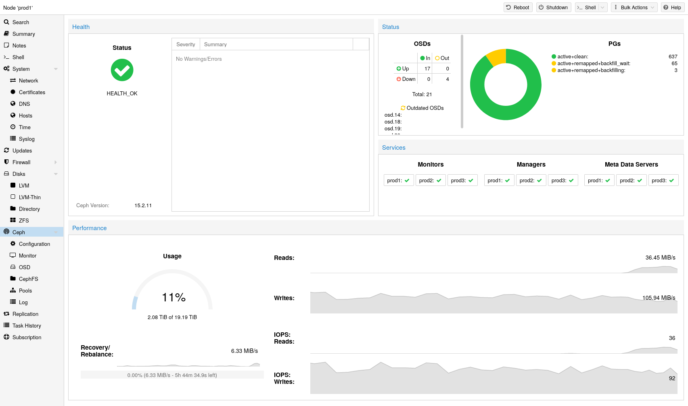](https://pve.proxmox.com/pve-docs/images/screenshot/gui-ceph-status-dashboard.png)

Proxmox VE 将计算和存储系统统一起来，也就是说，您可以在集群内的相同物理节点上同时进行计算（处理虚拟机和容器）和复制存储。传统的计算与存储资源孤岛可以整合为单个超融合设备。独立的存储网络（SAN）以及通过网络附加存储（NAS）进行的连接将不复存在。通过集成开源软件定义存储平台 Ceph，Proxmox VE 能够直接在虚拟机管理程序节点上运行和管理 Ceph 存储。

Ceph 是一种分布式对象存储和文件系统，旨在提供卓越的性能、可靠性和可扩展性。

**在 Proxmox VE 上使用 Ceph 具有以下一些优势：**

- 通过 CLI 和 GUI 轻松设置和管理
- 精简置备
- 快照支持
- 自我修复
- 可扩展至 EB 级别
- 提供块、文件系统和对象存储
- 设置具有不同性能和冗余特性的池
- 数据会被复制，从而具备容错能力
- 可在通用硬件上运行
- 无需硬件 RAID 控制器
- 开源

For small to medium-sized deployments, it is possible to install a Ceph server for using RADOS Block Devices (RBD) or CephFS directly on your Proxmox VE cluster nodes (see [Ceph RADOS Block Devices (RBD)](pvesm-1.md#ceph_rados_block_devices)). Recent hardware has a lot of CPU power and RAM, so running storage services and virtual guests on the same node is possible.

为简化管理，Proxmox VE 提供原生集成功能，可在 Proxmox VE 节点上安装和管理 [Ceph](http://ceph.com) 服务，您可以使用内置 Web 界面，也可以使用 *pveceph* 命令行工具。

## Terminology <a href="#_terminology" id="_terminology"></a>

**Ceph 由多个守护进程组成，用作 RBD 存储时需要：**

- Ceph 监视器（ceph-mon，或 MON）
- Ceph 管理器（ceph-mgr，或 MGR）
- Ceph 元数据服务（ceph-mds，或 MDS）
- Ceph 对象存储守护进程（ceph-osd，或 OSD）


我们强烈建议您熟悉 Ceph [\[1\]](#note-5be4abcb-1)、其架构 [\[2\]](#note-5be4abcb-2) 和术语 [\[3\]](#note-5be4abcb-3)。


## Recommendations for a Healthy Ceph Cluster <a href="#_recommendations_for_a_healthy_ceph_cluster" id="_recommendations_for_a_healthy_ceph_cluster"></a>

要构建超融合 Proxmox \+ Ceph 集群，部署时必须至少使用三台（最好完全相同的）服务器。

另请查阅 [Ceph 网站](https://docs.ceph.com/en/tentacle/start/hardware-recommendations/)上的建议。


以下建议应被视为选择硬件的粗略指南。因此，根据您的具体需求进行调整仍然至关重要。您应测试自己的部署，并持续监控其健康状况和性能。


<a id="pve_ceph_recommendation_cpu"></a>


**CPU**

Ceph services can be classified into two categories:

- CPU 使用率高，受益于较高的 CPU 基础频率和多个核心。此类服务包括：

  - 对象存储守护进程（OSD）服务
  - 用于 CephFS 的元数据服务（MDS）
- CPU 使用率适中，不需要多个 CPU 核心。这类服务包括：

  - 监视器（MON）服务
  - 管理器（MGR）服务

一个简单的经验法则是，您应为每个 Ceph 服务至少分配一个 CPU 核心（或线程），以提供维持 Ceph 稳定、持久性能所需的最低资源。

例如，如果您计划在一个节点上运行一个 Ceph 监视器、一个 Ceph 管理器和 6 个 Ceph OSD 服务，那么为了获得基本且稳定的性能，您应专门为 Ceph 预留 8 个 CPU 核心。

请注意，OSD 的 CPU 使用率主要取决于磁盘性能。磁盘可能达到的 IOPS（**IO** **O**perations per **S**econd）越高，OSD 服务可使用的 CPU 资源就越多。对于现代企业级 SSD 磁盘，例如能够持续维持超过 100’000 的高 IOPS 负载且具有亚毫秒延迟的 NVMe，每个 OSD 可以使用多个 CPU 线程；对于性能非常高的磁盘，每个由 NVMe 支持的 OSD 很可能会使用四到六个 CPU 线程。

<a id="pve_ceph_recommendation_memory"></a>


**内存**

Especially in a hyper-converged setup, the memory consumption needs to be carefully planned out and monitored. In addition to the predicted memory usage of virtual machines and containers, you must also account for having enough memory available for Ceph to provide excellent and stable performance.

虽然正常情况下内存使用量可能较少，但在恢复、重新平衡或回填等关键操作期间，内存消耗会增加。这意味着您应避免在常规运行时就耗尽所有可用内存，而应留出一些余量，以应对服务中断。

The current recommendation is to [configure](#pve_ceph_configuration) OSDs with at least **8 GiB of memory** for good performance. The OSD daemon requires 4 GiB by default.


总内存消耗主要由 OSD 守护进程的数量决定。但是，在关键操作期间，所有 Ceph 服务都可能需要额外内存。


<a id="pve_ceph_recommendation_network"></a>


**网络**

We recommend a network bandwidth of at least 10 Gbps, or more, to be used exclusively for Ceph traffic. A meshed network setup [\[4\]](#note-5be4abcb-4) is also an option for three to five node clusters, if there are no 10\+ Gbps switches available.


流量，尤其是在恢复期间产生的流量，会干扰同一网络上的其他服务，尤其是对延迟敏感的 Proxmox VE corosync 集群协议栈可能会受到影响，从而可能导致集群失去仲裁。将 Ceph 流量迁移到专用的物理隔离网络可以避免此类干扰，不仅可避免对 corosync 的干扰，也可避免对任何虚拟客户机提供的网络服务的干扰。


估算带宽需求时，您需要考虑磁盘的性能。单个 HDD 或许无法跑满 1 Gb 链路，但每个节点上的多个 HDD OSD 就已经能跑满 10 Gbps。如果使用现代 NVMe 连接的 SSD，单个 SSD 就可以跑满 10 Gbps 甚至更高的带宽。对于此类高性能部署，我们建议至少使用 25 Gpbs，而要充分发挥底层磁盘的全部性能潜力，甚至可能需要 40 Gbps 或 100\+ Gbps。

如果不确定，对于高性能部署，我们建议使用三个（物理）独立的网络：

- 一个用于 Ceph（内部）集群流量的超高带宽（25\+ Gbps）网络。
- 一个用于 Ceph（公共）流量的高带宽（10\+ Gpbs）网络，即 Ceph 服务器与 Ceph 客户端之间的存储流量。根据您的需求，该网络也可用于承载虚拟客户机流量和 VM 在线迁移流量。
- 一个专用于对延迟敏感的 corosync 集群通信的中等带宽（1 Gbps）网络。

如果启用了防火墙，您必须开放 Ceph 使用的端口，最简单的方法是使用防火墙 `macro`。

<a id="pve_ceph_recommendation_disk"></a>


**磁盘**

When planning the size of your Ceph cluster, it is important to take the recovery time into consideration. Especially with small clusters, recovery might take long. It is recommended that you use SSDs instead of HDDs in small setups to reduce recovery time, minimizing the likelihood of a subsequent failure event during recovery.

In general, SSDs will provide more IOPS than spinning disks. With this in mind, in addition to the higher cost, it may make sense to implement a [class based](#pve_ceph_device_classes) separation of pools. Another way to speed up OSDs is to use a faster disk as a journal or DB/**W**rite-**A**head-**L**og device, see [creating Ceph OSDs](#pve_ceph_osds). If a faster disk is used for multiple OSDs, a proper balance between OSD and WAL / DB (or journal) disk must be selected, otherwise the faster disk becomes the bottleneck for all linked OSDs.

除磁盘类型外，各节点使用大小一致且数量均匀分布的磁盘时，Ceph 的性能最佳。例如，每个节点配备 4 x 500 GB 磁盘，优于混合配置一块 1 TB 磁盘和三块 250 GB 磁盘。

您还需要平衡 OSD 数量和单个 OSD 容量。更大的容量可以提高存储密度，但也意味着单个 OSD 发生故障时，Ceph 必须一次性恢复更多数据。

<a id="pve_ceph_recommendation_raid"></a>


**避免使用 RAID**

As Ceph handles data object redundancy and multiple parallel writes to disks (OSDs) on its own, using a RAID controller normally doesn’t improve performance or availability. On the contrary, Ceph is designed to handle whole disks on its own, without any abstraction in between. RAID controllers are not designed for the Ceph workload and may complicate things and sometimes even reduce performance, as their write and caching algorithms may interfere with the ones from Ceph.


避免使用 RAID 控制器，改用主机总线适配器（HBA）。


## Initial Ceph Installation \& Configuration <a href="#pve_ceph_install_wizard" id="pve_ceph_install_wizard"></a>

### Using the Web-based Wizard <a href="#_using_the_web_based_wizard" id="_using_the_web_based_wizard"></a>

[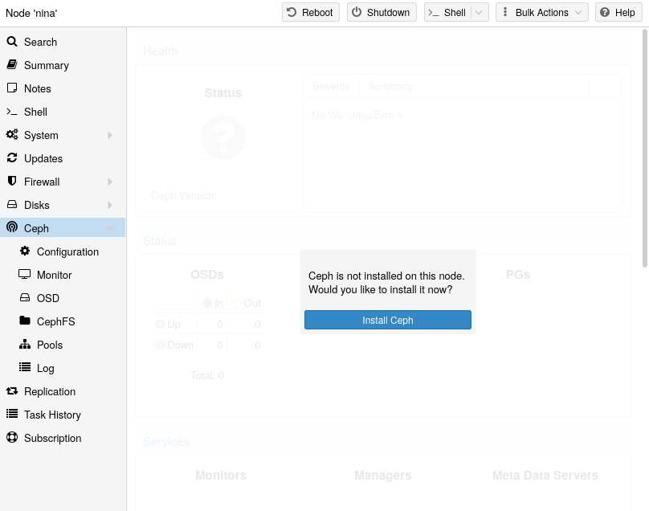](https://pve.proxmox.com/pve-docs/images/screenshot/gui-node-ceph-install.png)

使用 Proxmox VE 的好处是，它提供了易于使用的 Ceph 安装向导。点击一个集群节点，然后在菜单树中导航到 Ceph 部分。如果尚未安装 Ceph，您会看到提示您进行安装的信息。

该向导分为多个部分，每个部分都必须成功完成，才能使用 Ceph。

首先，您需要选择要安装的 Ceph 版本。优先选择其他节点使用的版本；如果这是您第一个安装 Ceph 的节点，则选择最新版本。

开始安装后，向导将从 Proxmox VE 的 Ceph 软件仓库下载并安装所有必需的软件包。

[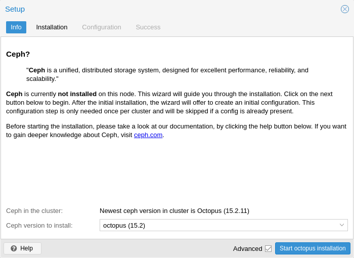](https://pve.proxmox.com/pve-docs/images/screenshot/gui-node-ceph-install-wizard-step0.png)

After finishing the installation step, you will need to create a configuration. This step is only needed once per cluster, as this configuration is distributed automatically to all remaining cluster members through Proxmox VE’s clustered [configuration file system (pmxcfs)](pmxcfs-8.md#chapter_pmxcfs).

配置步骤包括以下设置：

<a id="pve_ceph_wizard_networks"></a>


- **Public Network:** This network will be used for public storage communication (e.g., for virtual machines using a Ceph RBD backed disk, or a CephFS mount), and communication between the different Ceph services. This setting is required.   
   Separating your Ceph traffic from the Proxmox VE cluster communication (corosync), and possibly the front-facing (public) networks of your virtual guests, is highly recommended. Otherwise, Ceph’s high-bandwidth IO-traffic could cause interference with other low-latency dependent services.
- **Cluster Network:** Specify to separate the [OSD](#pve_ceph_osds) replication and heartbeat traffic as well. This setting is optional.   
   Using a physically separated network is recommended, as it will relieve the Ceph public and the virtual guests network, while also providing a significant Ceph performance improvements.   
   The Ceph cluster network can be configured and moved to another physically separated network at a later time.

[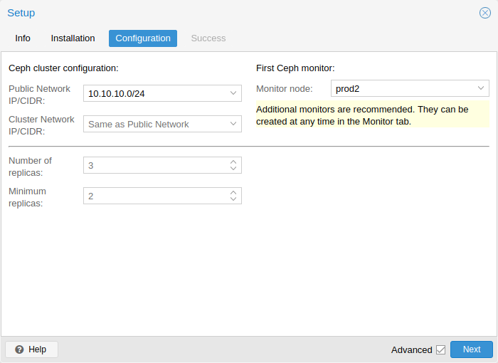](https://pve.proxmox.com/pve-docs/images/screenshot/gui-node-ceph-install-wizard-step2.png)

另外两个选项属于高级选项，因此只有在您清楚自己的操作时才应更改。

- **Number of replicas**: Defines how often an object is replicated.
- **Minimum replicas**: Defines the minimum number of required replicas for I/O to be marked as complete.

此外，您需要选择第一个监视器节点。此步骤为必需步骤。

That’s it. You should now see a success page as the last step, with further instructions on how to proceed. Your system is now ready to start using Ceph. To get started, you will need to create some additional [monitors](#pve_ceph_monitors), [OSDs](#pve_ceph_osds) and at least one [pool](#pve_ceph_pools).

The rest of this chapter will guide you through getting the most out of your Proxmox VE based Ceph setup. This includes the aforementioned tips and more, such as [CephFS](#pveceph_fs), which is a helpful addition to your new Ceph cluster.

### CLI Installation of Ceph Packages <a href="#pve_ceph_install" id="pve_ceph_install"></a>

除了使用 Web 界面中推荐的 Proxmox VE Ceph 安装向导外，您还可以在每个节点上使用以下 CLI 命令：

```text
pveceph install
```

This sets up an `apt` package repository in `/etc/apt/sources.list.d/ceph.sources` and installs the required software.

### Initial Ceph configuration via CLI <a href="#_initial_ceph_configuration_via_cli" id="_initial_ceph_configuration_via_cli"></a>

使用 Proxmox VE Ceph 安装向导（推荐），或在其中一个节点上运行以下命令：

```text
pveceph init --network 10.10.10.0/24
```

This creates an initial configuration at `/etc/pve/ceph.conf` with a dedicated network for Ceph. This file is automatically distributed to all Proxmox VE nodes, using [pmxcfs](pmxcfs-8.md#chapter_pmxcfs). The command also creates a symbolic link at `/etc/ceph/ceph.conf`, which points to that file. Thus, you can simply run Ceph commands without the need to specify a configuration file.

## Ceph Monitor <a href="#pve_ceph_monitors" id="pve_ceph_monitors"></a>

[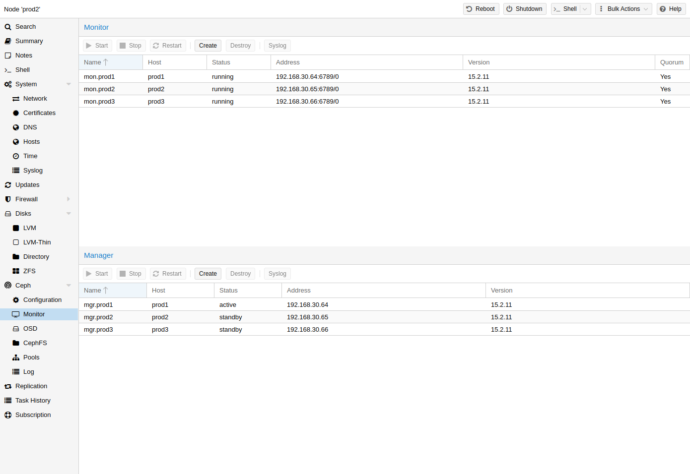](https://pve.proxmox.com/pve-docs/images/screenshot/gui-ceph-monitor.png)

Ceph 监视器（MON）[\[5\]](#note-5be4abcb-5) 维护集群映射的主副本。为实现高可用性，您至少需要 3 个监视器。如果您使用了安装向导，则已经安装了一个监视器。只要您的集群规模属于中小型，就不需要超过 3 个监视器。只有真正大型的集群才需要更多监视器。

### Create Monitors <a href="#pveceph_create_mon" id="pveceph_create_mon"></a>

在要放置监视器的每个节点上（建议三个监视器），通过 GUI 中的 *Ceph → Monitor* 选项卡创建一个监视器，或运行：

```text
pveceph mon create
```

### Destroy Monitors <a href="#pveceph_destroy_mon" id="pveceph_destroy_mon"></a>

要通过 GUI 移除 Ceph 监视器，请先在树视图中选择一个节点，然后转到 **Ceph → Monitor** 面板。选择 MON，然后单击 **Destroy** 按钮。

要通过 CLI 移除 Ceph 监视器，请先连接到正在运行 MON 的节点。然后执行以下命令：

```text
pveceph mon destroy
```


仲裁至少需要三个监视器。


## Ceph Manager <a href="#pve_ceph_manager" id="pve_ceph_manager"></a>

Manager 守护进程与监视器一同运行。它提供用于监控集群的接口。自 Ceph luminous 发布以来，至少需要一个 ceph-mgr [\[6\]](#note-5be4abcb-6) 守护进程。

### Create Manager <a href="#pveceph_create_mgr" id="pveceph_create_mgr"></a>

可以安装多个管理器，但在任何给定时间只有一个管理器处于活动状态。

```text
pveceph mgr create
```


建议将 Ceph 管理器安装在监视器节点上。为实现高可用性，请安装多个管理器。


### Destroy Manager <a href="#pveceph_destroy_mgr" id="pveceph_destroy_mgr"></a>

要通过 GUI 移除 Ceph 管理器，请先在树视图中选择一个节点，然后转到 **Ceph → Monitor** 面板。选择 Manager，然后单击 **Destroy** 按钮。

要通过 CLI 移除 Ceph 监视器，请先连接到正在运行 Manager 的节点。然后执行以下命令：

```text
pveceph mgr destroy
```


虽然管理器不是硬性依赖，但它对 Ceph 集群至关重要，因为它负责 PG 自动缩放、设备运行状况监控、遥测等重要功能。


## Ceph OSDs <a href="#pve_ceph_osds" id="pve_ceph_osds"></a>

[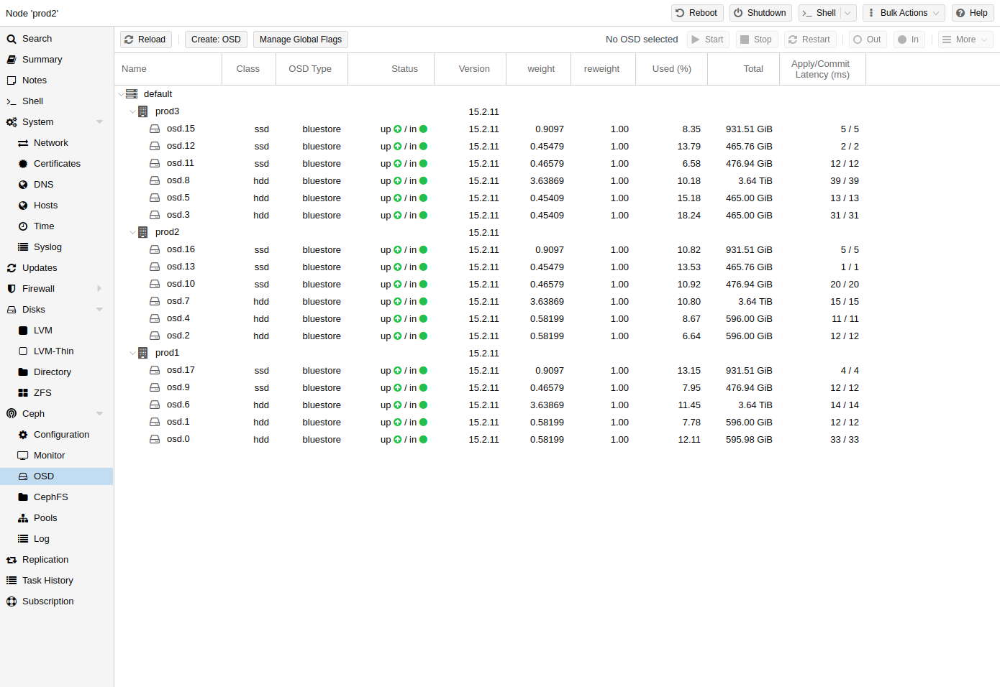](https://pve.proxmox.com/pve-docs/images/screenshot/gui-ceph-osd-status.png)

Ceph 对象存储守护进程（**O**bject **S**torage **D**aemons）通过网络为 Ceph 存储对象。建议每块物理磁盘使用一个 OSD。

### Create OSDs <a href="#pve_ceph_osd_create" id="pve_ceph_osd_create"></a>

您可以通过 Proxmox VE Web 界面或 CLI 使用 `pveceph` 创建 OSD。例如：

```text
pveceph osd create /dev/sd[X]
```


我们建议 Ceph 集群至少包含三个节点和至少 12 个 OSD，并在各节点之间均匀分布。


如果磁盘此前已被使用（例如用于 ZFS 或作为 OSD），您需要先清除所有相关使用痕迹。要删除分区表、引导扇区和任何其他 OSD 残留，可以使用以下命令：

```text
ceph-volume lvm zap /dev/sd[X] --destroy
```


上述命令将销毁磁盘上的所有数据！


**Ceph Bluestore**

从 Ceph Kraken 版本开始，引入了一种名为 Bluestore [\[7\]](#note-5be4abcb-7) 的新 Ceph OSD 存储类型。自 Ceph Luminous 起，创建 OSD 时默认使用此类型。

```text
pveceph osd create /dev/sd[X]
```

**Block.db 和 block.wal**

如果您想为 OSD 使用单独的 DB/WAL 设备，可以通过 *-db\_dev* 和 *-wal\_dev* 选项指定。如果未单独指定 WAL，则会将其与 DB 放在一起。

```text
pveceph osd create /dev/sd[X] -db_dev /dev/sd[Y] -wal_dev /dev/sd[Z]
```

您可以分别通过 *-db\_size* 和 *-wal\_size* 参数直接指定它们的大小。如果未给出这些参数，将按顺序使用以下值：

- bluestore\_block\_{db,wal}\_size，来自 Ceph 配置……

  - … database, section *osd*
  - … database, section *global*
  - … file, section *osd*
  - … file, section *global*
- OSD 大小的 10%（DB）/1%（WAL）


DB 存储 BlueStore 的内部元数据，WAL 是 BlueStore 的内部日志或预写式日志。建议使用高速 SSD 或 NVRAM 以获得更好的性能。


**Ceph Filestore**

在 Ceph Luminous 之前，Filestore 是 Ceph OSD 的默认存储类型。从 Ceph Nautilus 开始，Proxmox VE 不再支持使用 *pveceph* 创建此类 OSD。如果您仍想创建 filestore OSD，请直接使用 *ceph-volume*。

```text
ceph-volume lvm create --filestore --data /dev/sd[X] --journal /dev/sd[Y]
```

### Destroy OSDs <a href="#pve_ceph_osd_destroy" id="pve_ceph_osd_destroy"></a>

If you experience problems with an OSD or its disk, try to [troubleshoot](#pve_ceph_mon_and_ts) them first to decide if a [replacement](#pve_ceph_osd_replace) is needed.

要销毁 OSD，请转到 *\<Node\> → Ceph → OSD* 面板，或在 OSD 所在节点上使用上述 CLI 命令。

1. 确保集群有足够的空间来应对 OSD 的移除。在 *Ceph → OSD* 面板中，如果待销毁的 OSD 仍处于 `up` 和 `in` 状态（`AVAIL` 为非零值），请确保所有 OSD 的 `Used (%)` 值都远低于 `nearfull_ratio`，后者的默认值为 `85%`。

   这样可以降低即将进行的重新均衡所带来的风险，重新均衡可能导致 OSD 写满，从而阻塞 Ceph 池上的 I/O。

   使用以下命令可在 CLI 上获取相同的信息：

   ```text
   ceph osd df tree
   ```
2. 如果待销毁的 OSD 尚未处于 `out` 状态，请选择该 OSD，然后单击 **Out**。这会将其排除在数据分布之外，并启动重新均衡。

   以下命令可执行相同操作：

   ```text
   ceph osd out <id>
   ```
3. 如果条件允许，请等待 Ceph 完成重新均衡，以始终保有足够的副本。OSD 将会变空；清空后，它会显示 *0 PGs*。
4. 单击 **Stop**。如果目前尚无法安全停止，将会出现警告，此时应单击 **Cancel**。稍等片刻后再试。

   以下命令可用于检查停止 OSD 是否安全，并用于停止 OSD：

   ```text
   ceph osd ok-to-stop <id>
   pveceph stop --service osd.<id>
   ```
5. 最后：

   要从 Ceph 中移除 OSD 并删除所有磁盘数据，请先单击 **More → Destroy**。启用清理选项，以清除分区表和其他结构。这样便可以立即在 Proxmox VE 中重新使用该磁盘。然后，单击 **Remove**。

   用于销毁 OSD 的 CLI 命令是：

   ```text
   pveceph osd destroy <id> [--cleanup]
   ```

## Ceph Configuration <a href="#pve_ceph_configuration" id="pve_ceph_configuration"></a>

Ceph 守护进程和客户端从一个或多个配置源 [\[8\]](#note-5be4abcb-8) 获取其配置。在 Proxmox VE 中，使用一个最小的 ceph.conf 文件来保存引导设置。大多数配置保存在由 MON 服务维护的中央配置数据库中。

要持久化更改配置值，请使用以下命令 [\[9\]](#note-5be4abcb-9)：

<table>


<tbody>
<tr>
<td><p><code>ceph config dump</code></p></td>
<td><p>显示所有配置选项</p></td>
</tr>
<tr>
<td><p><code>ceph config get &lt;who&gt; &lt;name&gt;</code></p></td>
<td><p>显示某个实体的配置选项</p></td>
</tr>
<tr>
<td><p><code>ceph config set &lt;who&gt; &lt;name&gt; &lt;value&gt;</code></p></td>
<td><p>为一个或多个实体设置配置选项</p></td>
</tr>
<tr>
<td><p><code>ceph config rm &lt;who&gt; &lt;name&gt;</code></p></td>
<td><p>清除一个或多个实体的配置选项</p></td>
</tr>
</tbody>
</table>

**为所有 OSD 守护进程增大 osd\_memory\_target 的示例**

```text
ceph config set osd osd_memory_target 8G
```


如果某个选项存在于本地配置文件中，MON DB 中的配置将被忽略，因为其优先级较低。


## Ceph Pools <a href="#pve_ceph_pools" id="pve_ceph_pools"></a>

[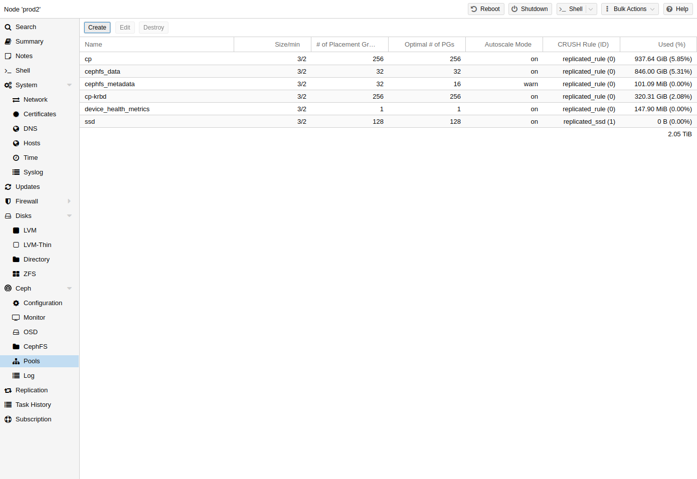](https://pve.proxmox.com/pve-docs/images/screenshot/gui-ceph-pools.png)

池是用于存储对象的逻辑组。它包含一组对象，称为 **P**lacement **G**roups（`PG`，`pg_num`）。

### Create and Edit Pools <a href="#_create_and_edit_pools" id="_create_and_edit_pools"></a>

您可以通过命令行或任何 Proxmox VE 宿主机的 Web 界面，在 **Ceph → Pools** 下创建和编辑池。

当未给出任何选项时，我们会默认设置 **128 PGs**、**3 个副本的 size** 和 **2 个副本的 min\_size**，以确保任何 OSD 发生故障时都不会造成数据丢失。


**不要将 min\_size 设置为 1**。对于 min\_size 为 1 的副本池，当对象只有 1 个副本时仍允许对其执行 I/O，这可能导致数据丢失、PG 不完整或无法找到对象。


建议您启用 PG-Autoscaler，或根据您的部署计算 PG 数量。您可以在线找到相关公式和 PG 计算器 [\[10\]](#note-5be4abcb-10)。从 Ceph Nautilus 起，您可以在完成设置后更改 PG [\[placement\_groups\]](#_footnote_placement_groups) 的数量。

PG 自动缩放器 [\[autoscaler\]](#_footnote_autoscaler) 可以在后台自动调整池的 PG 数量。设置 `Target Size` 或 `Target Ratio` 高级参数有助于 PG-Autoscaler 做出更好的决策。

**通过 CLI 创建池的示例**

```text
pveceph pool create <pool-name> --add_storages
```


如果您还想自动为池定义存储，请在 Web 界面中保持选中“Add as Storage”复选框，或在创建池时使用命令行选项 *--add\_storages*。


#### Pool Options <a href="#_pool_options" id="_pool_options"></a>

[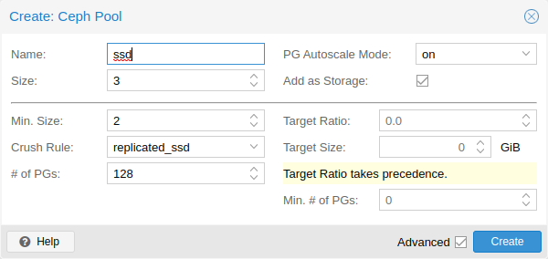](https://pve.proxmox.com/pve-docs/images/screenshot/gui-ceph-pool-create.png)

以下选项可在创建池时使用，其中部分选项也可在编辑池时使用。

**名称**

池的名称。该名称必须唯一，且之后无法更改。

**大小**

每个对象的副本数。Ceph 始终尝试为对象保留此数量的副本。默认值：`3`。

**PG 自动缩放模式**

池的自动 PG 缩放模式   
[\[自动缩放器\]](#_footnote_autoscaler)  
。如果设置为 `warn`，当池的 PG 数量不是最佳值时，会生成警告消息。默认值：`warn`。

**添加为存储**

使用新池配置 VM 或容器存储。默认值：`true`（仅在创建时可见）。

**高级选项**

**最小大小**

每个对象的最小副本数。如果 PG 的副本数少于此值，Ceph 将拒绝该池上的 I/O。默认值：`2`。

**CRUSH 规则**

The rule to use for mapping object placement in the cluster. These rules define how data is placed within the cluster. See [Ceph CRUSH \& device classes](#pve_ceph_device_classes) for information on device-based rules.

**PG 数量**

池在初始时应具有的归置组   
[\[placement\_groups\]](#_footnote_placement_groups)  
 数量。默认值：`128`。

**目标比例**

池中预期数据所占的比例。PG 自动缩放器会结合其他已设置的比例来使用此比例。如果两者均已设置，则此设置优先于 `target size`。

**目标大小**

池中预期数据的估计量。PG 自动缩放器使用此大小来估计最佳 PG 数量。

**最小 PG 数量**

归置组的最小数量。此设置用于微调该池 PG 数量的下限。PG 自动缩放器不会将 PG 合并到低于此阈值。

有关 Ceph 池处理的更多信息，请参阅 Ceph 池操作 [\[13\]](#note-5be4abcb-13)手册。

### Erasure Coded Pools <a href="#pve_ceph_ec_pools" id="pve_ceph_ec_pools"></a>

纠删码（EC）是一种“前向纠错”编码，可在发生一定量的数据丢失时恢复数据。与副本池相比，纠删码池可以提供更多可用空间，但代价是性能下降。

相比之下：在传统的副本池中，会存储数据的多个副本（`size`）；而在纠删码池中，数据会被拆分为 `k` 个数据块，并附加 `m` 个编码（校验）块。如果数据块丢失，可以使用这些编码块重建数据。

编码块数量 `m` 决定了在不丢失任何数据的情况下可以容忍丢失多少个 OSD。存储的对象总数为 `k + m`。

#### Creating EC Pools <a href="#_creating_ec_pools" id="_creating_ec_pools"></a>

可以使用 `pveceph` 命令行工具创建纠删码（EC）池。规划 EC 池时，必须考虑其工作方式与副本池不同这一事实。

The default `min_size` of an EC pool depends on the `m` parameter. If `m = 1`, the `min_size` of the EC pool will be `k`. The `min_size` will be `k + 1` if `m > 1`. The Ceph documentation recommends a conservative `min_size` of `k + 2`
[\[14\]](#note-5be4abcb-14).

如果可用 OSD 少于 `min_size` 个，则对该池的所有 I/O 都将被阻塞，直到再次有足够的 OSD 可用。


规划纠删码池时，请留意 `min_size`，因为它决定了需要有多少个 OSD 可用。否则，I/O 将被阻塞。


例如，一个 `k = 2`、`m = 1` 的 EC 池将具有 `size = 3`、`min_size = 2`，并且在一个 OSD 发生故障时仍可继续运行。如果该池配置为 `k = 2`、`m = 2`，则将为 `size = 4` 和 `min_size = 3`，并且在一个 OSD 丢失时仍可继续运行。

要创建新的 EC 池，请运行以下命令：

```text
pveceph pool create <pool-name> --erasure-coding k=2,m=1
```

可选参数为 `failure-domain` 和 `device-class`。如果需要更改池所使用的任何 EC 配置文件设置，则必须使用新的配置文件创建一个新池。

这将创建一个新的 EC 池，以及用于存储 RBD omap 和其他元数据所需的副本池。最终会有一个 `<pool name>-data` 池和一个 `<pool name>-metadata` 池。默认行为还会创建匹配的存储配置。如果不需要此行为，可以通过提供 `--add_storages 0` 参数将其禁用。手动配置存储时，请记住必须设置 `data-pool` 参数。只有这样，EC 池才会用于存储数据对象。例如：


可选参数 `--size`、`--min_size` 和 `--crush_rule` 将用于副本元数据池，而不会用于纠删码数据池。如果需要更改数据池的 `min_size`，可以稍后再进行更改。无法在纠删码池上更改 `size` 和 `crush_rule` 参数。


如果需要进一步自定义 EC 配置文件，可以直接使用 Ceph 工具创建该配置文件 [\[15\]](#note-5be4abcb-15)，并通过 `profile` 参数指定要使用的配置文件。

例如：

```text
pveceph pool create <pool-name> --erasure-coding profile=<profile-name>
```

#### FastEC (`allow_ec_optimizations`) <a href="#_fastec_span_class_monospaced_allow_ec_optimizations_span" id="_fastec_span_class_monospaced_allow_ec_optimizations_span"></a>

Ceph Tentacle 引入了一种名为 FastEC 的新纠删码 I/O 路径，可通过 `allow_ec_optimizations` 标志按池启用。FastEC 为 EC 池增加了部分读取和部分写入功能，显著提升了小块随机 I/O 的性能，而这是虚拟机磁盘 I/O 的主要访问模式。上游建议将其用于由 RBD 和 CephFS 支持的存储 [\[16\]](#note-5be4abcb-16)。

FastEC 有四项要求，由 Ceph 监视器强制执行：

- 池必须是纠删码池；
- 集群必须处于 `require_osd_release` tentacle 或更高版本；
- 纠删码配置文件必须使用支持优化 EC 路径的插件和技术组合：

  <table>


  <thead>
  <tr>
  <th>插件</th>
  <th>技术</th>
  <th>FastEC</th>
  </tr>
  </thead>
  <tbody>
  <tr>
  <td><p><code>isa</code></p></td>
  <td><p><code>reed_sol_van</code></p></td>
  <td><p>是</p></td>
  </tr>
  <tr>
  <td><p><code>isa</code></p></td>
  <td><p><code>cauchy</code></p></td>
  <td><p>否</p></td>
  </tr>
  <tr>
  <td><p><code>jerasure</code></p></td>
  <td><p><code>reed_sol_van</code></p></td>
  <td><p>是</p></td>
  </tr>
  <tr>
  <td><p><code>jerasure</code></p></td>
  <td><p>所有其他</p></td>
  <td><p>否</p></td>
  </tr>
  <tr>
  <td><p><code>lrc</code></p></td>
  <td><p>（任意）</p></td>
  <td><p>否</p></td>
  </tr>
  <tr>
  <td><p><code>shec</code></p></td>
  <td><p>（任意）</p></td>
  <td><p>否</p></td>
  </tr>
  <tr>
  <td><p><code>clay</code></p></td>
  <td><p>（任意）</p></td>
  <td><p>否</p></td>
  </tr>
  </tbody>
  </table>
- 池的条带单元必须是 4096 字节的倍数。默认条带单元满足此要求，因此，只有纠删码配置文件中使用了自定义 `stripe_unit` 的池才需要关注这一点。

如果任何前提条件未满足，`ceph osd pool set <pool>-data allow_ec_optimizations 1` 都会失败并给出描述性错误信息，不会静默降级。

`pveceph` 在创建 EC 配置文件时不会显式设置插件或技术，两者均取自监视器的 `osd_pool_default_erasure_code_profile` 选项（在 Squid 和 Tentacle 上默认均为 `reed_sol_van`）。因此，除非运维人员覆盖了此设置，否则默认即可满足技术要求。可使用以下命令验证：

```text
ceph config get mon osd_pool_default_erasure_code_profile
```

如果输出显示的技术不是 `reed_sol_van`，请更新集群范围的默认设置，或者显式创建一个兼容的配置文件，并在创建池时通过 `profile` 属性传入该配置文件（见上文）。

使用以下命令检查集群版本：

```text
ceph osd dump | grep require_osd_release
```

如果此处报告的版本低于 `tentacle`，请在所有 OSD 完成升级后运行 `ceph osd require-osd-release tentacle`。


`allow_ec_optimizations` 是一个单向开关。在池上启用后，Ceph 监视器会拒绝再次清除该标志，因此回滚需要清空并重新创建池。请仅在测试池上验证 FastEC 适用于您的工作负载后再启用它。


##### Enabling FastEC on a pool <a href="#_enabling_fastec_on_a_pool" id="_enabling_fastec_on_a_pool"></a>

FastEC 通过 `ceph` 命令行按池启用。它既可以设置在新池上，也可以设置在现有（已有数据）的池上。不会发生数据迁移或重新编码，仅会更改池元数据。

要在池上启用 FastEC，请对数据池（通常命名为 `<pool-name>-data`）运行以下命令：

```text
ceph osd pool set <pool-name>-data allow_ec_optimizations 1
```

使用以下命令验证结果：

```text
ceph osd pool get <pool-name>-data allow_ec_optimizations
```

同一命令还会报告任何 EC 池的当前状态，这在审计集群时非常有用。

在已有数据的池上设置该标志时，请注意以下事项：

- **Primary re-election.** FastEC marks data shards 1 through k-1 as non-primary, so PGs whose primary was on one of those shards will re-peer. This is a normal peering event and causes a brief I/O pause per affected PG.
- **Scrub interaction.** Re-peering cancels any in-flight scrub on affected PGs. Those PGs will need to be re-scrubbed after peering completes.

#### Adding EC Pools as Storage <a href="#_adding_ec_pools_as_storage" id="_adding_ec_pools_as_storage"></a>

您可以将现有的 EC 池作为存储添加到 Proxmox VE。其操作方式与添加 `RBD` 池相同，但需要额外的 `data-pool` 选项。

```text
pvesm add rbd <storage-name> --pool <replicated-pool> --data-pool <ec-pool>
```


对于不受本地 Proxmox VE 集群管理的任何外部 Ceph 集群，请不要忘记添加 `keyring` 和 `monhost` 选项。


### Destroy Pools <a href="#_destroy_pools" id="_destroy_pools"></a>

要通过 GUI 销毁池，请在树状视图中选择一个节点，然后转到 **Ceph → Pools** 面板。选择要销毁的池，然后点击 **Destroy** 按钮。要确认销毁该池，您需要输入池名称。

运行以下命令销毁池。指定 *-remove\_storages* 以同时删除关联的存储。

```text
pveceph pool destroy <name>
```


池删除会在后台运行，并且可能需要一些时间。在此过程中，您会注意到集群中的数据使用量逐渐减少。


### PG Autoscaler <a href="#_pg_autoscaler" id="_pg_autoscaler"></a>

PG 自动缩放器使集群能够考虑每个池中存储的（预期）数据量，并自动选择合适的 pg\_num 值。该功能自 Ceph Nautilus 起可用。

您可能需要先激活 PG 自动缩放器模块，调整才能生效。

```text
ceph mgr module enable pg_autoscaler
```

自动缩放器按池进行配置，具有以下模式：

<table>
<tr>
<td>warn <br/>
</td>
<td>
<p>如果建议的 <code>pg_num</code> 值与当前值相差过大，将发出健康警告。</p>
</td>
</tr>
<tr>
<td>on <br/>
</td>
<td>
<p><code>pg_num</code> 会自动调整，无需任何手动干预。</p>
</td>
</tr>
<tr>
<td>off <br/>
</td>
<td>
<p>不会自动调整 <code>pg_num</code>，并且即使 PG 数量不是最佳值，也不会发出警告。</p>
</td>
</tr>
</table>

可以使用 `target_size`、`target_size_ratio` 和 `pg_num_min` 选项调整缩放因子，以便满足未来的数据存储需求。


默认情况下，如果池的 PG 数量偏差达到 3 倍，自动缩放器就会考虑对其进行调整。这将导致数据放置发生显著变化，并可能给集群带来高负载。


您可以在 Ceph 博客中找到对 PG 自动缩放器更深入的介绍——[Nautilus 新功能：PG 合并和自动调优](https://ceph.io/rados/new-in-nautilus-pg-merging-and-autotuning/)。

## Ceph CRUSH \& Device Classes <a href="#pve_ceph_device_classes" id="pve_ceph_device_classes"></a>

[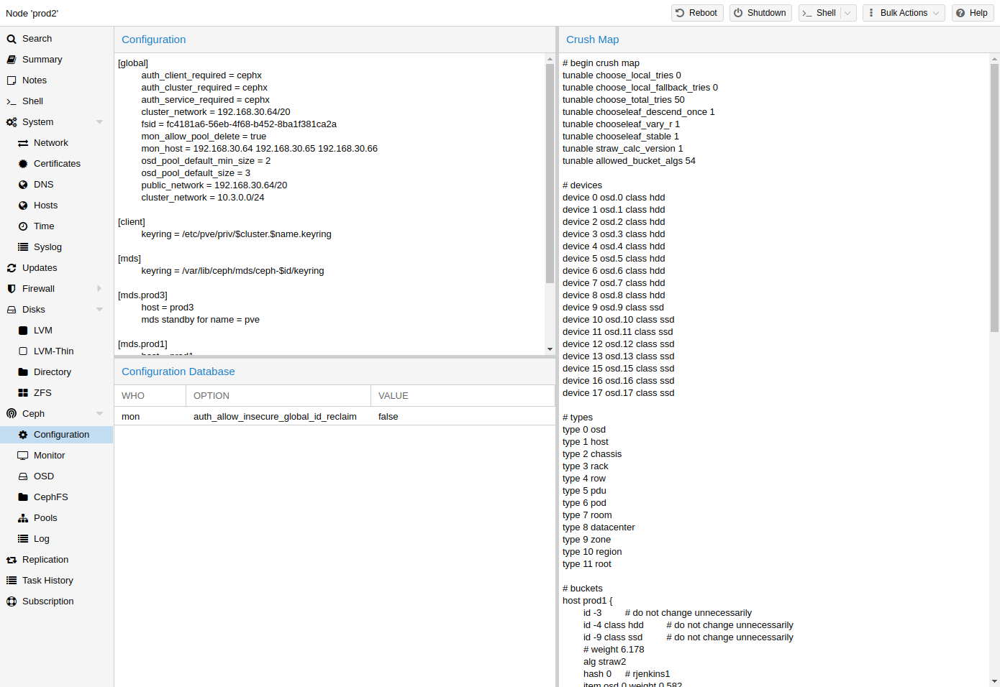](https://pve.proxmox.com/pve-docs/images/screenshot/gui-ceph-config.png)

[\[17\]](#note-5be4abcb-17)（**C**ontrolled **R**eplication **U**nder **S**calable **H**ashing）算法是 Ceph 的基础。

CRUSH 用于计算数据的存储位置和读取位置。其优势在于不需要中央索引服务。CRUSH 使用由 OSD、桶（设备位置）和池规则集（数据复制）组成的映射来工作。


更多信息请参阅 Ceph 文档中的 CRUSH map 一节 [\[18\]](#note-5be4abcb-18)。


可以更改此映射，以反映不同的复制层次结构。在保持所需分布的同时，可以将对象副本分隔开（例如，按故障域分隔）。

一种常见配置是为不同的 Ceph 池使用不同类别的磁盘。为此，Ceph 从 Luminous 开始引入了设备类别，以满足轻松生成规则集的需求。

可以在 *ceph osd tree* 的输出中查看设备类别。这些类别各自代表一个根桶，可以使用以下命令查看。

```text
ceph osd crush tree --show-shadow
```

上述命令的示例输出：

```text
ID  CLASS WEIGHT  TYPE NAME
-16  nvme 2.18307 root default~nvme
-13  nvme 0.72769     host sumi1~nvme
 12  nvme 0.72769         osd.12
-14  nvme 0.72769     host sumi2~nvme
 13  nvme 0.72769         osd.13
-15  nvme 0.72769     host sumi3~nvme
 14  nvme 0.72769         osd.14
 -1       7.70544 root default
 -3       2.56848     host sumi1
 12  nvme 0.72769         osd.12
 -5       2.56848     host sumi2
 13  nvme 0.72769         osd.13
 -7       2.56848     host sumi3
 14  nvme 0.72769         osd.14
```

要指示池仅在特定设备类别上分布对象，首先需要为该设备类别创建一个规则集：

```text
ceph osd crush rule create-replicated <rule-name> <root> <failure-domain> <class>
```

<table>


<tbody>
<tr>
<td><p>&lt;rule-name&gt;</p></td>
<td><p>规则名称，用于与池关联（可在 GUI 和 CLI 中看到）</p></td>
</tr>
<tr>
<td><p>&lt;root&gt;</p></td>
<td><p>应属于哪个 CRUSH 根（默认 Ceph 根为 "default"）</p></td>
</tr>
<tr>
<td><p>&lt;failure-domain&gt;</p></td>
<td><p>对象应在哪个故障域中分布（通常为 host）</p></td>
</tr>
<tr>
<td><p>&lt;class&gt;</p></td>
<td><p>要使用的 OSD 后备存储类型（例如 nvme、ssd、hdd）</p></td>
</tr>
</tbody>
</table>

规则加入 CRUSH map 后，即可指示池使用该规则集。

```text
ceph osd pool set <pool-name> crush_rule <rule-name>
```


如果池中已包含对象，则必须相应地移动这些对象。根据您的设置，这可能会对集群性能产生很大影响。作为替代方案，您可以创建一个新池并单独移动磁盘。



使用 PG 自动缩放器时，集群中的所有池都必须使用相同类型的 CRUSH 规则，要么全部指定设备类别，要么全部不指定。否则，自动缩放器将跳过受影响的池，其 `pg_num` 也不会得到调整。


## Cephx Authentication <a href="#pveceph_cephx_how_it_works" id="pveceph_cephx_how_it_works"></a>

Cephx [\[19\]](#note-5be4abcb-19)用于保护对 Ceph 集群的访问。

每个 Ceph 服务和客户端（包括存储使用方和工具）都以 Ceph 用户（例如 `client.admin` 或 `osd.3`）的身份，使用该用户的长期密钥向监视器进行身份验证。随后，监视器会签发称为票据的临时凭据：

<table>


<thead>
<tr>
<th>术语</th>
<th>用途</th>
</tr>
</thead>
<tbody>
<tr>
<td><p>用户密钥</p></td>
<td><p>客户端或 Ceph 服务用于向监视器进行身份验证的长期密钥。</p></td>
</tr>
<tr>
<td><p>监视器票据</p></td>
<td><p>允许经过身份验证的 Ceph 用户请求 Ceph 服务的票据。</p></td>
</tr>
<tr>
<td><p>服务票据</p></td>
<td><p>授予对 OSD、管理器或元数据服务器的临时访问权限。</p></td>
</tr>
<tr>
<td><p>轮换服务密钥</p></td>
<td><p>允许 Ceph 服务验证服务票据。监视器会自动替换这些密钥。</p></td>
</tr>
</tbody>
</table>

运行中的客户端通常仅在启动时读取其用户密钥。更新已保存的密钥或密钥环文件并不会更新该进程。现有票据和连接也可能在一段时间内继续可用。因此，密钥轮换必须考虑正在运行以及暂时断开连接的客户端。

### Keyring Locations <a href="#pveceph_keyrings" id="pveceph_keyrings"></a>

The authoritative `client.admin` keyring in a Proxmox VE Ceph cluster is `/etc/pve/priv/ceph.client.admin.keyring`, not the copy in `/etc/ceph`. The [Proxmox cluster file system (pmxcfs)](pmxcfs-8.md#chapter_pmxcfs) synchronizes it to every node. Credentials for managed Ceph storages are below `/etc/pve/priv/ceph/`.

`/var/lib/ceph` 下方的密钥环属于一个 Ceph 服务，并且仅位于其所在节点本地。`/etc/pve/priv/ceph.mon.keyring` 同时包含共享的 `mon.` 密钥和 `client.admin`。请始终将更新合并到此文件中，而不是覆盖该文件。`pveceph mon create` 在初始化监视器时会使用其 `mon.` 条目。

### Encrypted OSD Lockbox Keys <a href="#pveceph_cephx_lockbox" id="pveceph_cephx_lockbox"></a>

每个加密 OSD 都使用一个名为 `client.osd-lockbox.<UUID>` 的专用 Ceph 用户。其身份验证密钥称为锁箱密钥。它不是磁盘加密密钥本身：它使 OSD 能够从 Ceph 检索该密钥，并在启动时解锁其存储。Ceph 和 OSD 的块设备中必须包含相匹配的锁箱密钥副本。


切勿仅使用 `ceph auth` 轮换锁箱密钥。请使用迁移辅助工具，它会验证 OSD 身份并同时更新两份副本。


## Ceph Client <a href="#_ceph_client" id="_ceph_client"></a>

[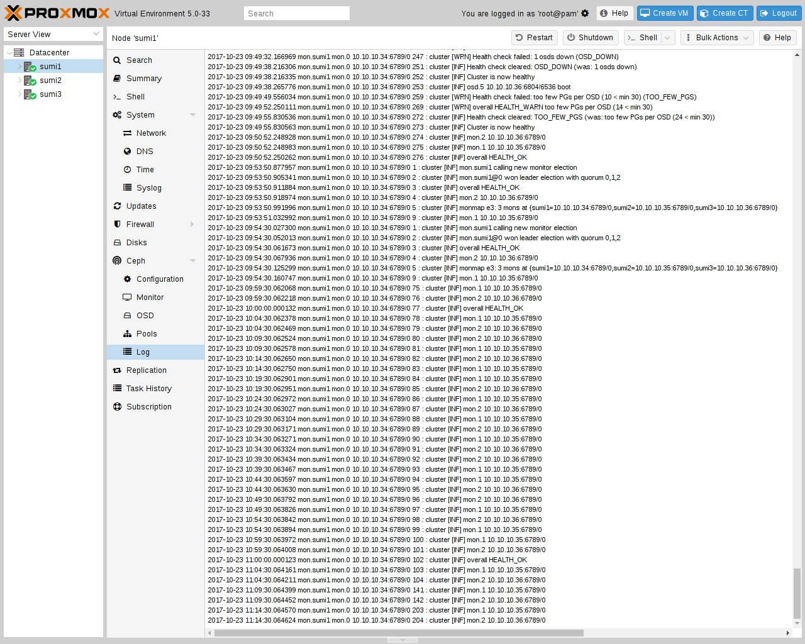](https://pve.proxmox.com/pve-docs/images/screenshot/gui-ceph-log.png)

Add an [RBD storage](pvesm-1.md#ceph_rados_block_devices) in the web interface to use a Ceph pool for virtual machine and container disks. For an external cluster, follow the [authentication instructions](pvesm-1.md#storage_rbd_auth) to configure a dedicated Ceph user and its keyring.

## CephFS <a href="#pveceph_fs" id="pveceph_fs"></a>

Ceph 还提供一种文件系统，它运行在与 RADOS 块设备相同的对象存储之上。**元**数**据**服**务**器（`MDS`）用于将 RADOS 支持的对象映射为文件和目录，使 Ceph 能够提供符合 POSIX 标准、支持复制的文件系统。这使您可以轻松配置集群化、高可用性的共享文件系统。Ceph 的元数据服务器可确保文件均匀分布在整个 Ceph 集群中。因此，即使在高负载情况下，也不会使单台宿主机不堪重负，而传统共享文件系统方案（例如 `NFS`）可能会存在这一问题。

[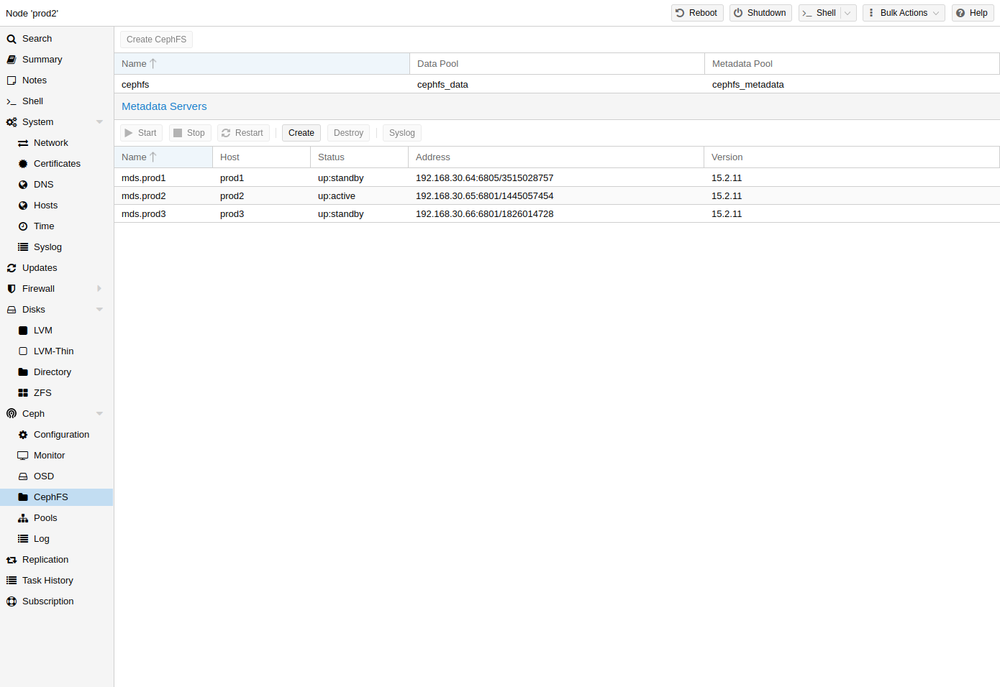](https://pve.proxmox.com/pve-docs/images/screenshot/gui-node-ceph-cephfs-panel.png)

Proxmox VE supports both creating a hyper-converged CephFS and using an existing [CephFS as storage](pvesm-1.md#storage_cephfs) to save backups, ISO files, and container templates.

### Metadata Server (MDS) <a href="#pveceph_fs_mds" id="pveceph_fs_mds"></a>

CephFS 需要至少配置并运行一个元数据服务器才能正常工作。您可以通过 Proxmox VE Web GUI 的 `Node
-> CephFS` 面板创建 MDS，也可以使用以下命令从命令行创建：

```text
pveceph mds create
```

可以在集群中创建多个元数据服务器，但在默认设置下，同一时间只能有一个处于活动状态。如果某个 MDS 或其节点无响应（或崩溃），另一个 `standby` MDS 将被提升为 `active`。您可以在创建时使用 *hotstandby* 参数选项，加快活动 MDS 与备用 MDS 之间的交接；如果已经创建了 MDS，也可以设置/添加：

```text
mds standby replay = true
```

在 `/etc/pve/ceph.conf` 中相应的 MDS 部分。启用此选项后，指定的 MDS 将保持 `warm` 状态并轮询活动 MDS，以便在出现任何问题时更快接管。


这种主动轮询会给您的系统和活动 `MDS` 带来额外的性能开销。


**多个活动 MDS**

自 Luminous（12.2.x）起，您可以同时运行多个活动元数据服务器，但通常只有在并行运行大量客户端时才有用。否则，`MDS` 很少会成为系统瓶颈。如果要进行此设置，请参阅 Ceph 文档。[\[20\]](#note-5be4abcb-20)

### Create CephFS <a href="#pveceph_fs_create" id="pveceph_fs_create"></a>

借助 Proxmox VE 对 CephFS 的集成，您可以轻松通过 Web 界面、CLI 或外部 API 接口创建 CephFS。要实现这一点，需要满足一些先决条件：

**成功设置 CephFS 的先决条件：**

- [Install Ceph packages](#pve_ceph_install) \- if this was already done some time ago, you may want to rerun it on an up-to-date system to ensure that all CephFS related packages get installed.
- [Setup Monitors](#pve_ceph_monitors)
- [Setup your OSDs](#pve_ceph_monitors)
- [Setup at least one MDS](#pveceph_fs_mds)

完成上述步骤后，您只需通过 Web GUI 的 `Node -> CephFS` 面板或命令行工具 `pveceph` 即可创建 CephFS，例如：

```text
pveceph fs create --pg_num 128 --add-storage
```

This creates a CephFS named *cephfs*, using a pool for its data named *cephfs\_data* with *128* placement groups and a pool for its metadata named *cephfs\_metadata* with one quarter of the data pool’s placement groups (`32`). Check the [Proxmox VE managed Ceph pool chapter](#pve_ceph_pools) or visit the Ceph documentation for more information regarding an appropriate placement group number (`pg_num`) for your setup   
[\[placement\_groups\]](#_footnote_placement_groups)  
. Additionally, the *--add-storage* parameter will add the CephFS to the Proxmox VE storage configuration after it has been created successfully.

### Destroy CephFS <a href="#_destroy_cephfs" id="_destroy_cephfs"></a>


销毁 CephFS 将使其中的所有数据无法使用。此操作无法撤销！


要彻底且妥善地移除 CephFS，需要执行以下步骤：

- 断开所有非 Proxmox VE 客户端的连接（例如，在客户机中卸载 CephFS）。
- 禁用所有相关的 CephFS Proxmox VE 存储条目（以防止其被自动挂载）。
- 从客户机中移除要销毁的 CephFS 上所有已使用的资源（例如 ISO）。
- 在所有集群节点上使用以下命令手动卸载 CephFS 存储：

  ```text
  umount /mnt/pve/<STORAGE-NAME>
  ```

  其中，`<STORAGE-NAME>` 是您的 Proxmox VE 中 CephFS 存储的名称。
- 现在，通过停止或销毁这些元数据服务器，确保没有元数据服务器（`MDS`）在为该 CephFS 运行。这可以通过 Web 界面或命令行界面完成；对于后者，您需要执行以下命令：

  ```text
  pveceph stop --service mds.NAME
  ```

  以停止它们，或者

  ```text
  pveceph mds destroy NAME
  ```

  以销毁它们。

  请注意，当活动 `MDS` 停止或被移除时，备用服务器会自动提升为活动状态，因此最好先停止所有备用服务器。
- 现在，您可以使用以下命令销毁 CephFS：

  ```text
  pveceph fs destroy NAME --remove-storages --remove-pools
  ```

  这还会自动销毁底层 Ceph 池，并从 pve 配置中移除这些存储。

完成这些步骤后，CephFS 应该已被完全移除；如果您还有其他 CephFS 实例，可以重新启动已停止的元数据服务器，让它们充当备用服务器。

## Ceph Maintenance <a href="#_ceph_maintenance" id="_ceph_maintenance"></a>

### Replace OSDs <a href="#pve_ceph_osd_replace" id="pve_ceph_osd_replace"></a>

With the following steps you can replace the disk of an OSD, which is one of the most common maintenance tasks in Ceph. If there is a problem with an OSD while its disk still seems to be healthy, read the [troubleshooting](#pve_ceph_mon_and_ts) section first.

1. If the disk failed, get a [recommended](#pve_ceph_recommendation_disk) replacement disk of the same type and size.
2. [Destroy](#pve_ceph_osd_destroy) the OSD in question.
3. 从服务器上卸下旧磁盘并安装新磁盘。
4. [Create](#pve_ceph_osd_create) the OSD again.
5. 自动重新平衡后，集群状态应恢复为 `HEALTH_OK`。对于仍列出的任何崩溃记录，可以运行以下命令予以确认：

```text
ceph crash archive-all
```

### Trim/Discard <a href="#_trim_discard" id="_trim_discard"></a>

It is good practice to run *fstrim* (discard) regularly on VMs and containers. This releases data blocks that the filesystem isn’t using anymore. It reduces data usage and resource load. Most modern operating systems issue such discard commands to their disks regularly. You only need to ensure that the Virtual Machines enable the [disk discard option](qm-1.md#qm_hard_disk_discard).

### Scrub \& Deep Scrub <a href="#pveceph_scrub" id="pveceph_scrub"></a>

Ceph 通过对归置组进行 *擦洗* 来确保数据完整性。Ceph 会检查 PG 中每个对象的健康状况。擦洗分为两种形式：每天进行的低成本元数据检查和每周进行的深度数据检查。每周深度擦洗会读取对象并使用校验和来确保数据完整性。如果正在运行的擦洗干扰业务（性能）需求，您可以调整执行擦洗 [\[21\]](#note-5be4abcb-21) 的时间。

### Mute a Health Check <a href="#pveceph_mute_health_check" id="pveceph_mute_health_check"></a>

将健康检查静音后，它仍然可见，但会被排除在总体健康状态之外，从而更容易发现新问题。Ceph 会继续评估该检查。请设置一个持续时间，以便被暂缓的警告自动恢复，例如两周后：

```text
ceph health mute <CHECK> 2w
```

在 Web 界面中，展开 **数据中心 → Ceph** 下的检查，点击 *静音*，并设置持续时间。该检查会保留在列表中，并标记为已静音；如需提前恢复，请在同一位置使用 *取消静音*。

默认情况下，当更多项目受到影响时，静音会被清除。仅当希望在这种情况下仍保持静音时，才启用 *保持静音*，或在命令中添加 `--sticky`。这不会改变持续时间：设置了持续时间的粘性静音仍会到期。


静音并不能解决该状况。在静音持续期间，即表示您接受其风险。


### Migrate Cephx Keys from `aes` to `aes256k` <a href="#pveceph_cephx_migration" id="pveceph_cephx_migration"></a>

This section explains how to migrate the cluster-owned keys and the keys of compatible Ceph users from `aes` to `aes256k`. For an explanation of Ceph users, tickets, and key storage, see [Cephx Authentication](#pveceph_cephx_how_it_works).

#### Why the Health Checks Appear <a href="#_why_the_health_checks_appear" id="_why_the_health_checks_appear"></a>

Ceph Squid 19.2.6 和 Ceph Tentacle 20.2.4 针对使用较旧 `aes` 加密方法的密钥和临时访问凭据新增了健康检查。因此，即使集群在升级前运行时没有警告，这些检查也可能在升级后立即出现。较旧的方法受 [*CVE-2025-30156*](https://docs.ceph.com/en/latest/security/CVE-2025-30156) 影响。有关背景信息，请参阅上游发布公告 [\[22\]](#note-5be4abcb-22)。

两项检查会将集群状态设置为 *HEALTH\_ERR*。这并不意味着存储访问或某个 Ceph 服务发生故障。请按照以下步骤迁移到 `aes256k`，并在所有客户端都支持后，禁用这种易受攻击的方法。

#### Migration Steps <a href="#pveceph_cephx_migration_helper" id="pveceph_cephx_migration_helper"></a>

迁移辅助工具会检查集群、轮换密钥，并继续中断的工作。在应用计划之前，请检查每次试运行的结果；添加 `--verbose` 可获取完整的节点、密钥环和设备清单以及检查诊断信息。

重复运行不会再次轮换已完成的密钥。每次运行后，请不带选项调用辅助工具，以检查当前状态并按照其输出的后续步骤操作。

**开始之前**

- 将 `pve-manager` 升级到 9.2.19 或更新版本，并在每个节点上安装最新的 Ceph 软件包。分阶段客户端密钥轮换要求每个监视器上都安装 Ceph 19.2.6-pve3、20.2.4-pve3 或更新版本。
- 然后完成所有 Ceph 服务的滚动重启。
- Resolve health warnings and errors not listed in [Health Check Reference](#pveceph_cephx_health_check_reference). Ensure every node is reachable over SSH.
- 仅以 `root` 身份在一个节点上运行辅助工具。在其运行期间，不要启动另一次迁移或滚动重启，也不要使用其他工具更改 Ceph 密钥。辅助工具的锁不会阻止直接执行 Ceph 身份验证命令。
- If Cephx is disabled on this cluster, follow [Clusters with Cephx Disabled](#pveceph_cephx_disabled) instead.

##### 1\. Migrate the Cluster-Owned Keys <a href="#_1_migrate_the_cluster_owned_keys" id="_1_migrate_the_cluster_owned_keys"></a>

在默认试运行模式下检查集群拥有的密钥迁移计划：

```text
/usr/share/pve-manager/migrations/pve-cephx-rotate-service-keys --rotate-cluster-keys
```

如果计划未报告任何阻塞项，请应用相同的选择：

```text
/usr/share/pve-manager/migrations/pve-cephx-rotate-service-keys --rotate-cluster-keys --apply
```

The helper rotates the manager, metadata server, OSD, monitor, bootstrap, crash, and [encrypted OSD lockbox keys](#pveceph_cephx_lockbox). It restarts services one at a time when needed, including monitors. Storage-user keys and `client.admin` stay unchanged, existing tickets remain valid, and the old cipher stays enabled.

Ceph 更新其健康状态后，两项错误级别的检查会清除。在旧的轮换密钥过期期间，有关轮换服务密钥的警告可能会持续几个小时。继续迁移之前，无需等待此警告清除。

##### 2\. Migrate the Keys of Compatible Ceph Users <a href="#pveceph_cephx_migration_clients" id="pveceph_cephx_migration_clients"></a>

<a id="pveceph_cipher_support"></a>


**检查兼容性**

Several workloads can share one Ceph user. Migrate its key only when every client supports `aes256k`, including disconnected and external clients. Ceph programs from the updated Proxmox VE packages support it; kernel clients require a **running** kernel version 7.0 or newer.

<table>


<tbody>
<tr>
<td><p>使用 RBD 磁盘的虚拟机</p></td>
<td><p>用户空间，除非启用了 <code>krbd</code>。</p></td>
</tr>
<tr>
<td><p>RBD 上的容器</p></td>
<td><p>始终使用内核客户端。</p></td>
</tr>
<tr>
<td><p>CephFS 挂载</p></td>
<td><p>内核，除非启用了 <code>fuse</code>。</p></td>
</tr>
</tbody>
</table>

还要检查外部系统。如果任何受影响的客户端不兼容或情况未知，请保持其用户的密钥不变，并推迟此步骤。

**暂存密钥**

将 `--rotate-all-storage-keys` 用于托管的本地 RBD 和 CephFS 存储的专用用户，并将 `--rotate-admin-key` 用于 `client.admin`，后者由命令行和没有自己用户的存储共用。这些用户的每个客户端都会受到影响；外部集群的存储除外。

辅助程序会暂存每个新密钥，并将其写入托管的密钥环和机密密钥文件。在确认之前，两个密钥都保持有效，以便客户端在旧密钥停用前完成刷新。如果某个监视器无法让两个密钥同时保持有效，辅助程序会拒绝暂存，并指出需要更新或重启的监视器。

检查合并后的计划：

```text
/usr/share/pve-manager/migrations/pve-cephx-rotate-service-keys \
    --rotate-all-storage-keys --rotate-admin-key
```

如果计划未报告任何阻塞项，请应用该计划：

```text
/usr/share/pve-manager/migrations/pve-cephx-rotate-service-keys \
    --rotate-all-storage-keys --rotate-admin-key --apply
```

在某个密钥处于暂存状态期间，不要添加或降级监视器，也不要使用其他工具更改该用户的密钥。其 `AUTH_INSECURE_CLIENT_KEY_TYPE` 警告会一直保留，直到确认操作将新密钥设为当前密钥并使旧密钥失效。

<a id="pveceph_cephx_refresh_clients"></a>


**刷新客户端**

- 在 Web 界面中在线迁移受影响的虚拟机，或者将其停止后再启动。仅重启客户机是不够的。
- 停止并重新启动受影响的容器和其他 RBD 客户端。
- 在确认之前，让 Ceph 存储上的备份、恢复、磁盘导入和克隆操作完成；这些操作可能会一直保留其开始时使用的密钥。
- 辅助程序会刷新空闲的 CephFS 挂载，而不会处理繁忙或无响应的挂载。待这些挂载不再被使用后，使用 `--apply` 重新运行辅助程序，以重试尚未完成的挂载。如果您的虚拟机挂载了来自 CephFS 挂载的 ISO，您可能需要卸载这些 ISO，或者将受影响的虚拟机迁移到其他节点，才能刷新该节点上的 CephFS 挂载。
- For clients outside Proxmox VE, distribute the staged credential from the [managed key files](#pveceph_cephx_external_copies), then restart or remount those clients.

辅助程序会报告可能仍持有旧密钥的会话。客户端提示涵盖整个宿主机，并非会话归属信息或完整的工作负载清单。没有所属进程的套接字会单独列出。请自行检查已断开连接的客户端和外部密钥副本。

##### 3\. Finish or Pause the Migration <a href="#pveceph_cephx_finish" id="pveceph_cephx_finish"></a>

执行最后一次试运行，检查是否仍有使用旧密钥的会话。当其观察到的检查全部通过时，它会提供确认命令，但无法为您验证已断开连接的客户端或外部密钥副本。

```text
/usr/share/pve-manager/migrations/pve-cephx-rotate-service-keys
```


在此步骤之后，仍需要旧密钥或旧加密算法的客户端将无法通过身份验证。现有 I/O 可能看起来仍能正常工作，直到重新连接时才失败。不要使用 `--force` 绕过阻塞项。


检查已断开连接的客户端和外部副本后，运行试运行所打印的确切命令。当所有轮换都已就绪且没有密钥需要旧加密算法时，它将打印选项 `--apply --confirm-all-clients-refreshed
--restrict-ciphers`。

If any client remains incompatible, keep its key unchanged and the old cipher enabled rather than restricting it. You can [mute the remaining warnings](#pveceph_mute_health_check) while waiting for those clients to upgrade.

使用 `pveceph auth status` 查看当前和待处理的密钥加密算法，因为 `ceph auth ls` 不会列出待处理的密钥。


`/etc/pve/priv/cephx-key-migration.json` 会记录进度，并包含保密的旧密钥。请妥善保护它，并一直保留到迁移完成且每个客户端都已刷新。过早删除它会丢失恢复迁移所需的记录。


#### Additional Migration Details <a href="#_additional_migration_details" id="_additional_migration_details"></a>

##### Health Check Reference <a href="#pveceph_cephx_health_check_reference" id="pveceph_cephx_health_check_reference"></a>

<table>


<thead>
<tr>
<th>健康检查</th>
<th>含义</th>
<th>操作</th>
</tr>
</thead>
<tbody>
<tr>
<td><p><code>AUTH_INSECURE_SERVICE_KEY_TYPE</code></p></td>
<td><p>某个 Ceph 服务密钥使用了旧加密算法。</p></td>
<td><p>运行由集群负责的迁移。此检查的严重级别为错误。</p></td>
</tr>
<tr>
<td><p><code>AUTH_INSECURE_SERVICE_TICKETS</code></p></td>
<td><p>监视器使用旧加密算法签发服务票据。</p></td>
<td><p>运行由集群负责的迁移。此检查的严重级别为错误。</p></td>
</tr>
<tr>
<td><p><code>AUTH_INSECURE_CLIENT_KEY_TYPE</code></p></td>
<td><p>某个 Ceph 用户的活动密钥使用了旧加密算法。已暂存密钥的用户会一直列在其中，直到其轮换得到确认。</p></td>
<td><p>轮换兼容用户的密钥并确认轮换，或者将警告静音。</p></td>
</tr>
<tr>
<td><p><code>AUTH_INSECURE_ROTATING_SERVICE_KEY_TYPE</code></p></td>
<td><p>正在轮换的服务密钥使用了旧加密算法。</p></td>
<td><p>继续迁移；正在轮换的旧密钥会自动过期，不会妨碍最终限制加密算法。</p></td>
</tr>
<tr>
<td><p><code>AUTH_INSECURE_KEYS_ALLOWED</code></p></td>
<td><p>监视器接受旧加密算法。</p></td>
<td><p>完成迁移，或者在仍有旧客户端期间将警告静音。</p></td>
</tr>
<tr>
<td><p><code>AUTH_INSECURE_KEYS_CREATABLE</code></p></td>
<td><p>监视器可以创建使用旧加密算法的密钥。</p></td>
<td><p>完成迁移，或者在仍有旧客户端期间将警告静音。</p></td>
</tr>
</tbody>
</table>

##### Clusters with Cephx Disabled <a href="#pveceph_cephx_disabled" id="pveceph_cephx_disabled"></a>

Ceph 会根据存储的密钥和加密算法设置评估这些健康检查，即使禁用了 Cephx 也是如此，也就是当 `auth_cluster_required`、`auth_service_required` 和 `auth_client_required` 设置为 `none` 时。因此，禁用 Cephx 并不会清除这些检查，而更改身份验证方法会中断现有客户端，之后需要重启或重新挂载这些客户端。

在禁用 Cephx 的集群上：

1. 运行不带选项的辅助程序并应用其计划。它会迁移管理器、元数据服务器和 OSD 密钥，在需要时逐个重启服务，并将服务票据切换到新加密算法。这会清除两个严重级别为错误的检查。如果身份验证数据库中存储了旧的 `mon.` 密钥，辅助程序会改为拒绝执行，并要求您先迁移该密钥。
2. 可以选择使用 `--rotate-client-keys` 迁移 bootstrap 和 crash 密钥。
3. 在不设置时长的情况下将剩余警告静音。禁用 Cephx 期间，辅助程序不会迁移其他 Ceph 用户的密钥，因为其客户端不使用 Cephx 进行身份验证：

   ```text
   ceph health mute AUTH_INSECURE_CLIENT_KEY_TYPE --sticky
   ceph health mute AUTH_INSECURE_KEYS_ALLOWED --sticky
   ceph health mute AUTH_INSECURE_KEYS_CREATABLE --sticky
   ```

当首选加密算法仍为 `aes` 时，不要手动限制允许的加密算法或禁止创建使用旧加密算法的密钥，否则创建密钥会失败。

Before you enable Cephx again, unmute these checks and make sure that every monitor, Ceph service, and client still has a key file matching the authentication database. Restart the monitors first, then all other Ceph services, and restart or remount the clients. Then run the migration as described in [Migration Steps](#pveceph_cephx_migration_helper).

##### Staged Keys and Confirmation <a href="#pveceph_cephx_staged_keys" id="pveceph_cephx_staged_keys"></a>

辅助程序会禁用待处理客户端密钥的自动提升，以便监视器让两个凭据都保持有效。较旧的监视器会在暂存密钥首次使用时将其提升，并终止整个集群的宽限期。因此，只有在每个监视器都支持该功能时，辅助程序才会进行暂存，并且每次运行时都会再次检查这一点。

使用 `--apply` 时，`--confirm-all-clients-refreshed` 会将每个暂存密钥设为当前密钥，并使其先前的密钥失效。如果任何尚未完成的轮换未就绪，初始检查会拒绝整个批次。随后，辅助程序会在停用每个旧凭据之前重新检查相应密钥。如果某个客户端在此批次处理期间重新出现，已完成的轮换会保持提交状态，而受阻的密钥会保持暂存状态。要单独确认已就绪的用户，请将 `--confirm-clients-refreshed <USER>` 与 `--apply` 一起使用。

Ceph 19.2.6-pve4 和 20.2.4-pve4 或更新版本的监视器可以识别每个会话的密钥，从而让已刷新的客户端在正向确认或回滚确认期间保持连接。请升级并重启较旧的监视器以使用此功能。如果没有密钥识别功能，该用户的每个可见客户端都必须在确认前断开连接；对于 `client.admin` 这类共享用户，最好进行升级。

##### Key Copies for External Clients <a href="#pveceph_cephx_external_copies" id="pveceph_cephx_external_copies"></a>

对于本地集群的外部客户端，请从其 Ceph 用户的托管文件中复制暂存凭据：

- RBD keyring: `/etc/pve/priv/ceph/<STORAGE_ID>.keyring`
- CephFS bare secret: `/etc/pve/priv/ceph/<STORAGE_ID>.secret`
- Administrative keyring: `/etc/pve/priv/ceph.client.admin.keyring`

请使用该用户的凭据，不要用 `client.admin` 代替。请安全地传输凭据，并在刷新客户端之前更新每个已保存的副本。由外部集群提供后端的存储则有所不同：辅助程序绝不会轮换该集群的密钥。请遵循其管理员的密钥轮换流程。

设置了 `monhost` 的存储会被视为外部存储，即使其监视器属于本地集群也是如此，因此辅助程序不会更新其密钥副本。如果该副本保存了您要迁移的 Ceph 用户的密钥，请在确认前使用同一用户的暂存密钥更新它，或者在确认回滚前使用恢复的密钥更新它。如果辅助程序在存储密钥副本中发现某个密钥，它会拒绝停用该密钥；请自行验证辅助程序无法检查的副本。

辅助程序会单独列出不受 Proxmox VE 管理的本地用户。请遵循其客户端支持的轮换流程，或者保持其密钥不变并继续启用旧加密算法。

##### Roll Back a Staged Client Key <a href="#pveceph_cephx_rollback" id="pveceph_cephx_rollback"></a>

要将已暂存密钥的用户恢复为其当前密钥：

1. 使用 `--abort-staged-key <USER> --apply` 运行辅助程序。在两个凭据均保持有效期间，它会将当前密钥恢复到每个托管副本。
2. 将所有客户端刷新回该密钥，包括已断开连接的客户端和外部密钥副本。辅助程序会像正向迁移期间一样重试托管的 CephFS 挂载。
3. 使用 `--confirm-abort-clients-refreshed <USER> --apply` 运行辅助程序以停用暂存密钥。如果监视器会话收集不完整、某个可见会话使用了暂存密钥、其密钥未知，或者某个存储密钥副本仍保存着暂存密钥，辅助程序会拒绝执行。

##### Emergency Cipher Override <a href="#_emergency_cipher_override" id="_emergency_cipher_override"></a>

监视器通常使用 MonMap 中存储的 `auth_allowed_ciphers` 列表来决定允许哪些密钥加密算法通过身份验证。本地启动选项 `mon_auth_emergency_allowed_ciphers` 会为某个监视器替换该列表。在错误的限制导致管理员无法访问后，它可以临时允许现有管理密钥所使用的加密算法 [\[23\]](#note-5be4abcb-23)。

配置此覆盖后，Ceph 会触发 `AUTH_EMERGENCY_CIPHERS_SET`。辅助程序会拒绝最终限制，因为更改 MonMap 不会生效。请仅使用此覆盖来恢复访问，然后修复正常配置，将其从 `/etc/pve/ceph.conf` 中移除，并在最后一次试运行之前重启每个监视器。

##### Interrupted Runs and Manual Fallback <a href="#_interrupted_runs_and_manual_fallback" id="_interrupted_runs_and_manual_fallback"></a>

发生中断后，待受影响的节点可以访问时，运行不带选项的辅助程序。未完成的密钥更新可以在其守护进程停止期间恢复。请保持日志不变，并遵循打印出的后续步骤，而不要开始手动轮换。请检查受影响的节点和服务日志，而不要假定已停止守护进程的密钥需要修复。

如果辅助程序仍无法继续，请安装最新的 `pve-manager` 并重试。在编辑日志或密钥环之前，或者在使用上游 Cephx 密钥迁移流程 [\[24\]](#note-5be4abcb-24) 之前，请联系 Proxmox 支持。该流程会更改 Ceph 身份验证数据库，但不会考虑以下 Proxmox VE 细节：

- 确保 `/etc/pve/priv` 和 `/var/lib/ceph` 下的每个托管密钥副本都包含 Ceph 接受的密钥。将更改合并到 `/etc/pve/priv/ceph.mon.keyring`；切勿覆盖它。
- 在身份验证数据库和加密 OSD 的块设备 LVM 标签中更新其 lockbox 密钥。其临时密钥环不是持久副本。
- 在使客户端先前的 Ceph 用户密钥失效之前，刷新每个客户端。
- 最后轮换 `client.admin`，并在更改它之前准备一个经过独立测试的恢复用户。

只有在具备涵盖上述每一项的完整且经过测试的恢复计划时，才能使用手动密钥轮换或加密算法限制命令。

### Shutdown Proxmox VE \+ Ceph HCI Cluster <a href="#pveceph_shutdown" id="pveceph_shutdown"></a>

要关闭整个 Proxmox VE \+ Ceph 集群，请先停止所有 Ceph 客户端。这些客户端主要是虚拟机和容器。如果您有其他可能访问 Ceph FS 或已安装的 RADOS GW 的客户端，也请停止它们。通过 Proxmox VE 工具关机时，高可用性客户机会将其状态切换为 *stopped*。

一旦所有客户端、虚拟机和容器都已关闭或不再访问 Ceph 集群，请验证 Ceph 集群处于健康状态。可以通过 Web UI 或 CLI 进行验证：

```text
ceph -s
```

为避免在关机和后续开机阶段引发任何恢复，请启用 *noout* OSD 标志。可以通过 **Ceph → OSD** 面板中的 **管理全局标志**按钮，或者通过 CLI 启用：

```text
ceph osd set noout
```

先关闭没有监视器（MON）的节点。这些节点关闭后，再继续关闭带有监视器的节点。

为集群开机时，先启动带有监视器（MON）的节点。所有节点都启动并运行后，确认所有 Ceph 服务都已启动并运行。最后，您应该看到的唯一 Ceph 警告是 *noout* 标志仍处于设置状态。您可以通过 Web UI 或 CLI 禁用它：

```text
ceph osd unset noout
```

现在可以启动客户机了。高可用性客户机开机时，会将其状态更改为 *started*。

### Network Changes <a href="#pveceph_network_change" id="pveceph_network_change"></a>

如果**可以同时配置旧网络和新网络**，则可以在 HCI 部署中更改 Ceph 使用的网络，而不会造成任何停机。

具体流程会因您要更改的网络而异。


注意！谨慎更改 Ceph 所使用的网络至关重要。否则可能导致 Ceph 集群损坏，并需要停机才能使其恢复工作状态！我们建议先在（虚拟）测试集群中试运行该过程，然后再更改生产基础设施。


在所有宿主机上配置好新网络后，请务必先对其进行测试，然后再继续更改。一种方法是在新网络上 ping 所有宿主机。如果使用较大的 MTU，请确保也测试其是否正常工作。例如，可以发送 ping 数据包，使最终数据包的大小达到最大 MTU。

要测试 9000 的 MTU，需要使用以下数据包大小：


我们假设采用简单的网络配置。在更复杂的部署中，您可能需要配置较低的 MTU，以计入数据包离开宿主机后可能添加的任何标头。


<table>
<tr>
<td>IPv4 <br/>
</td>
<td>
<p>IP 和 ICMP 的开销为 <em>28</em> 字节；因此 ping 最终的数据包大小为 <em>8972</em> 字节。</p>
</td>
</tr>
<tr>
<td>IPv6 <br/>
</td>
<td>
<p>开销为 <em>48</em> 字节，最终数据包大小为 <em>8952</em> 字节。</p>
</td>
</tr>
</table>

对于 IPv4，最终使用的 ping 命令如下所示：

```text
ping -M do -s 8972 {target IP}
```

在 IPv4 和 IPv6 网络之间切换时，需要确保 `ceph.conf` 文件中的以下选项正确设置为 `true` 或 `false`。这些配置选项决定 Ceph 服务应绑定到 IPv4 还是 IPv6 地址。

```text
ms_bind_ipv4 = true
ms_bind_ipv6 = false
```

#### Change the Ceph Public Network <a href="#pveceph_network_change_public" id="pveceph_network_change_public"></a>

Ceph 公共网络是 Ceph 集群中不同服务与客户端（例如 VM）之间的主要通信通道。将其更改为其他网络并不像更改 Ceph 集群网络那样简单。主要原因是，除了在 `ceph.conf` 文件中的配置外，Ceph MON（监视器）还有一项内部配置，用于跟踪属于集群的所有其他 MON，即 *monmap*。

因此，更改 Ceph 公共网络的过程要稍微复杂一些：

1. 更改 `public_network`（在 `/etc/pve/ceph.conf` 文件中，不要更改任何其他值）
2. 重启一台宿主机上的非 MON 服务：OSD、MGR 和 MDS
3. Wait until Ceph is back to *HEALTH\_OK*
4. 验证服务是否正在使用新网络
5. 继续在下一台宿主机上重启服务
6. 销毁一个 MON
7. 重新创建 MON
8. Wait until Ceph is back to *HEALTH\_OK*
9. 继续销毁并重新创建 MON

首先需要编辑 `/etc/pve/ceph.conf` 文件。更改 `public_network` 行，使其与新子网匹配。

```text
public_network = 10.9.9.30/24
```


不要更改 `mon_host` 行或任何 `[mon.HOSTNAME]` 节。销毁并重新创建 MON 时，这些内容会自动更新。



如果默认设置了主机位（例如最后一个八位组），不必担心；CIDR 表示法中的网络掩码定义了网络部分。


更改网络后，需要重启集群中的非 MON 服务，才能使更改生效。请每次只操作一个节点！要重启一个节点上的所有非 MON 服务，可以在该节点上使用以下命令。Ceph 为每种服务类型都设有 `systemd` 目标。

```text
systemctl restart ceph-osd.target
systemctl restart ceph-mgr.target
systemctl restart ceph-mds.target
```


只有使用 CephFS 时，才会有 MDS 守护进程（元数据服务器）。



第一个 OSD 服务重启后，GUI 会提示该 OSD 不再可达。这不是问题；VM 仍然可以访问这些 OSD。出现该消息的原因是 MGR 服务无法再访问该 OSD。MGR 服务重启后，该错误会消失。



不要同时在多台宿主机上重启 OSD。对于某些 PG（归置组），（默认）3 个副本中很可能有 2 个会不可用。这将导致 I/O 暂停，直到可用副本数量重新达到最低要求（`min_size`）。


要验证服务是否正在新网络上监听，可以在每个节点上运行以下命令：

```text
ss -tulpn | grep ceph
```


由于 OSD 也会在 Ceph 集群网络上监听，因此在 `ss -tulpn` 的输出中也会看到该网络。


一旦 Ceph 集群恢复完全健康状态（*HEALTH\_OK*），且服务正在新网络上监听，就继续重启该宿主机上的服务。

最后需要迁移到新网络的服务是 Ceph MON 本身。最简单的方法是逐一销毁并重新创建每个监视器。这样，`ceph.conf` 和监视器内部 `monmap` 中任何与之相关的条目都会自动处理。

销毁第一个 MON，然后重新创建它。继续处理集群中的下一个 MON 之前，请稍等片刻，并确保集群报告 *HEALTH\_OK* 后再继续。

重新创建所有 MON 后，可以验证 `ceph.conf` 文件中所有涉及 MON 的内容是否都引用新网络。这主要包括 `mon_host` 行和 `[mon.HOSTNAME]` 节。

最后再运行一次 `ss -tulpn | grep ceph`，应显示任何 Ceph 服务都不再使用旧网络。

#### Change the Ceph Cluster Network <a href="#pveceph_network_change_cluster" id="pveceph_network_change_cluster"></a>

Ceph 集群网络用于 OSD 之间的复制流量。因此，将其放置在独立的高速物理网络上可能会有所帮助。

总体过程如下：

1. 更改 `cluster_network`（位于 `/etc/pve/ceph.conf` 文件中）
2. 重启一台宿主机上的 OSD
3. Wait until Ceph is back to *HEALTH\_OK*
4. 验证 OSD 是否正在使用新网络
5. 继续在下一台宿主机上重启 OSD

首先需要编辑 `/etc/pve/ceph.conf` 文件。更改 `cluster_network` 行，使其与新子网匹配。

```text
cluster_network = 10.9.9.30/24
```


如果默认设置了主机位（例如最后一个八位组），不必担心；CIDR 表示法中的网络掩码定义了网络部分。


更改网络后，需要重启集群中的 OSD，才能使更改生效。请每次只操作一个节点！要重启一个节点上的所有 OSD，可以在该节点的 CLI 中运行以下命令：

```text
systemctl restart ceph-osd.target
```


不要同时在多台宿主机上重启 OSD。对于某些 PG（归置组），（默认）3 个副本中很可能有 2 个会不可用。这将导致 I/O 暂停，直到可用副本数量重新达到最低要求（`min_size`）。


要验证 OSD 服务是否正在新网络上监听，可以检查 **OSD 详细信息 → 网络** 选项卡（位于 **Ceph → OSD** 面板中），也可以在宿主机上运行以下命令：

```text
ss -tulpn | grep ceph-osd
```


由于 OSD 也会在 Ceph 公共网络上监听，因此在 `ss -tulpn` 的输出中也会看到该网络。


一旦 Ceph 集群恢复完全健康状态（*HEALTH\_OK*），且 OSD 正在新网络上监听，就继续在下一台宿主机上重启 OSD。

## Ceph Monitoring and Troubleshooting <a href="#pve_ceph_mon_and_ts" id="pve_ceph_mon_and_ts"></a>

从一开始就持续监控 Ceph 部署的健康状况非常重要，可以使用 Ceph 工具，也可以通过 Proxmox VE [API](../api/README.md) 访问状态。

以下 Ceph 命令可用于查看集群是否健康（*HEALTH\_OK*）、是否存在警告（*HEALTH\_WARN*），甚至是否存在错误（*HEALTH\_ERR*）。如果集群处于不健康状态，下面的状态命令还会概述当前事件和应采取的操作。要停止执行，请按 CTRL-C。

持续查看集群状态：

```text
watch ceph --status
```

打印一次集群状态（不更新），并持续追加状态事件行：

```text
ceph --watch
```

### Troubleshooting <a href="#pve_ceph_ts" id="pve_ceph_ts"></a>

本节包含常用的故障排除信息。更多信息可在 Ceph 官方网站的“故障排除”下找到 [\[25\]](#note-5be4abcb-25)。

<a id="pve_ceph_ts_logs"></a>


**受影响节点上的相关日志**

- Disk Health Monitoring
- *System → System Log* or via the CLI, for example of the last 2 days:

  ```text
  journalctl --since "2 days ago"
  ```
- IPMI 和 RAID 控制器日志

可以通过运行以下命令列出 Ceph 服务崩溃并查看详细信息：

```text
ceph crash ls
ceph crash info <crash_id>
```

可以通过运行以下命令确认标记为 new 的崩溃：

```text
ceph crash archive-all
```

要获得更详细的视图，每个 Ceph 服务在 `/var/log/ceph/` 下都有一个日志文件。如果需要更详细的信息，可以调整日志级别 [\[26\]](#note-5be4abcb-26)。

<a id="pve_ceph_ts_causes"></a>


**Ceph 问题的常见原因**

- Network problems like congestion, a faulty switch, a shut down interface or a blocking firewall. Check whether all Proxmox VE nodes are reliably reachable on the [corosync cluster network](pvecm-1.md#pvecm_cluster_network) and on the [Ceph public and cluster network](#pve_ceph_install_wizard).
- 磁盘或连接部件存在以下情况：

  - 有缺陷
  - 安装不牢固
  - lacking I/O performance under higher load (e.g. when using HDDs, consumer hardware or [inadvisable RAID controllers](#pve_ceph_recommendation_raid))
- Not fulfilling the [recommendations](#_recommendations_for_a_healthy_ceph_cluster) for a healthy Ceph cluster.

<a id="pve_ceph_ts_problems"></a>


**常见 Ceph 问题**

****

**OSD `down`/crashed**

有故障的 OSD 会被报告为 `down`，并且通常会在 10 分钟后自动变为 `out`。根据原因，它也可能自动恢复为 `up` 和 `in`。要尝试通过 Web 界面手动激活，请转到 *任意节点 → Ceph → OSD*，选择该 OSD，然后依次点击 **启动**、**In** 和 **重新加载**。使用 shell 时，在受影响的节点上运行以下命令：

```text
ceph-volume lvm activate --all
```

To activate a failed OSD, it may be necessary to [safely reboot](ha-manager-1.md#ha_manager_node_maintenance) the respective node or, as a last resort, to [recreate or replace](#pve_ceph_osd_replace) the OSD.

## Copyright and Disclaimer <a href="#_copyright_and_disclaimer" id="_copyright_and_disclaimer"></a>

版权所有 © 2007-2022 Proxmox Server Solutions GmbH

本程序是自由软件：您可以根据自由软件基金会发布的 GNU Affero General Public License 的条款重新分发和/或修改本程序，许可证版本可以是第 3 版，或（由您选择）任何更高版本。

本程序的分发是希望它能有用，但不提供任何担保；甚至没有适销性或特定用途适用性的默示担保。有关更多详情，请参阅 GNU Affero General Public License。

您应该已随本程序收到一份 GNU Affero General Public License 的副本。如果没有，请参阅 [https://www.gnu.org/licenses/](https://www.gnu.org/licenses/)

<a id="footnotes"></a>


---

## 注释

### 注释 1 <a href="#note-5be4abcb-1" id="note-5be4abcb-1"></a>

Ceph 简介 [https://docs.ceph.com/en/tentacle/start/](https://docs.ceph.com/en/tentacle/start/)

### 注释 2 <a href="#note-5be4abcb-2" id="note-5be4abcb-2"></a>

Ceph 架构 [https://docs.ceph.com/en/tentacle/architecture/](https://docs.ceph.com/en/tentacle/architecture/)

### 注释 3 <a href="#note-5be4abcb-3" id="note-5be4abcb-3"></a>

Ceph 术语表 [https://docs.ceph.com/en/tentacle/glossary](https://docs.ceph.com/en/tentacle/glossary)

### 注释 4 <a href="#note-5be4abcb-4" id="note-5be4abcb-4"></a>

Full Mesh Network for Ceph [https://pve.proxmox.com/wiki/Full\_Mesh\_Network\_for\_Ceph\_Server](https://pve.proxmox.com/wiki/Full_Mesh_Network_for_Ceph_Server)

### 注释 5 <a href="#note-5be4abcb-5" id="note-5be4abcb-5"></a>

Ceph 监视器 [https://docs.ceph.com/en/tentacle/rados/configuration/mon-config-ref/](https://docs.ceph.com/en/tentacle/rados/configuration/mon-config-ref/)

### 注释 6 <a href="#note-5be4abcb-6" id="note-5be4abcb-6"></a>

Ceph 管理器 [https://docs.ceph.com/en/tentacle/mgr/](https://docs.ceph.com/en/tentacle/mgr/)

### 注释 7 <a href="#note-5be4abcb-7" id="note-5be4abcb-7"></a>

Ceph Bluestore [https://ceph.com/community/new-luminous-bluestore/](https://ceph.com/community/new-luminous-bluestore/)

### 注释 8 <a href="#note-5be4abcb-8" id="note-5be4abcb-8"></a>

Ceph 配置源 [https://docs.ceph.com/en/latest/rados/configuration/ceph-conf/#config-sources](https://docs.ceph.com/en/latest/rados/configuration/ceph-conf/#config-sources)

### 注释 9 <a href="#note-5be4abcb-9" id="note-5be4abcb-9"></a>

Ceph MON DB 命令 [https://docs.ceph.com/en/latest/rados/configuration/ceph-conf/#commands](https://docs.ceph.com/en/latest/rados/configuration/ceph-conf/#commands)

### 注释 10 <a href="#note-5be4abcb-10" id="note-5be4abcb-10"></a>

PG 计算器 [https://web.archive.org/web/20210301111112/http://ceph.com/pgcalc/](https://web.archive.org/web/20210301111112/http://ceph.com/pgcalc/)

### 注释 placement\_groups <a href="#_footnote_placement_groups" id="_footnote_placement_groups"></a>

归置组 [https://docs.ceph.com/en/tentacle/rados/operations/placement-groups/](https://docs.ceph.com/en/tentacle/rados/operations/placement-groups/)

### 注释 autoscaler <a href="#_footnote_autoscaler" id="_footnote_autoscaler"></a>

自动缩放 [https://docs.ceph.com/en/tentacle/rados/operations/placement-groups/#automated-scaling](https://docs.ceph.com/en/tentacle/rados/operations/placement-groups/#automated-scaling)

### 注释 13 <a href="#note-5be4abcb-13" id="note-5be4abcb-13"></a>

Ceph 池操作 [https://docs.ceph.com/en/tentacle/rados/operations/pools/](https://docs.ceph.com/en/tentacle/rados/operations/pools/)

### 注释 14 <a href="#note-5be4abcb-14" id="note-5be4abcb-14"></a>

Ceph Erasure Coded Pool Recovery [https://docs.ceph.com/en/tentacle/rados/operations/erasure-code/#erasure-coded-pool-recovery](https://docs.ceph.com/en/tentacle/rados/operations/erasure-code/#erasure-coded-pool-recovery)

### 注释 15 <a href="#note-5be4abcb-15" id="note-5be4abcb-15"></a>

Ceph 纠删码配置文件 [https://docs.ceph.com/en/tentacle/rados/operations/erasure-code/#erasure-code-profiles](https://docs.ceph.com/en/tentacle/rados/operations/erasure-code/#erasure-code-profiles)

### 注释 16 <a href="#note-5be4abcb-16" id="note-5be4abcb-16"></a>

Ceph 纠删码 [https://docs.ceph.com/en/tentacle/rados/operations/erasure-code/](https://docs.ceph.com/en/tentacle/rados/operations/erasure-code/)

### 注释 17 <a href="#note-5be4abcb-17" id="note-5be4abcb-17"></a>

[https://ceph.com/assets/pdfs/weil-crush-sc06.pdf](https://ceph.com/assets/pdfs/weil-crush-sc06.pdf)

### 注释 18 <a href="#note-5be4abcb-18" id="note-5be4abcb-18"></a>

CRUSH map [https://docs.ceph.com/en/tentacle/rados/operations/crush-map/](https://docs.ceph.com/en/tentacle/rados/operations/crush-map/)

### 注释 19 <a href="#note-5be4abcb-19" id="note-5be4abcb-19"></a>

Cephx 授权和身份验证协议 [https://docs.ceph.com/en/tentacle/dev/cephx\_protocol/](https://docs.ceph.com/en/tentacle/dev/cephx_protocol/)

### 注释 20 <a href="#note-5be4abcb-20" id="note-5be4abcb-20"></a>

配置多个活动 MDS 守护进程 [https://docs.ceph.com/en/tentacle/cephfs/multimds/](https://docs.ceph.com/en/tentacle/cephfs/multimds/)

### 注释 21 <a href="#note-5be4abcb-21" id="note-5be4abcb-21"></a>

Ceph 擦洗 [https://docs.ceph.com/en/tentacle/rados/configuration/osd-config-ref/#scrubbing](https://docs.ceph.com/en/tentacle/rados/configuration/osd-config-ref/#scrubbing)

### 注释 22 <a href="#note-5be4abcb-22" id="note-5be4abcb-22"></a>

Ceph：Squid v19.2.6 和 Tentacle v20.2.4 发布 [https://ceph.io/en/news/blog/2026/v20-2-4-v19-2-6-combo-released/](https://ceph.io/en/news/blog/2026/v20-2-4-v19-2-6-combo-released/)

### 注释 23 <a href="#note-5be4abcb-23" id="note-5be4abcb-23"></a>

Ceph：紧急允许的加密算法 [https://docs.ceph.com/en/tentacle/rados/configuration/auth-config-ref/#emergency-allowed-ciphers](https://docs.ceph.com/en/tentacle/rados/configuration/auth-config-ref/#emergency-allowed-ciphers)

### 注释 24 <a href="#note-5be4abcb-24" id="note-5be4abcb-24"></a>

Ceph 文档：[https://docs.ceph.com/en/tentacle/rados/configuration/auth-config-ref/#cephx-upgrade](https://docs.ceph.com/en/tentacle/rados/configuration/auth-config-ref/#cephx-upgrade)

### 注释 25 <a href="#note-5be4abcb-25" id="note-5be4abcb-25"></a>

Ceph 故障排除 [https://docs.ceph.com/en/tentacle/rados/troubleshooting/](https://docs.ceph.com/en/tentacle/rados/troubleshooting/)

### 注释 26 <a href="#note-5be4abcb-26" id="note-5be4abcb-26"></a>

Ceph 日志和调试 [https://docs.ceph.com/en/tentacle/rados/troubleshooting/log-and-debug/](https://docs.ceph.com/en/tentacle/rados/troubleshooting/log-and-debug/)

---

来源：[Proxmox VE 官方文档](https://pve.proxmox.com/pve-docs/pveceph.1.html) · 版本 9.2.13 · 非官方中文翻译。
