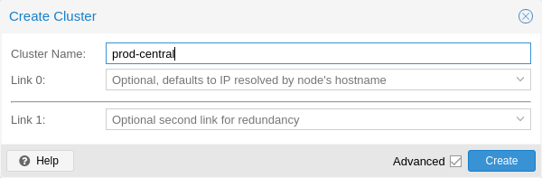
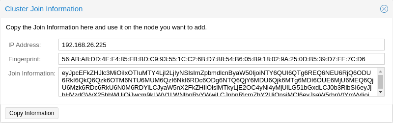
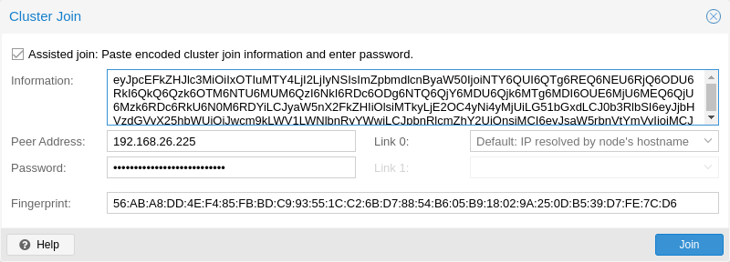

# pvecm(1)

## 名称 <a href="#chapter_pvecm" id="chapter_pvecm"></a>

pvecm \- Proxmox VE Cluster Manager

## 概要 <a href="#_synopsis" id="_synopsis"></a>

<a id="cli_pvecm"></a>


**pvecm** `<COMMAND> [ARGS] [OPTIONS]`

<a id="cli_pvecm_add"></a>


**pvecm add** `<hostname>` `[OPTIONS]`

Adds the current node to an existing cluster.

**`<hostname>`: `<string>`**

Hostname (or IP) of an existing cluster member.

**`--fingerprint` `([A-Fa-f0-9]{2}:){31}[A-Fa-f0-9]{2}`**

Certificate SHA 256 fingerprint.

**`--force` `<boolean>`**

Do not throw error if node already exists.

**`--link[n]` `[address=]<IP> [,priority=<integer>]`**

Address and priority information of a single corosync link. (up to 8 links supported; link0..link7)

**`--nodeid` `<integer> (1 - N)`**

Node id for this node.

**`--use_ssh` `<boolean>`**

Always use SSH to join, even if peer may do it over API.

**`--votes` `<integer> (0 - N)`**

Number of votes for this node

<a id="cli_pvecm_addnode"></a>


**pvecm addnode** `<node>` `[OPTIONS]`

Adds a node to the cluster configuration. This call is for internal use.

**`<node>`: `<string>`**

集群节点名称。

**`--apiversion` `<integer>`**

The JOIN\_API\_VERSION of the new node.

**`--force` `<boolean>`**

Do not throw error if node already exists.

**`--link[n]` `[address=]<IP> [,priority=<integer>]`**

Address and priority information of a single corosync link. (up to 8 links supported; link0..link7)

**`--new_node_ip` `<string>`**

IP Address of node to add. Used as fallback if no links are given.

**`--nodeid` `<integer> (1 - N)`**

Node id for this node.

**`--votes` `<integer> (0 - N)`**

Number of votes for this node

<a id="cli_pvecm_apiver"></a>


**pvecm apiver**

Return the version of the cluster join API available on this node.

<a id="cli_pvecm_create"></a>


**pvecm create** `<clustername>` `[OPTIONS]`

Generate new cluster configuration. If no links given, default to local IP address as link0.

**`<clustername>`: `<string>`**

The name of the cluster.

**`--link[n]` `[address=]<IP> [,priority=<integer>]`**

Address and priority information of a single corosync link. (up to 8 links supported; link0..link7)

**`--nodeid` `<integer> (1 - N)`**

Node id for this node.

**`--token-coefficient` `<integer> (0 - N)` (*default \=* `125`)**

Coefficient used to determine Corosync’s token timeout. See the corosync.conf(5) manual for more details.

**`--votes` `<integer> (1 - N)`**

Number of votes for this node.

<a id="cli_pvecm_delnode"></a>


**pvecm delnode** `<node>`

Removes a node from the cluster configuration.

**`<node>`: `<string>`**

集群节点名称。

<a id="cli_pvecm_expected"></a>


**pvecm expected** `<expected>`

Tells corosync a new value of expected votes.

**`<expected>`: `<integer> (1 - N)`**

Expected votes

<a id="cli_pvecm_help"></a>


**pvecm help** `[OPTIONS]`

获取指定命令的帮助。

**`--extra-args` `<array>`**

显示特定命令的帮助

**`--verbose` `<boolean>`**

详细输出格式。

<a id="cli_pvecm_keygen"></a>


**pvecm keygen** `<filename>`

Generate new cryptographic key for corosync.

**`<filename>`: `<string>`**

Output file name

<a id="cli_pvecm_mtunnel"></a>


**pvecm mtunnel** `[<extra-args>]` `[OPTIONS]`

Used by VM/CT migration \- do not use manually.

**`<extra-args>`: `<array>`**

以数组形式提供的额外参数

**`--get_migration_ip` `<boolean>` (*default \=* `0`)**

return the migration IP, if configured

**`--migration_network` `<string>`**

the migration network used to detect the local migration IP

**`--run-command` `<boolean>`**

Run a command with a tcp socket as standard input. The IP address and port are printed via this command’s stdandard output first, each on a separate line.

<a id="cli_pvecm_nodes"></a>


**pvecm nodes**

Displays the local view of the cluster nodes.

<a id="cli_pvecm_qdevice_remove"></a>


**pvecm qdevice remove**

Remove a configured QDevice

<a id="cli_pvecm_qdevice_setup"></a>


**pvecm qdevice setup** `<address>` `[OPTIONS]`

Setup the use of a QDevice

**`<address>`: `<string>`**

Specifies the network address of an external corosync QDevice

**`--force` `<boolean>`**

Do not throw error on possible dangerous operations.

**`--network` `<string>`**

The network which should be used to connect to the external qdevice

<a id="cli_pvecm_status"></a>


**pvecm status**

Displays the local view of the cluster status.

<a id="cli_pvecm_updatecerts"></a>


**pvecm updatecerts** `[OPTIONS]`

Update node certificates (and generate all needed files/directories).

**`--force` `<boolean>`**

Force generation of new SSL certificate.

**`--silent` `<boolean>`**

Ignore errors (i.e. when cluster has no quorum).

**`--unmerge-known-hosts` `<boolean>` (*default \=* `0`)**

Unmerge legacy SSH known hosts.

## 描述 <a href="#_description" id="_description"></a>

The Proxmox VE cluster manager `pvecm` is a tool to create a group of physical servers. Such a group is called a **cluster**. We use the [Corosync Cluster Engine](http://www.corosync.org) for reliable group communication. There’s no explicit limit for the number of nodes in a cluster. In practice, the actual possible node count may be limited by the host and network performance. Currently (2021), there are reports of clusters (using high-end enterprise hardware) with over 50 nodes in production.

`pvecm` can be used to create a new cluster, join nodes to a cluster, leave the cluster, get status information, and do various other cluster-related tasks. The **P**rox**m**o**x** **C**luster **F**ile **S**ystem (“pmxcfs”) is used to transparently distribute the cluster configuration to all cluster nodes.

Grouping nodes into a cluster has the following advantages:

- Centralized, web-based management
- Multi-master clusters: each node can do all management tasks
- Use of `pmxcfs`, a database-driven file system, for storing configuration files, replicated in real-time on all nodes using `corosync`
- Easy migration of virtual machines and containers between physical hosts
- Fast deployment
- Cluster-wide services like firewall and HA

## 要求 <a href="#pvecm_cluster_requirements" id="pvecm_cluster_requirements"></a>

- All nodes must be able to connect to each other via UDP ports 5405-5412 for corosync to work.
- Date and time must be synchronized.
- An SSH tunnel on TCP port 22 between nodes is required.
- If you are interested in High Availability, you need to have at least three nodes for reliable quorum. All nodes should have the same version.

  
  For smaller 2-node clusters, the [QDevice](#_corosync_external_vote_support) can be used to provide a 3rd vote.
  
- We recommend a dedicated physical NIC for the cluster traffic.

  
  The Proxmox VE cluster communication uses the Corosync protocol. It needs consistent low latency but not a lot of bandwidth. A dedicated 1 Gbit NIC is enough in most situations. It helps to avoid situations where other services can use up all the available bandwidth. Which in turn would increase the latency for the Corosync packets.
  
- Additional links for cluster traffic offers redundancy in case the dedicated network is down.

  
  Corosync supports up to 8 links.
  

  
  To ensure reliable Corosync redundancy, it is essential to have at least another link on a different physical network. This enables Corosync to keep the cluster communication alive should the dedicated network be down.
  

  
  A single link backed by a bond can be problematic in certain failure scenarios, see [Corosync Over Bonds](#pvecm_corosync_over_bonds).
  
- The root password of a cluster node is required for adding nodes.
- Online migration of virtual machines is only supported when nodes have CPUs from the same vendor. It might work otherwise, but this is never guaranteed.

## Preparing Nodes <a href="#_preparing_nodes" id="_preparing_nodes"></a>

First, install Proxmox VE on all nodes. Make sure that each node is installed with the final hostname and IP configuration. Changing the hostname and IP is not possible after cluster creation.

While it’s common to reference all node names and their IPs in `/etc/hosts` (or make their names resolvable through other means), this is not necessary for a cluster to work. It may be useful however, as you can then connect from one node to another via SSH, using the easier to remember node name (see also [Link Address Types](#pvecm_corosync_addresses)). Note that we always recommend referencing nodes by their IP addresses in the cluster configuration.

## Create a Cluster <a href="#pvecm_create_cluster" id="pvecm_create_cluster"></a>

You can either create a cluster on the console (login via `ssh`), or through the API using the Proxmox VE web interface (*Datacenter → Cluster*).


Use a unique name for your cluster. This name cannot be changed later. The cluster name follows the same rules as node names.


### Create via Web GUI <a href="#pvecm_cluster_create_via_gui" id="pvecm_cluster_create_via_gui"></a>

[](https://pve.proxmox.com/pve-docs/images/screenshot/gui-cluster-create.png)

Under *Datacenter → Cluster*, click on **Create Cluster**. Enter the cluster name and select a network connection from the drop-down list to serve as the main cluster network (Link 0). It defaults to the IP resolved via the node’s hostname.

As of Proxmox VE 6.2, up to 8 fallback links can be added to a cluster. To add a redundant link, click the *Add* button and select a link number and IP address from the respective fields. Prior to Proxmox VE 6.2, to add a second link as fallback, you can select the *Advanced* checkbox and choose an additional network interface (Link 1, see also [Corosync Redundancy](#pvecm_redundancy)).


Ensure that the network selected for cluster communication is not used for any high traffic purposes, like network storage or live-migration. While the cluster network itself produces small amounts of data, it is very sensitive to latency. Check out full [cluster network requirements](#pvecm_cluster_network_requirements).


### Create via the Command Line <a href="#pvecm_cluster_create_via_cli" id="pvecm_cluster_create_via_cli"></a>

Login via `ssh` to the first Proxmox VE node and run the following command:

```text
 hp1# pvecm create CLUSTERNAME
```

To check the state of the new cluster use:

```text
 hp1# pvecm status
```

### Multiple Clusters in the Same Network <a href="#_multiple_clusters_in_the_same_network" id="_multiple_clusters_in_the_same_network"></a>

It is possible to create multiple clusters in the same physical or logical network. In this case, each cluster must have a unique name to avoid possible clashes in the cluster communication stack. Furthermore, this helps avoid human confusion by making clusters clearly distinguishable.

While the bandwidth requirement of a corosync cluster is relatively low, the latency of packets and the packets per second (PPS) rate is the limiting factor. Different clusters in the same network can compete with each other for these resources, so it may still make sense to use separate physical network infrastructure for bigger clusters.

## Adding Nodes to the Cluster <a href="#pvecm_join_node_to_cluster" id="pvecm_join_node_to_cluster"></a>


All existing configuration in `/etc/pve` is overwritten when joining a cluster. In particular, a joining node cannot hold any guests, since guest IDs could otherwise conflict, and the node will inherit the cluster’s storage configuration. To join a node with existing guest, as a workaround, you can create a backup of each guest (using `vzdump`) and restore it under a different ID after joining. If the node’s storage layout differs, you will need to re-add the node’s storages, and adapt each storage’s node restriction to reflect on which nodes the storage is actually available.


### Join Node to Cluster via GUI <a href="#_join_node_to_cluster_via_gui" id="_join_node_to_cluster_via_gui"></a>

[](https://pve.proxmox.com/pve-docs/images/screenshot/gui-cluster-join-information.png)

Log in to the web interface on an existing cluster node. Under *Datacenter → Cluster*, click the **Join Information** button at the top. Then, click on the button **Copy Information**. Alternatively, copy the string from the *Information* field manually.

[](https://pve.proxmox.com/pve-docs/images/screenshot/gui-cluster-join.png)

Next, log in to the web interface on the node you want to add. Under *Datacenter → Cluster*, click on **Join Cluster**. Fill in the *Information* field with the *Join Information* text you copied earlier. Most settings required for joining the cluster will be filled out automatically. For security reasons, the cluster password has to be entered manually.


To enter all required data manually, you can disable the *Assisted Join* checkbox.


After clicking the **Join** button, the cluster join process will start immediately. After the node has joined the cluster, its current node certificate will be replaced by one signed from the cluster certificate authority (CA). This means that the current session will stop working after a few seconds. You then might need to force-reload the web interface and log in again with the cluster credentials.

Now your node should be visible under *Datacenter → Cluster*.

### Join Node to Cluster via Command Line <a href="#_join_node_to_cluster_via_command_line" id="_join_node_to_cluster_via_command_line"></a>

Log in to the node you want to join into an existing cluster via `ssh`.

```text
 # pvecm add IP-ADDRESS-CLUSTER
```

For `IP-ADDRESS-CLUSTER`, use the IP or hostname of an existing cluster node. An IP address is recommended (see [Link Address Types](#pvecm_corosync_addresses)).

By default, `pvecm add` authenticates against the existing cluster node’s API, prompting for that node’s `root@pam` password and verifying its SHA-256 certificate fingerprint. SSH password authentication is not required for this default flow, so administrators may keep `PasswordAuthentication no` set in `sshd_config`.

Pass `--use_ssh` to fall back to the legacy SSH-based join, which uses `ssh-copy-id` to merge the existing cluster’s root key onto the new node. That flow does require root SSH login (with password or key) on the existing node.

To check the state of the cluster use:

```text
 # pvecm status
```

**Cluster status after adding 4 nodes**

```text
 # pvecm status
Cluster information
~~~~~~~~~~~~~~~~~~~
Name:             prod-central
Config Version:   3
Transport:        knet
Secure auth:      on

Quorum information
~~~~~~~~~~~~~~~~~~
Date:             Tue Sep 14 11:06:47 2021
Quorum provider:  corosync_votequorum
Nodes:            4
Node ID:          0x00000001
Ring ID:          1.1a8
Quorate:          Yes

Votequorum information
~~~~~~~~~~~~~~~~~~~~~~
Expected votes:   4
Highest expected: 4
Total votes:      4
Quorum:           3
Flags:            Quorate

Membership information
~~~~~~~~~~~~~~~~~~~~~~
    Nodeid      Votes Name
0x00000001          1 192.168.15.91
0x00000002          1 192.168.15.92 (local)
0x00000003          1 192.168.15.93
0x00000004          1 192.168.15.94
```

If you only want a list of all nodes, use:

```text
 # pvecm nodes
```

**List nodes in a cluster**

```text
 # pvecm nodes

Membership information
~~~~~~~~~~~~~~~~~~~~~~
    Nodeid      Votes Name
         1          1 hp1
         2          1 hp2 (local)
         3          1 hp3
         4          1 hp4
```

### Adding Nodes with Separated Cluster Network <a href="#pvecm_adding_nodes_with_separated_cluster_network" id="pvecm_adding_nodes_with_separated_cluster_network"></a>

When adding a node to a cluster with a separated cluster network, you need to use the *link0* parameter to set the nodes address on that network:

Generator: GNU source-highlight by Lorenzo Bettini http://www.lorenzobettini.it http://www.gnu.org/software/src-highlite

```text
# pvecm add IP-ADDRESS-CLUSTER --link0 LOCAL-IP-ADDRESS-LINK0
```

If you want to use the built-in [redundancy](#pvecm_redundancy) of the Kronosnet transport layer, also use the *link1* parameter.

Using the GUI, you can select the correct interface from the corresponding *Link X* fields in the **Cluster Join** dialog.

## Remove a Cluster Node <a href="#pvecm_remove_node" id="pvecm_remove_node"></a>


Read the procedure carefully before proceeding, as it may not be what you want or need.


The following steps explain how to remove a node from a cluster that was also part of a [Ceph](pveceph-1.md#chapter_pveceph) cluster. If Ceph was not installed on your node, you can simply ignore the steps that mention it.


If your configuration contains a QDevice, you will need to remove it before removing the cluster node, as outlined in the FAQ [here](#_adding_deleting_nodes_after_qdevice_setup).


### Prerequisites <a href="#_prerequisites" id="_prerequisites"></a>

- Move all virtual machines and containers away from the node.
- Back up all local data on the node to be deleted.
- Make sure the node to be deleted is not part of any replication job anymore.

  
  If you fail to remove replication jobs from a node before removing the node itself, the replication job will become irremovable. Note that replication automatically switches direction when a replicated VM is migrated. Therefore, migrating a replicated VM from a node that is going to be deleted will set up replication jobs to that node automatically.
  
- Ensure that the remaining Ceph cluster has sufficient storage space and that the OSDs are running (i.e. `up` and `in`). The destruction of any OSD, especially the last one on a node, will trigger a data rebalance in Ceph.

  
  Make sure that there are still enough nodes with OSDs available to satisfy the `size/min_size` parameters configured for the Ceph pools. If there are fewer than `size` (default: 3\) nodes available, data redundancy will be degraded. If there are fewer than `min_size` (default: 2\) nodes available, the I/O of the pools will be blocked until there are enough replicas available. Affected guests may crash if their I/O is blocked.
  
- Ensure that sufficient [monitors](pveceph-1.md#pve_ceph_monitors), [managers](pveceph-1.md#pve_ceph_manager) and, if using CephFS, [metadata servers](pveceph-1.md#pveceph_fs_mds) remain available in the Ceph cluster.

### Remove the Cluster Node <a href="#_remove_the_cluster_node" id="_remove_the_cluster_node"></a>

Before a node can be removed from a cluster, you must ensure that it is no longer part of a Ceph cluster and that no Ceph resources or services are residing on it.

In the following example, the cluster node `node4` will be removed from both the Ceph-, and Proxmox VE corosync-cluster.

```text
node4# pvecm nodes

Membership information
~~~~~~~~~~~~~~~~~~~~~~
    Nodeid      Votes Name
         1          1 node1
         2          1 node2
         3          1 node3
         4          1 node4 (local)
```

1. Start by removing the node from the Ceph cluster, this consists of multiple steps:

   1. Start by [destroying](pveceph-1.md#pve_ceph_osd_destroy) the remaining Ceph OSDs on the node to be deleted, one after another.
   2. Wait until the [CEPH status](pveceph-1.md#pve_ceph_mon_and_ts) reaches `HEALTH_OK` again.
   3. If any exists, destroy the remaining [Ceph metadata servers](pveceph-1.md#pveceph_fs_mds) via the web interface at *Ceph → CephFS* or by running:

      ```text
      node4# pveceph mds destroy node4
      ```
   4. [Destroy the remaining Ceph monitor.](pveceph-1.md#pveceph_destroy_mon)
   5. [Destroy the remaining Ceph manager.](pveceph-1.md#pveceph_destroy_mgr)
   6. Finally, remove the now empty Ceph bucket (Proxmox VE node to be removed) from the CRUSH hierarchy.

      ```text
      node4# ceph osd crush remove node4
      ```
2. Now, power off `node4` and ensure that it will not power on again in this network with its current configuration.

   
   As mentioned above, it is critical to power off the node **before** removal, and make sure that it will **not** power on again (in the existing cluster network) with its current configuration. If you power on the node as it is, the cluster could end up broken, and it could be difficult to restore it to a functioning state.
   
3. Log into one of the remaining cluster nodes and remove the node `node4` from the cluster.

   ```text
   node1# pvecm delnode node4
   ```

   
   It is possible that you will receive an error message stating `could not kill node (error = cs_err_not_exist)`. This does not signify an actual failure in the deletion of the node, but rather a failure in Corosync trying to kill an offline node. Thus, it can be safely ignored.
   
4. Verify the node was successfully removed from the cluster

   ```text
   node1# pvecm nodes

   Membership information
   ~~~~~~~~~~~~~~~~~~~~~~
       Nodeid      Votes Name
            1          1 node1 (local)
            2          1 node2
            3          1 node3
   ```

### Cleanup Steps After Node Removal <a href="#_cleanup_steps_after_node_removal" id="_cleanup_steps_after_node_removal"></a>

- The configuration files of the removed node will still reside in */etc/pve/nodes/node4* in the cluster filesystem. Recover any configuration you still need and remove the directory afterwards.
- The SSH fingerprint of the removed node will still reside in the *known\_hosts* file on the other nodes. If you receive an SSH error after rejoining a node with the same IP or hostname, run `pvecm
    updatecerts` once on the re-added node to update its fingerprint cluster wide.
- Existing [high availability rules](ha-manager-1.md#ha_manager_rules) will still reference the deleted node, therefore remove the node from any existing rules.
- The public key of the removed node will still be listed in */etc/pve/priv/authorized\_keys* and should be deleted if it is no longer needed.

**Rejoin the same node again:**

If you want the same server to join the same cluster again, you have to:

- Reinstall Proxmox VE on the server,
- then [rejoin the node to the cluster](#pvecm_join_node_to_cluster)

## Separate a Node Without Reinstalling <a href="#pvecm_separate_node_without_reinstall" id="pvecm_separate_node_without_reinstall"></a>


This is **not** the recommended method, proceed with caution. Use the previous method if you’re unsure.


You can also separate a node from a cluster without reinstalling it from scratch. But after removing the node from the cluster, it will still have access to any shared storage. This must be resolved before you start removing the node from the cluster. A Proxmox VE cluster cannot share the exact same storage with another cluster, as storage locking doesn’t work over the cluster boundary. Furthermore, it may also lead to VMID conflicts.

It’s suggested that you create a new storage, where only the node which you want to separate has access. This can be a new export on your NFS or a new Ceph pool, to name a few examples. It’s just important that the exact same storage does not get accessed by multiple clusters. After setting up this storage, move all data and VMs from the node to it. Then you are ready to separate the node from the cluster.


If your configuration contains a QDevice, you will need to remove it before removing the cluster node, as outlined in the FAQ [here](#_adding_deleting_nodes_after_qdevice_setup).



Ensure that all shared resources are cleanly separated! Otherwise you will run into conflicts and problems.


First, stop the corosync and pve-cluster services on the node:

Generator: GNU source-highlight by Lorenzo Bettini http://www.lorenzobettini.it http://www.gnu.org/software/src-highlite

```text
systemctl stop pve-cluster
systemctl stop corosync
```

Start the cluster file system again in local mode:

Generator: GNU source-highlight by Lorenzo Bettini http://www.lorenzobettini.it http://www.gnu.org/software/src-highlite

```text
pmxcfs -l
```

Delete the corosync configuration files:

Generator: GNU source-highlight by Lorenzo Bettini http://www.lorenzobettini.it http://www.gnu.org/software/src-highlite

```text
rm /etc/pve/corosync.conf
rm -r /etc/corosync/*
```

You can now start the file system again as a normal service:

Generator: GNU source-highlight by Lorenzo Bettini http://www.lorenzobettini.it http://www.gnu.org/software/src-highlite

```text
killall pmxcfs
systemctl start pve-cluster
```

The node is now separated from the cluster. You can delete it from any remaining node of the cluster with:

Generator: GNU source-highlight by Lorenzo Bettini http://www.lorenzobettini.it http://www.gnu.org/software/src-highlite

```text
pvecm delnode oldnode
```

If the command fails due to a loss of quorum in the remaining node, you can set the expected votes to 1 as a workaround:

Generator: GNU source-highlight by Lorenzo Bettini http://www.lorenzobettini.it http://www.gnu.org/software/src-highlite

```text
pvecm expected 1
```

And then repeat the *pvecm delnode* command.

Now switch back to the separated node and delete all the remaining cluster files on it. This ensures that the node can be added to another cluster again without problems.

Generator: GNU source-highlight by Lorenzo Bettini http://www.lorenzobettini.it http://www.gnu.org/software/src-highlite

```text
rm /var/lib/corosync/*
```

As the configuration files from the other nodes are still in the cluster file system, you may want to clean those up too. After making absolutely sure that you have the correct node name, you can simply remove the entire directory recursively from */etc/pve/nodes/NODENAME*.


The node’s SSH keys will remain in the *authorized\_key* file. This means that the nodes can still connect to each other with public key authentication. You should fix this by removing the respective keys from the */etc/pve/priv/authorized\_keys* file.


## Quorum <a href="#_quorum" id="_quorum"></a>

Proxmox VE use a quorum-based technique to provide a consistent state among all cluster nodes.

A quorum is the minimum number of votes that a distributed transaction has to obtain in order to be allowed to perform an operation in a distributed system.

*Quorum (distributed computing)*  
— from Wikipedia

In case of network partitioning, state changes requires that a majority of nodes are online. The cluster switches to read-only mode if it loses quorum.


Proxmox VE assigns a single vote to each node by default.


## Cluster Network <a href="#pvecm_cluster_network" id="pvecm_cluster_network"></a>

The cluster network is the core of a cluster. All messages sent over it have to be delivered reliably to all nodes in their respective order. In Proxmox VE this part is done by corosync, an implementation of a high performance, low overhead, high availability development toolkit. It serves our decentralized configuration file system (`pmxcfs`).

### Network Requirements <a href="#pvecm_cluster_network_requirements" id="pvecm_cluster_network_requirements"></a>

The Proxmox VE cluster stack requires a reliable network with latencies under 5 milliseconds (LAN performance) between all nodes to operate stably. While on setups with a small node count a network with higher latencies *may* work, this is not guaranteed and gets rather unlikely with more than three nodes and latencies above around 10 ms.

The network should not be used heavily by other members, as while corosync does not use much bandwidth, it is sensitive to latency jitters; ideally corosync runs on its own physically separated network. Especially do not use a shared network for corosync and storage (except as a potential low-priority fallback in a [redundant](#pvecm_redundancy) configuration).

Before setting up a cluster, it is good practice to check if the network is fit for that purpose. To ensure that the nodes can connect to each other on the cluster network, you can test the connectivity between them with the `ping` tool.

If the Proxmox VE firewall is enabled, ACCEPT rules for corosync will automatically be generated \- no manual action is required.


Corosync used Multicast before version 3.0 (introduced in Proxmox VE 6.0). Modern versions rely on [Kronosnet](https://kronosnet.org/) for cluster communication, which, for now, only supports regular UDP unicast.



You can still enable Multicast or legacy unicast by setting your transport to `udp` or `udpu` in your [corosync.conf](#pvecm_edit_corosync_conf), but keep in mind that this will disable all cryptography and redundancy support. This is therefore not recommended.


### Corosync Over Bonds <a href="#pvecm_corosync_over_bonds" id="pvecm_corosync_over_bonds"></a>

#### Recommendations <a href="#_recommendations" id="_recommendations"></a>

We recommend at least one dedicated physical NIC for the primary Corosync link, see [Requirements](#pvecm_cluster_requirements). Bonds may be used as additional links for increased redundancy. The following caveats apply **whenever a bond is used for Corosync traffic**:

- Bond mode **active-backup** may not provide the expected redundancy in certain failure scenarios, see below for details.
- We **advise against** using bond modes **balance-rr**, **balance-xor**, **balance-tlb**, or **balance-alb** for Corosync traffic. They are known to be problematic in certain failure scenarios, see below for details.
- **IEEE 802.3ad (LACP)**: If LACP bonds are used for corosync traffic, we strongly recommend setting `bond-lacp-rate fast` on the **Proxmox VE** node and the **switch**! With the default setting `bond-lacp-rate slow`, this mode is known to be problematic in certain failure scenarios, see below for details.

#### Background <a href="#_background" id="_background"></a>

Using a bond as a Corosync link can be problematic in certain failure scenarios. Consider the failure scenario where one of the bonded interfaces fails and stops transmitting packets, but its link state stays up, and there are no other Corosync links available. In this scenario, some bond modes may cause a state of asymmetric connectivity where cluster nodes can only communicate with different subsets of other nodes. Affected are bond modes that provide load balancing, as these modes may still try to send out a subset of packets via the failed interface. In case of asymmetric connectivity, Corosync may not be able to form a stable quorum in the cluster. If this state persists and HA is enabled, even nodes whose bond does not have any issues may fence themselves. In the worst case, the whole cluster may fence itself.

The bond mode **active-backup** will **not** cause asymmetric connectivity in the failure scenario described above. However, the bond with the interface failure may not switch over to the backup link. The node may lose connection to the cluster and, if HA is enabled, fence itself.

Bond modes **balance-rr**, **balance-xor**, **balance\_tlb**, or **balance-alb** may cause asymmetric connectivity in the failure scenario above, which can lead to unexpected fencing if HA is enabled.

Bond mode **IEEE 802.3ad (LACP)** can cause asymmetric connectivity in the failure scenario above, but it can recover from this state, as each side of the bond (Proxmox VE node and switch) can stop using a bonded interface if it has not received three LACPDUs in a row on it. However, with default settings, LACPDUs are only sent every 30 seconds, yielding a failover time of 90 seconds. This is too long, as nodes with HA resources will fence themselves already after roughly one minute without a stable quorum. If LACP bonds are used for corosync traffic, we recommend setting `bond-lacp-rate fast` on the **Proxmox VE** node and the **switch**! Setting this option on one side requests the other side to send an LACPDU every second. Setting this option on both sides can reduce the failover time in the scenario above to 3 seconds and thus prevent fencing.

### Separate Cluster Network <a href="#_separate_cluster_network" id="_separate_cluster_network"></a>

When creating a cluster without any parameters, the corosync cluster network is generally shared with the web interface and the VMs' network. Depending on your setup, even storage traffic may get sent over the same network. It’s recommended to change that, as corosync is a time-critical, real-time application.

#### Setting Up a New Network <a href="#_setting_up_a_new_network" id="_setting_up_a_new_network"></a>

First, you have to set up a new network interface. It should be on a physically separate network. Ensure that your network fulfills the [cluster network requirements](#pvecm_cluster_network_requirements).

#### Separate On Cluster Creation <a href="#_separate_on_cluster_creation" id="_separate_on_cluster_creation"></a>

This is possible via the *linkX* parameters of the *pvecm create* command, used for creating a new cluster.

If you have set up an additional NIC with a static address on 10.10.10.1/25, and want to send and receive all cluster communication over this interface, you would execute:

Generator: GNU source-highlight by Lorenzo Bettini http://www.lorenzobettini.it http://www.gnu.org/software/src-highlite

```text
pvecm create test --link0 10.10.10.1
```

To check if everything is working properly, execute:

Generator: GNU source-highlight by Lorenzo Bettini http://www.lorenzobettini.it http://www.gnu.org/software/src-highlite

```text
systemctl status corosync
```

Afterwards, proceed as described above to [add nodes with a separated cluster network](#pvecm_adding_nodes_with_separated_cluster_network).

#### Separate After Cluster Creation <a href="#pvecm_separate_cluster_net_after_creation" id="pvecm_separate_cluster_net_after_creation"></a>

You can do this if you have already created a cluster and want to switch its communication to another network, without rebuilding the whole cluster. This change may lead to short periods of quorum loss in the cluster, as nodes have to restart corosync and come up one after the other on the new network.

Check how to [edit the corosync.conf file](#pvecm_edit_corosync_conf) first. Then, open it and you should see a file similar to:

```text
logging {
  debug: off
  to_syslog: yes
}

nodelist {

  node {
    name: due
    nodeid: 2
    quorum_votes: 1
    ring0_addr: due
  }

  node {
    name: tre
    nodeid: 3
    quorum_votes: 1
    ring0_addr: tre
  }

  node {
    name: uno
    nodeid: 1
    quorum_votes: 1
    ring0_addr: uno
  }

}

quorum {
  provider: corosync_votequorum
}

totem {
  cluster_name: testcluster
  config_version: 3
  ip_version: ipv4-6
  secauth: on
  version: 2
  interface {
    linknumber: 0
  }

}
```


`ringX_addr` actually specifies a corosync **link address**. The name "ring" is a remnant of older corosync versions that is kept for backwards compatibility.


The first thing you want to do is add the *name* properties in the node entries, if you do not see them already. Those **must** match the node name.

Then replace all addresses from the *ring0\_addr* properties of all nodes with the new addresses. You may use plain IP addresses or hostnames here. If you use hostnames, ensure that they are resolvable from all nodes (see also [Link Address Types](#pvecm_corosync_addresses)).

In this example, we want to switch cluster communication to the 10.10.10.0/25 network, so we change the *ring0\_addr* of each node respectively.


The exact same procedure can be used to change other *ringX\_addr* values as well. However, we recommend only changing one link address at a time, so that it’s easier to recover if something goes wrong.


After we increase the *config\_version* property, the new configuration file should look like:

```text
logging {
  debug: off
  to_syslog: yes
}

nodelist {

  node {
    name: due
    nodeid: 2
    quorum_votes: 1
    ring0_addr: 10.10.10.2
  }

  node {
    name: tre
    nodeid: 3
    quorum_votes: 1
    ring0_addr: 10.10.10.3
  }

  node {
    name: uno
    nodeid: 1
    quorum_votes: 1
    ring0_addr: 10.10.10.1
  }

}

quorum {
  provider: corosync_votequorum
}

totem {
  cluster_name: testcluster
  config_version: 4
  ip_version: ipv4-6
  secauth: on
  version: 2
  interface {
    linknumber: 0
  }

}
```

Then, after a final check to see that all changed information is correct, we save it and once again follow the [edit corosync.conf file](#pvecm_edit_corosync_conf) section to bring it into effect.

The changes will be applied live, so restarting corosync is not strictly necessary. If you changed other settings as well, or notice corosync complaining, you can optionally trigger a restart.

On a single node execute:

Generator: GNU source-highlight by Lorenzo Bettini http://www.lorenzobettini.it http://www.gnu.org/software/src-highlite

```text
systemctl restart corosync
```

Now check if everything is okay:

Generator: GNU source-highlight by Lorenzo Bettini http://www.lorenzobettini.it http://www.gnu.org/software/src-highlite

```text
systemctl status corosync
```

If corosync begins to work again, restart it on all other nodes too. They will then join the cluster membership one by one on the new network.

### Corosync Addresses <a href="#pvecm_corosync_addresses" id="pvecm_corosync_addresses"></a>

A corosync link address (for backwards compatibility denoted by *ringX\_addr* in `corosync.conf`) can be specified in two ways:

- **IPv4/v6 addresses** can be used directly. They are recommended, since they are static and usually not changed carelessly.
- **Hostnames** will be resolved using `getaddrinfo`, which means that by default, IPv6 addresses will be used first, if available (see also `man gai.conf`). Keep this in mind, especially when upgrading an existing cluster to IPv6.


Hostnames should be used with care, since the addresses they resolve to can be changed without touching corosync or the node it runs on \- which may lead to a situation where an address is changed without thinking about implications for corosync.


A separate, static hostname specifically for corosync is recommended, if hostnames are preferred. Also, make sure that every node in the cluster can resolve all hostnames correctly.

Since Proxmox VE 5.1, while supported, hostnames will be resolved at the time of entry. Only the resolved IP is saved to the configuration.

Nodes that joined the cluster on earlier versions likely still use their unresolved hostname in `corosync.conf`. It might be a good idea to replace them with IPs or a separate hostname, as mentioned above.

## Corosync Redundancy <a href="#pvecm_redundancy" id="pvecm_redundancy"></a>

Corosync supports redundant networking via its integrated Kronosnet layer by default (it is not supported on the legacy udp/udpu transports). It can be enabled by specifying more than one link address, either via the *--linkX* parameters of `pvecm`, in the GUI as **Link 1** (while creating a cluster or adding a new node) or by specifying more than one *ringX\_addr* in `corosync.conf`.


To provide useful failover, every link should be on its own physical network connection.


The following examples assume that each cluster node has one static address in 10.10.10.0/25 and one static address in 10.20.20.0/25 configured.

Links are used according to a priority setting. You can configure this priority by setting *knet\_link\_priority* in the corresponding interface section in `corosync.conf`, or, preferably, using the *priority* parameter when creating your cluster with `pvecm`:

```text
 # pvecm create CLUSTERNAME --link0 10.10.10.1,priority=15 --link1 10.20.20.1,priority=20
```

This would cause *link1* to be used first, since it has the higher priority.

If no priorities are configured manually (or two links have the same priority), links will be used in order of their number, with the lower number having higher priority.

Even if all links are working, only the one with the highest priority will see corosync traffic. Link priorities cannot be mixed, meaning that links with different priorities will not be able to communicate with each other.

Since lower priority links will not see traffic unless all higher priorities have failed, it becomes a useful strategy to specify networks used for other tasks (VMs, storage, etc.) as low-priority links. If worst comes to worst, a higher latency or more congested connection might be better than no connection at all.

### Adding Redundant Links To An Existing Cluster <a href="#_adding_redundant_links_to_an_existing_cluster" id="_adding_redundant_links_to_an_existing_cluster"></a>

To add a new link to a running configuration, first check how to [edit the corosync.conf file](#pvecm_edit_corosync_conf).

Then, add a new *ringX\_addr* to every node in the `nodelist` section. Make sure that your *X* is the same for every node you add it to, and that it is unique for each node.

Lastly, add a new *interface*, as shown below, to your `totem` section, replacing *X* with the link number chosen above.

Assuming you added a link with number 1, the new configuration file could look like this:

```text
logging {
  debug: off
  to_syslog: yes
}

nodelist {

  node {
    name: due
    nodeid: 2
    quorum_votes: 1
    ring0_addr: 10.10.10.2
    ring1_addr: 10.20.20.2
  }

  node {
    name: tre
    nodeid: 3
    quorum_votes: 1
    ring0_addr: 10.10.10.3
    ring1_addr: 10.20.20.3
  }

  node {
    name: uno
    nodeid: 1
    quorum_votes: 1
    ring0_addr: 10.10.10.1
    ring1_addr: 10.20.20.1
  }

}

quorum {
  provider: corosync_votequorum
}

totem {
  cluster_name: testcluster
  config_version: 4
  ip_version: ipv4-6
  secauth: on
  version: 2
  interface {
    linknumber: 0
  }
  interface {
    linknumber: 1
  }
}
```

The new link will be enabled as soon as you follow the last steps to [edit the corosync.conf file](#pvecm_edit_corosync_conf). A restart should not be necessary. You can check that corosync loaded the new link using:

```text
journalctl -b -u corosync
```

It might be a good idea to test the new link by temporarily disconnecting the old link on one node and making sure that its status remains online while disconnected:

```text
pvecm status
```

If you see a healthy cluster state, it means that your new link is being used.

## Role of SSH in Proxmox VE Clusters <a href="#_role_of_ssh_in_proxmox_ve_clusters" id="_role_of_ssh_in_proxmox_ve_clusters"></a>

Proxmox VE utilizes SSH tunnels for various features.

- Proxying console/shell sessions (node and guests)

  When using the shell for node B while being connected to node A, connects to a terminal proxy on node A, which is in turn connected to the login shell on node B via a non-interactive SSH tunnel.
- VM and CT memory and local-storage migration in *secure* mode.

  During the migration, one or more SSH tunnel(s) are established between the source and target nodes, in order to exchange migration information and transfer memory and disk contents.
- Storage replication

### SSH setup <a href="#_ssh_setup" id="_ssh_setup"></a>

On Proxmox VE systems, the following changes are made to the SSH configuration/setup:

- the `root` user’s SSH client config gets setup to prefer `AES` over `ChaCha20`
- the `root` user’s `authorized_keys` file gets linked to `/etc/pve/priv/authorized_keys`, merging all authorized keys within a cluster
- `sshd` is configured to allow logging in as root with a password


Older systems might also have `/etc/ssh/ssh_known_hosts` set up as symlink pointing to `/etc/pve/priv/known_hosts`, containing a merged version of all node host keys. This system was replaced with explicit host key pinning in `pve-cluster <<INSERT VERSION>>`, the symlink can be deconfigured if still in place by running `pvecm updatecerts --unmerge-known-hosts`.


### Pitfalls due to automatic execution of `.bashrc` and siblings <a href="#_pitfalls_due_to_automatic_execution_of_span_class_monospaced_bashrc_span_and_siblings" id="_pitfalls_due_to_automatic_execution_of_span_class_monospaced_bashrc_span_and_siblings"></a>

In case you have a custom `.bashrc`, or similar files that get executed on login by the configured shell, `ssh` will automatically run it once the session is established successfully. This can cause some unexpected behavior, as those commands may be executed with root permissions on any of the operations described above. This can cause possible problematic side-effects!

In order to avoid such complications, it’s recommended to add a check in `/root/.bashrc` to make sure the session is interactive, and only then run `.bashrc` commands.

You can add this snippet at the beginning of your `.bashrc` file:

```text
# Early exit if not running interactively to avoid side-effects!
case $- in
    *i*) ;;
      *) return;;
esac
```

## Corosync External Vote Support <a href="#_corosync_external_vote_support" id="_corosync_external_vote_support"></a>

This section describes a way to deploy an external voter in a Proxmox VE cluster. When configured, the cluster can sustain more node failures without violating safety properties of the cluster communication.

For this to work, there are two services involved:

- A QDevice daemon which runs on each Proxmox VE node
- An external vote daemon which runs on an independent server

As a result, you can achieve higher availability, even in smaller setups (for example 2\+1 nodes).

### QDevice Technical Overview <a href="#_qdevice_technical_overview" id="_qdevice_technical_overview"></a>

The Corosync Quorum Device (QDevice) is a daemon which runs on each cluster node. It provides a configured number of votes to the cluster’s quorum subsystem, based on an externally running third-party arbitrator’s decision. Its primary use is to allow a cluster to sustain more node failures than standard quorum rules allow. This can be done safely as the external device can see all nodes and thus choose only one set of nodes to give its vote. This will only be done if said set of nodes can have quorum (again) after receiving the third-party vote.

Currently, only *QDevice Net* is supported as a third-party arbitrator. This is a daemon which provides a vote to a cluster partition, if it can reach the partition members over the network. It will only give votes to one partition of a cluster at any time. It’s designed to support multiple clusters and is almost configuration and state free. New clusters are handled dynamically and no configuration file is needed on the host running a QDevice.

The only requirements for the external host are that it needs network access to the cluster and to have a corosync-qnetd package available. We provide a package for Debian based hosts, and other Linux distributions should also have a package available through their respective package manager.


Unlike corosync itself, a QDevice connects to the cluster over TCP/IP. The daemon can also run outside the LAN of the cluster and isn’t limited to the low latencies requirements of corosync.


### Supported Setups <a href="#_supported_setups" id="_supported_setups"></a>

We support QDevices for clusters with an even number of nodes and recommend it for 2 node clusters, if they should provide higher availability. For clusters with an odd node count, we currently discourage the use of QDevices. The reason for this is the difference in the votes which the QDevice provides for each cluster type. Even numbered clusters get a single additional vote, which only increases availability, because if the QDevice itself fails, you are in the same position as with no QDevice at all.

On the other hand, with an odd numbered cluster size, the QDevice provides *(N-1)* votes — where *N* corresponds to the cluster node count. This alternative behavior makes sense; if it had only one additional vote, the cluster could get into a split-brain situation. This algorithm allows for all nodes but one (and naturally the QDevice itself) to fail. However, there are two drawbacks to this:

- If the QNet daemon itself fails, no other node may fail or the cluster immediately loses quorum. For example, in a cluster with 15 nodes, 7 could fail before the cluster becomes inquorate. But, if a QDevice is configured here and it itself fails, **no single node** of the 15 may fail. The QDevice acts almost as a single point of failure in this case.
- The fact that all but one node plus QDevice may fail sounds promising at first, but this may result in a mass recovery of HA services, which could overload the single remaining node. Furthermore, a Ceph server will stop providing services if only *((N-1)/2)* nodes or less remain online.

If you understand the drawbacks and implications, you can decide yourself if you want to use this technology in an odd numbered cluster setup.

### QDevice-Net Setup <a href="#_qdevice_net_setup" id="_qdevice_net_setup"></a>

We recommend running any daemon which provides votes to corosync-qdevice as an unprivileged user. Proxmox VE and Debian provide a package which is already configured to do so. The traffic between the daemon and the cluster must be encrypted to ensure a safe and secure integration of the QDevice in Proxmox VE.

First, install the *corosync-qnetd* package on your external server

```text
external# apt install corosync-qnetd
```

and the *corosync-qdevice* package on all cluster nodes

```text
pve# apt install corosync-qdevice
```

After doing this, ensure that all the nodes in the cluster are online.

You can now set up your QDevice by running the following command on one of the Proxmox VE nodes:

```text
pve# pvecm qdevice setup <QDEVICE-IP>
```

The SSH key from the cluster will be automatically copied to the QDevice.


Make sure to setup key-based access for the root user on your external server, or temporarily allow root login with password during the setup phase. If you receive an error such as *Host key verification failed.* at this stage, running `pvecm updatecerts` could fix the issue.


After all the steps have successfully completed, you will see "Done". You can verify that the QDevice has been set up with:

```text
pve# pvecm status

...

Votequorum information
~~~~~~~~~~~~~~~~~~~~~
Expected votes:   3
Highest expected: 3
Total votes:      3
Quorum:           2
Flags:            Quorate Qdevice

Membership information
~~~~~~~~~~~~~~~~~~~~~~
    Nodeid      Votes    Qdevice Name
    0x00000001      1    A,V,NMW 192.168.22.180 (local)
    0x00000002      1    A,V,NMW 192.168.22.181
    0x00000000      1            Qdevice
```

#### QDevice Status Flags <a href="#pvecm_qdevice_status_flags" id="pvecm_qdevice_status_flags"></a>

The status output of the QDevice, as seen above, will usually contain three columns:

- `A` / `NA`: Alive or Not Alive. Indicates if the communication to the external `corosync-qnetd` daemon works.
- `V` / `NV`: If the QDevice will cast a vote for the node. In a split-brain situation, where the corosync connection between the nodes is down, but they both can still communicate with the external `corosync-qnetd` daemon, only one node will get the vote.
- `MW` / `NMW`: Master wins (`MV`) or not (`NMW`). Default is `NMW`, see   
  \[`votequorum_qdevice_master_wins` manual page [https://manpages.debian.org/stable/libvotequorum-dev/votequorum\_qdevice\_master\_wins.3.en.html](https://manpages.debian.org/stable/libvotequorum-dev/votequorum_qdevice_master_wins.3.en.html)\]  
  .
- `NR`: QDevice is not registered.


If your QDevice is listed as `Not Alive` (`NA` in the output above), ensure that port `5403` (the default port of the qnetd server) of your external server is reachable via TCP/IP!


### Frequently Asked Questions <a href="#_frequently_asked_questions" id="_frequently_asked_questions"></a>

#### Tie Breaking <a href="#_tie_breaking" id="_tie_breaking"></a>

In case of a tie, where two same-sized cluster partitions cannot see each other but can see the QDevice, the QDevice chooses the partition which has the lowest node id and provides a vote to it. This behavior can be tuned with the configuration option `tie_breaker` (see `man corosync-qdevice` for more information) and requires a restart of `corosync-qdevice.service` on all nodes.

#### Possible Negative Implications <a href="#_possible_negative_implications" id="_possible_negative_implications"></a>

For clusters with an even node count, there are no negative implications when using a QDevice. If it fails to work, it is the same as not having a QDevice at all.

#### Adding/Deleting Nodes After QDevice Setup <a href="#_adding_deleting_nodes_after_qdevice_setup" id="_adding_deleting_nodes_after_qdevice_setup"></a>

If you want to add a new node or remove an existing one from a cluster with a QDevice setup, you need to remove the QDevice first. After that, you can add or remove nodes normally. Once you have a cluster with an even node count again, you can set up the QDevice again as described previously.

#### Removing the QDevice <a href="#_removing_the_qdevice" id="_removing_the_qdevice"></a>

If you used the official `pvecm` tool to add the QDevice, you can remove it by running:

```text
pve# pvecm qdevice remove
```

## Corosync Configuration <a href="#_corosync_configuration" id="_corosync_configuration"></a>

The `/etc/pve/corosync.conf` file plays a central role in a Proxmox VE cluster. It controls the cluster membership and its network. For further information about it, check the corosync.conf man page:

Generator: GNU source-highlight by Lorenzo Bettini http://www.lorenzobettini.it http://www.gnu.org/software/src-highlite

```text
man corosync.conf
```

For node membership, you should always use the `pvecm` tool provided by Proxmox VE. You may have to edit the configuration file manually for other changes. Here are a few best practice tips for doing this.

### Edit corosync.conf <a href="#pvecm_edit_corosync_conf" id="pvecm_edit_corosync_conf"></a>

Editing the corosync.conf file is not always very straightforward. There are two on each cluster node, one in `/etc/pve/corosync.conf` and the other in `/etc/corosync/corosync.conf`. Editing the one in our cluster file system will propagate the changes to the local one, but not vice versa.

The configuration will get updated automatically, as soon as the file changes. This means that changes which can be integrated in a running corosync will take effect immediately. Thus, you should always make a copy and edit that instead, to avoid triggering unintended changes when saving the file while editing.

Generator: GNU source-highlight by Lorenzo Bettini http://www.lorenzobettini.it http://www.gnu.org/software/src-highlite

```text
cp /etc/pve/corosync.conf /etc/pve/corosync.conf.new
```

Then, open the config file with your favorite editor, such as `nano` or `vim.tiny`, which come pre-installed on every Proxmox VE node.


Always increment the *config\_version* number after configuration changes; omitting this can lead to problems.


After making the necessary changes, create another copy of the current working configuration file. This serves as a backup if the new configuration fails to apply or causes other issues.

Generator: GNU source-highlight by Lorenzo Bettini http://www.lorenzobettini.it http://www.gnu.org/software/src-highlite

```text
cp /etc/pve/corosync.conf /etc/pve/corosync.conf.bak
```

Then replace the old configuration file with the new one:

Generator: GNU source-highlight by Lorenzo Bettini http://www.lorenzobettini.it http://www.gnu.org/software/src-highlite

```text
mv /etc/pve/corosync.conf.new /etc/pve/corosync.conf
```

You can check if the changes could be applied automatically, using the following commands:

Generator: GNU source-highlight by Lorenzo Bettini http://www.lorenzobettini.it http://www.gnu.org/software/src-highlite

```text
systemctl status corosync
journalctl -b -u corosync
```

If the changes could not be applied automatically, you may have to restart the corosync service via:

Generator: GNU source-highlight by Lorenzo Bettini http://www.lorenzobettini.it http://www.gnu.org/software/src-highlite

```text
systemctl restart corosync
```

On errors, check the troubleshooting section below.

### Changing the Token Coefficient <a href="#pvecm_changing_token_coefficient" id="pvecm_changing_token_coefficient"></a>

The token coefficient can be configured in the `totem` section in `/etc/pve/corosync.conf`. If the token coefficient is not explicitly set, it defaults to 650 milliseconds. Since Proxmox VE 9.2, new clusters are created with a lower token coefficient of 125 milliseconds explicitly set in `/etc/pve/corosync.conf`. This reduces the time needed for reestablishing a new cluster membership after a node failure.

corosync uses the token coefficient to calculate several timeouts in relation to the cluster size   
\[`token_coefficient` in the corosync manual page [https://manpages.debian.org/stable/corosync/corosync.conf.5.en.html#token\_coefficient](https://manpages.debian.org/stable/corosync/corosync.conf.5.en.html#token_coefficient)\]  
, most importantly the token timeout and consensus timeout. corosync implements a token-passing protocol. The token timeout specifies how long a node waits for the token until it declares the token to be lost   
\[`token` in the corosync manual page [https://manpages.debian.org/stable/corosync/corosync.conf.5.en.html#token](https://manpages.debian.org/stable/corosync/corosync.conf.5.en.html#token)\]  
. The consensus timeout   
\[`consensus` in the corosync manual page [https://manpages.debian.org/stable/corosync/corosync.conf.5.en.html#consensus](https://manpages.debian.org/stable/corosync/corosync.conf.5.en.html#consensus)\]  
 specifies the time nodes wait for a consensus on a new cluster membership. The sum of token and consensus timeouts defines the minimum time needed to reestablish a new cluster membership after a node goes offline.

Keeping the sum of token and consensus timeouts below 30 seconds reduces the time needed for reestablishing a new cluster membership after a node failure. When HA is enabled, it is especially important that this time stays below 45 seconds to ensure that a new cluster membership is formed before the [watchdog timeout](ha-manager-1.md#ha_manager_crm) of 60 seconds expires, which would trigger a node fence. A safety margin below this 45 second limit is advisable so that transient timing variations do not push the cluster past the watchdog threshold. The recommended mechanism for lowering the token and consensus timeouts is lowering the token coefficient as explained below.

You can check the current token and consensus timeouts (in milliseconds) with the following command:

Generator: GNU source-highlight by Lorenzo Bettini http://www.lorenzobettini.it http://www.gnu.org/software/src-highlite

```text
corosync-cmapctl | grep -Ew 'runtime.config.totem.token|runtime.config.totem.consensus'
```

For example:

Generator: GNU source-highlight by Lorenzo Bettini http://www.lorenzobettini.it http://www.gnu.org/software/src-highlite

```text
runtime.config.totem.consensus (u32) = 5940
runtime.config.totem.token (u32) = 4950
```

The sum of these two values (10.89 seconds in the example) defines the minimum time needed to reestablish a new cluster membership after a node goes offline. Lowering the token coefficient is

- a suggested optimization if this value exceeds 30 seconds,
- recommended if it exceeds 40 seconds,
- strongly recommended if it exceeds 45 seconds.

To lower the token coefficient, first make sure your setup adheres [to the network requirements](#pvecm_cluster_network_requirements), especially with regards to latency. Then:

- If the `token_coefficient` is not yet set explicitly to 125 milliseconds in corosync.conf, [edit corosync.conf](#pvecm_edit_corosync_conf) and add `token_coefficient: 125` to the `totem` section. Do not forget to [increase the `config_version`](#pvecm_edit_corosync_conf).
- Otherwise, if 125 milliseconds is not low enough to keep the timeouts within the limits above, select a `token_coefficient` with which the token and consensus timeouts sum up to at most 45 seconds. By default, corosync computes the token and consensus timeouts (in milliseconds) according to the following formula:

  ```text
  token = 3000 + (number_of_nodes - 2) * token_coefficient
  consensus = 1.2 * token
  ```

  [Edit corosync.conf](#pvecm_edit_corosync_conf) and set an appropriate `token_coefficient` option in the `totem` section. Do not forget to [increase the `config_version`](#pvecm_edit_corosync_conf). Test your setup thoroughly for stability!

After adjusting the `token_coefficient` in `corosync.conf`, recent corosync versions will automatically adopt the new value for the cluster. For corosync versions below `3.1.10-pve1`, corosync needs to be restarted on all nodes for the change to take effect.

### Troubleshooting <a href="#_troubleshooting" id="_troubleshooting"></a>

#### Issue: *quorum.expected\_votes must be configured* <a href="#_issue_em_quorum_expected_votes_must_be_configured_em" id="_issue_em_quorum_expected_votes_must_be_configured_em"></a>

When corosync starts to fail and you get the following message in the system log:

```text
[...]
corosync[1647]:  [QUORUM] Quorum provider: corosync_votequorum failed to initialize.
corosync[1647]:  [SERV  ] Service engine 'corosync_quorum' failed to load for reason
    'configuration error: nodelist or quorum.expected_votes must be configured!'
[...]
```

It means that the hostname you set for a corosync *ringX\_addr* in the configuration could not be resolved.

#### Write Configuration When Not Quorate <a href="#_write_configuration_when_not_quorate" id="_write_configuration_when_not_quorate"></a>

If you need to change */etc/pve/corosync.conf* on a node with no quorum, and you understand what you are doing, use:

Generator: GNU source-highlight by Lorenzo Bettini http://www.lorenzobettini.it http://www.gnu.org/software/src-highlite

```text
pvecm expected 1
```

This sets the expected vote count to 1 and makes the cluster quorate. You can then fix your configuration, or revert it back to the last working backup.

This is not enough if corosync cannot start anymore. In that case, it is best to edit the local copy of the corosync configuration in */etc/corosync/corosync.conf*, so that corosync can start again. Ensure that on all nodes, this configuration has the same content to avoid split-brain situations.

### Corosync Configuration Glossary <a href="#pvecm_corosync_conf_glossary" id="pvecm_corosync_conf_glossary"></a>

**ringX\_addr**

This names the different link addresses for the Kronosnet connections between nodes.

## Cluster Cold Start <a href="#_cluster_cold_start" id="_cluster_cold_start"></a>

It is obvious that a cluster is not quorate when all nodes are offline. This is a common case after a power failure.


It is always a good idea to use an uninterruptible power supply (“UPS”, also called “battery backup”) to avoid this state, especially if you want HA.


On node startup, the `pve-guests` service is started and waits for quorum. Once quorate, it starts all guests which have the `onboot` flag set.

When you turn on nodes, or when power comes back after power failure, it is likely that some nodes will boot faster than others. Please keep in mind that guest startup is delayed until you reach quorum.

## Guest VMID Auto-Selection <a href="#pvecm_next_id_range" id="pvecm_next_id_range"></a>

When creating new guests the web interface will ask the backend for a free VMID automatically. The default range for searching is `100` to `1000000` (lower than the maximal allowed VMID enforced by the schema).

Sometimes admins either want to allocate new VMIDs in a separate range, for example to easily separate temporary VMs with ones that choose a VMID manually. Other times its just desired to provided a stable length VMID, for which setting the lower boundary to, for example, `100000` gives much more room for.

To accommodate this use case one can set either lower, upper or both boundaries via the `datacenter.cfg` configuration file, which can be edited in the web interface under *Datacenter* → *Options*.


The range is only used for the next-id API call, so it isn’t a hard limit.


## Guest Migration <a href="#_guest_migration" id="_guest_migration"></a>

Migrating virtual guests to other nodes is a useful feature in a cluster. There are settings to control the behavior of such migrations. This can be done via the configuration file `datacenter.cfg` or for a specific migration via API or command-line parameters.

It makes a difference if a guest is online or offline, or if it has local resources (like a local disk).

For details about virtual machine migration, see the [QEMU/KVM Migration Chapter](qm-1.md#qm_migration).

For details about container migration, see the [Container Migration Chapter](pct-1.md#pct_migration).

### Migration Type <a href="#_migration_type" id="_migration_type"></a>

The migration type defines if the migration data should be sent over an encrypted (`secure`) channel or an unencrypted (`insecure`) one. Setting the migration type to `insecure` means that the RAM content of a virtual guest is also transferred unencrypted, which can lead to information disclosure of critical data from inside the guest (for example, passwords or encryption keys).

Therefore, we strongly recommend using the secure channel if you do not have full control over the network and can not guarantee that no one is eavesdropping on it.


Storage migration does not follow this setting. Currently, it always sends the storage content over a secure channel.


Encryption requires a lot of computing power, so this setting is often changed to `insecure` to achieve better performance. The impact on modern systems is lower because they implement AES encryption in hardware. The performance impact is particularly evident in fast networks, where you can transfer 10 Gbps or more.

### Migration Network <a href="#pvecm_migration_network" id="pvecm_migration_network"></a>

By default, Proxmox VE uses the network in which cluster communication takes place to send the migration traffic. This is not optimal both because sensitive cluster traffic can be disrupted and this network may not have the best bandwidth available on the node.

Setting the migration network parameter allows the use of a dedicated network for all migration traffic. In addition to the memory, this also affects the storage traffic for offline migrations.

The migration network is set as a network using CIDR notation. This has the advantage that you don’t have to set individual IP addresses for each node. Proxmox VE can determine the real address on the destination node from the network specified in the CIDR form. To enable this, the network must be specified so that each node has exactly one IP in the respective network.

#### Example <a href="#_example" id="_example"></a>

We assume that we have a three-node setup, with three separate networks. One for public communication with the Internet, one for cluster communication, and a very fast one, which we want to use as a dedicated network for migration.

A network configuration for such a setup might look as follows:

```text
iface eno1 inet manual

# public network
auto vmbr0
iface vmbr0 inet static
    address 192.X.Y.57/24
    gateway 192.X.Y.1
    bridge-ports eno1
    bridge-stp off
    bridge-fd 0

# cluster network
auto eno2
iface eno2 inet static
    address  10.1.1.1/24

# fast network
auto eno3
iface eno3 inet static
    address  10.1.2.1/24
```

Here, we will use the network 10.1.2.0/24 as a migration network. For a single migration, you can do this using the `migration_network` parameter of the command-line tool:

```text
# qm migrate 106 tre --online --migration_network 10.1.2.0/24
```

To configure this as the default network for all migrations in the cluster, set the `migration` property of the `/etc/pve/datacenter.cfg` file:

```text
# use dedicated migration network
migration: secure,network=10.1.2.0/24
```


The migration type must always be set when the migration network is set in `/etc/pve/datacenter.cfg`.


## 版权与免责声明 <a href="#_copyright_and_disclaimer" id="_copyright_and_disclaimer"></a>

版权所有 © 2007-2022 Proxmox Server Solutions GmbH

本程序是自由软件：您可以根据自由软件基金会发布的 GNU Affero General Public License 的条款重新分发和/或修改本程序，许可证版本可以是第 3 版，或（由您选择）任何更高版本。

本程序的分发是希望它能有用，但不提供任何担保；甚至没有适销性或特定用途适用性的默示担保。有关更多详情，请参阅 GNU Affero General Public License。

您应该已随本程序收到一份 GNU Affero General Public License 的副本。如果没有，请参阅 [https://www.gnu.org/licenses/](https://www.gnu.org/licenses/)

<a id="footnotes"></a>


---

---

来源：[Proxmox VE 官方文档](https://pve.proxmox.com/pve-docs/pvecm.1.html) · 版本 9.2.13 · 非官方中文翻译。
