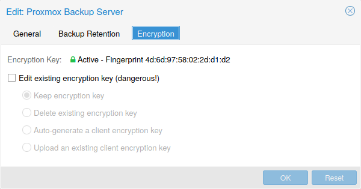

# pvesm(1)

## NAME <a href="#chapter_storage" id="chapter_storage"></a>

pvesm \- Proxmox VE Storage Manager

## SYNOPSIS <a href="#_synopsis" id="_synopsis"></a>

<a id="cli_pvesm"></a>


**pvesm** `<COMMAND> [ARGS] [OPTIONS]`

<a id="cli_pvesm_add"></a>


**pvesm add** `<type> <storage>` `[OPTIONS]`

Create a new storage.

**`<type>`: `<btrfs | cephfs | cifs | dir | esxi | iscsi | iscsidirect | lvm | lvmthin | nfs | pbs | rbd | zfs | zfspool>`**

Storage type.

**`<storage>`: `<storage ID>`**

The storage identifier.

**`--authsupported` `<string>`**

Authsupported.

**`--base` `<string>`**

Base volume. This volume is automatically activated.

**`--blocksize` `<a power of 2 with optional k or m suffix>`**

ZFS block size

**`--bwlimit` `[clone=<LIMIT>] [,default=<LIMIT>] [,migration=<LIMIT>] [,move=<LIMIT>] [,restore=<LIMIT>]`**

设置各种操作的 I/O 带宽限制（单位为 KiB/s）。

**`--comstar_hg` `<string>`**

host group for comstar views

**`--comstar_tg` `<string>`**

target group for comstar views

**`--content` `<string>`**

Allowed content types.


the value *rootdir* is used for Containers, and value *images* for VMs.


**`--content-dirs` `<string>`**

Overrides for default content type directories.

**`--create-base-path` `<boolean>` (*default \=* `yes`)**

Create the base directory if it doesn’t exist.

**`--create-subdirs` `<boolean>` (*default \=* `yes`)**

Populate the directory with the default structure.

**`--data-pool` `<string>`**

Data Pool (for erasure coding only)

**`--datastore` `<string>`**

Proxmox Backup Server datastore name.

**`--disable` `<boolean>`**

Flag to disable the storage.

**`--domain` `<string>`**

CIFS domain.

**`--encryption-key` `a file containing an encryption key, or the special value "autogen"`**

Encryption key. Use *autogen* to generate one automatically without passphrase.

**`--export` `<string>`**

NFS export path.

**`--fingerprint` `([A-Fa-f0-9]{2}:){31}[A-Fa-f0-9]{2}`**

Certificate SHA 256 fingerprint.

**`--format` `<qcow2 | raw | subvol | vmdk>`**

Default image format.

**`--fs-name` `<string>`**

The Ceph filesystem name.

**`--fuse` `<boolean>`**

Mount CephFS through FUSE.

**`--is_mountpoint` `<string>` (*default \=* `no`)**

Assume the given path is an externally managed mountpoint and consider the storage offline if it is not mounted. Using a boolean (yes/no) value serves as a shortcut to using the target path in this field.

**`--iscsiprovider` `<string>`**

iscsi provider

**`--keyring` `file containing the keyring to authenticate in the Ceph cluster`**

Client keyring contents (for external clusters).

**`--krbd` `<boolean>` (*default \=* `0`)**

Always access rbd through krbd kernel module.

**`--lio_tpg` `<string>`**

Linux LIO 目标的目标门户组

**`--master-pubkey` `a file containing a PEM-formatted master public key`**

Base64-encoded, PEM-formatted public RSA key. Used to encrypt a copy of the encryption-key which will be added to each encrypted backup.

**`--max-protected-backups` `<integer> (-1 - N)` (*default \=* `Unlimited for users with Datastore.Allocate privilege, 5 for other users`)**

Maximal number of protected backups per guest. Use *-1* for unlimited.

**`--mkdir` `<boolean>` (*default \=* `yes`)**

Create the directory if it doesn’t exist and populate it with default sub-dirs. NOTE: Deprecated, use the *create-base-path* and *create-subdirs* options instead.

**`--monhost` `<string>`**

IP addresses of monitors (for external clusters).

**`--mountpoint` `<string>`**

mount point

**`--namespace` `<string>`**

Namespace.

**`--nocow` `<boolean>` (*default \=* `0`)**

Set the NOCOW flag on files. Disables data checksumming and causes data errors to be unrecoverable from while allowing direct I/O. Only use this if data does not need to be any more safe than on a single ext4 formatted disk with no underlying raid system.

**`--nodes` `<string>`**

List of nodes for which the storage configuration applies.

**`--nowritecache` `<boolean>`**

禁用目标上的写入缓存

**`--options` `<string>`**

NFS/CIFS mount options (see *man nfs* or *man mount.cifs*)

**`--password` `<password>`**

Password for accessing the share/datastore.

**`--path` `<string>`**

File system path.

**`--pool` `<string>`**

Pool.

**`--port` `<integer> (1 - 65535)`**

Use this port to connect to the storage instead of the default one (for example, with PBS or ESXi). For NFS and CIFS, use the *options* option to configure the port via the mount options.

**`--portal` `<string>`**

iSCSI 门户（IP 或 DNS 名称，可选端口）。

**`--preallocation` `<falloc | full | metadata | off>` (*default \=* `metadata`)**

Preallocation mode for raw and qcow2 images. Using *metadata* on raw images results in preallocation\=off.

**`--prune-backups` `[keep-all=<1|0>] [,keep-daily=<N>] [,keep-hourly=<N>] [,keep-last=<N>] [,keep-monthly=<N>] [,keep-weekly=<N>] [,keep-yearly=<N>]`**

The retention options with shorter intervals are processed first with --keep-last being the very first one. Each option covers a specific period of time. We say that backups within this period are covered by this option. The next option does not take care of already covered backups and only considers older backups.

**`--saferemove` `<boolean>`**

Zero-out data when removing LVs.

**`--saferemove-stepsize` `<1 | 16 | 2 | 32 | 4 | 8>` (*default \=* `32`)**

Wipe step size in MiB. It will be capped to the maximum supported by the storage.

**`--saferemove_throughput` `<string>`**

Wipe throughput (cstream -t parameter value).

**`--server` `<string>`**

Server IP or DNS name.

**`--share` `<string>`**

CIFS share.

**`--shared` `<boolean>`**

Indicate that this is a single storage with the same contents on all nodes (or all listed in the *nodes* option). It will not make the contents of a local storage automatically accessible to other nodes, it just marks an already shared storage as such!

**`--skip-cert-verification` `<boolean>` (*default \=* `false`)**

Disable TLS certificate verification, only enable on fully trusted networks!

**`--smbversion` `<2.0 | 2.1 | 3 | 3.0 | 3.11 | default>` (*default \=* `default`)**

SMB protocol version. *default* if not set, negotiates the highest SMB2\+ version supported by both the client and server.

**`--snapshot-as-volume-chain` `<boolean>` (*default \=* `0`)**

Enable support for creating storage-vendor agnostic snapshot through volume backing-chains.

**`--sparse` `<boolean>`**

use sparse volumes

**`--subdir` `<string>`**

Subdir to mount.

**`--tagged_only` `<boolean>`**

Only list logical volumes tagged with *pve-vm-ID*.

**`--target` `<string>`**

iSCSI 目标端。

**`--thinpool` `<string>`**

LVM thin pool LV name.

**`--username` `<string>`**

RBD Id.

**`--vgname` `<string>`**

Volume group name.

**`--zfs-base-path` `<string>`**

Base path where to look for the created ZFS block devices. Set automatically during creation if not specified. Usually */dev/zvol*.

<a id="cli_pvesm_alloc"></a>


**pvesm alloc** `<storage> <vmid> <filename> <size>` `[OPTIONS]`

Allocate disk images.

**`<storage>`: `<storage ID>`**

The storage identifier.

**`<vmid>`: `<integer> (100 - 999999999)`**

Specify owner VM

**`<filename>`: `<string>`**

The name of the file to create.

**`<size>`: `\d+[MG]?`**

Size in kilobyte (1024 bytes). Optional suffixes *M* (megabyte, 1024K) and *G* (gigabyte, 1024M)

**`--format` `<qcow2 | raw | subvol | vmdk>`**

Format of the image.


Requires option(s): `size`


<a id="cli_pvesm_apiinfo"></a>


**pvesm apiinfo**

Returns APIVER and APIAGE.

<a id="cli_pvesm_cifsscan"></a>


**pvesm cifsscan**

An alias for *pvesm scan cifs*.

<a id="cli_pvesm_export"></a>


**pvesm export** `<volume> <format> <filename>` `[OPTIONS]`

Used internally to export a volume.

**`<volume>`: `<string>`**

Volume identifier

**`<format>`: `<btrfs | qcow2+size | raw+size | tar+size | vmdk+size | zfs>`**

Export stream format

**`<filename>`: `<string>`**

Destination file name

**`--base` `(?^i:[a-z0-9_\-]{1,40})`**

Snapshot to start an incremental stream from

**`--snapshot` `(?^i:[a-z0-9_\-]{1,40})`**

Snapshot to export

**`--snapshot-list` `<string>`**

Ordered list of snapshots to transfer

**`--with-snapshots` `<boolean>` (*default \=* `0`)**

Whether to include intermediate snapshots in the stream

<a id="cli_pvesm_extractconfig"></a>


**pvesm extractconfig** `<volume>`

Extract configuration from vzdump backup archive.

**`<volume>`: `<string>`**

Volume identifier

<a id="cli_pvesm_free"></a>


**pvesm free** `<volume>` `[OPTIONS]`

Delete volume

**`<volume>`: `<string>`**

Volume identifier

**`--delay` `<integer> (1 - 30)`**

Time to wait for the task to finish. We return *null* if the task finish within that time.

**`--storage` `<storage ID>`**

The storage identifier.

<a id="cli_pvesm_help"></a>


**pvesm help** `[OPTIONS]`

获取指定命令的帮助。

**`--extra-args` `<array>`**

显示特定命令的帮助

**`--verbose` `<boolean>`**

详细输出格式。

<a id="cli_pvesm_import"></a>


**pvesm import** `<volume> <format> <filename>` `[OPTIONS]`

Used internally to import a volume.

**`<volume>`: `<string>`**

Volume identifier

**`<format>`: `<btrfs | qcow2+size | raw+size | tar+size | vmdk+size | zfs>`**

Import stream format

**`<filename>`: `<string>`**

Source file name. For *\-* stdin is used, the tcp://\<IP-or-CIDR\> format allows to use a TCP connection, the unix://PATH-TO-SOCKET format a UNIX socket as input.Else, the file is treated as common file.

**`--allow-rename` `<boolean>` (*default \=* `0`)**

Choose a new volume ID if the requested volume ID already exists, instead of throwing an error.

**`--base` `(?^i:[a-z0-9_\-]{1,40})`**

Base snapshot of an incremental stream

**`--delete-snapshot` `(?^i:[a-z0-9_\-]{1,80})`**

A snapshot to delete on success

**`--snapshot` `(?^i:[a-z0-9_\-]{1,40})`**

The current-state snapshot if the stream contains snapshots

**`--with-snapshots` `<boolean>` (*default \=* `0`)**

Whether the stream includes intermediate snapshots

<a id="cli_pvesm_iscsiscan"></a>


**pvesm iscsiscan**

An alias for *pvesm scan iscsi*.

<a id="cli_pvesm_list"></a>


**pvesm list** `<storage>` `[OPTIONS]`

List storage content.

**`<storage>`: `<storage ID>`**

The storage identifier.

**`--content` `<string>`**

Only list content of this type.

**`--vmid` `<integer> (100 - 999999999)`**

Only list images for this VM

<a id="cli_pvesm_lvmscan"></a>


**pvesm lvmscan**

An alias for *pvesm scan lvm*.

<a id="cli_pvesm_lvmthinscan"></a>


**pvesm lvmthinscan**

An alias for *pvesm scan lvmthin*.

<a id="cli_pvesm_nfsscan"></a>


**pvesm nfsscan**

An alias for *pvesm scan nfs*.

<a id="cli_pvesm_path"></a>


**pvesm path** `<volume>`

Get filesystem path for specified volume

**`<volume>`: `<string>`**

Volume identifier

<a id="cli_pvesm_prune-backups"></a>


**pvesm prune-backups** `<storage>` `[OPTIONS]`

Prune backups. Only those using the standard naming scheme are considered. If no keep options are specified, those from the storage configuration are used.

**`<storage>`: `<storage ID>`**

The storage identifier.

**`--dry-run` `<boolean>`**

Only show what would be pruned, don’t delete anything.

**`--keep-all` `<boolean>`**

Keep all backups. Conflicts with the other options when true.

**`--keep-daily` `<N>`**

Keep backups for the last \<N\> different days. If there is morethan one backup for a single day, only the latest one is kept.

**`--keep-hourly` `<N>`**

Keep backups for the last \<N\> different hours. If there is morethan one backup for a single hour, only the latest one is kept.

**`--keep-last` `<N>`**

Keep the last \<N\> backups.

**`--keep-monthly` `<N>`**

Keep backups for the last \<N\> different months. If there is morethan one backup for a single month, only the latest one is kept.

**`--keep-weekly` `<N>`**

Keep backups for the last \<N\> different weeks. If there is morethan one backup for a single week, only the latest one is kept.

**`--keep-yearly` `<N>`**

Keep backups for the last \<N\> different years. If there is morethan one backup for a single year, only the latest one is kept.

**`--type` `<lxc | qemu>`**

Either *qemu* or *lxc*. Only consider backups for guests of this type.

**`--vmid` `<integer> (100 - 999999999)`**

Only consider backups for this guest.

<a id="cli_pvesm_remove"></a>


**pvesm remove** `<storage>`

Delete storage configuration.

**`<storage>`: `<storage ID>`**

The storage identifier.

<a id="cli_pvesm_scan_cifs"></a>


**pvesm scan cifs** `<server>` `[OPTIONS]`

Scan remote CIFS server.

**`<server>`: `<string>`**

The server address (name or IP).

**`--domain` `<string>`**

SMB domain (Workgroup).

**`--password` `<password>`**

User password.

**`--username` `<string>`**

User name.

<a id="cli_pvesm_scan_iscsi"></a>


**pvesm scan iscsi** `<portal>`

Scan remote iSCSI server.

**`<portal>`: `<string>`**

The iSCSI portal (IP or DNS name with optional port).

<a id="cli_pvesm_scan_lvm"></a>


**pvesm scan lvm**

List local LVM volume groups.

<a id="cli_pvesm_scan_lvmthin"></a>


**pvesm scan lvmthin** `<vg>`

List local LVM Thin Pools.

**`<vg>`: `[a-zA-Z0-9\.\+\_][a-zA-Z0-9\.\+\_\-]+`**

no description available

<a id="cli_pvesm_scan_nfs"></a>


**pvesm scan nfs** `<server>`

Scan remote NFS server.

**`<server>`: `<string>`**

The server address (name or IP).

<a id="cli_pvesm_scan_pbs"></a>


**pvesm scan pbs** `<server> <username> --password <string>` `[OPTIONS]` `[FORMAT_OPTIONS]`

Scan remote Proxmox Backup Server.

**`<server>`: `<string>`**

The server address (name or IP).

**`<username>`: `<string>`**

User-name or API token-ID.

**`--fingerprint` `([A-Fa-f0-9]{2}:){31}[A-Fa-f0-9]{2}`**

Certificate SHA 256 fingerprint.

**`--password` `<string>`**

User password or API token secret.

**`--port` `<integer> (1 - 65535)` (*default \=* `8007`)**

Optional port.

<a id="cli_pvesm_scan_zfs"></a>


**pvesm scan zfs**

Scan zfs pool list on local node.

<a id="cli_pvesm_set"></a>


**pvesm set** `<storage>` `[OPTIONS]`

Update storage configuration.

**`<storage>`: `<storage ID>`**

The storage identifier.

**`--blocksize` `<a power of 2 with optional k or m suffix>`**

ZFS block size

**`--bwlimit` `[clone=<LIMIT>] [,default=<LIMIT>] [,migration=<LIMIT>] [,move=<LIMIT>] [,restore=<LIMIT>]`**

设置各种操作的 I/O 带宽限制（单位为 KiB/s）。

**`--comstar_hg` `<string>`**

host group for comstar views

**`--comstar_tg` `<string>`**

target group for comstar views

**`--content` `<string>`**

Allowed content types.


the value *rootdir* is used for Containers, and value *images* for VMs.


**`--content-dirs` `<string>`**

Overrides for default content type directories.

**`--create-base-path` `<boolean>` (*default \=* `yes`)**

Create the base directory if it doesn’t exist.

**`--create-subdirs` `<boolean>` (*default \=* `yes`)**

Populate the directory with the default structure.

**`--data-pool` `<string>`**

Data Pool (for erasure coding only)

**`--delete` `<string>`**

要删除的设置列表。

**`--digest` `<string>`**

如果当前配置文件的摘要不同，则阻止更改。这可用于防止并发修改。

**`--disable` `<boolean>`**

Flag to disable the storage.

**`--domain` `<string>`**

CIFS domain.

**`--encryption-key` `a file containing an encryption key, or the special value "autogen"`**

Encryption key. Use *autogen* to generate one automatically without passphrase.

**`--fingerprint` `([A-Fa-f0-9]{2}:){31}[A-Fa-f0-9]{2}`**

Certificate SHA 256 fingerprint.

**`--format` `<qcow2 | raw | subvol | vmdk>`**

Default image format.

**`--fs-name` `<string>`**

The Ceph filesystem name.

**`--fuse` `<boolean>`**

Mount CephFS through FUSE.

**`--is_mountpoint` `<string>` (*default \=* `no`)**

Assume the given path is an externally managed mountpoint and consider the storage offline if it is not mounted. Using a boolean (yes/no) value serves as a shortcut to using the target path in this field.

**`--keyring` `file containing the keyring to authenticate in the Ceph cluster`**

Client keyring contents (for external clusters).

**`--krbd` `<boolean>` (*default \=* `0`)**

Always access rbd through krbd kernel module.

**`--lio_tpg` `<string>`**

Linux LIO 目标的目标门户组

**`--master-pubkey` `a file containing a PEM-formatted master public key`**

Base64-encoded, PEM-formatted public RSA key. Used to encrypt a copy of the encryption-key which will be added to each encrypted backup.

**`--max-protected-backups` `<integer> (-1 - N)` (*default \=* `Unlimited for users with Datastore.Allocate privilege, 5 for other users`)**

Maximal number of protected backups per guest. Use *-1* for unlimited.

**`--mkdir` `<boolean>` (*default \=* `yes`)**

Create the directory if it doesn’t exist and populate it with default sub-dirs. NOTE: Deprecated, use the *create-base-path* and *create-subdirs* options instead.

**`--monhost` `<string>`**

IP addresses of monitors (for external clusters).

**`--mountpoint` `<string>`**

mount point

**`--namespace` `<string>`**

Namespace.

**`--nocow` `<boolean>` (*default \=* `0`)**

Set the NOCOW flag on files. Disables data checksumming and causes data errors to be unrecoverable from while allowing direct I/O. Only use this if data does not need to be any more safe than on a single ext4 formatted disk with no underlying raid system.

**`--nodes` `<string>`**

List of nodes for which the storage configuration applies.

**`--nowritecache` `<boolean>`**

禁用目标上的写入缓存

**`--options` `<string>`**

NFS/CIFS mount options (see *man nfs* or *man mount.cifs*)

**`--password` `<password>`**

Password for accessing the share/datastore.

**`--pool` `<string>`**

Pool.

**`--port` `<integer> (1 - 65535)`**

Use this port to connect to the storage instead of the default one (for example, with PBS or ESXi). For NFS and CIFS, use the *options* option to configure the port via the mount options.

**`--preallocation` `<falloc | full | metadata | off>` (*default \=* `metadata`)**

Preallocation mode for raw and qcow2 images. Using *metadata* on raw images results in preallocation\=off.

**`--prune-backups` `[keep-all=<1|0>] [,keep-daily=<N>] [,keep-hourly=<N>] [,keep-last=<N>] [,keep-monthly=<N>] [,keep-weekly=<N>] [,keep-yearly=<N>]`**

The retention options with shorter intervals are processed first with --keep-last being the very first one. Each option covers a specific period of time. We say that backups within this period are covered by this option. The next option does not take care of already covered backups and only considers older backups.

**`--saferemove` `<boolean>`**

Zero-out data when removing LVs.

**`--saferemove-stepsize` `<1 | 16 | 2 | 32 | 4 | 8>` (*default \=* `32`)**

Wipe step size in MiB. It will be capped to the maximum supported by the storage.

**`--saferemove_throughput` `<string>`**

Wipe throughput (cstream -t parameter value).

**`--server` `<string>`**

Server IP or DNS name.

**`--shared` `<boolean>`**

Indicate that this is a single storage with the same contents on all nodes (or all listed in the *nodes* option). It will not make the contents of a local storage automatically accessible to other nodes, it just marks an already shared storage as such!

**`--skip-cert-verification` `<boolean>` (*default \=* `false`)**

Disable TLS certificate verification, only enable on fully trusted networks!

**`--smbversion` `<2.0 | 2.1 | 3 | 3.0 | 3.11 | default>` (*default \=* `default`)**

SMB protocol version. *default* if not set, negotiates the highest SMB2\+ version supported by both the client and server.

**`--snapshot-as-volume-chain` `<boolean>` (*default \=* `0`)**

Enable support for creating storage-vendor agnostic snapshot through volume backing-chains.

**`--sparse` `<boolean>`**

use sparse volumes

**`--subdir` `<string>`**

Subdir to mount.

**`--tagged_only` `<boolean>`**

Only list logical volumes tagged with *pve-vm-ID*.

**`--username` `<string>`**

RBD Id.

**`--zfs-base-path` `<string>`**

Base path where to look for the created ZFS block devices. Set automatically during creation if not specified. Usually */dev/zvol*.

<a id="cli_pvesm_status"></a>


**pvesm status** `[OPTIONS]`

Get status for all datastores.

**`--content` `<string>`**

Only list stores which support this content type.

**`--enabled` `<boolean>` (*default \=* `0`)**

Only list stores which are enabled (not disabled in config).

**`--format` `<boolean>` (*default \=* `0`)**

Include information about formats

**`--storage` `<storage ID>`**

Only list status for specified storage

**`--target` `<string>`**

If target is different to *node*, we only lists shared storages which content is accessible on this *node* and the specified *target* node.

<a id="cli_pvesm_zfsscan"></a>


**pvesm zfsscan**

An alias for *pvesm scan zfs*.

## DESCRIPTION <a href="#_description" id="_description"></a>

Proxmox VE 存储模型非常灵活。虚拟机镜像可以存储在一个或多个本地存储上，也可以存储在 NFS 或 iSCSI（NAS、SAN）等共享存储上。没有任何限制，您可以根据需要配置任意数量的存储池。您可以使用 Debian Linux 可用的所有存储技术。

将 VM 存储在共享存储上的一个主要好处是，可以在线迁移正在运行的机器而无需任何停机，因为集群中的所有节点都可以直接访问 VM 磁盘镜像。无需复制 VM 镜像数据，因此在这种情况下在线迁移速度非常快。

存储库（软件包 `libpve-storage-perl`）使用灵活的插件系统，为所有存储类型提供通用接口。可以轻松地对其进行扩展，以便将来支持更多存储类型。

## Storage Types <a href="#_storage_types" id="_storage_types"></a>

基本上有两类不同的存储类型：

**文件级存储**

文件级存储技术允许访问功能完整的（POSIX）文件系统。它们通常比任何块级存储（见下文）都更灵活，并允许您存储任何类型的内容。ZFS 可能是最先进的系统，它完全支持快照和克隆。

**块级存储**

允许存储大型 *raw* 镜像。通常无法在这类存储类型上存储其他文件（ISO、备份等）。大多数现代块级存储实现都支持快照和克隆。Ceph RADOS 是一个分布式系统，可将存储数据复制到不同的节点，并可作为 RBD（RADOS 块设备）进行访问。

<table>
<caption>Table 1. Available storage types</caption>


<thead>
<tr>
<th>描述</th>
<th>插件类型</th>
<th>级别</th>
<th>共享</th>
<th>快照</th>
<th>稳定</th>
</tr>
</thead>
<tbody>
<tr>
<td><p>ZFS（本地）</p></td>
<td><p>zfspool</p></td>
<td><p>两者<sup>1</sup></p></td>
<td><p>否</p></td>
<td><p>是</p></td>
<td><p>是</p></td>
</tr>
<tr>
<td><p>目录</p></td>
<td><p>dir</p></td>
<td><p>文件</p></td>
<td><p>否</p></td>
<td><p>是<sup>2</sup></p></td>
<td><p>是</p></td>
</tr>
<tr>
<td><p>BTRFS</p></td>
<td><p>btrfs</p></td>
<td><p>文件</p></td>
<td><p>否</p></td>
<td><p>是</p></td>
<td><p>技术预览<sup>5</sup></p></td>
</tr>
<tr>
<td><p>NFS</p></td>
<td><p>nfs</p></td>
<td><p>文件</p></td>
<td><p>是</p></td>
<td><p>是<sup>2</sup></p></td>
<td><p>是</p></td>
</tr>
<tr>
<td><p>CIFS</p></td>
<td><p>cifs</p></td>
<td><p>文件</p></td>
<td><p>是</p></td>
<td><p>是<sup>2</sup></p></td>
<td><p>是</p></td>
</tr>
<tr>
<td><p>Proxmox Backup</p></td>
<td><p>pbs</p></td>
<td><p>两者</p></td>
<td><p>是</p></td>
<td><p>n/a</p></td>
<td><p>是</p></td>
</tr>
<tr>
<td><p>CephFS</p></td>
<td><p>cephfs</p></td>
<td><p>文件</p></td>
<td><p>是</p></td>
<td><p>是</p></td>
<td><p>是</p></td>
</tr>
<tr>
<td><p>LVM</p></td>
<td><p>lvm</p></td>
<td><p>块</p></td>
<td><p>否<sup>3</sup></p></td>
<td><p>是<sup>4</sup></p></td>
<td><p>是</p></td>
</tr>
<tr>
<td><p>LVM-thin</p></td>
<td><p>lvmthin</p></td>
<td><p>块</p></td>
<td><p>否</p></td>
<td><p>是</p></td>
<td><p>是</p></td>
</tr>
<tr>
<td><p>iSCSI/kernel</p></td>
<td><p>iscsi</p></td>
<td><p>块</p></td>
<td><p>是<sup>3</sup></p></td>
<td><p>是<sup>4</sup></p></td>
<td><p>是</p></td>
</tr>
<tr>
<td><p>iSCSI/libiscsi</p></td>
<td><p>iscsidirect</p></td>
<td><p>块</p></td>
<td><p>是<sup>3</sup></p></td>
<td><p>是<sup>4</sup></p></td>
<td><p>是</p></td>
</tr>
<tr>
<td><p>FC/SAS</p></td>
<td><p>native<sup>6</sup></p></td>
<td><p>块</p></td>
<td><p>是<sup>3</sup></p></td>
<td><p>是<sup>4</sup></p></td>
<td><p>是</p></td>
</tr>
<tr>
<td><p>Ceph/RBD</p></td>
<td><p>rbd</p></td>
<td><p>块</p></td>
<td><p>是</p></td>
<td><p>是</p></td>
<td><p>是</p></td>
</tr>
<tr>
<td><p>基于 iSCSI 的 ZFS</p></td>
<td><p>zfs</p></td>
<td><p>块</p></td>
<td><p>是</p></td>
<td><p>是</p></td>
<td><p>是</p></td>
</tr>
</tbody>
</table>

1：VM 的磁盘镜像存储在 ZFS 卷（zvol）数据集中，这些数据集提供块设备功能。

2：在基于文件的存储上，可以使用 *qcow2* 格式创建快照，既可以使用内部快照功能，也可以使用卷链快照4。创建和删除内部 *qcow2* 快照会阻塞正在运行的 VM，而且效率不高。在 NFS 等网络存储上，性能尤其差。在某些配置中，对于大型磁盘（大小为数百 GiB 或 TiB 级），这些操作可能需要几分钟，在极端情况下甚至需要数小时。如果您的配置受到影响，请在 VM 关机时创建和删除快照，并做好任务耗时较长的准备。

3：在集群中使用 iSCSI、FibreChannel（FC）或 SAS 块存储作为共享存储时，LVM 用于将 LUN 划分为虚拟磁盘。[多路径指南](https://pve.proxmox.com/wiki/Multipath)介绍了如何在集群中进行配置，包括多路径配置，在这些场景中通常需要多路径。

4: Since Proxmox VE 9, snapshots as a volume chain have been available for VMs. These snapshots use separate volumes for the snapshot data and layer them. For more details, see the description for `snapshot-as-volume-chain` in the [LVM configuration](#pvesm_lvm_config) section.

5 技术预览，提供尽力而为的支持。

6 Fibre Channel（FC）和 SAS 块存储由宿主机直接处理，无需专用存储插件。

### Thin Provisioning <a href="#_thin_provisioning" id="_thin_provisioning"></a>

许多存储以及 QEMU 镜像格式 `qcow2` 都支持 *精简置备*。启用精简置备后，只有客户机系统实际使用的块才会写入存储。

例如，假设您创建了一台配备 32GB 硬盘的 VM，安装客户机操作系统后，该 VM 的根文件系统中包含 3 GB 数据。在这种情况下，即使客户机 VM 看到的是 32GB 硬盘，也只有 3GB 会写入存储。通过这种方式，精简置备允许您创建大于当前可用存储块的磁盘镜像。您可以为 VM 创建大型磁盘镜像，并在需要时向存储添加更多磁盘，而无需调整 VM 文件系统的大小。

所有具有“快照”功能的存储类型也都支持精简置备。


如果存储空间用尽，使用该存储上卷的所有客户机都会收到 IO 错误。这可能导致文件系统不一致，并可能损坏您的数据。因此，建议避免对存储资源进行过度置备，或者仔细监测可用空间，以避免出现此类情况。


## Storage Configuration <a href="#_storage_configuration" id="_storage_configuration"></a>

所有与 Proxmox VE 相关的存储配置都存储在 `/etc/pve/storage.cfg` 处的单个文本文件中。由于该文件位于 `/etc/pve/` 中，因此会自动分发到所有集群节点。所以，所有节点共享相同的存储配置。

共享存储配置对于共享存储非常有意义，因为所有节点都可以访问同一个“共享”存储。但它对本地存储类型也很有用。在这种情况下，此类本地存储在所有节点上都可用，但它们在物理上并不相同，并且可以包含完全不同的内容。

### Storage Pools <a href="#_storage_pools" id="_storage_pools"></a>

每个存储池都有一个 `<type>`，并通过其 `<STORAGE_ID>` 进行唯一标识。池配置如下所示：

```text
<type>: <STORAGE_ID>
        <property> <value>
        <property> <value>
        <property>
        ...
```

`<type>: <STORAGE_ID>` 行开始池定义，后面是属性列表。大多数属性都需要一个值。某些属性有合理的默认值，在这种情况下可以省略该值。

具体来说，请查看安装后的默认存储配置。其中包含一个名为 `local` 的特殊本地存储池，该池指向目录 `/var/lib/vz`，并且始终可用。Proxmox VE 安装程序会根据安装时选择的存储类型创建其他存储条目。

**默认存储配置（`/etc/pve/storage.cfg`）**

```text
dir: local
        path /var/lib/vz
        content iso,vztmpl,backup

# default image store on LVM based installation
lvmthin: local-lvm
        thinpool data
        vgname pve
        content rootdir,images

# default image store on ZFS based installation
zfspool: local-zfs
        pool rpool/data
        sparse
        content images,rootdir
```


让多个存储配置指向完全相同的底层存储会产生问题。此类*别名*存储配置可能导致两个不同的卷 ID（*volid*）指向完全相同的磁盘镜像。Proxmox VE 要求镜像的卷 ID 所指向的位置是唯一的。为*别名*存储配置选择不同的内容类型或许可行，但不建议这样做。


### Common Storage Properties <a href="#_common_storage_properties" id="_common_storage_properties"></a>

一些存储属性为不同存储类型所共有。

**nodes**

可使用或访问此存储的集群节点名称列表。可以使用此属性将存储访问权限限制在一组特定的节点内。

**content**

一个存储可以支持多种内容类型，例如虚拟磁盘镜像、CD-ROM ISO 镜像、容器模板或容器根目录。并非所有存储类型都支持所有内容类型。可以设置此属性来选择此存储的用途。

**images**

QEMU/KVM VM 镜像。

**rootdir**

允许存储容器数据。

**vztmpl**

容器模板。

**backup**

备份文件（`vzdump`）。

**iso**

ISO 镜像

**snippets**

片段文件，例如客户机钩子脚本

**import**

可从此存储导入的 OVA 和 VM 磁盘镜像

**shared**

表明这是一个在所有节点（或 *nodes* 选项中列出的所有节点）上具有相同内容的单一存储。它不会使本地存储的内容自动可供其他节点访问，只是将已共享的存储标记为共享存储！

**disable**

可以使用此标志完全禁用该存储。

**prune-backups**

Retention options for backups. For details, see [Backup Retention](vzdump-1.md#vzdump_retention).

**format**

默认镜像格式（`raw|qcow2|vmdk`）

**preallocation**

Preallocation mode (`off|metadata|falloc|full`) for `raw` and `qcow2` images on file-based storages. The default is `metadata`, which is treated like `off` for `raw` images. When using network storages in combination with large `qcow2` images, using `off` can help to avoid timeouts.


不建议在不同的 Proxmox VE 集群上使用同一个存储池。某些存储操作需要独占访问存储，因此需要正确的锁定机制。虽然集群内部实现了这种锁定，但它在不同集群之间不起作用。


## Volumes <a href="#_volumes" id="_volumes"></a>

我们使用一种特殊表示法来定位存储数据。当你从存储池分配数据时，它会返回这样一个卷标识符。卷由 `<STORAGE_ID>` 和后随的卷名标识，卷名取决于存储类型，二者以冒号分隔。有效的 `<VOLUME_ID>` 如下所示：

```text
local:230/example-image.raw
```

```text
local:iso/debian-501-amd64-netinst.iso
```

```text
local:vztmpl/debian-5.0-joomla_1.5.9-1_i386.tar.gz
```

```text
iscsi-storage:0.0.2.scsi-14f504e46494c4500494b5042546d2d646744372d31616d61
```

要获取 `<VOLUME_ID>` 的文件系统路径，请使用：

```text
pvesm path <VOLUME_ID>
```

### Volume Ownership <a href="#_volume_ownership" id="_volume_ownership"></a>

对于 `image` 类型的卷，存在所有权关系。每个此类卷都归某个 VM 或容器所有。例如，卷 `local:230/example-image.raw` 归 VM 230 所有。大多数存储后端会将此所有权信息编码到卷名中。

删除 VM 或容器时，系统还会删除归该 VM 或容器所有的所有关联卷。

## Using the Command-line Interface <a href="#_using_the_command_line_interface" id="_using_the_command_line_interface"></a>

建议你熟悉存储池和卷标识符背后的概念，但在实际使用中，并不强制你在命令行上执行任何此类底层操作。通常，卷的分配和删除由 VM 和容器管理工具完成。

尽管如此，仍有一个名为 `pvesm` 的命令行工具（“Proxmox VE Storage Manager”），它能够执行常见的存储管理任务。

### Examples <a href="#_examples" id="_examples"></a>

添加存储池

```text
pvesm add <TYPE> <STORAGE_ID> <OPTIONS>
pvesm add dir <STORAGE_ID> --path <PATH>
pvesm add nfs <STORAGE_ID> --path <PATH> --server <SERVER> --export <EXPORT>
pvesm add lvm <STORAGE_ID> --vgname <VGNAME>
pvesm add iscsi <STORAGE_ID> --portal <HOST[:PORT]> --target <TARGET>
```

禁用存储池

```text
pvesm set <STORAGE_ID> --disable 1
```

启用存储池

```text
pvesm set <STORAGE_ID> --disable 0
```

更改/设置存储选项

```text
pvesm set <STORAGE_ID> <OPTIONS>
pvesm set <STORAGE_ID> --shared 1
pvesm set local --format qcow2
pvesm set <STORAGE_ID> --content iso
```

删除存储池。此操作不会删除任何数据，也不会断开连接或卸载任何内容。它仅删除存储配置。

```text
pvesm remove <STORAGE_ID>
```

分配卷

```text
pvesm alloc <STORAGE_ID> <VMID> <name> <size> [--format <raw|qcow2>]
```

在本地存储中分配一个 4G 的卷。如果将空字符串作为 `<name>` 传入，则会自动生成名称。

```text
pvesm alloc local <VMID> '' 4G
```

释放卷

```text
pvesm free <VOLUME_ID>
```


此操作确实会销毁所有卷数据。


列出存储状态

```text
pvesm status
```

列出存储内容

```text
pvesm list <STORAGE_ID> [--vmid <VMID>]
```

列出按 VMID 分配的卷

```text
pvesm list <STORAGE_ID> --vmid <VMID>
```

列出 ISO 镜像

```text
pvesm list <STORAGE_ID> --content iso
```

列出容器模板

```text
pvesm list <STORAGE_ID> --content vztmpl
```

显示卷的文件系统路径

```text
pvesm path <VOLUME_ID>
```

将卷 `local:103/vm-103-disk-0.qcow2` 导出到文件 `target`。这主要在内部与 `pvesm import` 一起使用。流格式 qcow2\+size 与 qcow2 格式不同。因此，导出的文件不能直接附加到 VM。其他格式也是如此。

```text
pvesm export local:103/vm-103-disk-0.qcow2 qcow2+size target --with-snapshots 1
```

## Directory Backend <a href="#storage_directory" id="storage_directory"></a>

存储池类型：`dir`

Proxmox VE 可以使用本地目录或本地挂载的共享目录进行存储。目录是一种文件级存储，因此你可以存储任何内容类型，例如虚拟磁盘镜像、容器、模板、ISO 镜像或备份文件。


你可以通过标准 Linux `/etc/fstab` 挂载其他存储，然后为该挂载点定义一个目录存储。通过这种方式，可以使用 Linux 支持的任何文件系统。


此后端仅假定底层目录兼容 POSIX，别无其他要求。这意味着你无法在存储级别创建快照。但使用 `qcow2` 文件格式的 VM 镜像有一种变通方法，因为该格式内部支持快照。


某些存储类型不支持 `O_DIRECT`，因此无法在此类存储上使用缓存模式 `none`。只需改用缓存模式 `writeback` 即可。


我们使用预定义的目录布局，将不同的内容类型存储到不同的子目录中。所有文件级存储后端都使用此布局。

<table>
<caption>Table 2. Directory layout</caption>


<thead>
<tr>
<th>内容类型</th>
<th>子目录</th>
</tr>
</thead>
<tbody>
<tr>
<td><p>VM 镜像</p></td>
<td><p><code>images/&lt;VMID&gt;/</code></p></td>
</tr>
<tr>
<td><p>ISO 镜像</p></td>
<td><p><code>template/iso/</code></p></td>
</tr>
<tr>
<td><p>容器模板</p></td>
<td><p><code>template/cache/</code></p></td>
</tr>
<tr>
<td><p>备份文件</p></td>
<td><p><code>dump/</code></p></td>
</tr>
<tr>
<td><p>片段</p></td>
<td><p><code>snippets/</code></p></td>
</tr>
<tr>
<td><p>导入</p></td>
<td><p><code>import/</code></p></td>
</tr>
</tbody>
</table>

### Configuration <a href="#_configuration" id="_configuration"></a>

此后端支持所有通用存储属性，并增加了两个附加属性。`path` 属性用于指定目录。该目录必须是绝对文件系统路径。

可选的 `content-dirs` 属性允许更改默认布局。它由逗号分隔的标识符列表组成，格式如下：

```text
vtype=path
```

其中，`vtype` 是该存储允许的一种内容类型，`path` 是相对于该存储挂载点的路径。

**配置示例（`/etc/pve/storage.cfg`）**

```text
dir: backup
        path /mnt/backup
        content backup
        prune-backups keep-last=7
        max-protected-backups 3
        content-dirs backup=custom/backup/dir
```

上述配置定义了一个名为 `backup` 的存储池。该池可用于为每个 VM 存储最多 7 个常规备份（`keep-last=7`）和 3 个受保护备份。备份文件的实际路径为 `/mnt/backup/custom/backup/dir/...`。

### File naming conventions <a href="#_file_naming_conventions" id="_file_naming_conventions"></a>

此后端为 VM 镜像使用明确定义的命名方案：

```text
vm-<VMID>-<NAME>.<FORMAT>
```

**`<VMID>`**

指定所有者 VM。

**`<NAME>`**

这可以是不含空白字符的任意名称（`ascii`）。后端默认使用 `disk-[N]`，其中 `[N]` 会被替换为一个整数，以使名称唯一。

**`<FORMAT>`**

指定镜像格式（`raw|qcow2|vmdk`）。

创建 VM 模板时，所有 VM 镜像都会被重命名，以表明它们现在是只读的，并且可以用作克隆的基础镜像：

```text
base-<VMID>-<NAME>.<FORMAT>
```


此类基础镜像用于生成克隆镜像。因此，必须确保这些文件为只读且永远不会被修改。后端会将访问模式更改为 `0444`，并在存储支持的情况下设置不可变标志（`chattr +i`）。


### Storage Features <a href="#_storage_features" id="_storage_features"></a>

如上所述，大多数文件系统本身并不支持快照。为解决此问题，此后端能够使用 `qcow2` 的内部快照功能。

克隆也是如此。后端使用 `qcow2` 的基础镜像功能来创建克隆。

<table>
<caption>Table 3. Storage features for backend <code>dir</code></caption>


<thead>
<tr>
<th>内容类型</th>
<th>镜像格式</th>
<th>共享</th>
<th>快照</th>
<th>克隆</th>
</tr>
</thead>
<tbody>
<tr>
<td><p>images rootdir vztmpl iso backup snippets</p></td>
<td><p>raw qcow2 vmdk subvol</p></td>
<td><p>否</p></td>
<td><p>qcow2</p></td>
<td><p>qcow2</p></td>
</tr>
</tbody>
</table>

### Examples <a href="#_examples_2" id="_examples_2"></a>

请使用以下命令在存储 `local` 上分配一个 4GB 镜像：

```text
# pvesm alloc local 100 vm-100-disk10.raw 4G
Formatting '/var/lib/vz/images/100/vm-100-disk10.raw', fmt=raw size=4294967296
successfully created 'local:100/vm-100-disk10.raw'
```


镜像名称必须符合上述命名约定。


实际的文件系统路径可通过以下命令查看：

```text
# pvesm path local:100/vm-100-disk10.raw
/var/lib/vz/images/100/vm-100-disk10.raw
```

可以通过以下命令删除镜像：

```text
# pvesm free local:100/vm-100-disk10.raw
```

## NFS Backend <a href="#storage_nfs" id="storage_nfs"></a>

存储池类型：`nfs`

NFS 后端基于目录后端，因此二者共享大多数属性。目录布局和文件命名约定相同。主要优势在于，您可以直接配置 NFS 服务器属性，使后端能够自动挂载共享。无需修改 `/etc/fstab`。后端还可以测试服务器是否在线，并提供查询服务器所导出共享的方法。

### Configuration <a href="#_configuration_2" id="_configuration_2"></a>

该后端支持除 shared 标志以外的所有通用存储属性，shared 标志始终处于设置状态。此外，以下属性用于配置 NFS 服务器：

**server**

服务器 IP 或 DNS 名称。为避免 DNS 查询延迟，通常最好使用 IP 地址而不是 DNS 名称，除非您有非常可靠的 DNS 服务器，或者已在本地 `/etc/hosts` 文件中列出该服务器。

**export**

NFS 导出路径（由 `pvesm nfsscan` 列出）。

您还可以设置 NFS 挂载选项：

**path**

本地挂载点（默认为 `/mnt/pve/<STORAGE_ID>/`）。

**content-dirs**

默认目录布局的覆盖设置。可选。

**options**

NFS 挂载选项（参见 `man nfs`）。

**配置示例（`/etc/pve/storage.cfg`）**

```text
nfs: iso-templates
        path /mnt/pve/iso-templates
        server 10.0.0.10
        export /space/iso-templates
        options vers=3,soft
        content iso,vztmpl
```


NFS 请求超时后，默认会无限期重试 NFS 请求。这可能导致客户端出现意外挂起。对于只读内容，值得考虑使用 NFS 的 `soft` 选项，该选项将重试次数限制为三次。


### Storage Features <a href="#_storage_features_2" id="_storage_features_2"></a>

NFS 不支持快照，但后端利用 `qcow2` 的功能来实现快照和克隆。

<table>
<caption>Table 4. Storage features for backend <code>nfs</code></caption>


<thead>
<tr>
<th>内容类型</th>
<th>镜像格式</th>
<th>共享</th>
<th>快照</th>
<th>克隆</th>
</tr>
</thead>
<tbody>
<tr>
<td><p>images rootdir vztmpl iso backup snippets</p></td>
<td><p>raw qcow2 vmdk</p></td>
<td><p>是</p></td>
<td><p>qcow2</p></td>
<td><p>qcow2</p></td>
</tr>
</tbody>
</table>

### Examples <a href="#_examples_3" id="_examples_3"></a>

可以通过以下命令获取已导出的 NFS 共享列表：

```text
# pvesm scan nfs <server>
```

## CIFS Backend <a href="#storage_cifs" id="storage_cifs"></a>

存储池类型：`cifs`

CIFS 后端扩展了目录后端，因此无需手动设置 CIFS 挂载。可以通过 Proxmox VE API 或 Web 界面直接添加此类存储，并享有我们后端的所有优势，例如服务器心跳检查或便捷地选择导出的共享。

### Configuration <a href="#_configuration_3" id="_configuration_3"></a>

该后端支持除 shared 标志以外的所有通用存储属性，shared 标志始终处于设置状态。此外，还提供以下 CIFS 特有属性：

**server**

服务器 IP 或 DNS 名称。必需。


为避免 DNS 查询延迟，通常最好使用 IP 地址而不是 DNS 名称，除非您有非常可靠的 DNS 服务器，或者已在本地 `/etc/hosts` 文件中列出该服务器。


**share**

要使用的 CIFS 共享（通过 `pvesm scan cifs <address>` 或 Web 界面获取可用共享）。必需。

**username**

CIFS 存储的用户名。可选，默认为“guest”。

**password**

用户密码。可选。密码将保存在只有 root 可读的文件中（`/etc/pve/priv/storage/<STORAGE-ID>.pw`）。

**domain**

为此存储设置用户域（工作组）。可选。

**smbversion**

SMB 协议版本。可选，设置为 `default` 或未设置时，协商客户端和服务器均支持的最高 SMB2\+ 版本。由于安全问题，不支持 SMB1。

**path**

本地挂载点。可选，默认为 `/mnt/pve/<STORAGE_ID>/`。

**content-dirs**

默认目录布局的覆盖设置。可选。

**options**

其他 CIFS 挂载选项（参见 `man mount.cifs`）。某些选项会自动设置，不应在此处设置。Proxmox VE 将始终设置 `soft` 选项。根据配置，以下选项会自动设置：`username`、`credentials`、`guest`、`domain`、`vers`。

**subdir**

要挂载的共享子目录。可选，默认为共享的根目录。

**配置示例（`/etc/pve/storage.cfg`）**

```text
cifs: backup
        path /mnt/pve/backup
        server 10.0.0.11
        share VMData
        content backup
        options noserverino,echo_interval=30
        username anna
        smbversion 3
        subdir /data
```

### Storage Features <a href="#_storage_features_3" id="_storage_features_3"></a>

CIFS 在存储级别不支持快照。但如果仍希望使用快照和克隆功能，可以使用 `qcow2` 后备文件。

<table>
<caption>Table 5. Storage features for backend <code>cifs</code></caption>


<thead>
<tr>
<th>内容类型</th>
<th>镜像格式</th>
<th>共享</th>
<th>快照</th>
<th>克隆</th>
</tr>
</thead>
<tbody>
<tr>
<td><p>images rootdir vztmpl iso backup snippets</p></td>
<td><p>raw qcow2 vmdk</p></td>
<td><p>是</p></td>
<td><p>qcow2</p></td>
<td><p>qcow2</p></td>
</tr>
</tbody>
</table>

### Examples <a href="#_examples_4" id="_examples_4"></a>

可以通过以下命令获取已导出的 CIFS 共享列表：

```text
# pvesm scan cifs <server> [--username <username>] [--password]
```

然后，可以通过以下命令将其中一个共享作为存储添加到整个 Proxmox VE 集群：

```text
# pvesm add cifs <storagename> --server <server> --share <share> [--username <username>] [--password]
```

## Proxmox Backup Server <a href="#storage_pbs" id="storage_pbs"></a>

存储池类型：`pbs`

该后端允许将 [Proxmox Backup Server](https://www.proxmox.com/en/products/proxmox-backup-server/overview) 像其他存储一样直接集成到 Proxmox VE 中。

Proxmox Backup 存储可通过 Proxmox VE API、CLI 或 Web 界面直接添加。

### Configuration <a href="#_configuration_4" id="_configuration_4"></a>

该后端支持除 shared 标志以外的所有通用存储属性，shared 标志始终处于设置状态。此外，还提供以下 Proxmox Backup Server 特有属性：

**server**

服务器 IP 或 DNS 名称。必需。

**port**

使用此端口代替默认端口（即 `8007`）。可选。

**username**

Proxmox Backup Server 存储的用户名。必需。


不要忘记在用户名中添加领域。例如，`root@pam` 或 `archiver@pbs`。


**password**

用户密码。该值将保存在 `/etc/pve/priv/storage/<STORAGE-ID>.pw` 下的文件中，并且仅允许 root 用户访问。必需。

**datastore**

要使用的 Proxmox Backup Server 数据存储的 ID。必需。

**fingerprint**

Proxmox Backup Server API TLS 证书的指纹。可以在服务器仪表板中获取，也可以使用 `proxmox-backup-manager cert info` 命令获取。对于自签名证书，或宿主机不信任服务器 CA 的任何其他证书，此项为必需。

**encryption-key**

用于从客户端加密备份数据的密钥。目前仅支持不受密码保护的密钥（不使用密钥派生函数（kdf））。密钥将保存在 `/etc/pve/priv/storage/<STORAGE-ID>.enc` 下的文件中，并且仅允许 root 用户访问。使用特殊值 `autogen` 可通过 `proxmox-backup-client key create --kdf none <path>` 自动生成新密钥。可选。

**master-pubkey**

用于在备份任务中加密备份加密密钥的 RSA 公钥。该密钥将保存在 `/etc/pve/priv/storage/<STORAGE-ID>.master.pem` 下的文件中，并且仅允许 root 用户访问。备份加密密钥的加密副本将附加到每个备份中，并存储在 Proxmox Backup Server 实例上，以用于恢复。可选，需要 `encryption-key`。

**配置示例（`/etc/pve/storage.cfg`）**

```text
pbs: backup
        datastore main
        server enya.proxmox.com
        content backup
        fingerprint 09:54:ef:..snip..:88:af:47:fe:4c:3b:cf:8b:26:88:0b:4e:3c:b2
        prune-backups keep-all=1
        username archiver@pbs
        encryption-key a9:ee:c8:02:13:..snip..:2d:53:2c:98
        master-pubkey 1
```

### Storage Features <a href="#_storage_features_4" id="_storage_features_4"></a>

Proxmox Backup Server 仅支持备份，备份可以基于块级或文件级。Proxmox VE 对虚拟机使用块级备份，对容器使用文件级备份。

<table>
<caption>Table 6. Storage features for backend <code>pbs</code></caption>


<thead>
<tr>
<th>内容类型</th>
<th>镜像格式</th>
<th>共享</th>
<th>快照</th>
<th>克隆</th>
</tr>
</thead>
<tbody>
<tr>
<td><p>backup</p></td>
<td><p>n/a</p></td>
<td><p>是</p></td>
<td><p>n/a</p></td>
<td><p>n/a</p></td>
</tr>
</tbody>
</table>

### Encryption <a href="#storage_pbs_encryption" id="storage_pbs_encryption"></a>

[](https://pve.proxmox.com/pve-docs/images/screenshot/storage-pbs-encryption-with-key.png)

可以选择配置使用 GCM 模式的 AES-256 客户端加密。可以通过 Web 界面配置加密，也可以在 CLI 上使用 `encryption-key` 选项进行配置（见上文）。密钥将保存在 `/etc/pve/priv/storage/<STORAGE-ID>.enc` 文件中，该文件仅 root 用户可访问。


没有密钥，备份将无法访问。因此，您应妥善管理密钥，并将其存放在与所备份内容分开的位置。例如，可能会发生这样的情况：您使用存储在某个系统上的密钥备份了整个系统。如果该系统随后因任何原因无法访问并需要恢复，则将无法进行恢复，因为加密密钥会随故障系统一起丢失。


建议您妥善保管密钥，同时确保其易于获取，以便快速进行灾难恢复。因此，最佳存放位置是密码管理器，在那里可以立即找回密钥。作为备用措施，还应将密钥保存到 USB 闪存盘，并将其存放在安全的位置。这样，密钥不依赖于任何系统，同时在紧急情况下仍易于恢复。最后，为应对最坏情况，还应考虑将密钥的纸质副本锁在安全的地方。`paperkey` 子命令可用于创建密钥的 QR 编码版本。以下命令将 `paperkey` 命令的输出发送到文本文件，以便于打印。

```text
# proxmox-backup-client key paperkey /etc/pve/priv/storage/<STORAGE-ID>.enc --output-format text > qrkey.txt
```

此外，还可以使用单个 RSA 主密钥对进行密钥恢复：将所有执行加密备份的客户端配置为使用同一个主公钥，之后所有加密备份都将包含所用 AES 加密密钥的 RSA 加密副本。即使客户端系统不再可用，相应的主私钥也可用于恢复 AES 密钥并解密备份。


主密钥对适用与普通加密密钥相同的安全保管规则。没有私钥副本就无法恢复！`paperkey` 命令支持生成主私钥的纸质副本，以便存放在安全的物理位置。


由于加密在客户端进行管理，您可以在服务器上对未加密备份和加密备份使用同一个数据存储，即使这些备份使用不同的密钥加密也是如此。但是，使用不同密钥的备份之间无法进行重复数据删除，因此通常最好创建单独的数据存储。


如果加密没有带来益处，例如在可信网络中本地运行服务器时，请不要使用加密。从未加密备份中恢复总是更容易。


### Example: Add Storage over CLI <a href="#_example_add_storage_over_cli" id="_example_add_storage_over_cli"></a>

可以通过以下命令获取可用的 Proxmox Backup Server 数据存储列表：

```text
# pvesm scan pbs <server> <username> [--password <string>] [--fingerprint <string>]
```

然后，可以通过以下命令将其中一个数据存储作为存储添加到整个 Proxmox VE 集群：

```text
# pvesm add pbs <id> --server <server> --datastore <datastore> --username <username> --fingerprint 00:B4:... --password
```

## Local ZFS Pool Backend <a href="#storage_zfspool" id="storage_zfspool"></a>

存储池类型：`zfspool`

该后端允许您访问本地 ZFS 池（或此类池中的 ZFS 文件系统）。

### Configuration <a href="#_configuration_5" id="_configuration_5"></a>

该后端支持通用存储属性 `content`、`nodes`、`disable`，以及以下 ZFS 特有属性：

**pool**

选择 ZFS 池/文件系统。所有分配都在该池内完成。

**blocksize**

设置 ZFS 的 blocksize 参数。

**sparse**

使用 ZFS 精简置备。稀疏卷是指预留空间不等于卷大小的卷。

**挂载点**

The mount point of the ZFS pool/filesystem. Changing this does not affect the `mountpoint` property of the dataset seen by `zfs`. Defaults to `/<pool>`.

**配置示例（`/etc/pve/storage.cfg`）**

```text
zfspool: vmdata
        pool tank/vmdata
        content rootdir,images
        sparse
```

### File naming conventions <a href="#_file_naming_conventions_2" id="_file_naming_conventions_2"></a>

后端对 VM 镜像使用以下命名方案：

```text
vm-<VMID>-<NAME>      // normal VM images
base-<VMID>-<NAME>    // template VM image (read-only)
subvol-<VMID>-<NAME>  // subvolumes (ZFS filesystem for containers)
```

**`<VMID>`**

指定所有者 VM。

**`<NAME>`**

这可以是不含空白的任意名称（`ascii`）。后端默认使用 `disk[N]`，其中 `[N]` 会替换为一个整数，以确保名称唯一。

### Storage Features <a href="#_storage_features_5" id="_storage_features_5"></a>

就快照和克隆而言，ZFS 可能是最先进的存储类型。后端同时将 ZFS 数据集用于 VM 镜像（格式为 `raw`）和容器数据（格式为 `subvol`）。ZFS 属性会从父数据集继承，因此您可以直接在父数据集上设置默认值。

<table>
<caption>Table 7. Storage features for backend <code>zfs</code></caption>


<thead>
<tr>
<th>内容类型</th>
<th>镜像格式</th>
<th>共享</th>
<th>快照</th>
<th>克隆</th>
</tr>
</thead>
<tbody>
<tr>
<td><p>images rootdir</p></td>
<td><p>raw subvol</p></td>
<td><p>否</p></td>
<td><p>是</p></td>
<td><p>是</p></td>
</tr>
</tbody>
</table>

### Encryption <a href="#_encryption" id="_encryption"></a>

ZFS 支持对数据集层级结构进行加密。每个加密数据集要么是 `encryption_root`，自身存储加密属性，要么是其 `encryption_root` 的后代——详情请参阅 `zfs-load-key(8)` 手册页。

发送和接收加密数据集受到一些限制，因为某些加密参数（对称密码的初始化向量）要么需要随数据一起传输，这会破坏接收端对加密属性的继承；要么需要在目标端重新创建，这就要求以未加密形式发送数据——详情请参阅 `zfs-recv(8)` 手册页。

在 Proxmox VE 中迁移和存储复制加密数据集时，发送的数据不包含加密属性，加密状态由目标端决定。

如果要发送和接收加密的 ZFS 数据集，需要确保所有节点上所有涉及的存储均已加密。

### Examples <a href="#_examples_5" id="_examples_5"></a>

建议额外创建一个 ZFS 文件系统来存储 VM 镜像：

```text
# zfs create tank/vmdata
```

要在新分配的文件系统上启用压缩：

```text
# zfs set compression=on tank/vmdata
```

可以使用以下命令获取可用 ZFS 文件系统的列表：

```text
# pvesm scan zfs
```

## LVM Backend <a href="#storage_lvm" id="storage_lvm"></a>

存储池类型：`lvm`

LVM 是位于硬盘和分区之上的轻量级软件层。它可用于将可用磁盘空间划分为更小的逻辑卷。

另一种用例是在大型 iSCSI LUN（逻辑单元号）或通过光纤通道连接的 SAN（存储区域网络）之上部署 LVM。这样，您就可以轻松管理 iSCSI LUN 上的空间；否则这将无法实现，因为 iSCSI 规范未定义用于空间分配的管理接口。

### Configuration <a href="#pvesm_lvm_config" id="pvesm_lvm_config"></a>

LVM 后端支持通用存储属性 `content`、`nodes`、`disable`，以及以下 LVM 特定属性：

**`vgname`**

LVM 卷组名称。必须指向一个现有的卷组。

**`base`**

基础卷。在访问存储之前，会自动激活此卷。当 LVM 卷组位于远程 iSCSI 服务器上时，这尤其有用。

**`saferemove`**

在 Web 界面中称为“擦除已删除的卷”（Wipe Removed Volumes）。删除 LV 时将数据清零。删除卷时，这可确保所有数据都被擦除，之后创建的其他 LV（恰好分配到相同物理区域）无法访问这些数据。这是一项开销很大的操作，但在某些环境中，可能需要将其作为一项安全措施。

支持“写零”操作的存储设备将使用 `blkdiscard` 将块清零。否则，将改用 `cstream`。

**`saferemove-stepsize`**

擦除步长，单位为 MiB（`blkdiscard -p` 参数值），上限为底层存储支持的最大步长。默认最高为 32 MiB（最大值）。

**`saferemove_throughput`**

擦除吞吐量（`cstream -t` 参数值），默认最高为 10 MiB/s。

**`snapshot-as-volume-chain`**

设置此标志可为使用卷后备链的 LVM 上的虚拟机启用快照支持。启用此设置后，拍摄快照会以快照名称保存当前状态，并启动一个以该快照为后备的新卷。

基于快照的卷将其父快照卷引用为后备卷，并且仅记录与该后备卷的差异。目前，快照卷是厚置备的 LVM 逻辑卷。

这种设计避免了原生 LVM 快照的问题，例如显著的输入/输出（I/O）性能损失，以及预分配空间耗尽时出现的意外危险行为。

卷链快照为任何支持块存储的存储系统提供与厂商无关的快照支持。这包括 iSCSI 和通过光纤通道连接的 SAN。

请注意，尽管此功能依赖 qcow2，但它仅使用 qcow2 在后备链中对多个卷进行分层的能力，而不使用 qcow2 的快照功能。快照功能由 PVE 存储系统管理。

启用或禁用此标志仅影响新创建的虚拟磁盘卷。

为了高效支持 `snapshot-as-volume-chain`，后备存储必须支持精简置备和 discard。在 PVE 端，每个快照都会显示为占用完整的卷大小，但如果满足这些要求，其在底层存储上的实际空间占用会更小。


卷链快照目前在 Proxmox VE 中属于**技术预览**。


**配置示例（`/etc/pve/storage.cfg`）**

```text
lvm: myspace
        vgname myspace
        content rootdir,images
```

### File naming conventions <a href="#_file_naming_conventions_3" id="_file_naming_conventions_3"></a>

该后端基本上使用与 ZFS 池后端相同的命名约定。

```text
vm-<VMID>-<NAME>      // normal VM images
```

### Storage Features <a href="#_storage_features_6" id="_storage_features_6"></a>

LVM 是典型的块存储系统。遗憾的是，常规 LVM 快照效率低下，因为在快照处于活动状态时，它们会干扰整个卷组内的所有写操作，导致 I/O 性能显著下降。这就是 LVM 不支持链接克隆的原因，也是 Proxmox VE 增加卷链快照支持的原因。此功能通过存储插件管理快照卷，并使用 qcow2 将各个独立卷分层组成后备链。这会创建向客户机公开的单一磁盘状态。

LVM 的一个优点是可以与共享存储配合使用，例如 iSCSI LUN。如果在配置中将存储标记为共享，后端会实现适当的集群范围锁定。


对于非共享的本地存储，可以使用 LVM-thin 后端。它支持快照和链接克隆。


<table>
<caption>Table 8. Storage features for backend <code>lvm</code></caption>


<thead>
<tr>
<th>内容类型</th>
<th>镜像格式</th>
<th>共享</th>
<th>快照</th>
<th>完整克隆</th>
<th>链接克隆</th>
</tr>
</thead>
<tbody>
<tr>
<td><p>images rootdir</p></td>
<td><p>raw, qcow2<sup>1</sup></p></td>
<td><p>可行</p></td>
<td><p>是<sup>1</sup></p></td>
<td><p>是</p></td>
<td><p>否</p></td>
</tr>
</tbody>
</table>

1: Since Proxmox VE 9, snapshots as a volume chain have been available for VMs, for details see the [LVM configuration](#pvesm_lvm_config) section.

### Examples <a href="#_examples_6" id="_examples_6"></a>

可以使用以下命令获取可用 LVM 卷组的列表：

```text
# pvesm scan lvm
```

## LVM thin Backend <a href="#storage_lvmthin" id="storage_lvmthin"></a>

存储池类型：`lvmthin`

LVM 通常在创建卷时分配块。而 LVM thin 池则在写入块时才分配块。这种行为称为精简置备，因为卷可以远大于实际可用的物理空间。

可以使用常规的 LVM 命令行工具管理和创建 LVM thin 池（详情请参阅 `man lvmthin`）。假设已经有一个名为 `pve` 的 LVM 卷组，以下命令将创建一个名为 `data` 的新 LVM thin 池（大小为 100G）：

```text
lvcreate -L 100G -n data pve
lvconvert --type thin-pool pve/data
```

### Configuration <a href="#_configuration_6" id="_configuration_6"></a>

LVM thin 后端支持通用存储属性 `content`、`nodes`、`disable`，以及以下 LVM 特定属性：

**`vgname`**

LVM 卷组名称。必须指向一个现有的卷组。

**`thinpool`**

LVM thin 池的名称。

**配置示例（`/etc/pve/storage.cfg`）**

```text
lvmthin: local-lvm
        thinpool data
        vgname pve
        content rootdir,images
```

### File naming conventions <a href="#_file_naming_conventions_4" id="_file_naming_conventions_4"></a>

该后端基本上使用与 ZFS 池后端相同的命名约定。

```text
vm-<VMID>-<NAME>      // normal VM images
```

### Storage Features <a href="#_storage_features_7" id="_storage_features_7"></a>

LVM thin 是块存储，但能高效地全面支持快照和克隆。新卷会自动用零初始化。

必须指出，LVM thin 池不能跨多个节点共享，因此只能将其用作本地存储。

<table>
<caption>Table 9. Storage features for backend <code>lvmthin</code></caption>


<thead>
<tr>
<th>内容类型</th>
<th>镜像格式</th>
<th>共享</th>
<th>快照</th>
<th>克隆</th>
</tr>
</thead>
<tbody>
<tr>
<td><p>images rootdir</p></td>
<td><p>raw</p></td>
<td><p>否</p></td>
<td><p>是</p></td>
<td><p>是</p></td>
</tr>
</tbody>
</table>

### Examples <a href="#_examples_7" id="_examples_7"></a>

可以使用以下命令获取卷组 `pve` 上可用的 LVM thin 池列表：

```text
# pvesm scan lvmthin pve
```

## Open-iSCSI initiator <a href="#storage_open_iscsi" id="storage_open_iscsi"></a>

存储池类型：`iscsi`

iSCSI 是一种广泛用于连接存储服务器的技术。几乎所有存储厂商都支持 iSCSI。此外，还有开源的 iSCSI 目标端解决方案，例如基于 Debian 的 [OpenMediaVault](https://www.openmediavault.org/)。

要使用此后端，需要安装 [Open-iSCSI](https://www.open-iscsi.com/)（`open-iscsi`）软件包。这是标准的 Debian 软件包，但为节省资源，默认不会安装。

```text
# apt-get install open-iscsi
```

可以使用 `iscsiadm` 工具执行底层 iSCSI 管理任务。

### Configuration <a href="#_configuration_7" id="_configuration_7"></a>

后端支持通用存储属性 `content`、`nodes`、`disable`，以及以下 iSCSI 特定属性：

**门户**

iSCSI 门户（IP 或 DNS 名称，可选端口）。

**目标端**

iSCSI 目标端。

**配置示例（`/etc/pve/storage.cfg`）**

```text
iscsi: mynas
     portal 10.10.10.1
     target iqn.2006-01.openfiler.com:tsn.dcb5aaaddd
     content none
```


如果要在 iSCSI 之上使用 LVM，设置 `content none` 是合理的。这样就无法直接使用 iSCSI LUN 创建 VM。


### File naming conventions <a href="#_file_naming_conventions_5" id="_file_naming_conventions_5"></a>

iSCSI 协议未定义用于分配或删除数据的接口。相反，这些操作需要在目标端完成，并且因厂商而异。目标端只是将它们导出为带编号的 LUN。因此，Proxmox VE 的 iSCSI 卷名称仅编码 Linux 内核所看到的 LUN 的一些信息。

### Storage Features <a href="#_storage_features_8" id="_storage_features_8"></a>

iSCSI 是块级存储，不提供管理接口。因此，通常最好导出一个大型 LUN，并在该 LUN 之上配置 LVM。然后，就可以使用 LVM 插件管理该 iSCSI LUN 上的存储。

<table>
<caption>Table 10. Storage features for backend <code>iscsi</code></caption>


<thead>
<tr>
<th>内容类型</th>
<th>镜像格式</th>
<th>共享</th>
<th>快照</th>
<th>克隆</th>
</tr>
</thead>
<tbody>
<tr>
<td><p>images none</p></td>
<td><p>raw</p></td>
<td><p>是</p></td>
<td><p>否</p></td>
<td><p>否</p></td>
</tr>
</tbody>
</table>

### Examples <a href="#_examples_8" id="_examples_8"></a>

可以使用以下命令扫描远程 iSCSI 门户并获取可能的目标端列表：

```text
pvesm scan iscsi <HOST[:PORT]>
```

## User Mode iSCSI Backend <a href="#storage_iscsidirect" id="storage_iscsidirect"></a>

存储池类型：`iscsidirect`

此后端提供的功能基本上与 Open-iSCSI 后端相同，但使用用户级库实现。需要安装 `libiscsi-bin` 软件包才能使用此后端。

需要注意的是，这不涉及任何内核驱动程序，因此可以将其视为一种性能优化。但缺点是，无法在此类 iSCSI LUN 之上使用 LVM。因此，需要在存储服务器端管理所有空间分配。

### Configuration <a href="#_configuration_8" id="_configuration_8"></a>

用户模式 iSCSI 后端使用与 Open-iSCSI 后端相同的配置选项。

**配置示例（`/etc/pve/storage.cfg`）**

```text
iscsidirect: faststore
     portal 10.10.10.1
     target iqn.2006-01.openfiler.com:tsn.dcb5aaaddd
```

### Storage Features <a href="#_storage_features_9" id="_storage_features_9"></a>


此后端仅适用于 VM。容器无法使用此驱动程序。


<table>
<caption>Table 11. Storage features for backend <code>iscsidirect</code></caption>


<thead>
<tr>
<th>内容类型</th>
<th>镜像格式</th>
<th>共享</th>
<th>快照</th>
<th>克隆</th>
</tr>
</thead>
<tbody>
<tr>
<td><p>images</p></td>
<td><p>raw</p></td>
<td><p>是</p></td>
<td><p>否</p></td>
<td><p>否</p></td>
</tr>
</tbody>
</table>

## Ceph RADOS Block Devices (RBD) <a href="#ceph_rados_block_devices" id="ceph_rados_block_devices"></a>

存储池类型：`rbd`

[Ceph](https://ceph.com) 是一种分布式对象存储和文件系统，旨在提供卓越的性能、可靠性和可扩展性。RADOS 块设备实现了功能丰富的块级存储，并具有以下优势：

- 精简置备
- 可调整大小的卷
- 分布式且具备冗余（跨多个 OSD 条带化）
- 完整的快照和克隆功能
- 自我修复
- 无单点故障
- 可扩展到艾字节级
- 提供内核和用户空间实现


对于较小规模的部署，也可以直接在 Proxmox VE 节点上运行 Ceph 服务。现代硬件拥有充足的 CPU 性能和内存，因此可以在同一节点上运行存储服务和虚拟机。


### Configuration <a href="#storage_rbd_config" id="storage_rbd_config"></a>

此后端支持通用存储属性 `nodes`、`disable`、`content`，以及以下 `rbd` 特有属性：

**monhost**

监视器守护进程 IP 列表。可选，仅当 Ceph 未在 Proxmox VE 集群上运行时才需要。设置 `monhost` 后，Proxmox VE 会将该集群视为外部集群，并为此存储保留单独的密钥副本，即使这些监视器属于此 Proxmox VE 集群的 Ceph 集群也是如此。

**pool**

Ceph 池名称。

**username**

Ceph 客户端 ID。可选，默认为 `admin`。仅使用不带 `client.` 前缀的 ID。

**krbd**

强制通过 krbd 内核模块访问 rados 块设备。可选。


无论该选项的值如何，容器都将使用 `krbd`。


**外部 Ceph 集群的配置示例（`/etc/pve/storage.cfg`）**

```text
rbd: ceph-external
        monhost 10.1.1.20 10.1.1.21 10.1.1.22
        pool ceph-external
        content images
        username pve-rbd
```


您可以使用 `rbd` 实用程序执行底层管理任务。


### Authentication <a href="#storage_rbd_auth" id="storage_rbd_auth"></a>


如果 Ceph 本地安装在 Proxmox VE 集群上，添加存储时会自动完成以下操作。


如果使用默认启用的 `cephx` 身份验证，请提供来自外部 Ceph 集群的密钥环。按照 Ceph 用户管理中的说明，获取或创建一个仅具有此存储所需权限的专用身份。[\[cephusermgmt\]](#_footnote_cephusermgmt) 以下示例使用 `client.pve-rbd`；不要将 `client.admin` 复制到存储客户端。

将密钥环复制到一个 Proxmox VE 节点：

```text
# scp <external-ceph-server>:/etc/ceph/ceph.client.pve-rbd.keyring /root/rbd.keyring
```

然后将该文件和不带 `client.` 前缀的身份传递给 `pvesm`：

```text
# pvesm add rbd <name> --monhost "10.1.1.20 10.1.1.21 10.1.1.22" \
    --pool ceph-external --content images --username pve-rbd \
    --keyring /root/rbd.keyring
```

`pvesm` 成功后，删除 `/root/rbd.keyring`，因为其中包含明文密钥。

通过 GUI 配置外部 RBD 存储时，可以将密钥环复制并粘贴到相应字段中。

密钥环将存储在

```text
# /etc/pve/priv/ceph/<STORAGE_ID>.keyring
```

如果外部集群轮换此身份，请在刷新其使用者之前替换已存储的密钥环。本地 cephx 迁移辅助程序绝不会轮换外部集群的密钥。

### Ceph client configuration (optional) <a href="#_ceph_client_configuration_optional" id="_ceph_client_configuration_optional"></a>

连接外部 Ceph 存储时，并不总能在外部集群的配置数据库中设置客户端特定选项。您可以在 Ceph 密钥环旁添加一个 `ceph.conf`，以更改该存储的 Ceph 客户端配置。

ceph.conf 必须与存储同名。

```text
# /etc/pve/priv/ceph/<STORAGE_ID>.conf
```

有关可用设置，请参阅 RBD 配置参考 [\[2\]](#note-ba7965fa-2)。


请勿轻易更改这些设置。Proxmox VE 会将 \<STORAGE\_ID\>.conf 与存储配置合并。


### Storage Features <a href="#_storage_features_10" id="_storage_features_10"></a>

`rbd` 后端是块级存储，实现了完整的快照和克隆功能。

<table>
<caption>Table 12. Storage features for backend <code>rbd</code></caption>


<thead>
<tr>
<th>内容类型</th>
<th>镜像格式</th>
<th>共享</th>
<th>快照</th>
<th>克隆</th>
</tr>
</thead>
<tbody>
<tr>
<td><p>images rootdir</p></td>
<td><p>raw</p></td>
<td><p>是</p></td>
<td><p>是</p></td>
<td><p>是</p></td>
</tr>
</tbody>
</table>

## Ceph Filesystem (CephFS) <a href="#storage_cephfs" id="storage_cephfs"></a>

存储池类型：`cephfs`

CephFS 实现了一个符合 POSIX 标准的文件系统，使用 [Ceph](https://ceph.com) 存储集群来存储数据。由于 CephFS 构建于 Ceph 之上，因此它继承了 Ceph 的大部分特性，包括冗余性、可扩展性、自我修复和高可用性。


Proxmox VE can [manage Ceph setups](pveceph-1.md#chapter_pveceph), which makes configuring a CephFS storage easier. As modern hardware offers a lot of processing power and RAM, running storage services and VMs on same node is possible without a significant performance impact.


To use the CephFS storage plugin, you must replace the stock Debian Ceph client, by adding our Ceph repository. Once added, run `apt update`, followed by `apt dist-upgrade`, in order to get the newest packages.


请确保未配置其他 Ceph 软件仓库。否则安装将失败，或者节点上会存在混合版本的软件包，从而导致意外行为。


### Configuration <a href="#storage_cephfs_config" id="storage_cephfs_config"></a>

此后端支持通用存储属性 `nodes`、`disable`、`content`，以及以下 `cephfs` 特有属性：

**fs-name**

Ceph 文件系统名称。

**monhost**

监视器守护进程地址列表。可选，仅当 Ceph 未在 Proxmox VE 集群上运行时才需要。设置 `monhost` 后，Proxmox VE 会将该集群视为外部集群，并为此存储保留单独的密钥副本，即使这些监视器属于此 Proxmox VE 集群的 Ceph 集群也是如此。

**path**

本地挂载点。可选，默认为 `/mnt/pve/<STORAGE_ID>/`。

**username**

Ceph 客户端 ID。可选，默认为 `admin`。仅使用不带 `client.` 前缀的 ID。

**subdir**

要挂载的 CephFS 子目录。可选，默认为 `/`。

**fuse**

通过 FUSE 而非内核客户端访问 CephFS。可选，默认为 `0`。

**外部 Ceph 集群的配置示例（`/etc/pve/storage.cfg`）**

```text
cephfs: cephfs-external
        monhost 10.1.1.20 10.1.1.21 10.1.1.22
        path /mnt/pve/cephfs-external
        content backup
        username pve-cephfs
        fs-name cephfs
```


如果未禁用 cephx，请不要忘记设置客户端的密钥文件。


### Authentication <a href="#storage_cephfs_auth" id="storage_cephfs_auth"></a>


如果 Ceph 本地安装在 Proxmox VE 集群上，添加存储时会自动完成以下操作。


如果使用默认启用的 `cephx` 身份验证，请提供一个专用身份的密钥，该身份仅具有此存储所需的权限。按照 Ceph 用户管理中的说明获取或创建该身份。  
[\[cephusermgmt\]](#_footnote_cephusermgmt)  
 以下示例使用 `client.pve-cephfs`；不要将 `client.admin` 用于存储客户端。

通过 SSH 将密钥本身导出到一个 Proxmox VE 节点：

```text
# ssh root@<external-ceph-server> \
    'ceph auth get-key client.pve-cephfs' > /root/cephfs.secret
```

然后将该文件和不带 `client.` 前缀的身份传递给 `pvesm`：

```text
# pvesm add cephfs <name> --monhost "10.1.1.20 10.1.1.21 10.1.1.22" \
    --fs-name cephfs --content backup --username pve-cephfs \
    --keyring /root/cephfs.secret
```

`pvesm` 成功后，删除 `/root/cephfs.secret`，因为其中包含明文密钥。

在 Web 界面中配置外部 CephFS 存储时，请将密钥粘贴到相应字段中。CephFS 使用密钥本身，而不是带有 `[client.<USER>]` 节的 RBD 密钥环格式。Proxmox VE 将密钥存储在 `/etc/pve/priv/ceph/<STORAGE_ID>.secret`。

如果外部集群轮换此身份，请在重新挂载存储之前替换已存储的密钥。本地 cephx 迁移辅助程序绝不会轮换外部集群的密钥。

### Storage Features <a href="#_storage_features_11" id="_storage_features_11"></a>

`cephfs` 后端是一个基于 Ceph 集群、符合 POSIX 标准的文件系统。

<table>
<caption>Table 13. Storage features for backend <code>cephfs</code></caption>


<thead>
<tr>
<th>内容类型</th>
<th>镜像格式</th>
<th>共享</th>
<th>快照</th>
<th>克隆</th>
</tr>
</thead>
<tbody>
<tr>
<td><p>vztmpl iso backup snippets</p></td>
<td><p>none</p></td>
<td><p>是</p></td>
<td><p>是<sup>[1]</sup></p></td>
<td><p>否</p></td>
</tr>
</tbody>
</table>

\[1\] 尽管目前没有已知缺陷，但快照尚不能保证稳定，因为它们缺乏充分测试。

## BTRFS Backend <a href="#storage_btrfs" id="storage_btrfs"></a>

存储池类型：`btrfs`

从表面上看，这种存储类型与目录存储类型非常相似，因此总体概述请参阅目录后端一节。

主要区别在于，使用这种存储类型时，`raw` 格式的磁盘将放置在子卷中，以便创建快照，并支持保留快照的离线存储迁移。


BTRFS 在打开文件时会遵循 `O_DIRECT` 标志，这意味着虚拟机不应使用缓存模式 `none`，否则会出现校验和错误。


### Configuration <a href="#_configuration_9" id="_configuration_9"></a>

此后端的配置方式与目录存储类似。请注意，将本身并非挂载点的目录添加为 BTRFS 存储时，强烈建议通过 `is_mountpoint` 选项指定实际挂载点。

例如，如果 BTRFS 文件系统挂载在 `/mnt/data2`，并且要将其 `pve-storage/` 子目录（可以是快照，建议如此）添加为名为 `data2` 的存储池，可以使用以下条目：

```text
btrfs: data2
        path /mnt/data2/pve-storage
        content rootdir,images
        is_mountpoint /mnt/data2
```

### Snapshots <a href="#_snapshots" id="_snapshots"></a>

为子卷或 `raw` 文件创建快照时，快照将创建为只读子卷，其路径为原路径后接 `@` 和快照名称。

## ZFS over ISCSI Backend <a href="#storage_zfs" id="storage_zfs"></a>

存储池类型：`zfs`

此后端通过 `ssh` 访问一台远程机器，该机器以 ZFS 池作为存储，并实现了 iSCSI 目标。它为每个客户机磁盘创建一个 ZVOL，并将其导出为 iSCSI LUN。Proxmox VE 将此 LUN 用作客户机磁盘。

支持以下 iSCSI 目标实现：

- LIO (Linux)
- IET (Linux)
- ISTGT (FreeBSD)
- Comstar (Solaris)


此插件需要支持 ZFS 的远程存储设备，不能用它在我现在继续...普通存储设备/SAN 上创建 ZFS 池


### Configuration <a href="#_configuration_10" id="_configuration_10"></a>

要使用 ZFS over iSCSI 插件，需要配置远程机器（目标），使其接受来自 Proxmox VE 节点的 `ssh` 连接。Proxmox VE 连接到目标以创建 ZVOL，并通过 iSCSI 将其导出。身份验证通过存储在 `/etc/pve/priv/zfs/<target_ip>_id_rsa` 中的 SSH 密钥（无密码保护）完成。

以下步骤创建一个 SSH 密钥，并将其分发到 IP 地址为 192.0.2.1 的存储机器：

```text
mkdir /etc/pve/priv/zfs
ssh-keygen -f /etc/pve/priv/zfs/192.0.2.1_id_rsa
ssh-copy-id -i /etc/pve/priv/zfs/192.0.2.1_id_rsa.pub root@192.0.2.1
ssh -i /etc/pve/priv/zfs/192.0.2.1_id_rsa root@192.0.2.1
```

此后端支持通用存储属性 `content`、`nodes`、`disable`，以及以下 ZFS over ISCSI 特有属性：

**pool**

iSCSI 目标上的 ZFS 池/文件系统。所有分配都在该池中进行。

**门户**

iSCSI 门户（IP 或 DNS 名称，可选端口）。

**目标端**

iSCSI 目标端。

**iscsiprovider**

远程机器上使用的 iSCSI 目标实现

**comstar\_tg**

comstar 视图的目标组。

**comstar\_hg**

comstar 视图的主机组。

**lio\_tpg**

Linux LIO 目标的目标门户组

**nowritecache**

禁用目标上的写入缓存

**blocksize**

设置 ZFS 的 blocksize 参数。

**sparse**

使用 ZFS 精简置备。稀疏卷是指预留空间不等于卷大小的卷。

**配置示例（`/etc/pve/storage.cfg`）**

```text
zfs: lio
   blocksize 4k
   iscsiprovider LIO
   pool tank
   portal 192.0.2.111
   target iqn.2003-01.org.linux-iscsi.lio.x8664:sn.xxxxxxxxxxxx
   content images
   lio_tpg tpg1
   sparse 1

zfs: solaris
   blocksize 4k
   target iqn.2010-08.org.illumos:02:xxxxxxxx-xxxx-xxxx-xxxx-xxxxxxxxxxxx:tank1
   pool tank
   iscsiprovider comstar
   portal 192.0.2.112
   content images

zfs: freebsd
   blocksize 4k
   target iqn.2007-09.jp.ne.peach.istgt:tank1
   pool tank
   iscsiprovider istgt
   portal 192.0.2.113
   content images

zfs: iet
   blocksize 4k
   target iqn.2001-04.com.example:tank1
   pool tank
   iscsiprovider iet
   portal 192.0.2.114
   content images
```

### Storage Features <a href="#_storage_features_12" id="_storage_features_12"></a>

ZFS over iSCSI 插件提供支持快照的共享存储。您需要确保 ZFS 设备不会成为部署中的单点故障。

<table>
<caption>Table 14. Storage features for backend <code>iscsi</code></caption>


<thead>
<tr>
<th>内容类型</th>
<th>镜像格式</th>
<th>共享</th>
<th>快照</th>
<th>克隆</th>
</tr>
</thead>
<tbody>
<tr>
<td><p>images</p></td>
<td><p>raw</p></td>
<td><p>是</p></td>
<td><p>是</p></td>
<td><p>否</p></td>
</tr>
</tbody>
</table>

## Copyright and Disclaimer <a href="#_copyright_and_disclaimer" id="_copyright_and_disclaimer"></a>

版权所有 © 2007-2022 Proxmox Server Solutions GmbH

本程序是自由软件：您可以根据自由软件基金会发布的 GNU Affero General Public License 的条款重新分发和/或修改本程序，许可证版本可以是第 3 版，或（由您选择）任何更高版本。

本程序的分发是希望它能有用，但不提供任何担保；甚至没有适销性或特定用途适用性的默示担保。有关更多详情，请参阅 GNU Affero General Public License。

您应该已随本程序收到一份 GNU Affero General Public License 的副本。如果没有，请参阅 [https://www.gnu.org/licenses/](https://www.gnu.org/licenses/)

<a id="footnotes"></a>


---

## 注释

### 注释 cephusermgmt <a href="#_footnote_cephusermgmt" id="_footnote_cephusermgmt"></a>

[Ceph 用户管理](https://docs.ceph.com/en/tentacle/rados/operations/user-management/)

### 注释 2 <a href="#note-ba7965fa-2" id="note-ba7965fa-2"></a>

RBD 配置参考 [https://docs.ceph.com/en/tentacle/rbd/rbd-config-ref/](https://docs.ceph.com/en/tentacle/rbd/rbd-config-ref/)

---

来源：[Proxmox VE 官方文档](https://pve.proxmox.com/pve-docs/pvesm.1.html) · 版本 9.2.13 · 非官方中文翻译。
