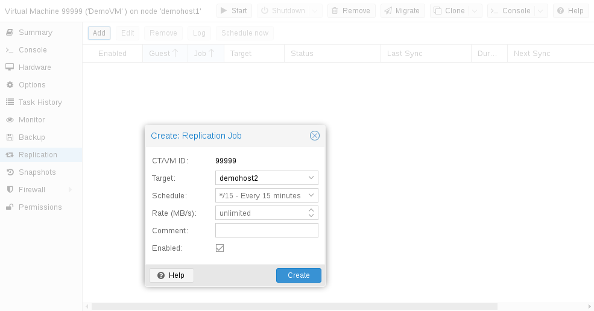

# pvesr(1)

## 名称 <a href="#chapter_pvesr" id="chapter_pvesr"></a>

pvesr \- Proxmox VE 存储复制

## 概要 <a href="#synopsis" id="synopsis"></a>

### **pvesr** `<COMMAND> [ARGS] [OPTIONS]` <a href="#cli_pvesr" id="cli_pvesr"></a>

### **pvesr create-local-job** `<id> <target>` `[OPTIONS]` <a href="#cli_pvesr_create-local-job" id="cli_pvesr_create-local-job"></a>

创建新的复制任务

**`<id>`: `[1-9][0-9]{2,8}-\d{1,9}`**

复制任务 ID。此 ID 由客户机 ID 和任务编号组成，以连字符分隔，即 *\<GUEST\>-\<JOBNUM\>*。

**`<target>`: `<string>`**

目标节点。

**`--comment` `<string>`**

描述。

**`--disable` `<boolean>`**

用于禁用/停用条目的标志。

**`--rate` `<number> (1 - N)`**

以 mbps（兆字节每秒）为单位的浮点数速率限制。

**`--remove_job` `<full | local>`**

将复制任务标记为待移除。此任务将移除所有本地复制快照。如果设置为 *full*，还会尝试移除目标上的复制卷。然后此任务将从配置文件中移除自身。

**`--schedule` `<string>` （*默认值 \=* `*/15`）**

存储复制计划。其格式是 `systemd` 日历事件的一个子集。

**`--source` `<string>`**

供内部使用，用于检测客户机是否被接管。

### **pvesr delete** `<id>` `[OPTIONS]` <a href="#cli_pvesr_delete" id="cli_pvesr_delete"></a>

将复制任务标记为待移除。

**`<id>`: `[1-9][0-9]{2,8}-\d{1,9}`**

复制任务 ID。此 ID 由客户机 ID 和任务编号组成，以连字符分隔，即 *\<GUEST\>-\<JOBNUM\>*。

**`--force` `<boolean>`（*默认 \=* `0`）**

将移除 jobconfig 条目，但不执行清理。

**`--keep` `<boolean>` （*默认值 \=* `0`）**

保留目标上的复制数据（不移除）。

### **pvesr disable** `<id>` <a href="#cli_pvesr_disable" id="cli_pvesr_disable"></a>

禁用复制任务。

**`<id>`: `[1-9][0-9]{2,8}-\d{1,9}`**

复制任务 ID。此 ID 由客户机 ID 和任务编号组成，以连字符分隔，即 *\<GUEST\>-\<JOBNUM\>*。

### **pvesr enable** `<id>` <a href="#cli_pvesr_enable" id="cli_pvesr_enable"></a>

启用复制任务。

**`<id>`: `[1-9][0-9]{2,8}-\d{1,9}`**

复制任务 ID。此 ID 由客户机 ID 和任务编号组成，以连字符分隔，即 *\<GUEST\>-\<JOBNUM\>*。

### **pvesr finalize-local-job** `<id> [<extra-args>]` `[OPTIONS]` <a href="#cli_pvesr_finalize-local-job" id="cli_pvesr_finalize-local-job"></a>

完成复制任务的收尾工作。这会移除时间戳与 \<last\_sync\> 不同的所有复制快照。

**`<id>`: `[1-9][0-9]{2,8}-\d{1,9}`**

复制任务 ID。此 ID 由客户机 ID 和任务编号组成，以连字符分隔，即 *\<GUEST\>-\<JOBNUM\>*。

**`<extra-args>`: `<array>`**

要考虑的卷 ID 列表。

**`--last_sync` `<integer> (0 - N)`**

上次成功同步的时间（UNIX 纪元时间）。如果未指定，则移除所有复制快照。

### **pvesr help** `[OPTIONS]` <a href="#cli_pvesr_help" id="cli_pvesr_help"></a>

获取指定命令的帮助。

**`--extra-args` `<array>`**

显示特定命令的帮助

**`--verbose` `<boolean>`**

详细输出格式。

### **pvesr list** <a href="#cli_pvesr_list" id="cli_pvesr_list"></a>

列出复制任务。

### **pvesr prepare-local-job** `<id> [<extra-args>]` `[OPTIONS]` <a href="#cli_pvesr_prepare-local-job" id="cli_pvesr_prepare-local-job"></a>

准备启动复制任务。在复制开始之前，在目标节点上调用。此调用供内部使用，并在 stdout 上返回 JSON 对象。此方法首先检查虚拟机 \<vmid\> 是否位于本地节点上。如果是，则立即停止。随后此方法扫描所有卷 ID，查找快照，并移除时间戳与 \<last\_sync\> 不同的所有复制快照。它也会移除任何未使用的卷。返回一个哈希，对所有存在复制快照的卷提供布尔标记。

**`<id>`: `[1-9][0-9]{2,8}-\d{1,9}`**

复制任务 ID。此 ID 由客户机 ID 和任务编号组成，以连字符分隔，即 *\<GUEST\>-\<JOBNUM\>*。

**`<extra-args>`: `<array>`**

要考虑的卷 ID 列表。

**`--force` `<boolean>`（*默认 \=* `0`）**

允许移除所有现有卷（卷列表为空）。

**`--last_sync` `<integer> (0 - N)`**

上次成功同步的时间（UNIX 纪元时间）。如果未指定，则移除所有复制快照。

**`--parent_snapname` `<string>`**

快照的名称。

**`--scan` `<string>`**

要扫描陈旧卷的存储 ID 列表。

### **pvesr read** `<id>` <a href="#cli_pvesr_read" id="cli_pvesr_read"></a>

读取复制任务配置。

**`<id>`: `[1-9][0-9]{2,8}-\d{1,9}`**

复制任务 ID。此 ID 由客户机 ID 和任务编号组成，以连字符分隔，即 *\<GUEST\>-\<JOBNUM\>*。

### **pvesr run** `[OPTIONS]` <a href="#cli_pvesr_run" id="cli_pvesr_run"></a>

此方法由 systemd-timer 调用，并执行所有同步任务或指定同步任务。

**`--id` `[1-9][0-9]{2,8}-\d{1,9}`**

复制任务 ID。此 ID 由客户机 ID 和任务编号组成，以连字符分隔，即 *\<GUEST\>-\<JOBNUM\>*。

**`--mail` `<boolean>` （*默认值 \=* `0`）**

发生故障时发送电子邮件通知。

**`--verbose` `<boolean>`（*默认值 \=* `0`）**

向 stdout 打印更详细的日志。

### **pvesr schedule-now** `<id>` <a href="#cli_pvesr_schedule-now" id="cli_pvesr_schedule-now"></a>

安排复制任务尽快启动。

**`<id>`: `[1-9][0-9]{2,8}-\d{1,9}`**

复制任务 ID。此 ID 由客户机 ID 和任务编号组成，以连字符分隔，即 *\<GUEST\>-\<JOBNUM\>*。

### **pvesr set-state** `<vmid> <state>` <a href="#cli_pvesr_set-state" id="cli_pvesr_set-state"></a>

在迁移时设置任务复制状态。此调用供内部使用。它接受 JSON 对象形式的任务状态。

**`<vmid>`: `<integer> (100 - 999999999)`**

VM 的唯一 ID。

**`<state>`: `<string>`**

作为 JSON 解码后字符串的任务状态。

### **pvesr status** `[OPTIONS]` <a href="#cli_pvesr_status" id="cli_pvesr_status"></a>

列出此节点上所有复制任务的状态。

**`--guest` `<integer> (100 - 999999999)`**

仅列出此客户机的复制任务。

### **pvesr update** `<id>` `[OPTIONS]` <a href="#cli_pvesr_update" id="cli_pvesr_update"></a>

更新复制任务配置。

**`<id>`: `[1-9][0-9]{2,8}-\d{1,9}`**

复制任务 ID。此 ID 由客户机 ID 和任务编号组成，以连字符分隔，即 *\<GUEST\>-\<JOBNUM\>*。

**`--comment` `<string>`**

描述。

**`--delete` `<string>`**

要删除的设置列表。

**`--digest` `<string>`**

如果当前配置文件的摘要不同，则阻止更改。这可用于防止并发修改。

**`--disable` `<boolean>`**

用于禁用/停用条目的标志。

**`--rate` `<number> (1 - N)`**

以 mbps（兆字节每秒）为单位的浮点数速率限制。

**`--remove_job` `<full | local>`**

将复制任务标记为待移除。此任务将移除所有本地复制快照。如果设置为 *full*，还会尝试移除目标上的复制卷。然后此任务将从配置文件中移除自身。

**`--schedule` `<string>` （*默认值 \=* `*/15`）**

存储复制计划。其格式是 `systemd` 日历事件的一个子集。

**`--source` `<string>`**

供内部使用，用于检测客户机是否被接管。

## 描述 <a href="#description" id="description"></a>

`pvesr` 命令行工具用于管理 Proxmox VE 存储复制框架。存储复制为使用本地存储的客户机提供冗余，并缩短迁移时间。

它会将客户机卷复制到另一个节点，因此无需使用共享存储即可使所有数据可用。复制使用快照来最大限度地减少通过网络发送的流量。因此，在初始完全同步之后，仅增量发送新数据。如果节点发生故障，客户机数据仍可在副本所在节点上使用。

复制按可配置的间隔自动进行。最小复制间隔为一分钟，最大为每周一次。指定这些间隔的格式是 `systemd` 日历事件的一个子集，请参阅[计划格式](#pvesr_schedule_time_format)章节：

可以将一台客户机复制到多个目标节点，但不能向同一目标节点复制两次。

可以限制每次复制的带宽，以避免存储或服务器过载。

如果客户机迁移到的节点已经是其复制目标，则只需传输自上次复制以来的更改（所谓的 `deltas`）。这可显著缩短所需时间。如果将客户机迁移到复制目标节点，复制方向会自动切换。

例如：VM100 当前位于 `nodeA`，并复制到 `nodeB`。您将其迁移到 `nodeB`，因此现在它会自动从 `nodeB` 复制回 `nodeA`。

如果迁移到的节点不是客户机的复制目标，则必须传输整个磁盘数据。迁移后，复制作业会继续将此客户机复制到配置的节点。


高可用性可以与存储复制结合使用，但在上次同步时间与节点故障时间之间可能会丢失一些数据。


## 支持的存储类型 <a href="#supported_storage_types" id="supported_storage_types"></a>

<table>
<caption>表 1. 存储类型</caption>


<thead>
<tr>
<th>描述</th>
<th>插件类型</th>
<th>快照</th>
<th>稳定</th>
</tr>
</thead>
<tbody>
<tr>
<td><p>ZFS（本地）</p></td>
<td><p>zfspool</p></td>
<td><p>是</p></td>
<td><p>是</p></td>
</tr>
</tbody>
</table>

## 计划格式 <a href="#pvesr_schedule_time_format" id="pvesr_schedule_time_format"></a>

复制使用日历事件配置计划。

## 错误处理 <a href="#error_handling" id="error_handling"></a>

如果复制作业遇到问题，它会进入错误状态。在此状态下，配置的复制间隔会暂时暂停。系统会每隔 30 分钟重试失败的复制。一旦成功，原来的计划就会重新激活。

### 可能的问题 <a href="#possible_issues" id="possible_issues"></a>

以下列出了一些最常见的问题。根据您的部署情况，可能还有其他原因。

- 网络未正常工作。
- 复制目标存储上没有剩余可用空间。
- 目标节点上无法使用具有相同存储 ID 的存储。


您始终可以使用复制日志来找出问题的原因。


### 发生错误时迁移客户机 <a href="#migrating_a_guest_in_case_of_error" id="migrating_a_guest_in_case_of_error"></a>

发生严重错误时，虚拟客户机可能会卡在故障节点上。此时需要手动将其重新迁移到正常工作的节点。

### 示例 <a href="#example" id="example"></a>

假设您有两个客户机（VM 100 和 CT 200）运行在节点 A 上，并复制到节点 B。节点 A 发生故障且无法重新上线。现在，您必须手动将客户机迁移到节点 B。

- 通过 ssh 连接到节点 B，或通过 Web UI 打开其 Shell
- 检查集群是否具有仲裁

  ```text
  # pvecm status
  ```
- 如果没有仲裁，我们强烈建议先解决此问题，使节点恢复可操作状态。仅当目前无法做到这一点时，才可使用以下命令在当前节点上强制达到仲裁：

  ```text
  # pvecm expected 1
  ```


设置 `expected votes` 后，务必避免任何影响集群的更改（例如添加/移除节点、存储、虚拟客户机）。仅使用它来让关键客户机恢复运行，或解决仲裁问题本身。


- 将两个客户机配置文件从原节点 A 移动到节点 B：

  ```text
  # mv /etc/pve/nodes/A/qemu-server/100.conf /etc/pve/nodes/B/qemu-server/100.conf
  # mv /etc/pve/nodes/A/lxc/200.conf /etc/pve/nodes/B/lxc/200.conf
  ```
- 现在可以重新启动这些客户机：

  ```text
  # qm start 100
  # pct start 200
  ```

请记得将 VMID 和节点名称替换为各自的值。

## 管理任务 <a href="#managing_jobs" id="managing_jobs"></a>

[](https://pve.proxmox.com/pve-docs/images/screenshot/gui-qemu-add-replication-job.png)

您可以使用 Web GUI 轻松创建、修改和删除复制作业。此外，还可以使用命令行界面（CLI）工具 `pvesr` 完成这些操作。

在 Web GUI 中，可以在所有级别（数据中心、节点、虚拟客户机）找到复制面板。它们的区别在于显示哪些作业：全部作业、节点特定作业或客户机特定作业。

添加新任务时，需要指定客户机（如果尚未选择）以及目标节点。复制[计划](#pvesr_schedule_time_format)可以自行设置，以替代不符合需求的默认值 `all
15 minutes`。可以对复制任务设置速率限制。速率限制有助于将存储负载保持在可接受范围。

复制作业由集群范围内唯一的 ID 标识。此 ID 由 VMID 和作业编号组成。只有使用 CLI 工具时才必须手动指定此 ID。

## 网络 <a href="#network" id="network"></a>

默认情况下，复制流量与客户机迁移流量使用同一网络。如果未设置迁移网络，则复制流量会转而默认使用管理网络。

要为复制流量使用不同的网络，请配置 `Replication Network`（在 Web 界面的 `Datacenter -> Options ->
Replication Settings` 下），或设置 `replication` 属性（位于 `datacenter.cfg` 文件中）：

```text
# use dedicated replication network
replication: secure,network=10.1.2.0/24
```

## 命令行接口示例 <a href="#command_line_interface_examples" id="command_line_interface_examples"></a>

为 ID 为 100 的客户机创建一个每 5 分钟运行一次、带宽限制为 10 Mbps（兆字节每秒）的复制作业。

```text
# pvesr create-local-job 100-0 pve1 --schedule "*/5" --rate 10
```

禁用 ID 为 `100-0` 的活动作业。

```text
# pvesr disable 100-0
```

启用 ID 为 `100-0` 的已停用作业。

```text
# pvesr enable 100-0
```

将 ID 为 `100-0` 的作业的计划间隔更改为每小时一次。

```text
# pvesr update 100-0 --schedule '*/00'
```

## 版权与免责声明 <a href="#copyright_and_disclaimer" id="copyright_and_disclaimer"></a>

版权所有 © 2007-2022 Proxmox Server Solutions GmbH

本程序是自由软件：您可以根据自由软件基金会发布的 GNU Affero General Public License 的条款重新分发和/或修改本程序，许可证版本可以是第 3 版，或（由您选择）任何更高版本。

本程序的分发是希望它能有用，但不提供任何担保；甚至没有适销性或特定用途适用性的默示担保。有关更多详情，请参阅 GNU Affero General Public License。

您应该已随本程序收到一份 GNU Affero General Public License 的副本。如果没有，请参阅 [https://www.gnu.org/licenses/](https://www.gnu.org/licenses/)

<a id="footnotes"></a>


---

---

来源：[Proxmox VE 官方文档](https://pve.proxmox.com/pve-docs/pvesr.1.html) · 版本 9.2.13 · 非官方中文翻译。
