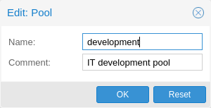
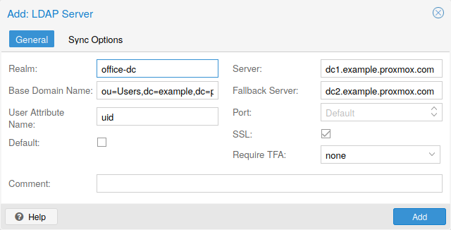
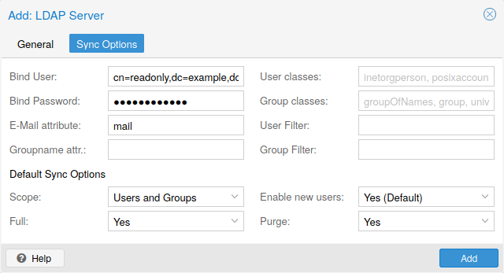
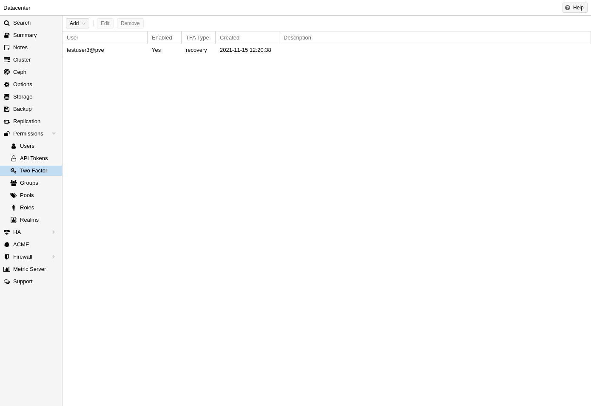
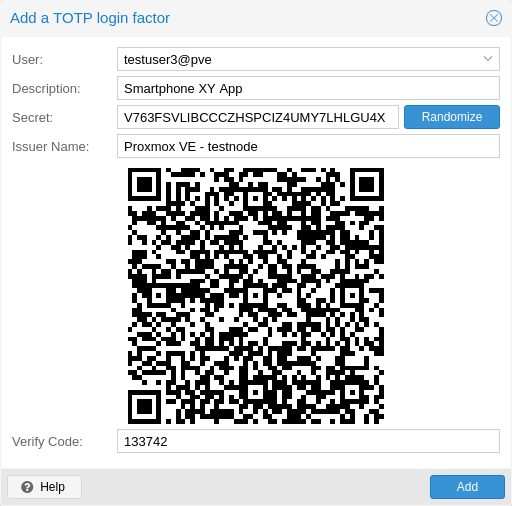
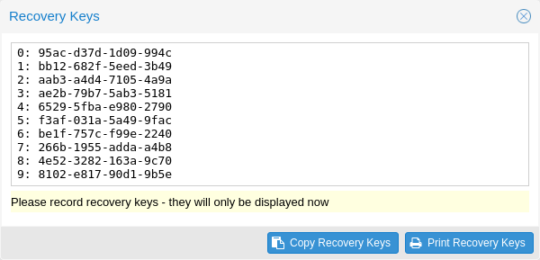
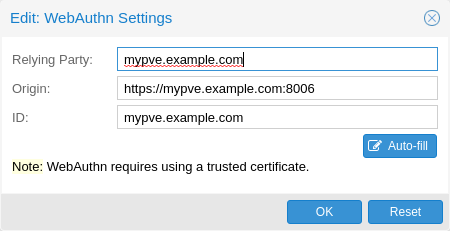
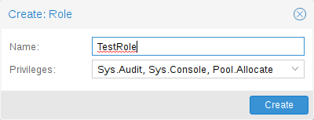

# pveum(1)

## 名称 <a href="#chapter_user_management" id="chapter_user_management"></a>

pveum \- Proxmox VE 用户管理器

## 概要 <a href="#synopsis" id="synopsis"></a>

### <strong>pveum</strong> `<COMMAND> [ARGS] [OPTIONS]` <a href="#cli_pveum" id="cli_pveum"></a>

### <strong>pveum acl delete</strong> `<path> --roles <string>` `[OPTIONS]` <a href="#cli_pveum_acl_delete" id="cli_pveum_acl_delete"></a>

更新访问控制列表（添加或移除权限）。

**`<path>`: `<string>`**

访问控制路径

**`--groups` `<string>`**

组列表。

**`--propagate` `<boolean>` （<em>默认值 \=</em> `1`）**

允许传播（继承）权限。

**`--roles` `<string>`**

角色列表。

**`--tokens` `<string>`**

API 令牌列表。

**`--users` `<string>`**

用户列表。

### <strong>pveum acl list</strong> `[FORMAT_OPTIONS]` <a href="#cli_pveum_acl_list" id="cli_pveum_acl_list"></a>

获取访问控制列表（ACL）。

### <strong>pveum acl modify</strong> `<path> --roles <string>` `[OPTIONS]` <a href="#cli_pveum_acl_modify" id="cli_pveum_acl_modify"></a>

更新访问控制列表（添加或移除权限）。

**`<path>`: `<string>`**

访问控制路径

**`--groups` `<string>`**

组列表。

**`--propagate` `<boolean>` （<em>默认值 \=</em> `1`）**

允许传播（继承）权限。

**`--roles` `<string>`**

角色列表。

**`--tokens` `<string>`**

API 令牌列表。

**`--users` `<string>`**

用户列表。

### <strong>pveum acldel</strong> <a href="#cli_pveum_acldel" id="cli_pveum_acldel"></a>

<em>pveum acl delete</em> 的别名。

### <strong>pveum aclmod</strong> <a href="#cli_pveum_aclmod" id="cli_pveum_aclmod"></a>

<em>pveum acl modify</em> 的别名。

### <strong>pveum group add</strong> `<groupid>` `[OPTIONS]` <a href="#cli_pveum_group_add" id="cli_pveum_group_add"></a>

创建新组。

**`<groupid>`: `<string>`**

没有可用的说明

**`--comment` `<string>`**

没有可用的说明

### <strong>pveum group delete</strong> `<groupid>` <a href="#cli_pveum_group_delete" id="cli_pveum_group_delete"></a>

删除组。

**`<groupid>`: `<string>`**

没有可用的说明

### <strong>pveum group list</strong> `[FORMAT_OPTIONS]` <a href="#cli_pveum_group_list" id="cli_pveum_group_list"></a>

组索引。

### <strong>pveum group modify</strong> `<groupid>` `[OPTIONS]` <a href="#cli_pveum_group_modify" id="cli_pveum_group_modify"></a>

更新组数据。

**`<groupid>`: `<string>`**

没有可用的说明

**`--comment` `<string>`**

没有可用的说明

### <strong>pveum groupadd</strong> <a href="#cli_pveum_groupadd" id="cli_pveum_groupadd"></a>

<em>pveum group add</em> 的别名。

### <strong>pveum groupdel</strong> <a href="#cli_pveum_groupdel" id="cli_pveum_groupdel"></a>

<em>pveum group delete</em> 的别名。

### <strong>pveum groupmod</strong> <a href="#cli_pveum_groupmod" id="cli_pveum_groupmod"></a>

<em>pveum group modify</em> 的别名。

### <strong>pveum help</strong> `[OPTIONS]` <a href="#cli_pveum_help" id="cli_pveum_help"></a>

获取指定命令的帮助。

**`--extra-args` `<array>`**

显示特定命令的帮助

**`--verbose` `<boolean>`**

详细输出格式。

### <strong>pveum passwd</strong> `<userid>` `[OPTIONS]` <a href="#cli_pveum_passwd" id="cli_pveum_passwd"></a>

更改用户密码。

**`<userid>`: `<string>`**

完整的用户 ID，格式为 `name@realm`。

**`--confirmation-password` `<string>`**

执行更改的用户的当前密码。

### <strong>pveum pool add</strong> `<poolid>` `[OPTIONS]` <a href="#cli_pveum_pool_add" id="cli_pveum_pool_add"></a>

创建新资源池。

**`<poolid>`: `<string>`**

没有可用的说明

**`--comment` `<string>`**

没有可用的说明

### <strong>pveum pool delete</strong> `<poolid>` <a href="#cli_pveum_pool_delete" id="cli_pveum_pool_delete"></a>

删除资源池。

**`<poolid>`: `<string>`**

没有可用的说明

### <strong>pveum pool list</strong> `[OPTIONS]` `[FORMAT_OPTIONS]` <a href="#cli_pveum_pool_list" id="cli_pveum_pool_list"></a>

列出资源池或获取资源池配置。

**`--poolid` `<string>`**

没有可用的说明

**`--type` `<lxc | qemu | storage>`**

没有可用的说明


需要选项：`poolid`


### <strong>pveum pool modify</strong> `<poolid>` `[OPTIONS]` <a href="#cli_pveum_pool_modify" id="cli_pveum_pool_modify"></a>

更新资源池。

**`<poolid>`: `<string>`**

没有可用的说明

**`--allow-move` `<boolean>` （<em>默认值 \=</em> `0`）**

即使客户机已在其他资源池中，也允许添加。客户机将从当前资源池移除，并添加到此资源池。

**`--comment` `<string>`**

没有可用的说明

**`--delete` `<boolean>` (<em>默认 \=</em> `0`)**

移除传入的 VMID 和/或存储 ID，而非添加。

**`--storage` `<string>`**

要添加到此资源池或从中移除的存储 ID 列表。

**`--vms` `<string>`**

要添加到此资源池或从中移除的客户机 VMID 列表。

### <strong>pveum realm add</strong> `<realm> --type <string>` `[OPTIONS]` <a href="#cli_pveum_realm_add" id="cli_pveum_realm_add"></a>

添加认证服务器。

**`<realm>`: `<string>`**

认证域 ID

**`--acr-values` `^[^\x00-\x1F\x7F <>#"]*$`**

指定请求授权服务器在认证请求中使用的认证上下文类引用值。

**`--audiences` `^[^\x00-\x1F\x7F <>#"]*$`**

除了 <em>client-id</em> 之外，还接受 OpenID 签发者可能包含的受众列表。

**`--autocreate` `<boolean>` （<em>默认值 \=</em> `0`）**

如果用户不存在，则自动创建。

**`--base_dn` `<string>`**

LDAP 基础域名

**`--bind_dn` `<string>`**

LDAP 绑定域名

**`--capath` `<string>` （<em>默认值 \=</em> `/etc/ssl/certs`）**

CA 证书存储路径

**`--case-sensitive` `<boolean>` （<em>默认值 \=</em> `1`）**

用户名区分大小写

**`--cert` `<string>`**

客户端证书路径

**`--certkey` `<string>`**

客户端证书密钥路径

**`--check-connection` `<boolean>` （<em>默认值 \=</em> `0`）**

检查与服务器的绑定连接。

**`--client-id` `<string>`**

OpenID 客户端 ID

**`--client-key` `<string>`**

OpenID 客户端密钥

**`--comment` `<string>`**

描述。

**`--default` `<boolean>`**

将此认证域用作默认认证域

**`--domain` `\S+`**

AD 域名

**`--filter` `<string>`**

用户同步的 LDAP 过滤器。

**`--group_classes` `<string>` （<em>默认值 \=</em> `groupOfNames, group, univentionGroup, ipausergroup`）**

组的对象类。

**`--group_dn` `<string>`**

组同步的 LDAP 基础域名。如果未设置，则使用 base\_dn。

**`--group_filter` `<string>`**

组同步的 LDAP 过滤器。

**`--group_name_attr` `<string>`**

表示组名称的 LDAP 属性。如果未设置或未找到，则使用 DN 的第一个值作为名称。

**`--groups-autocreate` `<boolean>` （<em>默认值 \=</em> `0`）**

如果组不存在，则自动创建。

**`--groups-claim` `(?^:[A-Za-z0-9\.\-_]+)`**

用于获取组的 OpenID 声明。

**`--groups-overwrite` `<boolean>` （<em>默认值 \=</em> `0`）**

登录时覆盖该用户的所有组。

**`--issuer-url` `<string>`**

OpenID 签发者 URL

**`--mode` `<ldap | ldap+starttls | ldaps>` （<em>默认值 \=</em> `ldap`）**

LDAP 协议模式。

**`--password` `<string>`**

LDAP 绑定密码。将保存在 <em>/etc/pve/priv/realm/\<REALM\>.pw</em> 中。

**`--port` `<integer> (1 - 65535)`**

服务器端口。

**`--prompt` `(?:none|login|consent|select_account|\S+)`**

指定授权服务器是否提示最终用户重新认证并同意。

**`--query-userinfo` `<boolean>` （<em>默认值 \=</em> `1`）**

启用对 userinfo 端点的查询，以获取声明值。

**`--scopes` `<string>` （<em>默认值 \=</em> `email profile`）**

指定应授权并返回的作用域（用户详细信息），例如 <em>email</em> 或 <em>profile</em>。

**`--secure` `<boolean>`**

使用安全的 LDAPS 协议。已弃用：请改用 <em>mode</em>。

**`--server1` `<string>`**

服务器 IP 地址（或 DNS 名称）

**`--server2` `<string>`**

备用服务器 IP 地址（或 DNS 名称）

**`--sslversion` `<tlsv1 | tlsv1_1 | tlsv1_2 | tlsv1_3>`**

LDAPS TLS/SSL 版本。不建议使用低于 1.2 的版本！

**`--sync-defaults-options` `[enable-new=<1|0>] [,full=<1|0>] [,purge=<1|0>] [,remove-vanished=([acl];[properties];[entry])|none] [,scope=<users|groups|both>]`**

同步行为的默认选项。

**`--sync_attributes` `\w+=[^,]+(,\s*\w+=[^,]+)*`**

以逗号分隔的 key\=value 对列表，用于指定哪些 LDAP 属性映射到哪些 PVE 用户字段。例如，要将 LDAP 属性 <em>mail</em> 映射到 PVE 的 <em>email</em>，请写入 <em>email\=mail</em>。默认情况下，每个 PVE 用户字段都由同名 LDAP 属性表示。

**`--tfa` `type=<TFATYPE> [,digits=<COUNT>] [,id=<ID>] [,key=<KEY>] [,step=<SECONDS>] [,url=<URL>]`**

使用双因素认证。

**`--type` `<ad | ldap | openid | pam | pve>`**

认证域类型。

**`--user_attr` `\S{2,}`**

LDAP 用户属性名称

**`--user_classes` `<string>` （<em>默认值 \=</em> `inetorgperson, posixaccount, person, user`）**

用户的对象类。

**`--username-claim` `<string>`**

用于生成唯一用户名的 OpenID 声明。

**`--verify` `<boolean>` （<em>默认值 \=</em> `0`）**

验证服务器的 SSL 证书

### <strong>pveum realm delete</strong> `<realm>` <a href="#cli_pveum_realm_delete" id="cli_pveum_realm_delete"></a>

删除认证服务器。

**`<realm>`: `<string>`**

认证域 ID

### <strong>pveum realm list</strong> `[FORMAT_OPTIONS]` <a href="#cli_pveum_realm_list" id="cli_pveum_realm_list"></a>

认证域索引。

### <strong>pveum realm modify</strong> `<realm>` `[OPTIONS]` <a href="#cli_pveum_realm_modify" id="cli_pveum_realm_modify"></a>

更新认证服务器设置。

**`<realm>`: `<string>`**

认证域 ID

**`--acr-values` `^[^\x00-\x1F\x7F <>#"]*$`**

指定请求授权服务器在认证请求中使用的认证上下文类引用值。

**`--audiences` `^[^\x00-\x1F\x7F <>#"]*$`**

除了 <em>client-id</em> 之外，还接受 OpenID 签发者可能包含的受众列表。

**`--autocreate` `<boolean>` （<em>默认值 \=</em> `0`）**

如果用户不存在，则自动创建。

**`--base_dn` `<string>`**

LDAP 基础域名

**`--bind_dn` `<string>`**

LDAP 绑定域名

**`--capath` `<string>` （<em>默认值 \=</em> `/etc/ssl/certs`）**

CA 证书存储路径

**`--case-sensitive` `<boolean>` （<em>默认值 \=</em> `1`）**

用户名区分大小写

**`--cert` `<string>`**

客户端证书路径

**`--certkey` `<string>`**

客户端证书密钥路径

**`--check-connection` `<boolean>` （<em>默认值 \=</em> `0`）**

检查与服务器的绑定连接。

**`--client-id` `<string>`**

OpenID 客户端 ID

**`--client-key` `<string>`**

OpenID 客户端密钥

**`--comment` `<string>`**

描述。

**`--default` `<boolean>`**

将此认证域用作默认认证域

**`--delete` `<string>`**

要删除的设置列表。

**`--digest` `<string>`**

如果当前配置文件的摘要不同，则阻止更改。这可用于防止并发修改。

**`--domain` `\S+`**

AD 域名

**`--filter` `<string>`**

用户同步的 LDAP 过滤器。

**`--group_classes` `<string>` （<em>默认值 \=</em> `groupOfNames, group, univentionGroup, ipausergroup`）**

组的对象类。

**`--group_dn` `<string>`**

组同步的 LDAP 基础域名。如果未设置，则使用 base\_dn。

**`--group_filter` `<string>`**

组同步的 LDAP 过滤器。

**`--group_name_attr` `<string>`**

表示组名称的 LDAP 属性。如果未设置或未找到，则使用 DN 的第一个值作为名称。

**`--groups-autocreate` `<boolean>` （<em>默认值 \=</em> `0`）**

如果组不存在，则自动创建。

**`--groups-claim` `(?^:[A-Za-z0-9\.\-_]+)`**

用于获取组的 OpenID 声明。

**`--groups-overwrite` `<boolean>` （<em>默认值 \=</em> `0`）**

登录时覆盖该用户的所有组。

**`--issuer-url` `<string>`**

OpenID 签发者 URL

**`--mode` `<ldap | ldap+starttls | ldaps>` （<em>默认值 \=</em> `ldap`）**

LDAP 协议模式。

**`--password` `<string>`**

LDAP 绑定密码。将保存在 <em>/etc/pve/priv/realm/\<REALM\>.pw</em> 中。

**`--port` `<integer> (1 - 65535)`**

服务器端口。

**`--prompt` `(?:none|login|consent|select_account|\S+)`**

指定授权服务器是否提示最终用户重新认证并同意。

**`--query-userinfo` `<boolean>` （<em>默认值 \=</em> `1`）**

启用对 userinfo 端点的查询，以获取声明值。

**`--scopes` `<string>` （<em>默认值 \=</em> `email profile`）**

指定应授权并返回的作用域（用户详细信息），例如 <em>email</em> 或 <em>profile</em>。

**`--secure` `<boolean>`**

使用安全的 LDAPS 协议。已弃用：请改用 <em>mode</em>。

**`--server1` `<string>`**

服务器 IP 地址（或 DNS 名称）

**`--server2` `<string>`**

备用服务器 IP 地址（或 DNS 名称）

**`--sslversion` `<tlsv1 | tlsv1_1 | tlsv1_2 | tlsv1_3>`**

LDAPS TLS/SSL 版本。不建议使用低于 1.2 的版本！

**`--sync-defaults-options` `[enable-new=<1|0>] [,full=<1|0>] [,purge=<1|0>] [,remove-vanished=([acl];[properties];[entry])|none] [,scope=<users|groups|both>]`**

同步行为的默认选项。

**`--sync_attributes` `\w+=[^,]+(,\s*\w+=[^,]+)*`**

以逗号分隔的 key\=value 对列表，用于指定哪些 LDAP 属性映射到哪些 PVE 用户字段。例如，要将 LDAP 属性 <em>mail</em> 映射到 PVE 的 <em>email</em>，请写入 <em>email\=mail</em>。默认情况下，每个 PVE 用户字段都由同名 LDAP 属性表示。

**`--tfa` `type=<TFATYPE> [,digits=<COUNT>] [,id=<ID>] [,key=<KEY>] [,step=<SECONDS>] [,url=<URL>]`**

使用双因素认证。

**`--user_attr` `\S{2,}`**

LDAP 用户属性名称

**`--user_classes` `<string>` （<em>默认值 \=</em> `inetorgperson, posixaccount, person, user`）**

用户的对象类。

**`--verify` `<boolean>` （<em>默认值 \=</em> `0`）**

验证服务器的 SSL 证书

### <strong>pveum realm sync</strong> `<realm>` `[OPTIONS]` <a href="#cli_pveum_realm_sync" id="cli_pveum_realm_sync"></a>

将用户和/或组从配置的 LDAP 同步到 user.cfg。注意：同步后的组将命名为 <em>name-$realm</em>，因此请确保这些组不存在，以免覆盖。

**`<realm>`: `<string>`**

认证域 ID

**`--dry-run` `<boolean>` （<em>默认值 \=</em> `0`）**

如果设置，则不写入任何内容。

**`--enable-new` `<boolean>` （<em>默认值 \=</em> `1`）**

立即启用新同步的用户。

**`--full` `<boolean>`**

已弃用：请改用 <em>remove-vanished</em>。如果设置，则以 LDAP 目录为准，删除同步未返回的用户或组，并移除同步用户所有在本地修改的属性。如果未设置，则仅同步已同步数据中存在的信息，不删除或修改其他任何内容。

**`--purge` `<boolean>`**

已弃用：请改用 <em>remove-vanished</em>。移除在同步期间从配置中移除的用户或组的 ACL。

**`--remove-vanished` `([acl];[properties];[entry])|none` （<em>默认值 \=</em> `none`）**

以分号分隔的列表，指定当相应项目或用户在同步中消失时要移除的内容。可用值如下：<em>entry</em> 在同步未返回用户/组时将其移除。<em>properties</em> 移除现有用户/组上已设置但源中不存在的属性（包括自定义属性）。<em>acl</em> 在同步未返回用户/组时移除 ACL。也可以不使用列表，而使用 <em>none</em>（默认值）。

**`--scope` `<both | groups | users>`**

选择要同步的内容。

### <strong>pveum role add</strong> `<roleid>` `[OPTIONS]` <a href="#cli_pveum_role_add" id="cli_pveum_role_add"></a>

创建新角色。

**`<roleid>`: `<string>`**

没有可用的说明

**`--privs` `<string>`**

没有可用的说明

### <strong>pveum role delete</strong> `<roleid>` <a href="#cli_pveum_role_delete" id="cli_pveum_role_delete"></a>

删除角色。

**`<roleid>`: `<string>`**

没有可用的说明

### <strong>pveum role list</strong> `[FORMAT_OPTIONS]` <a href="#cli_pveum_role_list" id="cli_pveum_role_list"></a>

角色索引。

### <strong>pveum role modify</strong> `<roleid>` `[OPTIONS]` <a href="#cli_pveum_role_modify" id="cli_pveum_role_modify"></a>

更新现有角色。

**`<roleid>`: `<string>`**

没有可用的说明

**`--append` `<boolean>`**

没有可用的说明


需要选项：`privs`


**`--privs` `<string>`**

没有可用的说明

### <strong>pveum roleadd</strong> <a href="#cli_pveum_roleadd" id="cli_pveum_roleadd"></a>

<em>pveum role add</em> 的别名。

### <strong>pveum roledel</strong> <a href="#cli_pveum_roledel" id="cli_pveum_roledel"></a>

<em>pveum role delete</em> 的别名。

### <strong>pveum rolemod</strong> <a href="#cli_pveum_rolemod" id="cli_pveum_rolemod"></a>

<em>pveum role modify</em> 的别名。

### <strong>pveum ticket</strong> `<username>` `[OPTIONS]` <a href="#cli_pveum_ticket" id="cli_pveum_ticket"></a>

创建或验证认证票据。

**`<username>`: `<string>`**

用户名

**`--new-format` `<boolean>` （<em>默认值 \=</em> `1`）**

此参数现在会被忽略，并视为 1。

**`--otp` `<string>`**

双因素认证的一次性密码。

**`--path` `<string>`**

验证票据，并检查用户是否具有 <em>privs</em> 访问权限，路径为 <em>path</em>


需要选项：`privs`


**`--privs` `<string>`**

验证票据，并检查用户是否具有 <em>privs</em> 访问权限，路径为 <em>path</em>


需要选项：`path`


**`--realm` `<string>`**

可以选择通过此参数传入认证域。通常将认证域直接添加到用户名中：\<username\>@\<realm\>。

**`--tfa-challenge` `<string>`**

用户要响应的已签名 TFA 质询字符串。

### <strong>pveum user add</strong> `<userid>` `[OPTIONS]` <a href="#cli_pveum_user_add" id="cli_pveum_user_add"></a>

创建新用户。

**`<userid>`: `<string>`**

完整的用户 ID，格式为 `name@realm`。

**`--comment` `<string>`**

没有可用的说明

**`--email` `<string>`**

没有可用的说明

**`--enable` `<boolean>` （<em>默认值 \=</em> `1`）**

启用账户（默认）。可以将其设置为 <em>0</em> 以禁用账户

**`--expire` `<integer> (0 - N)`**

账户到期日期（自纪元以来的秒数）。<em>0</em> 表示没有到期日期。

**`--firstname` `<string>`**

没有可用的说明

**`--groups` `<string>`**

没有可用的说明

**`--keys` `[0-9a-zA-Z!=]{0,4096}`**

双因素认证的密钥（yubico）。

**`--lastname` `<string>`**

没有可用的说明

**`--password` `<string>`**

初始密码。

### <strong>pveum user delete</strong> `<userid>` <a href="#cli_pveum_user_delete" id="cli_pveum_user_delete"></a>

删除用户。

**`<userid>`: `<string>`**

完整的用户 ID，格式为 `name@realm`。

### <strong>pveum user list</strong> `[OPTIONS]` `[FORMAT_OPTIONS]` <a href="#cli_pveum_user_list" id="cli_pveum_user_list"></a>

用户索引。

**`--enabled` `<boolean>`**

enable 属性的可选过滤器。

**`--full` `<boolean>` （<em>默认值 \=</em> `0`）**

包含组和令牌信息。

### <strong>pveum user modify</strong> `<userid>` `[OPTIONS]` <a href="#cli_pveum_user_modify" id="cli_pveum_user_modify"></a>

更新用户配置。

**`<userid>`: `<string>`**

完整的用户 ID，格式为 `name@realm`。

**`--append` `<boolean>`**

没有可用的说明


需要选项：`groups`


**`--comment` `<string>`**

没有可用的说明

**`--email` `<string>`**

没有可用的说明

**`--enable` `<boolean>` （<em>默认值 \=</em> `1`）**

启用账户（默认）。可以将其设置为 <em>0</em> 以禁用账户

**`--expire` `<integer> (0 - N)`**

账户到期日期（自纪元以来的秒数）。<em>0</em> 表示没有到期日期。

**`--firstname` `<string>`**

没有可用的说明

**`--groups` `<string>`**

没有可用的说明

**`--keys` `[0-9a-zA-Z!=]{0,4096}`**

双因素认证的密钥（yubico）。

**`--lastname` `<string>`**

没有可用的说明

### <strong>pveum user permissions</strong> `[<userid>]` `[OPTIONS]` `[FORMAT_OPTIONS]` <a href="#cli_pveum_user_permissions" id="cli_pveum_user_permissions"></a>

获取给定用户/令牌的有效权限。

**`<userid>`: `(?^:^(?^:[^\s:/]+)\@(?^:[A-Za-z][A-Za-z0-9\.\-_]+)(?:!(?^:[A-Za-z][A-Za-z0-9\.\-_]+))?$)`**

用户 ID 或完整的 API 令牌 ID

**`--path` `<string>`**

仅转储此特定路径，而不是整棵树。

### <strong>pveum user tfa delete</strong> `<userid>` `[OPTIONS]` <a href="#cli_pveum_user_tfa_delete" id="cli_pveum_user_tfa_delete"></a>

删除用户的 TFA 条目。

**`<userid>`: `<string>`**

完整的用户 ID，格式为 `name@realm`。

**`--id` `<string>`**

TFA ID，如果未提供，则删除所有 TFA 条目。

### <strong>pveum user tfa list</strong> `[<userid>]` <a href="#cli_pveum_user_tfa_list" id="cli_pveum_user_tfa_list"></a>

列出 TFA 条目。

**`<userid>`: `<string>`**

完整的用户 ID，格式为 `name@realm`。

### <strong>pveum user tfa unlock</strong> `<userid>` <a href="#cli_pveum_user_tfa_unlock" id="cli_pveum_user_tfa_unlock"></a>

解锁用户的 TFA 认证。

**`<userid>`: `<string>`**

完整的用户 ID，格式为 `name@realm`。

### <strong>pveum user token add</strong> `<userid> <tokenid>` `[OPTIONS]` `[FORMAT_OPTIONS]` <a href="#cli_pveum_user_token_add" id="cli_pveum_user_token_add"></a>

为特定用户生成新的 API 令牌。注意：返回的 API 令牌值需要保存，因为之后无法再次获取！

**`<userid>`: `<string>`**

完整的用户 ID，格式为 `name@realm`。

**`<tokenid>`: `(?^:[A-Za-z][A-Za-z0-9\.\-_]+)`**

用户特定的令牌标识符。

**`--comment` `<string>`**

没有可用的说明

**`--expire` `<integer> (0 - N)` （<em>默认值 \=</em> `same as user`）**

API 令牌到期日期（自纪元以来的秒数）。<em>0</em> 表示没有到期日期。

**`--privsep` `<boolean>` （<em>默认值 \=</em> `1`）**

使用单独的 ACL 限制 API 令牌权限（默认），或赋予对应用户的全部权限。

### <strong>pveum user token delete</strong> `<userid> <tokenid>` `[FORMAT_OPTIONS]` <a href="#cli_pveum_user_token_delete" id="cli_pveum_user_token_delete"></a>

移除特定用户的 API 令牌。

**`<userid>`: `<string>`**

完整的用户 ID，格式为 `name@realm`。

**`<tokenid>`: `(?^:[A-Za-z][A-Za-z0-9\.\-_]+)`**

用户特定的令牌标识符。

### <strong>pveum user token list</strong> `<userid>` `[FORMAT_OPTIONS]` <a href="#cli_pveum_user_token_list" id="cli_pveum_user_token_list"></a>

获取用户 API 令牌。

**`<userid>`: `<string>`**

完整的用户 ID，格式为 `name@realm`。

### <strong>pveum user token modify</strong> `<userid> <tokenid>` `[OPTIONS]` `[FORMAT_OPTIONS]` <a href="#cli_pveum_user_token_modify" id="cli_pveum_user_token_modify"></a>

更新特定用户的 API 令牌。注意：设置 <em>regenerate</em> 后，返回的令牌值需要保存，因为之后无法再次获取！

**`<userid>`: `<string>`**

完整的用户 ID，格式为 `name@realm`。

**`<tokenid>`: `(?^:[A-Za-z][A-Za-z0-9\.\-_]+)`**

用户特定的令牌标识符。

**`--comment` `<string>`**

没有可用的说明

**`--delete` `<string>`**

要删除的设置列表。

**`--expire` `<integer> (0 - N)` （<em>默认值 \=</em> `same as user`）**

API 令牌到期日期（自纪元以来的秒数）。<em>0</em> 表示没有到期日期。

**`--privsep` `<boolean>` （<em>默认值 \=</em> `1`）**

使用单独的 ACL 限制 API 令牌权限（默认），或赋予对应用户的全部权限。

**`--regenerate` `<boolean>` （<em>默认值 \=</em> `0`）**

重新生成令牌的秘密值。此操作之后，所有使用旧秘密值的用户都将失去访问权限。

### <strong>pveum user token permissions</strong> `<userid> <tokenid>` `[OPTIONS]` `[FORMAT_OPTIONS]` <a href="#cli_pveum_user_token_permissions" id="cli_pveum_user_token_permissions"></a>

获取给定令牌的有效权限。

**`<userid>`: `<string>`**

完整的用户 ID，格式为 `name@realm`。

**`<tokenid>`: `(?^:[A-Za-z][A-Za-z0-9\.\-_]+)`**

用户特定的令牌标识符。

**`--path` `<string>`**

仅转储此特定路径，而不是整棵树。

### <strong>pveum user token remove</strong> <a href="#cli_pveum_user_token_remove" id="cli_pveum_user_token_remove"></a>

<em>pveum user token delete</em> 的别名。

### <strong>pveum useradd</strong> <a href="#cli_pveum_useradd" id="cli_pveum_useradd"></a>

<em>pveum user add</em> 的别名。

### <strong>pveum userdel</strong> <a href="#cli_pveum_userdel" id="cli_pveum_userdel"></a>

<em>pveum user delete</em> 的别名。

### <strong>pveum usermod</strong> <a href="#cli_pveum_usermod" id="cli_pveum_usermod"></a>

<em>pveum user modify</em> 的别名。

## 描述 <a href="#description" id="description"></a>

Proxmox VE 支持多种身份验证来源，例如 Linux PAM、集成的 Proxmox VE 身份验证服务器、LDAP、Microsoft Active Directory 和 OpenID Connect。

通过对所有对象（虚拟机、存储、节点等）使用基于角色的用户和权限管理，可以定义精细的访问权限。

## 用户 <a href="#pveum_users" id="pveum_users"></a>

Proxmox VE 将用户属性保存在 `/etc/pve/user.cfg` 中。密码不保存在这里；用户会关联到下文描述的[认证域](#pveum_authentication_realms)。因此，系统内部通常通过用户名和认证域来标识用户，形式为 `<userid>@<realm>`。

此文件中的每个用户条目包含以下信息：

- 名字
- 姓氏
- 电子邮件地址
- 所属组
- 可选的到期日期
- 关于此用户的注释或备注
- 此用户是启用还是禁用
- 可选的双因素身份验证密钥


禁用或删除用户，或设置的到期日期已过时，此用户将无法登录新会话或启动新任务。此用户已启动的所有任务（例如终端会话）都 <strong>不会</strong> 因任何此类事件而自动终止。


### 系统管理员 <a href="#system_administrator" id="system_administrator"></a>

系统的 root 用户始终可以通过 Linux PAM 认证域登录，并且是不受限制的管理员。此用户不能删除，但仍可更改其属性。系统邮件会发送到分配给此用户的电子邮件地址。

## 组 <a href="#pveum_groups" id="pveum_groups"></a>

每个用户可以属于多个组。组是组织访问权限的首选方式。应始终将权限授予组，而非单个用户。这样可得到更易于维护的访问控制列表。

## API 令牌 <a href="#pveum_tokens" id="pveum_tokens"></a>

API 令牌允许其他系统、软件或 API 客户端以无状态方式访问 REST API 的大部分功能。例外是提供虚拟机或系统控制台访问的端点。这些端点需要用户权限，不能通过 API 令牌访问。

可以为单个用户生成令牌，并赋予单独的权限和到期日期，以限制访问范围和持续时间。如果 API 令牌泄露，可以撤销令牌，而无需禁用用户本身。

API 令牌有两种基本类型：

- 分离权限：需要通过 ACL 向令牌显式授予访问权限。其有效权限通过用户权限与令牌权限取交集计算。<strong>这是默认设置</strong>，适用于新创建的令牌。
- 完整权限：令牌权限与关联用户的权限完全相同。只有集成确实需要用户的完整权限时，才禁用权限分离。

创建令牌时设置 `expire` 时间戳（Unix 纪元秒数），以免废弃的自动化任务悄无声息地继续运行。一旦超过期限，身份验证代码就会拒绝请求。


令牌值仅在生成令牌时显示/返回一次。之后无法再次通过 API 获取！


要使用 API 令牌，请在发出 API 请求时将 HTTP 标头 <em>Authorization</em> 设为显示的值，形式为 `PVEAPIToken=USER@REALM!TOKENID=UUID`，或参阅 API 客户端文档。

## 资源池 <a href="#pveum_resource_pools" id="pveum_resource_pools"></a>

[](https://pve.proxmox.com/pve-docs/images/screenshot/gui-datacenter-pool-window.png)

资源池是一组虚拟机、容器和存储设备。如果某些用户需要对特定资源集进行受控访问，资源池可简化权限处理，因为它允许将单项权限应用于一组元素，无需逐个资源管理。资源池通常与组配合使用，使组成员对一组虚拟机和存储拥有权限。

## 认证域 <a href="#pveum_authentication_realms" id="pveum_authentication_realms"></a>

由于 Proxmox VE 用户只是某些外部认证域中现有用户的对应项，因此必须在 `/etc/pve/domains.cfg` 中配置认证域。可用的认证域（身份验证方法）如下：

**Linux PAM 标准身份验证**

Linux PAM 是系统范围的用户身份验证框架。这些用户通过 `adduser` 等命令在宿主机系统上创建。如果 Proxmox VE 宿主机系统中存在 PAM 用户，可以向 Proxmox VE 添加相应条目，允许这些用户使用系统用户名和密码登录。

**Proxmox VE 身份验证服务器**

这是类似 Unix 的密码存储，将密码哈希存储在 `/etc/pve/priv/shadow.cfg` 中。密码使用 SHA-256 哈希算法进行哈希。对于小型（甚至中型）安装，如果用户无需访问 Proxmox VE 之外的任何内容，这是最方便的认证域。在这种情况下，用户完全由 Proxmox VE 管理，并且可以通过 GUI 更改自己的密码。

**LDAP**

LDAP（轻量目录访问协议）是使用目录服务进行身份验证的开放跨平台协议。OpenLDAP 是一种流行的 LDAP 协议开源实现。

**Microsoft Active Directory（AD）**

Microsoft Active Directory（AD）是 Windows 域网络的目录服务，Proxmox VE 支持将其作为认证域。它支持使用 LDAP 作为身份验证协议。

**OpenID Connect**

OpenID Connect 作为身份层实现在 OAuth 2.0 协议之上。它允许客户端根据外部授权服务器执行的身份验证来验证用户身份。

### Linux PAM 标准认证 <a href="#user-realms-pam" id="user-realms-pam"></a>

由于 Linux PAM 对应宿主机系统用户，因此在允许用户登录的每个节点上都必须存在系统用户。用户使用其通常的系统密码进行身份验证。此认证域默认添加且无法移除。

通过 GUI 或等效的 `/access/password` API 端点更改密码，仅应用于本地节点，而非整个集群。尽管 Proxmox VE 采用多主设计，为不同节点使用不同密码仍可带来安全收益。

在可配置性方面，管理员可以要求此认证域的登录使用双因素身份验证，并将该认证域设为默认认证域。

### Proxmox VE 认证服务器 <a href="#user-realms-pve" id="user-realms-pve"></a>

Proxmox VE 身份验证服务器认证域是简单的类 Unix 密码存储。该认证域默认创建，与 Linux PAM 一样，唯一可用的配置项是要求此认证域用户进行双因素身份验证，以及将其设为默认登录认证域。

与其他 Proxmox VE 认证域类型不同，用户的创建和身份验证完全通过 Proxmox VE 进行，而非针对其他系统进行身份验证。因此，创建此类用户时必须设置密码。

### LDAP <a href="#user-realms-ldap" id="user-realms-ldap"></a>

也可以使用外部 LDAP 服务器进行用户身份验证（例如 OpenLDAP）。在此认证域类型中，会在 <em>基本域名</em>（`base_dn`）下搜索用户，使用 <em>用户属性名称</em>（`user_attr`）字段指定的用户名属性。

可以配置一台服务器和可选的备用服务器，连接可通过 SSL 加密。此外，可以为目录和组配置过滤器。过滤器允许进一步限制认证域的范围。

例如，如果用户通过以下 LDIF 数据集表示：

```text
# user1 of People at ldap-test.com
dn: uid=user1,ou=People,dc=ldap-test,dc=com
objectClass: top
objectClass: person
objectClass: organizationalPerson
objectClass: inetOrgPerson
uid: user1
cn: Test User 1
sn: Testers
description: This is the first test user.
```

<em>基本域名</em> 将为 `ou=People,dc=ldap-test,dc=com`，用户属性将为 `uid`。

如果 Proxmox VE 需要先向 LDAP 服务器进行身份验证（绑定）才能查询和验证用户，可以通过 `bind_dn` 属性（位于 `/etc/pve/domains.cfg` 中）配置绑定域名。其密码随后必须存储在 `/etc/pve/priv/realm/<realmname>.pw` 中（例如 `/etc/pve/priv/realm/my-ldap.pw`）。此文件应包含单行明文密码。

要验证证书，需要设置 `capath`。可以将其直接设为 LDAP 服务器的 CA 证书，或包含所有受信任 CA 证书的系统路径（`/etc/ssl/certs`）。此外，还需设置 `verify` 选项，也可以通过 Web 界面设置。

LDAP 服务器认证域的主要配置选项如下：

- `Realm`（`realm`）：Proxmox VE 用户的认证域标识符
- `Base Domain Name`（`base_dn`）：搜索用户的目录
- `User Attribute Name`（`user_attr`）：包含用户登录时所用用户名的 LDAP 属性
- `Server`（`server1`）：托管 LDAP 目录的服务器
- `Fallback Server`（`server2`）：可选的备用服务器地址，以备主服务器无法访问
- `Port`（`port`）：LDAP 服务器监听的端口


要允许特定用户使用 LDAP 服务器进行认证，还必须从 Proxmox VE 服务器将其添加为该认证域的用户。此操作可以通过[同步](#pveum_ldap_sync)自动完成。


### Microsoft Active Directory（AD） <a href="#user-realms-ad" id="user-realms-ad"></a>

要将 Microsoft AD 设置为认证域，需要指定服务器地址和认证域。Active Directory 支持 LDAP 的大多数相同属性，例如可选的备用服务器、端口和 SSL 加密。此外，配置后可以通过[同步](#pveum_ldap_sync)操作自动将用户添加到 Proxmox VE。

与 LDAP 一样，如果 Proxmox VE 在绑定到 AD 服务器之前需要进行身份验证，必须配置 <em>绑定用户</em>（`bind_dn`）属性。Microsoft AD 默认通常需要此属性。

Microsoft Active Directory 的主要配置设置为：

- `Realm`（`realm`）：Proxmox VE 用户的认证域标识符
- `Domain`（`domain`）：服务器的 AD 域
- `Server`（`server1`）：服务器的 FQDN 或 IP 地址
- `Fallback Server`（`server2`）：可选的备用服务器地址，以备主服务器无法访问
- `Port`（`port`）：Microsoft AD 服务器监听的端口


Microsoft AD 通常以不区分大小写的方式检查用户名等值。要使 Proxmox VE 采用相同行为，可以在 Web UI 中编辑认证域来禁用默认的 `case-sensitive` 选项，或使用 CLI（将 `ID` 替换为认证域 ID）：`pveum realm modify ID --case-sensitive 0`


### 同步基于 LDAP 的认证域 <a href="#pveum_ldap_sync" id="pveum_ldap_sync"></a>

[](https://pve.proxmox.com/pve-docs/images/screenshot/gui-datacenter-realm-add-ldap.png)

可以自动同步基于 LDAP 的认证域（LDAP 和 Microsoft Active Directory）的用户和组，无需手动将其添加到 Proxmox VE。可以从 Web 界面 `Authentication` 面板的添加/编辑窗口访问同步选项，或使用 `pveum realm add/modify` 命令。随后可以从 GUI 的 `Authentication` 面板执行同步操作，或使用以下命令：

```text
pveum realm sync <realm>
```

用户和组同步到集群范围的配置文件 `/etc/pve/user.cfg`。

#### 属性到用户属性的映射 <a href="#attributes_to_properties" id="attributes_to_properties"></a>

如果同步响应包含用户属性，它们将同步到 `user.cfg` 中匹配的用户属性。例如：`firstname` 或 `lastname`。

如果属性名称与 Proxmox VE 用户属性不匹配，可以使用 `sync_attributes` 选项在配置中设置自定义的字段对字段映射。

如果某些内容消失，可以通过同步选项控制如何处理这些属性，参见下文。

#### 同步配置 <a href="#sync_configuration" id="sync_configuration"></a>

基于 LDAP 的认证域的同步配置选项位于添加/编辑窗口的 `Sync Options` 选项卡。

配置选项如下：

- `Bind User`（`bind_dn`）：指用于查询用户和组的 LDAP 账户。此账户需要访问所有所需条目的权限。如果设置，将通过绑定执行搜索；否则匿名搜索。用户必须是完整的 LDAP 格式可分辨名称（DN），例如 `cn=admin,dc=example,dc=com`。
- 组名称属性（group\_name\_attr）：表示用户的组。仅同步遵守 `user.cfg` 常规字符限制的条目。为避免名称冲突，同步组时会在名称后附加 `-$realm`。请确保同步不会覆盖手动创建的组。
- `User classes`（`user_classes`）：与用户关联的对象类。
- `Group classes`（`group_classes`）：与组关联的对象类。
- `E-Mail attribute`：如果基于 LDAP 的服务器指定了用户电子邮件地址，也可以在此设置关联属性，将其包含在同步中。在命令行中，可通过 `--sync_attributes` 参数实现。
- `User Filter`（`filter`）：用于进一步针对特定用户的过滤选项。
- `Group Filter`（`group_filter`）：用于进一步针对特定组的过滤选项。


过滤器允许创建一组附加匹配条件，以缩小同步范围。有关可用 LDAP 过滤器类型及其用法的信息，请参阅 [ldap.com](https://ldap.com/ldap-filters/)。


#### 同步选项 <a href="#pveum_ldap_sync_options" id="pveum_ldap_sync_options"></a>

[](https://pve.proxmox.com/pve-docs/images/screenshot/gui-datacenter-realm-add-ldap-sync-options.png)

除上一节指定的选项外，还可以配置其他选项，描述同步操作的行为。

这些选项可以在同步前作为参数设置，也可以通过认证域选项 `sync-defaults-options` 设置为默认值。

同步的主要选项为：

- `Scope`（`scope`）：要同步的范围。可以是 `users`、`groups` 或 `both`。
- `Enable new`（`enable-new`）：如果设置，新同步的用户会被启用并可登录。默认为 `true`。
- `Remove Vanished`（`remove-vanished`）：这是一个选项列表，激活后决定在同步响应未返回相应内容时是否移除它们。选项包括：

  - `ACL`（`acl)`：移除同步响应未返回的用户和组的 ACL。通常与 `Entry` 配合使用最为合理。
  - `Entry`（`entry`）：如果同步响应未返回条目（即用户和组），则移除这些条目。
  - `Properties`（`properties`）：如果同步响应中的用户不包含某些属性，则移除条目的这些属性。这包括所有属性，甚至从未由同步设置的属性。令牌和启用标志除外，即使启用此选项也会保留。
- `Preview`（`dry-run`）：不向配置写入任何数据。如果希望查看哪些用户和组会被同步到 `user.cfg`，此选项很有用。

#### 保留字符 <a href="#pveum_ldap_reserved_characters" id="pveum_ldap_reserved_characters"></a>

某些字符为保留字符（参见 [RFC2253](https://www.ietf.org/rfc/rfc2253.txt)），如果未正确转义，就无法轻易在 DN 的属性值中使用。

以下字符需要转义：

- 开头或末尾的空格（ ）
- 开头的井号（`#`）
- 逗号（`,`）
- 加号（`+`）
- 双引号（`"`）
- 正斜杠（`/`）
- 尖括号（`<>`）
- 分号（`;`）
- 等号（`=`）

要在 DN 中使用此类字符，请用双引号括起属性值。例如，要使用 CN（通用名称）为 `Example, User` 的用户绑定，请将 `CN="Example, User",OU=people,DC=example,DC=com` 用作 `bind_dn` 的值。

这适用于 `base_dn`、`bind_dn` 和 `group_dn` 属性。


含有冒号和正斜杠的用户无法同步，因为这些是用户名中的保留字符。


### OpenID Connect <a href="#pveum_openid" id="pveum_openid"></a>

OpenID Connect 的主要配置选项为：

- `Issuer URL`（`issuer-url`）：这是授权服务器的 URL。Proxmox VE 使用 OpenID Connect Discovery 协议自动配置更多详细信息。

  虽然可以使用未加密的 `http://` URL，但强烈建议使用加密的 `https://` 连接。
- `Realm`（`realm`）：Proxmox VE 用户的认证域标识符
- `Client ID`（`client-id`）：OpenID 客户端 ID。
- `Client Key`（`client-key`）：可选的 OpenID 客户端密钥。
- `Autocreate Users`（`autocreate`）：如果用户不存在，则自动创建。虽然身份验证在 OpenID 服务器上完成，但所有用户仍需要在 Proxmox VE 用户配置中有条目。可以手动添加，或使用 `autocreate` 选项自动添加新用户。
- `Username Claim`（`username-claim`）：用于生成唯一用户名的 OpenID 声明（`subject`、`username` 或 `email`）。
- `Autocreate Groups`（`groups-autocreate`）：创建声明中的所有组，而非使用现有 PVE 组（默认行为）。
- `Groups Claim`（`groups-claim`）：用于从 ID 令牌或 userinfo 端点检索组的 OpenID 声明。
- `Overwrite Groups`（`groups-overwrite`）：覆盖分配给用户的所有组，而非追加到现有组（默认行为）。

#### 用户名映射 <a href="#username_mapping" id="username_mapping"></a>

OpenID Connect 规范定义了一个唯一属性（OpenID 术语中称为 <em>声明</em>），名为 `subject`。默认使用此属性的值生成 Proxmox VE 用户名，只需添加 `@` 和认证域名称：`${subject}@${realm}`。

遗憾的是，大多数 OpenID 服务器对 `subject` 使用随机字符串，例如 `DGH76OKH34BNG3245SB`，因此典型用户名类似 `DGH76OKH34BNG3245SB@yourrealm`。虽然唯一，但这种随机字符串很难记忆，几乎无法将其与真实用户关联。

`username-claim` 设置允许使用其他属性进行用户名映射。如果 OpenID Connect 服务器提供该属性并保证其唯一性，则优先将其设为 `username`。

另一种选择是使用 `email`，这也会产生易读的用户名。同样，只有服务器保证此属性唯一时才使用此设置。

#### 组映射 <a href="#groups_mapping" id="groups_mapping"></a>

在 OpenID 配置中指定 `groups-claim` 设置会启用组映射功能。`groups-claim` 提供的数据应为字符串列表，对应用户在 Proxmox VE 中应加入的组。为防止冲突，OpenID 声明中的组名称会添加后缀 `-<realm name>`（例如，OpenID 组名称为 `my-openid-group`，位于认证域 `oidc`，则 Proxmox VE 中的组名称为 `my-openid-group-oidc`）。

默认情况下，OpenID 提供商报告但在 Proxmox VE 中不存在的组都会被忽略。如果 OpenID 提供商报告的所有组都应在 Proxmox VE 中存在，可使用 `groups-autocreate` 选项，在用户登录时自动创建这些组。

默认情况下，组会追加到用户现有的组中。有时可能希望用 OpenID 提供商的组覆盖用户在 Proxmox VE 中已加入的所有组。启用 `groups-overwrite` 设置后，会先移除用户在 Proxmox VE 中的所有组，再添加 OpenID 提供商报告的组。

某些情况下，OpenID 服务器发送的组声明可能含有 Proxmox VE 组 ID 中不允许的字符。任何包含 Proxmox VE 组名称不允许字符的组都不会被包含，并会向日志发送警告。

#### 高级设置 <a href="#advanced_settings" id="advanced_settings"></a>

- `Query userinfo endpoint`（`query-userinfo`）：启用此选项会要求 OpenID Connect 身份验证器查询“userinfo”端点以获取声明值。对于某些不支持“userinfo”端点的身份提供商（例如 ADFS），禁用此选项很有用。

#### 示例 <a href="#examples" id="examples"></a>

以下是使用 Google 创建 OpenID 认证域的示例。需要将 `--client-id` 和 `--client-key` 替换为 Google OpenID 设置中的值。

```text
pveum realm add myrealm1 --type openid --issuer-url  https://accounts.google.com --client-id XXXX --client-key YYYY --username-claim email
```

上述命令使用 `--username-claim email`，因此 Proxmox VE 端的用户名类似 `example.user@google.com@myrealm1`。

Keycloak（[https://www.keycloak.org/](https://www.keycloak.org/)）是一种流行的开源身份和访问管理工具，支持 OpenID Connect。在以下示例中，需要将 `--issuer-url` 和 `--client-id` 替换为您的信息：

```text
pveum realm add myrealm2 --type openid --issuer-url  https://your.server:8080/realms/your-realm --client-id XXX --username-claim username
```

使用 `--username-claim username` 可在 Proxmox VE 端获得简单的用户名，例如 `example.user@myrealm2`。


需要确保不允许用户自行编辑用户名设置（在 Keycloak 服务器上）。


## 双因素认证 <a href="#pveum_tfa_auth" id="pveum_tfa_auth"></a>

有两种方式使用双因素身份验证：

认证域可以要求使用 <em>TOTP</em>（基于时间的一次性密码）或 <em>YubiKey OTP</em>。此时，新创建的用户需要立即添加密钥，因为没有第二因素就无法登录。对于 <em>TOTP</em>，用户还可以稍后更改 <em>TOTP</em>，前提是他们能够先登录。

或者，即使认证域不强制要求，用户也可以在之后选择启用双因素身份验证。

### 可用的第二因素 <a href="#available_second_factors" id="available_second_factors"></a>

可以设置多个第二因素，以避免丢失智能手机或安全密钥后永久无法访问账户。

除认证域强制使用的 TOTP 和 YubiKey OTP 外，还可以使用以下双因素身份验证方法：

- 用户配置的 TOTP（[基于时间的一次性密码](https://en.wikipedia.org/wiki/Time-based_One-Time_Password)）。由共享密钥和当前时间推导出的短代码，每 30 秒更改一次。
- WebAuthn（[Web 身份验证](https://en.wikipedia.org/wiki/WebAuthn)）。一种通用身份验证标准，由各种安全设备实现，例如硬件密钥，或计算机和智能手机中的可信平台模块（TPM）。
- 一次性恢复密钥。应将此密钥列表打印后锁在安全的地方，或以数字形式保存在电子保险库中。每个密钥只能使用一次。即使所有其他第二因素均丢失或损坏，它们也能很好地确保您不会被锁定在账户之外。

在支持 WebAuthn 之前，用户可以设置 U2F。现有 U2F 因素仍可使用，但建议在服务器上配置 WebAuthn 后切换到 WebAuthn。

### 认证域强制的双因素认证 <a href="#realm_enforced_two_factor_authentication" id="realm_enforced_two_factor_authentication"></a>

添加或编辑认证域时，可通过 <em>TFA</em> 下拉框选择一种可用方法。认证域启用 TFA 后，TFA 将成为强制要求，只有配置了 TFA 的用户才能登录。

目前有两种可用方法：

**基于时间的 OATH（TOTP）**

这使用标准 HMAC-SHA1 算法，将当前时间与用户配置的密钥一起进行哈希。时间步长和密码长度参数可配置。

用户可以配置多个密钥（以空格分隔），密钥可以使用 Base32（RFC3548）或十六进制表示。

Proxmox VE 提供密钥生成工具（`oathkeygen`），可输出 Base32 表示的随机密钥，直接用于各种 OTP 工具，例如 `oathtool` 命令行工具，或 Android 上的 Google Authenticator、FreeOTP、andOTP 等类似应用。

**YubiKey OTP**

通过 YubiKey 进行身份验证时，必须配置 Yubico API ID、API KEY 和验证服务器 URL，并且用户必须拥有可用的 YubiKey。要从 YubiKey 获取密钥 ID，可以通过 USB 连接后触发 YubiKey 一次，并将输入密码的前 12 个字符复制到用户的 <em>密钥 ID</em> 字段。

请参阅 [YubiKey OTP](https://developers.yubico.com/OTP/) 文档，了解如何使用 [YubiCloud](https://www.yubico.com/products/services-software/yubicloud/) 或 [托管自己的验证服务器](https://developers.yubico.com/Software_Projects/Yubico_OTP/YubiCloud_Validation_Servers/)。

### 双因素认证的限制与锁定 <a href="#pveum_tfa_lockout" id="pveum_tfa_lockout"></a>

第二因素旨在用户密码以某种方式泄露或被猜出时提供保护。然而，某些因素仍可能被暴力破解。因此，第二因素登录尝试失败过多后，用户会被锁定。

对于 TOTP，8 次失败尝试会禁用用户的 TOTP 因素。使用恢复密钥登录时会解锁。如果 TOTP 是唯一可用因素，则需要管理员介入，并强烈建议要求用户立即更改密码。

由于 FIDO2/Webauthn 和恢复密钥较不易遭受暴力攻击，其限制较高（100 次尝试），但超出限制后，所有第二因素将被阻止一小时。

管理员可随时通过 UI 中的用户列表或命令行解锁用户的双因素身份验证：

```text
 pveum user tfa unlock joe@pve
```

### 用户配置的 TOTP 认证 <a href="#pveum_user_configured_totp" id="pveum_user_configured_totp"></a>

用户可以选择启用 <em>TOTP</em> 或 <em>WebAuthn</em> 作为登录时的第二因素，通过用户列表中的 <em>TFA</em> 按钮进行设置（除非认证域强制使用 <em>YubiKey OTP</em>）。

用户始终可以添加和使用一次性 <em>恢复密钥</em>。

[](https://pve.proxmox.com/pve-docs/images/screenshot/gui-datacenter-two-factor.png)

打开 <em>TFA</em> 窗口后，用户会看到用于设置 <em>TOTP</em> 身份验证的对话框。<em>密钥</em> 字段包含密钥，可通过 <em>随机生成</em> 按钮随机生成。可以添加可选的 <em>签发者名称</em>，向 <em>TOTP</em> 应用提供此密钥用途的信息。大多数 <em>TOTP</em> 应用会将签发者名称与对应的 <em>OTP</em> 值一起显示。用户名也包含在供 <em>TOTP</em> 应用使用的二维码中。

生成密钥后，会显示二维码，可用于 FreeOTP 等大多数 OTP 应用。随后用户需要验证当前用户密码（除非以 <em>root</em> 登录），并验证能够正确使用 <em>TOTP</em> 密钥：将当前 <em>OTP</em> 值输入 <em>验证码</em> 字段，然后按 <em>应用</em> 按钮。

### TOTP <a href="#user_tfa_setup_totp" id="user_tfa_setup_totp"></a>

[](https://pve.proxmox.com/pve-docs/images/screenshot/pve-gui-tfa-add-totp.png)

不需要服务器设置。只需在智能手机上安装 TOTP 应用（例如 [FreeOTP](https://freeotp.github.io/)），并使用 Proxmox VE Web 界面添加 TOTP 因素。

### WebAuthn <a href="#user_tfa_setup_webauthn" id="user_tfa_setup_webauthn"></a>

要使 WebAuthn 正常工作，需要具备两项条件：

- 受信任的 HTTPS 证书（例如使用 [Let’s Encrypt](https://pve.proxmox.com/wiki/Certificate_Management)）。虽然它可能可以使用不受信任的证书工作，但如果证书不受信任，某些浏览器可能发出警告或拒绝 WebAuthn 操作。
- 设置 WebAuthn 配置（参见 Proxmox VE Web 界面的 <strong>数据中心 → 选项 → WebAuthn 设置</strong>）。大多数设置中可以自动填充。

满足这两项要求后，即可在 <strong>双因素</strong> 面板（位于 <strong>数据中心 → 权限 → 双因素</strong> 下）添加 WebAuthn 配置。

### 恢复密钥 <a href="#user_tfa_setup_recovery_keys" id="user_tfa_setup_recovery_keys"></a>

[](https://pve.proxmox.com/pve-docs/images/screenshot/pve-gui-tfa-add-recovery-keys.png)

恢复密钥代码无需任何准备；只需在 <strong>双因素</strong> 面板（位于 <strong>数据中心 → 权限 → 双因素</strong> 下）创建一组恢复密钥。


任何时候，每个用户只能有一组一次性恢复密钥。


### 服务器端 Webauthn 配置 <a href="#pveum_configure_webauthn" id="pveum_configure_webauthn"></a>

[](https://pve.proxmox.com/pve-docs/images/screenshot/gui-datacenter-webauthn-edit.png)

要允许用户使用 <em>WebAuthn</em> 身份验证，必须使用具有有效 SSL 证书的有效域名，否则某些浏览器可能发出警告或完全拒绝身份验证。


更改 <em>WebAuthn</em> 配置可能使所有现有的 <em>WebAuthn</em> 注册失效！


这通过 `/etc/pve/datacenter.cfg` 完成。例如：

```text
webauthn: rp=mypve.example.com,origin=https://mypve.example.com:8006,id=mypve.example.com
```

### 服务器端 U2F 配置 <a href="#pveum_configure_u2f" id="pveum_configure_u2f"></a>


建议改用 WebAuthn。


要允许用户使用 <em>U2F</em> 身份验证，可能需要使用具有有效 SSL 证书的有效域名，否则某些浏览器可能发出警告或完全拒绝使用 U2F。最初需要配置 <em>AppId</em> [\[1\]](#note-f5682feb-1)。


更改 <em>AppId</em> 会使所有现有的 <em>U2F</em> 注册失效！


这通过 `/etc/pve/datacenter.cfg` 完成。例如：

```text
u2f: appid=https://mypve.example.com:8006
```

对于单个节点，<em>AppId</em> 可以直接设为 Web 界面的地址，与浏览器中使用的完全相同，包括 <em>https://</em> 和端口，如上所示。请注意，某些浏览器在匹配 <em>AppId</em> 时可能比其他浏览器更严格。

使用多个节点时，最好使用单独的 `https` 服务器提供 `appid.json` [\[2\]](#note-f5682feb-2) 文件，因为这似乎与大多数浏览器兼容。如果所有节点使用同一顶级域名的子域名，使用该顶级域名作为 <em>AppId</em> 可能就足够了。不过应注意，某些浏览器可能不接受这种方式。


错误的 <em>AppId</em> 通常会产生错误，但我们遇到过不产生错误的情况，特别是在 Chromium 中，通过子域名访问节点，却使用顶级域名的 <em>AppId</em> 时。因此，建议使用多个浏览器测试配置，因为之后更改 <em>AppId</em> 会使现有的 <em>U2F</em> 注册失效。


### 用户激活 U2F <a href="#pveum_user_configured_u2f" id="pveum_user_configured_u2f"></a>

要启用 <em>U2F</em> 身份验证，打开 <em>TFA</em> 窗口的 <em>U2F</em> 选项卡，输入当前密码（除非以 root 登录），然后按 <em>注册</em> 按钮。如果服务器设置正确，且浏览器接受服务器提供的 <em>AppId</em>，将出现消息，提示用户按下 <em>U2F</em> 设备上的按钮（如果是 <em>YubiKey</em>，按钮指示灯应稳定闪烁，约每秒两次）。

Firefox 用户可能需要启用 <em>security.webauth.u2f</em>（通过 <em>about:config</em>），才能使用 <em>U2F</em> 令牌。

## 权限管理 <a href="#pveum_permission_management" id="pveum_permission_management"></a>

用户要执行某项操作（例如列出、修改或删除虚拟机配置的部分内容），需要具备适当的权限。

Proxmox VE 使用基于角色和路径的权限管理系统。权限表中的条目允许用户、组或令牌在访问 <em>对象</em> 或 <em>路径</em> 时承担特定角色。这意味着此类访问规则可以表示为三元组 <em>(path, user, role)</em>、<em>(path, group, role)</em> 或 <em>(path, token, role)</em>，其中角色包含一组允许的操作，路径表示这些操作的目标。

### 角色 <a href="#pveum_roles" id="pveum_roles"></a>

角色就是权限列表。Proxmox VE 附带多个预定义角色，可满足大多数需求。

- `Administrator`：具有完整权限
- `NoAccess`：没有任何权限（用于禁止访问）
- `PVEAdmin`：可执行大多数任务，但无权修改系统设置（`Sys.PowerMgmt`、`Sys.Modify`、`Realm.Allocate`）或权限（`Permissions.Modify`）
- `PVEAuditor`：具有只读权限
- `PVEDatastoreAdmin`：创建和分配备份空间与模板
- `PVEDatastoreUser`：分配备份空间并查看存储
- `PVEMappingAdmin`：管理资源映射
- `PVEMappingUser`：查看和使用资源映射
- `PVEPoolAdmin`：分配池
- `PVEPoolUser`：查看池
- `PVESDNAdmin`：管理 SDN 配置
- `PVESDNUser`：访问网桥/VNet
- `PVESysAdmin`：审计、系统控制台和系统日志
- `PVETemplateUser`：查看和克隆模板
- `PVEUserAdmin`：管理用户
- `PVEVMAdmin`：全面管理虚拟机
- `PVEVMUser`：查看、备份、配置 CD-ROM、虚拟机控制台、虚拟机电源管理

可以在 GUI 中查看全部预定义角色。

可以通过 GUI 或命令行添加新角色。

[](https://pve.proxmox.com/pve-docs/images/screenshot/gui-datacenter-role-add.png)

在 GUI 中，导航到 <em>权限 → 角色</em> 选项卡（位于 <em>数据中心</em>），然后点击 <em>创建</em> 按钮。在此可设置角色名称，并从 <em>权限</em> 下拉菜单中选择任何所需权限。

要通过命令行添加角色，可以使用 <em>pveum</em> CLI 工具，例如：

```text
pveum role add VM_Power-only --privs "VM.PowerMgmt VM.Console"
pveum role add Sys_Power-only --privs "Sys.PowerMgmt Sys.Console"
```


以 `PVE` 开头的角色始终为内置角色，自定义角色不得使用此保留前缀。


### 特权 <a href="#privileges" id="privileges"></a>

权限是执行特定操作的权利。为简化管理，权限列表被组织为角色，随后可用于权限表中。请注意，如果不是角色的一部分，权限不能直接分配给用户和路径。

目前支持以下权限：

**节点/系统相关权限**

- `Group.Allocate`：创建/修改/移除组
- `Mapping.Audit`：查看资源映射
- `Mapping.Modify`：管理资源映射
- `Mapping.Use`：使用资源映射
- `Permissions.Modify`：修改访问权限
- `Pool.Allocate`：创建/修改/移除池
- `Pool.Audit`：查看池
- `Realm.AllocateUser`：将用户分配到认证域
- `Realm.Allocate`：创建/修改/移除认证域
- `SDN.Allocate`：管理 SDN 配置
- `SDN.Audit`：查看 SDN 配置
- `Sys.Audit`：查看节点状态/配置、Corosync 集群配置和 HA 配置
- `Sys.Console`：访问节点控制台
- `Sys.Incoming`：允许来自其他集群的传入数据流（实验性）
- `Sys.Modify`：创建/修改/移除节点网络参数
- `Sys.PowerMgmt`：节点电源管理（启动、停止、重置、关闭等）
- `Sys.Syslog`：查看 syslog
- `User.Modify`：创建/修改/移除用户访问及详细信息。

**虚拟机相关权限**

- `SDN.Use`：访问 SDN VNet 和本地网桥
- `VM.Allocate`：在服务器上创建/移除虚拟机
- `VM.Audit`：查看虚拟机配置
- `VM.Backup`：备份/恢复虚拟机
- `VM.Clone`：克隆/复制虚拟机
- `VM.Config.CDROM`：弹出/更换 CD-ROM
- `VM.Config.CPU`：修改 CPU 设置
- `VM.Config.Cloudinit`：修改 Cloud-init 参数
- `VM.Config.Disk`：添加/修改/移除磁盘
- `VM.Config.HWType`：修改模拟硬件类型
- `VM.Config.Memory`：修改内存设置
- `VM.Config.Network`：添加/修改/移除网络设备
- `VM.Config.Options`：修改任何其他虚拟机配置
- `VM.Console`：访问虚拟机控制台
- `VM.GuestAgent.Audit`：发出获取信息的 QEMU 客户机代理命令
- `VM.GuestAgent.FileRead`：通过 QEMU 客户机代理读取客户机中的文件
- `VM.GuestAgent.FileSystemMgmt`：通过 QEMU 客户机代理冻结/解冻/修剪文件系统
- `VM.GuestAgent.FileWrite`：通过 QEMU 客户机代理写入客户机中的文件
- `VM.GuestAgent.Unrestricted`：发出任意 QEMU 客户机代理命令
- `VM.Migrate`：将虚拟机迁移到集群中的其他服务器
- `VM.PowerMgmt`：电源管理（启动、停止、重置、关闭等）
- `VM.Replicate`：配置和运行客户机复制
- `VM.Snapshot.Rollback`：将虚拟机回滚到其某个快照
- `VM.Snapshot`：创建/删除虚拟机快照

**存储相关权限**

- `Datastore.Allocate`：创建/修改/移除数据存储并删除卷
- `Datastore.AllocateSpace`：在数据存储上分配空间
- `Datastore.AllocateTemplate`：分配/上传模板和 ISO 镜像
- `Datastore.Audit`：查看/浏览数据存储


`Permissions.Modify` 和 `Sys.Modify` 都应谨慎处理，因为它们允许修改系统及其配置中危险或敏感的部分。



请仔细阅读下面关于继承的章节，了解已分配角色（及其权限）如何沿 ACL 树传播。


### 对象与路径 <a href="#objects_and_paths" id="objects_and_paths"></a>

访问权限分配给对象，例如虚拟机、存储或资源池。我们使用类似文件系统的路径来定位这些对象。这些路径自然形成一棵树，可选择将较高级别（较短路径）的权限沿层次结构向下传播。

<a id="pveum_templated_paths"></a>


路径可以使用模板。当 API 调用需要模板化路径上的权限时，路径可能包含对 API 调用参数的引用。这些引用使用花括号指定。某些参数隐式取自 API 调用的 URI。例如，权限路径 `/nodes/{node}` 在调用 <em>/nodes/mynode/status</em> 时要求具有 `/nodes/mynode` 上的权限，而路径 `{path}` 在发往 `/access/acl` 的 PUT 请求中引用该方法的 `path` 参数。

以下是一些示例：

- `/nodes/{node}`：访问 Proxmox VE 服务器
- `/vms`：涵盖所有虚拟机
- `/vms/{vmid}`：访问特定虚拟机
- `/storage/{storeid}`：访问特定存储
- `/pool/{poolname}`：访问特定[资源池](#pveum_pools)中包含的资源
- `/access/groups`：组管理
- `/access/realms/{realmid}`：对认证域的管理访问

#### 继承 <a href="#inheritance" id="inheritance"></a>

如前所述，对象路径形成类似文件系统的树，权限可以由树中下层对象继承（默认设置 propagate 标志）。使用以下继承规则：

- 单个用户的权限始终替换组权限。
- 当用户是组成员时，组权限适用。
- 较深层级的权限替换从上层继承的权限。
- `NoAccess` 取消给定路径上的所有其他角色。

此外，权限分离令牌在任何给定路径上都不可能拥有其关联用户不具备的权限。

### 资源池 <a href="#pveum_pools" id="pveum_pools"></a>

池可用于将一组虚拟机和数据存储组织在一起。随后只需在池（`/pool/{poolid}`）上设置权限，所有池成员都会继承这些权限。这是简化访问控制的好方法。

### 我需要哪些权限？ <a href="#which_permissions_do_i_need" id="which_permissions_do_i_need"></a>

每个方法的文档都记录了所需 API 权限，可在 [https://pve.proxmox.com/pve-docs/api-viewer/](../api/README.md) 查阅。

权限以列表形式指定，可解释为逻辑函数和访问检查函数组成的树：

**`["and", <subtests>...]` 和 `["or", <subtests>...]`**

当前列表中的每个（`and`）或任意（`or`）后续元素必须为真。

**`["perm", <path>, [ <privileges>... ], <options>...]`**

`path` 是模板化参数（参见[对象与路径](#objects_and_paths)）。在指定路径上，必须允许列出的所有特权（如果使用 `any` 选项，则允许任一特权即可）。如果指定了 `require-param` 选项，则该选项指定的参数为必需参数，即使 API 调用的模式定义将其列为可选参数也是如此。

**`["userid-group", [ <privileges>... ], <options>...]`**

调用方必须在 `/access/groups` 上具有所列任意权限。此外，根据是否设置 `groups_param` 选项，有两种可能的检查：

- 设置了 `groups_param`：API 调用具有非可选的 `groups` 参数，调用方必须在所列全部组上具有所列任意权限。
- 未设置 `groups_param`：通过 `userid` 参数传入的用户必须存在，并且属于调用方拥有所列任意权限的组（通过 `/access/groups/<group>` 路径）。

**`["userid-param", "self"]`**

为 API 调用的 `userid` 参数提供的值必须指向执行操作的用户（通常与 `or` 结合使用，允许用户对自身执行操作，即使没有提升的权限）。

**`["userid-param", "Realm.AllocateUser"]`**

用户需要具有 `Realm.AllocateUser` 访问权限，目标为 `/access/realm/<realm>`，其中 `<realm>` 指通过 `userid` 参数传入的用户所属认证域。请注意，用户无需存在即可与认证域关联，因为用户 ID 以 `<username>@<realm>` 形式传入。

**`["perm-modify", <path>]`**

`path` 是模板化参数（参见[对象与路径](#objects_and_paths)）。用户需要拥有 `Permissions.Modify` 特权，或根据路径拥有以下可作为替代的特权：

- `/storage/...`：需要“Datastore.Allocate”
- `/vms/...`：需要“VM.Allocate”
- `/pool/...`：需要“Pool.Allocate”

  如果路径为空，需要具有 `Permissions.Modify`，位于 `/access` 上。

  如果用户没有 `Permissions.Modify` 权限，则只能委派其在给定路径上自身权限的子集（例如，拥有 `PVEVMAdmin` 的用户可以分配 `PVEVMUser`，但不能分配 `PVEAdmin`）。

## 命令行工具 <a href="#command_line_tool" id="command_line_tool"></a>

大多数用户只需使用 GUI 管理用户。不过也有一个功能完整的命令行工具，名为 `pveum`（“<strong>P</strong>roxmox <strong>VE</strong> <strong>U</strong>ser <strong>M</strong>anager”的缩写，即 Proxmox VE 用户管理器）。请注意，所有 Proxmox VE 命令行工具都是 API 的封装，因此也可以通过 REST API 访问这些功能。

以下是一些简单用法示例。要显示帮助，输入：

```text
 pveum
```

或（显示特定命令的详细帮助）

```text
 pveum help user add
```

创建新用户：

```text
 pveum user add testuser@pve -comment "Just a test"
```

设置或更改密码（并非所有认证域都支持）：

```text
 pveum passwd testuser@pve
```

禁用用户：

```text
 pveum user modify testuser@pve -enable 0
```

创建新组：

```text
 pveum group add testgroup
```

创建新角色：

```text
 pveum role add PVE_Power-only -privs "VM.PowerMgmt VM.Console"
```

## 实际示例 <a href="#real_world_examples" id="real_world_examples"></a>

### 管理员组 <a href="#administrator_group" id="administrator_group"></a>

管理员可能希望创建一组具有完整管理员权限的用户（不使用 root 账户）。

为此，首先定义组：

```text
 pveum group add admin -comment "System Administrators"
```

然后分配角色：

```text
 pveum acl modify / -group admin -role Administrator
```

最后，可以将用户添加到新的 <em>admin</em> 组：

```text
 pveum user modify testuser@pve -group admin
```

### 审计员 <a href="#auditors" id="auditors"></a>

可以通过向用户或组分配 `PVEAuditor` 角色，授予用户只读访问权限。

示例 1：允许用户 `joe@pve` 查看所有内容

```text
 pveum acl modify / -user joe@pve -role PVEAuditor
```

示例 2：允许用户 `joe@pve` 查看所有虚拟机

```text
 pveum acl modify /vms -user joe@pve -role PVEAuditor
```

### 委派用户管理 <a href="#delegate_user_management" id="delegate_user_management"></a>

如果希望将用户管理委派给用户 `joe@pve`，可以使用：

```text
 pveum acl modify /access -user joe@pve -role PVEUserAdmin
```

用户 `joe@pve` 现在可以添加和移除用户，以及更改其他用户属性，例如密码。这是一个非常强大的角色，您很可能希望将其限制在选定的认证域和组中。以下示例允许 `joe@pve` 修改认证域 `pve` 内的用户，条件是这些用户属于组 `customers`：

```text
 pveum acl modify /access/realm/pve -user joe@pve -role PVEUserAdmin
 pveum acl modify /access/groups/customers -user joe@pve -role PVEUserAdmin
```


该用户可以添加其他用户，但前提是这些用户属于组 `customers` 且位于认证域 `pve` 内。


### 用于监控的受限 API 令牌 <a href="#limited_api_token_for_monitoring" id="limited_api_token_for_monitoring"></a>

API 令牌的权限始终是对应用户权限的子集，这意味着 API 令牌不能用于执行其所属用户无权执行的任务。本节将演示如何使用具有单独权限的 API 令牌，进一步限制令牌所有者的权限。

为用户 `joe@pve` 在所有虚拟机上授予 PVEVMAdmin 角色：

```text
 pveum acl modify /vms -user joe@pve -role PVEVMAdmin
```

添加具有单独权限的新 API 令牌，仅允许查看虚拟机信息（例如用于监控）：

```text
 pveum user token add joe@pve monitoring -privsep 1
 pveum acl modify /vms -token 'joe@pve!monitoring' -role PVEAuditor
```

验证用户和令牌的权限：

```text
 pveum user permissions joe@pve
 pveum user token permissions joe@pve monitoring
```

### 资源池 <a href="#resource_pools" id="resource_pools"></a>

企业通常分为多个较小部门，通常希望为各部门分配资源并委派管理任务。假设要为软件开发部门设置一个池。首先创建组：

```text
 pveum group add developers -comment "Our software developers"
```

现在创建属于该组的新用户：

```text
 pveum user add developer1@pve -group developers -password
```


“-password”参数将提示输入密码


然后为开发部门创建资源池：

```text
 pveum pool add dev-pool --comment "IT development pool"
```

最后，可以为该池分配权限：

```text
 pveum acl modify /pool/dev-pool/ -group developers -role PVEAdmin
```

软件开发人员现在可以管理分配给该池的资源。

## 版权与免责声明 <a href="#copyright_and_disclaimer" id="copyright_and_disclaimer"></a>

版权所有 © 2007-2022 Proxmox Server Solutions GmbH

本程序是自由软件：您可以根据自由软件基金会发布的 GNU Affero General Public License 的条款重新分发和/或修改本程序，许可证版本可以是第 3 版，或（由您选择）任何更高版本。

本程序的分发是希望它能有用，但不提供任何担保；甚至没有适销性或特定用途适用性的默示担保。有关更多详情，请参阅 GNU Affero General Public License。

您应该已随本程序收到一份 GNU Affero General Public License 的副本。如果没有，请参阅 [https://www.gnu.org/licenses/](https://www.gnu.org/licenses/)

<a id="footnotes"></a>


---

## 注释

### 注释 1 <a href="#note-f5682feb-1" id="note-f5682feb-1"></a>

AppId [https://developers.yubico.com/U2F/App\_ID.html](https://developers.yubico.com/U2F/App_ID.html)

### 注释 2 <a href="#note-f5682feb-2" id="note-f5682feb-2"></a>

多 facet 应用：[https://developers.yubico.com/U2F/App\_ID.html](https://developers.yubico.com/U2F/App_ID.html)

---

来源：[Proxmox VE 官方文档](https://pve.proxmox.com/pve-docs/pveum.1.html) · 版本 9.2.13 · 非官方中文翻译。
