# qm(1)

## 名称 <a href="#chapter_virtual_machines" id="chapter_virtual_machines"></a>

qm \- QEMU/KVM Virtual Machine Manager

## 概要 <a href="#_synopsis" id="_synopsis"></a>

<a id="cli_qm"></a>


**qm** `<COMMAND> [ARGS] [OPTIONS]`

<a id="cli_qm_agent"></a>


**qm agent**

An alias for *qm guest cmd*.

<a id="cli_qm_cleanup"></a>


**qm cleanup** `<vmid> <clean-shutdown> <guest-requested>`

Cleans up resources like tap devices, vgpus, etc. Called after a vm shuts down, crashes, etc.

**`<vmid>`: `<integer> (100 - 999999999)`**

VM 的唯一 ID。

**`<clean-shutdown>`: `<boolean>`**

Indicates if qemu shutdown cleanly.

**`<guest-requested>`: `<boolean>`**

Indicates if the shutdown was requested by the guest or via qmp.

<a id="cli_qm_clone"></a>


**qm clone** `<vmid> <newid>` `[OPTIONS]`

Create a copy of virtual machine/template.

**`<vmid>`: `<integer> (100 - 999999999)`**

VM 的唯一 ID。

**`<newid>`: `<integer> (100 - 999999999)`**

克隆的 VMID。

**`--bwlimit` `<integer> (0 - N)` (*default \=* `clone limit from datacenter or storage config`)**

覆盖 I/O 带宽限制（单位为 KiB/s）。

**`--description` `<string>`**

Description for the new VM.

**`--format` `<qcow2 | raw | vmdk>`**

Target disk format. Only valid for full clone. If the target storage does not support the format, the storage’s default format is used instead.

**`--full` `<boolean>`**

Create a full copy of all disks. This is always done when you clone a normal VM. For VM templates, we try to create a linked clone by default.

**`--name` `<string>`**

Set a name for the new VM.

**`--pool` `<string>`**

Add the new VM to the specified pool.

**`--snapname` `<string>`**

快照的名称。

**`--storage` `<storage ID>`**

完整克隆的目标存储。

**`--target` `<string>`**

目标节点。仅当原始 VM 位于共享存储上时才允许。

<a id="cli_qm_cloudinit_dump"></a>


**qm cloudinit dump** `<vmid> <type>`

Get automatically generated cloudinit config.

**`<vmid>`: `<integer> (100 - 999999999)`**

VM 的唯一 ID。

**`<type>`: `<meta | network | user>`**

Config type.

<a id="cli_qm_cloudinit_pending"></a>


**qm cloudinit pending** `<vmid>`

Get the cloudinit configuration with both current and pending values.

**`<vmid>`: `<integer> (100 - 999999999)`**

VM 的唯一 ID。

<a id="cli_qm_cloudinit_update"></a>


**qm cloudinit update** `<vmid>`

Regenerate and change cloudinit config drive.

**`<vmid>`: `<integer> (100 - 999999999)`**

VM 的唯一 ID。

<a id="cli_qm_config"></a>


**qm config** `<vmid>` `[OPTIONS]`

Get the virtual machine configuration with pending configuration changes applied. Set the *current* parameter to get the current configuration instead.

**`<vmid>`: `<integer> (100 - 999999999)`**

VM 的唯一 ID。

**`--current` `<boolean>`（*默认 \=* `0`）**

获取当前值（而非待生效值）。

**`--snapshot` `<string>`**

从指定快照获取配置值。

<a id="cli_qm_create"></a>


**qm create** `<vmid>` `[OPTIONS]`

Create or restore a virtual machine.

**`<vmid>`: `<integer> (100 - 999999999)`**

VM 的唯一 ID。

**`--acpi` `<boolean>` (*default \=* `1`)**

启用/禁用 ACPI。

**`--affinity` `<string>`**

用于执行客户机进程的宿主机核心列表，例如：0,5,8-11

**`--agent` `[enabled=]<1|0> [,freeze-fs=<1|0>] [,fstrim_cloned_disks=<1|0>] [,type=<virtio|isa>]`**

启用/禁用与 QEMU Guest Agent 的通信及其属性。

**`--allow-ksm` `<boolean>` (*default \=* `1`)**

允许通过 KSM（内核同页合并）合并此客户机的内存页。

**`--amd-sev` `[type=]<sev-type> [,allow-smt=<1|0>] [,kernel-hashes=<1|0>] [,no-debug=<1|0>] [,no-key-sharing=<1|0>]`**

AMD CPU 的安全加密虚拟化（SEV）功能

**`--arch` `<aarch64 | x86_64>`**

虚拟处理器架构。默认为宿主机架构。

**`--archive` `<string>`**

The backup archive. Either the file system path to a .tar or .vma file (use *\-* to pipe data from stdin) or a proxmox storage backup volume identifier.

**`--args` `<string>`**

Arbitrary arguments passed to kvm.

**`--audio0` `device=<ich9-intel-hda|intel-hda|AC97> [,driver=<spice|none>]`**

配置音频设备，与 QXL/Spice 结合使用时很有用。

**`--autostart` `<boolean>` (*default \=* `0`)**

崩溃后自动重启（目前被忽略）。

**`--balloon` `<integer> (0 - N)`**

VM 的目标 RAM 大小，单位为 MiB。默认启用 balloon 驱动程序，除非通过将值设置为零明确禁用它。

**`--bios` `<ovmf | seabios>` (*default \=* `seabios`)**

选择 BIOS 实现。

**`--boot` `[[legacy=]<[acdn]{1,4}>] [,order=<device[;device...]>]`**

指定客户机启动顺序。请使用 *order\=* 子属性，因为不带键的用法或 *legacy\=* 已弃用。

**`--bootdisk` `(ide|sata|scsi|virtio)\d+`**

启用从指定磁盘启动。已弃用：请改用 *boot: order\=foo;bar*。

**`--bwlimit` `<integer> (0 - N)` (*default \=* `restore limit from datacenter or storage config`)**

覆盖 I/O 带宽限制（单位为 KiB/s）。

**`--cdrom` `<volume>`**

这是选项 -ide2 的别名

**`--cicustom` `[meta=<volume>] [,network=<volume>] [,user=<volume>] [,vendor=<volume>]`**

cloud-init：指定自定义文件，以在启动时替换自动生成的文件。

**`--cipassword` `<password>`**

cloud-init：分配给用户的密码。通常不建议使用此选项，请改用 ssh 密钥。另请注意，较旧版本的 cloud-init 不支持哈希密码。

**`--citype` `<configdrive2 | nocloud | opennebula>`**

指定 cloud-init 配置格式。默认值取决于配置的操作系统类型（`ostype`。Linux 使用 `nocloud` 格式，Windows 使用 `configdrive2`。

**`--ciupgrade` `<boolean>` (*default \=* `1`)**

cloud-init：首次启动后自动执行软件包升级。

**`--ciuser` `<string>`**

cloud-init：指定要更改 ssh 密钥和密码的用户名，以代替映像中配置的默认用户。

**`--cores` `<integer> (1 - N)` (*default \=* `1`)**

每个 CPU 插槽的核心数。

**`--cpu` `[[cputype=]<string>] [,flags=<+FLAG[;-FLAG...]>] [,guest-phys-bits=<integer>] [,hidden=<1|0>] [,hv-vendor-id=<vendor-id>] [,level=<integer>] [,phys-bits=<8-64|host>] [,reported-model=<enum>]`**

模拟的 CPU 类型。

**`--cpulimit` `<number> (0 - 128)` (*default \=* `0`)**

CPU 使用限制。

**`--cpuunits` `<integer> (1 - 262144)` (*default \=* `cgroup v1: 1024, cgroup v2: 100`)**

CPU weight for a VM, will be clamped to \[1, 10000\] in cgroup v2.

**`--description` `<string>`**

虚拟机的描述。显示在 Web 界面的虚拟机摘要中。此描述会作为注释保存在配置文件内。

**`--efidisk0` `[file=]<volume> [,efitype=<2m|4m>] [,format=<enum>] [,import-from=<source volume>] [,ms-cert=<enum>] [,pre-enrolled-keys=<1|0>] [,size=<DiskSize>]`**

Configure a disk for storing EFI vars. Use the special syntax STORAGE\_ID:SIZE\_IN\_GiB to allocate a new volume. Note that SIZE\_IN\_GiB is ignored here and that the default EFI vars are copied to the volume instead. Use STORAGE\_ID:0 and the *import-from* parameter to import from an existing volume.

**`--force` `<boolean>`**

Allow to overwrite existing VM.


Requires option(s): `archive`


**`--freeze` `<boolean>`**

启动时冻结 CPU（使用 *c* 监视器命令开始执行）。

**`--ha-managed` `<boolean>`（*默认 \=* `0`）**

Add the VM as a HA resource after it was created.

**`--hookscript` `<string>`**

在虚拟机生命周期的各个阶段执行的脚本。

**`--hostpci[n]` `[[host=]<HOSTPCIID[;HOSTPCIID2...]>] [,device-id=<hex id>] [,driver=<vfio|keep>] [,legacy-igd=<1|0>] [,mapping=<mapping-id>] [,mdev=<string>] [,pcie=<1|0>] [,rombar=<1|0>] [,romfile=<string>] [,sub-device-id=<hex id>] [,sub-vendor-id=<hex id>] [,vendor-id=<hex id>] [,x-vga=<1|0>]`**

将宿主机 PCI 设备映射到客户机中。

**`--hotplug` `<string>` (*default \=* `network,disk,usb`)**

选择性启用热插拔功能。这是以逗号分隔的热插拔功能列表：*network*、*disk*、*cpu*、*memory*、*usb* 和 *cloudinit*。使用 *0* 完全禁用热插拔。将 *1* 用作值是默认值 `network,disk,usb` 的别名。机器版本 \>\= 7.1 且 ostype 为 l26 或 windows \> 7 的客户机支持 USB 热插拔。

**`--hugepages` `<1024 | 2 | any>`**

启用大页内存。

设置大页的大小，单位为 MiB。如果值设置为 *any*，则尽可能使用 1 GiB 大页，否则大小将回退到 2 MiB。

**`--ide[n]` `[file=]<volume> [,aio=<native|threads|io_uring>] [,backup=<1|0>] [,bps=<bps>] [,bps_max_length=<seconds>] [,bps_rd=<bps>] [,bps_rd_max_length=<seconds>] [,bps_wr=<bps>] [,bps_wr_max_length=<seconds>] [,cache=<enum>] [,detect_zeroes=<1|0>] [,discard=<ignore|on>] [,format=<enum>] [,import-from=<source volume>] [,iops=<iops>] [,iops_max=<iops>] [,iops_max_length=<seconds>] [,iops_rd=<iops>] [,iops_rd_max=<iops>] [,iops_rd_max_length=<seconds>] [,iops_wr=<iops>] [,iops_wr_max=<iops>] [,iops_wr_max_length=<seconds>] [,mbps=<mbps>] [,mbps_max=<mbps>] [,mbps_rd=<mbps>] [,mbps_rd_max=<mbps>] [,mbps_wr=<mbps>] [,mbps_wr_max=<mbps>] [,media=<cdrom|disk>] [,model=<model>] [,replicate=<1|0>] [,rerror=<ignore|report|stop>] [,serial=<serial>] [,shared=<1|0>] [,size=<DiskSize>] [,snapshot=<1|0>] [,ssd=<1|0>] [,werror=<enum>] [,wwn=<wwn>]`**

Use volume as IDE hard disk or CD-ROM (n is 0 to 3). Use the special syntax STORAGE\_ID:SIZE\_IN\_GiB to allocate a new volume. Use STORAGE\_ID:0 and the *import-from* parameter to import from an existing volume.

**`--import-working-storage` `<storage ID>`**

A file-based storage with *images* content-type enabled, which is used as an intermediary extraction storage during import. Defaults to the source storage.

**`--intel-tdx` `[type=]<tdx-type> ,attestation=<1|0> [,vsock-cid=<integer>] [,vsock-port=<integer>]`**

Intel CPU 的信任域扩展（TDX）功能

**`--ipconfig[n]` `[gw=<GatewayIPv4>] [,gw6=<GatewayIPv6>] [,ip=<IPv4Format/CIDR>] [,ip6=<IPv6Format/CIDR>]`**

cloud-init：为相应接口指定 IP 地址和网关。

IP 地址使用 CIDR 表示法，网关是可选的，但需要指定相同类型的 IP 地址。

IP 地址可以使用特殊字符串 *dhcp* 来表示使用 DHCP，在这种情况下不应提供显式网关。对于 IPv6，可以使用特殊字符串 *auto* 来表示使用无状态自动配置。这需要 cloud-init 19.4 或更高版本。

如果启用了 cloud-init，且既未指定 IPv4 地址也未指定 IPv6 地址，则默认在 IPv4 上使用 dhcp。

**`--ivshmem` `size=<integer> [,name=<string>]`**

虚拟机间共享内存。适用于虚拟机之间的直接通信，或与宿主机的直接通信。

**`--keephugepages` `<boolean>` (*default \=* `0`)**

Use together with hugepages. If enabled, hugepages will not not be deleted after VM shutdown and can be used for subsequent starts.

**`--keyboard` `<da | de | de-ch | en-gb | en-us | es | fi | fr | fr-be | fr-ca | fr-ch | hu | is | it | ja | lt | mk | nl | no | pl | pt | pt-br | sl | sv | tr>`**

Keyboard layout for VNC server. This option is generally not required and is often better handled from within the guest OS.

**`--kvm` `<boolean>` (*default \=* `1`)**

Enable/disable KVM hardware virtualization.

**`--live-restore` `<boolean>`**

Start the VM immediately while importing or restoring in the background.

**`--localtime` `<boolean>`**

Set the real time clock (RTC) to local time. This is enabled by default if the `ostype` indicates a Microsoft Windows OS.

**`--lock` `<backup | clone | create | migrate | rollback | snapshot | snapshot-delete | suspended | suspending>`**

Lock/unlock the VM.

**`--machine` `[[type=]<machine type>] [,aw-bits=<number>] [,enable-s3=<1|0>] [,enable-s4=<1|0>] [,viommu=<intel|virtio>]`**

Specify the QEMU machine.

**`--memory` `[current=]<integer>`**

Memory properties.

**`--migrate_downtime` `<number> (0 - N)` (*default \=* `0.1`)**

Set maximum tolerated downtime (in seconds) for migrations. Should the migration not be able to converge in the very end, because too much newly dirtied RAM needs to be transferred, the limit will be increased automatically step-by-step until migration can converge. Will be capped to 2000 seconds (maximum in QEMU).

**`--migrate_speed` `<integer> (0 - N)` (*default \=* `0`)**

Set maximum speed (in MB/s) for migrations. Value 0 is no limit.

**`--name` `<string>`**

Set a name for the VM. Only used on the configuration web interface.

**`--nameserver` `<string>`**

cloud-init: Sets DNS server IP address for a container. Create will automatically use the setting from the host if neither searchdomain nor nameserver are set.

**`--net[n]` `[model=]<enum> [,bridge=<bridge>] [,firewall=<1|0>] [,host-tunnel=<1|0>] [,link_down=<1|0>] [,macaddr=<XX:XX:XX:XX:XX:XX>] [,mtu=<integer>] [,queues=<integer>] [,rate=<number>] [,tag=<integer>] [,trunks=<vlanid[;vlanid...]>] [,<model>=<macaddr>]`**

Specify network devices.

**`--numa` `<boolean>` (*default \=* `0`)**

Enable/disable NUMA.

**`--numa[n]` `cpus=<id[-id];...> [,hostnodes=<id[-id];...>] [,memory=<number>] [,policy=<preferred|bind|interleave>]`**

NUMA topology.

**`--onboot` `<boolean>`（*默认 \=* `0`）**

Specifies whether a VM will be started during system bootup.

**`--ostype` `<l24 | l26 | other | solaris | w2k | w2k3 | w2k8 | win10 | win11 | win7 | win8 | wvista | wxp>` (*default \=* `other`)**

Specify guest operating system.

**`--parallel[n]` `/dev/parport\d+|/dev/usb/lp\d+`**

Map host parallel devices (n is 0 to 2).

**`--pool` `<string>`**

将 VM 添加到指定池。

**`--protection` `<boolean>`（*默认 \=* `0`）**

Sets the protection flag of the VM. This will disable the remove VM and remove disk operations.

**`--reboot` `<boolean>` (*default \=* `1`)**

Allow reboot. If set to *0* the VM exit on reboot.

**`--rng0` `[source=]</dev/urandom|/dev/random|/dev/hwrng> [,max_bytes=<integer>] [,period=<integer>]`**

Configure a VirtIO-based Random Number Generator.

**`--sata[n]` `[file=]<volume> [,aio=<native|threads|io_uring>] [,backup=<1|0>] [,bps=<bps>] [,bps_max_length=<seconds>] [,bps_rd=<bps>] [,bps_rd_max_length=<seconds>] [,bps_wr=<bps>] [,bps_wr_max_length=<seconds>] [,cache=<enum>] [,detect_zeroes=<1|0>] [,discard=<ignore|on>] [,format=<enum>] [,import-from=<source volume>] [,iops=<iops>] [,iops_max=<iops>] [,iops_max_length=<seconds>] [,iops_rd=<iops>] [,iops_rd_max=<iops>] [,iops_rd_max_length=<seconds>] [,iops_wr=<iops>] [,iops_wr_max=<iops>] [,iops_wr_max_length=<seconds>] [,mbps=<mbps>] [,mbps_max=<mbps>] [,mbps_rd=<mbps>] [,mbps_rd_max=<mbps>] [,mbps_wr=<mbps>] [,mbps_wr_max=<mbps>] [,media=<cdrom|disk>] [,replicate=<1|0>] [,rerror=<ignore|report|stop>] [,serial=<serial>] [,shared=<1|0>] [,size=<DiskSize>] [,snapshot=<1|0>] [,ssd=<1|0>] [,werror=<enum>] [,wwn=<wwn>]`**

Use volume as SATA hard disk or CD-ROM (n is 0 to 5). Use the special syntax STORAGE\_ID:SIZE\_IN\_GiB to allocate a new volume. Use STORAGE\_ID:0 and the *import-from* parameter to import from an existing volume.

**`--scsi[n]` `[file=]<volume> [,aio=<native|threads|io_uring>] [,backup=<1|0>] [,bps=<bps>] [,bps_max_length=<seconds>] [,bps_rd=<bps>] [,bps_rd_max_length=<seconds>] [,bps_wr=<bps>] [,bps_wr_max_length=<seconds>] [,cache=<enum>] [,detect_zeroes=<1|0>] [,discard=<ignore|on>] [,format=<enum>] [,import-from=<source volume>] [,iops=<iops>] [,iops_max=<iops>] [,iops_max_length=<seconds>] [,iops_rd=<iops>] [,iops_rd_max=<iops>] [,iops_rd_max_length=<seconds>] [,iops_wr=<iops>] [,iops_wr_max=<iops>] [,iops_wr_max_length=<seconds>] [,iothread=<1|0>] [,mbps=<mbps>] [,mbps_max=<mbps>] [,mbps_rd=<mbps>] [,mbps_rd_max=<mbps>] [,mbps_wr=<mbps>] [,mbps_wr_max=<mbps>] [,media=<cdrom|disk>] [,product=<product>] [,queues=<integer>] [,replicate=<1|0>] [,rerror=<ignore|report|stop>] [,ro=<1|0>] [,scsiblock=<1|0>] [,serial=<serial>] [,shared=<1|0>] [,size=<DiskSize>] [,snapshot=<1|0>] [,ssd=<1|0>] [,vendor=<vendor>] [,werror=<enum>] [,wwn=<wwn>]`**

Use volume as SCSI hard disk or CD-ROM (n is 0 to 30). Use the special syntax STORAGE\_ID:SIZE\_IN\_GiB to allocate a new volume. Use STORAGE\_ID:0 and the *import-from* parameter to import from an existing volume.

**`--scsihw` `<lsi | lsi53c810 | megasas | pvscsi | virtio-scsi-pci | virtio-scsi-single>` (*default \=* `lsi`)**

SCSI controller model

**`--searchdomain` `<string>`**

cloud-init: Sets DNS search domains for a container. Create will automatically use the setting from the host if neither searchdomain nor nameserver are set.

**`--serial[n]` `(/dev/[^,]+|socket)`**

Create a serial device inside the VM (n is 0 to 3\)

**`--shares` `<integer> (0 - 50000)` (*default \=* `1000`)**

Amount of memory shares for auto-ballooning. The larger the number is, the more memory this VM gets. Number is relative to weights of all other running VMs. Using zero disables auto-ballooning. Auto-ballooning is done by pvestatd.

**`--smbios1` `[base64=<1|0>] [,family=<Base64 encoded string>] [,manufacturer=<Base64 encoded string>] [,product=<Base64 encoded string>] [,serial=<Base64 encoded string>] [,sku=<Base64 encoded string>] [,uuid=<UUID>] [,version=<Base64 encoded string>]`**

Specify SMBIOS type 1 fields.

**`--smp` `<integer> (1 - N)` (*default \=* `1`)**

The number of CPUs. Please use option -sockets instead.

**`--sockets` `<integer> (1 - N)` (*default \=* `1`)**

The number of CPU sockets.

**`--spice_enhancements` `[foldersharing=<1|0>] [,videostreaming=<off|all|filter>]`**

Configure additional enhancements for SPICE.

**`--sshkeys` `<filepath>`**

cloud-init: Setup public SSH keys (one key per line, OpenSSH format).

**`--start` `<boolean>`（*默认 \=* `0`）**

Start VM after it was created successfully.

**`--startdate` `(now | YYYY-MM-DD | YYYY-MM-DDTHH:MM:SS)` (*default \=* `now`)**

Set the initial date of the real time clock. Valid format for date are:'now' or *2006-06-17T16:01:21* or *2006-06-17*.

**`--startup` \`\[\[order\=\]\\d\+\] \[,up\=\\d\+\] \[,down\=\\d\+\] \`**

启动和关闭行为。Order 是一个非负数，用于定义总体启动顺序。关闭时按相反顺序执行。此外，还可以设置以秒为单位的 *up* 或 *down* 延迟，指定在启动或停止下一个 VM 之前等待的延迟时间。

**`--storage` `<storage ID>`**

Default storage.

**`--tablet` `<boolean>` (*default \=* `1`)**

Enable/disable the USB tablet device.

**`--tags` `<string>`**

Tags of the VM. This is only meta information.

**`--tdf` `<boolean>` (*default \=* `0`)**

Enable/disable time drift fix.

**`--template` `<boolean>`（*默认 \=* `0`）**

启用/禁用模板。

**`--tpmstate0` `[file=]<volume> [,format=<raw|qcow2|vmdk>] [,import-from=<source volume>] [,size=<DiskSize>] [,version=<v1.2|v2.0>]`**

Configure a Disk for storing TPM state. The format is fixed to *raw*. Use the special syntax STORAGE\_ID:SIZE\_IN\_GiB to allocate a new volume. Note that SIZE\_IN\_GiB is ignored here and 4 MiB will be used instead. Use STORAGE\_ID:0 and the *import-from* parameter to import from an existing volume.

**`--unique` `<boolean>`**

分配唯一的随机以太网地址。


Requires option(s): `archive`


**`--unused[n]` `[file=]<volume>`**

对未使用卷的引用。这供内部使用，不应手动修改。

**`--usb[n]` `[[host=]<HOSTUSBDEVICE|spice>] [,mapping=<mapping-id>] [,usb3=<1|0>]`**

Configure an USB device (n is 0 to 4, for machine version \>\= 7.1 and ostype l26 or windows \> 7, n can be up to 14).

**`--vcpus` `<integer> (1 - N)` (*default \=* `0`)**

Number of hotplugged vcpus.

**`--vga` `[[type=]<enum>] [,clipboard=<vnc>] [,memory=<integer>]`**

Configure the VGA hardware.

**`--virtio[n]` `[file=]<volume> [,aio=<native|threads|io_uring>] [,backup=<1|0>] [,bps=<bps>] [,bps_max_length=<seconds>] [,bps_rd=<bps>] [,bps_rd_max_length=<seconds>] [,bps_wr=<bps>] [,bps_wr_max_length=<seconds>] [,cache=<enum>] [,detect_zeroes=<1|0>] [,discard=<ignore|on>] [,format=<enum>] [,import-from=<source volume>] [,iops=<iops>] [,iops_max=<iops>] [,iops_max_length=<seconds>] [,iops_rd=<iops>] [,iops_rd_max=<iops>] [,iops_rd_max_length=<seconds>] [,iops_wr=<iops>] [,iops_wr_max=<iops>] [,iops_wr_max_length=<seconds>] [,iothread=<1|0>] [,mbps=<mbps>] [,mbps_max=<mbps>] [,mbps_rd=<mbps>] [,mbps_rd_max=<mbps>] [,mbps_wr=<mbps>] [,mbps_wr_max=<mbps>] [,media=<cdrom|disk>] [,replicate=<1|0>] [,rerror=<ignore|report|stop>] [,ro=<1|0>] [,serial=<serial>] [,shared=<1|0>] [,size=<DiskSize>] [,snapshot=<1|0>] [,werror=<enum>]`**

Use volume as VIRTIO hard disk (n is 0 to 15). Use the special syntax STORAGE\_ID:SIZE\_IN\_GiB to allocate a new volume. Use STORAGE\_ID:0 and the *import-from* parameter to import from an existing volume.

**`--virtiofs[n]` `[dirid=]<mapping-id> [,cache=<enum>] [,direct-io=<1|0>] [,expose-acl=<1|0>] [,expose-xattr=<1|0>]`**

Configuration for sharing a directory between host and guest using Virtio-fs.

**`--vmgenid` `<UUID>` (*default \=* `1 (autogenerated)`)**

Set VM Generation ID. Use *1* to autogenerate on create or update, pass *0* to disable explicitly.

**`--vmstatestorage` `<storage ID>`**

Default storage for VM state volumes/files.

**`--watchdog` `[[model=]<i6300esb|ib700>] [,action=<enum>]`**

Create a virtual hardware watchdog device.

<a id="cli_qm_delsnapshot"></a>


**qm delsnapshot** `<vmid> <snapname>` `[OPTIONS]`

Delete a VM snapshot.

**`<vmid>`: `<integer> (100 - 999999999)`**

VM 的唯一 ID。

**`<snapname>`: `<string>`**

快照的名称。

**`--force` `<boolean>`**

即使删除磁盘快照失败，也从配置文件中移除。

<a id="cli_qm_destroy"></a>


**qm destroy** `<vmid>` `[OPTIONS]`

Destroy the VM and all used/owned volumes. Removes any VM specific permissions and firewall rules

**`<vmid>`: `<integer> (100 - 999999999)`**

VM 的唯一 ID。

**`--destroy-unreferenced-disks` `<boolean>` (*default \=* `0`)**

If set, destroy additionally all disks not referenced in the config but with a matching VMID from all enabled storages.

**`--purge` `<boolean>`**

Remove VMID from configurations, like backup \& replication jobs and HA.

**`--skiplock` `<boolean>`**

忽略锁——仅允许 root 使用此选项。

<a id="cli_qm_disk_import"></a>


**qm disk import** `<vmid> <source> <storage>` `[OPTIONS]`

Import an external disk image as an unused disk in a VM. The image format has to be supported by qemu-img(1).

**`<vmid>`: `<integer> (100 - 999999999)`**

VM 的唯一 ID。

**`<source>`: `<string>`**

Path to the disk image to import

**`<storage>`: `<storage ID>`**

Target storage ID

**`--format` `<qcow2 | raw | vmdk>`**

Target format

**`--target-disk` `<efidisk0 | ide0 | ide1 | ide2 | ide3 | sata0 | sata1 | sata2 | sata3 | sata4 | sata5 | scsi0 | scsi1 | scsi10 | scsi11 | scsi12 | scsi13 | scsi14 | scsi15 | scsi16 | scsi17 | scsi18 | scsi19 | scsi2 | scsi20 | scsi21 | scsi22 | scsi23 | scsi24 | scsi25 | scsi26 | scsi27 | scsi28 | scsi29 | scsi3 | scsi30 | scsi4 | scsi5 | scsi6 | scsi7 | scsi8 | scsi9 | tpmstate0 | unused0 | unused1 | unused10 | unused100 | unused101 | unused102 | unused103 | unused104 | unused105 | unused106 | unused107 | unused108 | unused109 | unused11 | unused110 | unused111 | unused112 | unused113 | unused114 | unused115 | unused116 | unused117 | unused118 | unused119 | unused12 | unused120 | unused121 | unused122 | unused123 | unused124 | unused125 | unused126 | unused127 | unused128 | unused129 | unused13 | unused130 | unused131 | unused132 | unused133 | unused134 | unused135 | unused136 | unused137 | unused138 | unused139 | unused14 | unused140 | unused141 | unused142 | unused143 | unused144 | unused145 | unused146 | unused147 | unused148 | unused149 | unused15 | unused150 | unused151 | unused152 | unused153 | unused154 | unused155 | unused156 | unused157 | unused158 | unused159 | unused16 | unused160 | unused161 | unused162 | unused163 | unused164 | unused165 | unused166 | unused167 | unused168 | unused169 | unused17 | unused170 | unused171 | unused172 | unused173 | unused174 | unused175 | unused176 | unused177 | unused178 | unused179 | unused18 | unused180 | unused181 | unused182 | unused183 | unused184 | unused185 | unused186 | unused187 | unused188 | unused189 | unused19 | unused190 | unused191 | unused192 | unused193 | unused194 | unused195 | unused196 | unused197 | unused198 | unused199 | unused2 | unused20 | unused200 | unused201 | unused202 | unused203 | unused204 | unused205 | unused206 | unused207 | unused208 | unused209 | unused21 | unused210 | unused211 | unused212 | unused213 | unused214 | unused215 | unused216 | unused217 | unused218 | unused219 | unused22 | unused220 | unused221 | unused222 | unused223 | unused224 | unused225 | unused226 | unused227 | unused228 | unused229 | unused23 | unused230 | unused231 | unused232 | unused233 | unused234 | unused235 | unused236 | unused237 | unused238 | unused239 | unused24 | unused240 | unused241 | unused242 | unused243 | unused244 | unused245 | unused246 | unused247 | unused248 | unused249 | unused25 | unused250 | unused251 | unused252 | unused253 | unused254 | unused255 | unused26 | unused27 | unused28 | unused29 | unused3 | unused30 | unused31 | unused32 | unused33 | unused34 | unused35 | unused36 | unused37 | unused38 | unused39 | unused4 | unused40 | unused41 | unused42 | unused43 | unused44 | unused45 | unused46 | unused47 | unused48 | unused49 | unused5 | unused50 | unused51 | unused52 | unused53 | unused54 | unused55 | unused56 | unused57 | unused58 | unused59 | unused6 | unused60 | unused61 | unused62 | unused63 | unused64 | unused65 | unused66 | unused67 | unused68 | unused69 | unused7 | unused70 | unused71 | unused72 | unused73 | unused74 | unused75 | unused76 | unused77 | unused78 | unused79 | unused8 | unused80 | unused81 | unused82 | unused83 | unused84 | unused85 | unused86 | unused87 | unused88 | unused89 | unused9 | unused90 | unused91 | unused92 | unused93 | unused94 | unused95 | unused96 | unused97 | unused98 | unused99 | virtio0 | virtio1 | virtio10 | virtio11 | virtio12 | virtio13 | virtio14 | virtio15 | virtio2 | virtio3 | virtio4 | virtio5 | virtio6 | virtio7 | virtio8 | virtio9>`**

The disk name where the volume will be imported to (e.g. scsi1).

<a id="cli_qm_disk_move"></a>


**qm disk move** `<vmid> <disk> [<storage>]` `[OPTIONS]`

Move volume to different storage or to a different VM.

**`<vmid>`: `<integer> (100 - 999999999)`**

VM 的唯一 ID。

**`<disk>`: `<efidisk0 | ide0 | ide1 | ide2 | ide3 | sata0 | sata1 | sata2 | sata3 | sata4 | sata5 | scsi0 | scsi1 | scsi10 | scsi11 | scsi12 | scsi13 | scsi14 | scsi15 | scsi16 | scsi17 | scsi18 | scsi19 | scsi2 | scsi20 | scsi21 | scsi22 | scsi23 | scsi24 | scsi25 | scsi26 | scsi27 | scsi28 | scsi29 | scsi3 | scsi30 | scsi4 | scsi5 | scsi6 | scsi7 | scsi8 | scsi9 | tpmstate0 | unused0 | unused1 | unused10 | unused100 | unused101 | unused102 | unused103 | unused104 | unused105 | unused106 | unused107 | unused108 | unused109 | unused11 | unused110 | unused111 | unused112 | unused113 | unused114 | unused115 | unused116 | unused117 | unused118 | unused119 | unused12 | unused120 | unused121 | unused122 | unused123 | unused124 | unused125 | unused126 | unused127 | unused128 | unused129 | unused13 | unused130 | unused131 | unused132 | unused133 | unused134 | unused135 | unused136 | unused137 | unused138 | unused139 | unused14 | unused140 | unused141 | unused142 | unused143 | unused144 | unused145 | unused146 | unused147 | unused148 | unused149 | unused15 | unused150 | unused151 | unused152 | unused153 | unused154 | unused155 | unused156 | unused157 | unused158 | unused159 | unused16 | unused160 | unused161 | unused162 | unused163 | unused164 | unused165 | unused166 | unused167 | unused168 | unused169 | unused17 | unused170 | unused171 | unused172 | unused173 | unused174 | unused175 | unused176 | unused177 | unused178 | unused179 | unused18 | unused180 | unused181 | unused182 | unused183 | unused184 | unused185 | unused186 | unused187 | unused188 | unused189 | unused19 | unused190 | unused191 | unused192 | unused193 | unused194 | unused195 | unused196 | unused197 | unused198 | unused199 | unused2 | unused20 | unused200 | unused201 | unused202 | unused203 | unused204 | unused205 | unused206 | unused207 | unused208 | unused209 | unused21 | unused210 | unused211 | unused212 | unused213 | unused214 | unused215 | unused216 | unused217 | unused218 | unused219 | unused22 | unused220 | unused221 | unused222 | unused223 | unused224 | unused225 | unused226 | unused227 | unused228 | unused229 | unused23 | unused230 | unused231 | unused232 | unused233 | unused234 | unused235 | unused236 | unused237 | unused238 | unused239 | unused24 | unused240 | unused241 | unused242 | unused243 | unused244 | unused245 | unused246 | unused247 | unused248 | unused249 | unused25 | unused250 | unused251 | unused252 | unused253 | unused254 | unused255 | unused26 | unused27 | unused28 | unused29 | unused3 | unused30 | unused31 | unused32 | unused33 | unused34 | unused35 | unused36 | unused37 | unused38 | unused39 | unused4 | unused40 | unused41 | unused42 | unused43 | unused44 | unused45 | unused46 | unused47 | unused48 | unused49 | unused5 | unused50 | unused51 | unused52 | unused53 | unused54 | unused55 | unused56 | unused57 | unused58 | unused59 | unused6 | unused60 | unused61 | unused62 | unused63 | unused64 | unused65 | unused66 | unused67 | unused68 | unused69 | unused7 | unused70 | unused71 | unused72 | unused73 | unused74 | unused75 | unused76 | unused77 | unused78 | unused79 | unused8 | unused80 | unused81 | unused82 | unused83 | unused84 | unused85 | unused86 | unused87 | unused88 | unused89 | unused9 | unused90 | unused91 | unused92 | unused93 | unused94 | unused95 | unused96 | unused97 | unused98 | unused99 | virtio0 | virtio1 | virtio10 | virtio11 | virtio12 | virtio13 | virtio14 | virtio15 | virtio2 | virtio3 | virtio4 | virtio5 | virtio6 | virtio7 | virtio8 | virtio9>`**

The disk you want to move.

**`<storage>`: `<storage ID>`**

Target storage.

**`--bwlimit` `<integer> (0 - N)` (*default \=* `move limit from datacenter or storage config`)**

覆盖 I/O 带宽限制（单位为 KiB/s）。

**`--delete` `<boolean>` (*默认 \=* `0`)**

Delete the original disk after successful copy. By default the original disk is kept as unused disk.

**`--digest` `<string>`**

如果当前配置文件的 SHA1 摘要不同，则阻止更改。这可用于防止并发修改。

**`--format` `<qcow2 | raw | vmdk>`**

Target disk format. Only used when moving to a different storage. If the target storage does not support the format, the storage’s default format is used instead.

**`--target-digest` `<string>`**

Prevent changes if the current config file of the target VM has a different SHA1 digest. This can be used to detect concurrent modifications.

**`--target-disk` `<efidisk0 | ide0 | ide1 | ide2 | ide3 | sata0 | sata1 | sata2 | sata3 | sata4 | sata5 | scsi0 | scsi1 | scsi10 | scsi11 | scsi12 | scsi13 | scsi14 | scsi15 | scsi16 | scsi17 | scsi18 | scsi19 | scsi2 | scsi20 | scsi21 | scsi22 | scsi23 | scsi24 | scsi25 | scsi26 | scsi27 | scsi28 | scsi29 | scsi3 | scsi30 | scsi4 | scsi5 | scsi6 | scsi7 | scsi8 | scsi9 | tpmstate0 | unused0 | unused1 | unused10 | unused100 | unused101 | unused102 | unused103 | unused104 | unused105 | unused106 | unused107 | unused108 | unused109 | unused11 | unused110 | unused111 | unused112 | unused113 | unused114 | unused115 | unused116 | unused117 | unused118 | unused119 | unused12 | unused120 | unused121 | unused122 | unused123 | unused124 | unused125 | unused126 | unused127 | unused128 | unused129 | unused13 | unused130 | unused131 | unused132 | unused133 | unused134 | unused135 | unused136 | unused137 | unused138 | unused139 | unused14 | unused140 | unused141 | unused142 | unused143 | unused144 | unused145 | unused146 | unused147 | unused148 | unused149 | unused15 | unused150 | unused151 | unused152 | unused153 | unused154 | unused155 | unused156 | unused157 | unused158 | unused159 | unused16 | unused160 | unused161 | unused162 | unused163 | unused164 | unused165 | unused166 | unused167 | unused168 | unused169 | unused17 | unused170 | unused171 | unused172 | unused173 | unused174 | unused175 | unused176 | unused177 | unused178 | unused179 | unused18 | unused180 | unused181 | unused182 | unused183 | unused184 | unused185 | unused186 | unused187 | unused188 | unused189 | unused19 | unused190 | unused191 | unused192 | unused193 | unused194 | unused195 | unused196 | unused197 | unused198 | unused199 | unused2 | unused20 | unused200 | unused201 | unused202 | unused203 | unused204 | unused205 | unused206 | unused207 | unused208 | unused209 | unused21 | unused210 | unused211 | unused212 | unused213 | unused214 | unused215 | unused216 | unused217 | unused218 | unused219 | unused22 | unused220 | unused221 | unused222 | unused223 | unused224 | unused225 | unused226 | unused227 | unused228 | unused229 | unused23 | unused230 | unused231 | unused232 | unused233 | unused234 | unused235 | unused236 | unused237 | unused238 | unused239 | unused24 | unused240 | unused241 | unused242 | unused243 | unused244 | unused245 | unused246 | unused247 | unused248 | unused249 | unused25 | unused250 | unused251 | unused252 | unused253 | unused254 | unused255 | unused26 | unused27 | unused28 | unused29 | unused3 | unused30 | unused31 | unused32 | unused33 | unused34 | unused35 | unused36 | unused37 | unused38 | unused39 | unused4 | unused40 | unused41 | unused42 | unused43 | unused44 | unused45 | unused46 | unused47 | unused48 | unused49 | unused5 | unused50 | unused51 | unused52 | unused53 | unused54 | unused55 | unused56 | unused57 | unused58 | unused59 | unused6 | unused60 | unused61 | unused62 | unused63 | unused64 | unused65 | unused66 | unused67 | unused68 | unused69 | unused7 | unused70 | unused71 | unused72 | unused73 | unused74 | unused75 | unused76 | unused77 | unused78 | unused79 | unused8 | unused80 | unused81 | unused82 | unused83 | unused84 | unused85 | unused86 | unused87 | unused88 | unused89 | unused9 | unused90 | unused91 | unused92 | unused93 | unused94 | unused95 | unused96 | unused97 | unused98 | unused99 | virtio0 | virtio1 | virtio10 | virtio11 | virtio12 | virtio13 | virtio14 | virtio15 | virtio2 | virtio3 | virtio4 | virtio5 | virtio6 | virtio7 | virtio8 | virtio9>`**

The config key the disk will be moved to on the target VM (for example, ide0 or scsi1). Default is the source disk key.

**`--target-vmid` `<integer> (100 - 999999999)`**

VM 的唯一 ID。

<a id="cli_qm_disk_rescan"></a>


**qm disk rescan** `[OPTIONS]`

重新扫描所有存储，并更新磁盘大小和未使用的磁盘映像。

**`--dryrun` `<boolean>` (*默认 \=* `0`)**

Do not actually write changes out to VM config(s).

**`--vmid` `<integer> (100 - 999999999)`**

VM 的唯一 ID。

<a id="cli_qm_disk_resize"></a>


**qm disk resize** `<vmid> <disk> <size>` `[OPTIONS]`

Extend volume size.

**`<vmid>`: `<integer> (100 - 999999999)`**

VM 的唯一 ID。

**`<disk>`: `<efidisk0 | ide0 | ide1 | ide2 | ide3 | sata0 | sata1 | sata2 | sata3 | sata4 | sata5 | scsi0 | scsi1 | scsi10 | scsi11 | scsi12 | scsi13 | scsi14 | scsi15 | scsi16 | scsi17 | scsi18 | scsi19 | scsi2 | scsi20 | scsi21 | scsi22 | scsi23 | scsi24 | scsi25 | scsi26 | scsi27 | scsi28 | scsi29 | scsi3 | scsi30 | scsi4 | scsi5 | scsi6 | scsi7 | scsi8 | scsi9 | tpmstate0 | virtio0 | virtio1 | virtio10 | virtio11 | virtio12 | virtio13 | virtio14 | virtio15 | virtio2 | virtio3 | virtio4 | virtio5 | virtio6 | virtio7 | virtio8 | virtio9>`**

要调整大小的磁盘。

**`<size>`: `\+?\d+(\.\d+)?[KMGT]?`**

The new size. With the `+` sign the value is added to the actual size of the volume and without it, the value is taken as an absolute one. Shrinking disk size is not supported.

**`--digest` `<string>`**

如果当前配置文件的 SHA1 摘要不同，则阻止更改。这可用于防止并发修改。

**`--skiplock` `<boolean>`**

忽略锁——仅允许 root 使用此选项。

<a id="cli_qm_disk_unlink"></a>


**qm disk unlink** `<vmid> --idlist <string>` `[OPTIONS]`

Unlink/delete disk images.

**`<vmid>`: `<integer> (100 - 999999999)`**

VM 的唯一 ID。

**`--force` `<boolean>`**

Force physical removal. Without this, we simple remove the disk from the config file and create an additional configuration entry called *unused\[n\]*, which contains the volume ID. Unlink of unused\[n\] always cause physical removal.

**`--idlist` `<string>`**

A list of disk IDs you want to delete.

<a id="cli_qm_enroll-efi-keys"></a>


**qm enroll-efi-keys** `<vmid>`

Enroll important updated certificates to the EFI disk with pre-enrolled-keys. Currently, these are UEFI 2023 certificates from Microsoft. Must be called while the VM is shut down.

**`<vmid>`: `<integer> (100 - 999999999)`**

VM 的唯一 ID。

<a id="cli_qm_guest_cmd"></a>


**qm guest cmd** `<vmid> <command>`

Execute QEMU Guest Agent commands.

**`<vmid>`: `<integer> (100 - 999999999)`**

VM 的唯一 ID。

**`<command>`: `<fsfreeze-freeze | fsfreeze-status | fsfreeze-thaw | fstrim | get-fsinfo | get-host-name | get-memory-block-info | get-memory-blocks | get-osinfo | get-time | get-timezone | get-users | get-vcpus | info | network-get-interfaces | ping | shutdown | suspend-disk | suspend-hybrid | suspend-ram>`**

The QGA command.

<a id="cli_qm_guest_exec"></a>


**qm guest exec** `<vmid> [<extra-args>]` `[OPTIONS]`

Executes the given command via the guest agent

**`<vmid>`: `<integer> (100 - 999999999)`**

VM 的唯一 ID。

**`<extra-args>`: `<array>`**

以数组形式提供的额外参数

**`--pass-stdin` `<boolean>` (*default \=* `0`)**

When set, read STDIN until EOF and forward to guest agent via *input-data* (usually treated as STDIN to process launched by guest agent). Allows maximal 1 MiB.

**`--synchronous` `<boolean>` (*default \=* `1`)**

If set to off, returns the pid immediately instead of waiting for the command to finish or the timeout.

**`--timeout` `<integer> (0 - N)` (*default \=* `30`)**

The maximum time to wait synchronously for the command to finish. If reached, the pid gets returned. Set to 0 to deactivate

<a id="cli_qm_guest_exec-status"></a>


**qm guest exec-status** `<vmid> <pid>`

Gets the status of the given pid started by the guest-agent

**`<vmid>`: `<integer> (100 - 999999999)`**

VM 的唯一 ID。

**`<pid>`: `<integer>`**

The PID to query

<a id="cli_qm_guest_passwd"></a>


**qm guest passwd** `<vmid> <username>` `[OPTIONS]`

Sets the password for the given user to the given password

**`<vmid>`: `<integer> (100 - 999999999)`**

VM 的唯一 ID。

**`<username>`: `<string>`**

The user to set the password for.

**`--crypted` `<boolean>` (*default \=* `0`)**

set to 1 if the password has already been passed through crypt()

<a id="cli_qm_help"></a>


**qm help** `[OPTIONS]`

获取指定命令的帮助。

**`--extra-args` `<array>`**

显示特定命令的帮助

**`--verbose` `<boolean>`**

详细输出格式。

<a id="cli_qm_import"></a>


**qm import** `<vmid> <source> --storage <string>` `[OPTIONS]`

Import a foreign virtual guest from a supported import source, such as an ESXi storage.

**`<vmid>`: `<integer> (100 - 999999999)`**

VM 的唯一 ID。

**`<source>`: `<string>`**

The import source volume id.

**`--acpi` `<boolean>` (*default \=* `1`)**

启用/禁用 ACPI。

**`--affinity` `<string>`**

用于执行客户机进程的宿主机核心列表，例如：0,5,8-11

**`--agent` `[enabled=]<1|0> [,freeze-fs=<1|0>] [,fstrim_cloned_disks=<1|0>] [,type=<virtio|isa>]`**

启用/禁用与 QEMU Guest Agent 的通信及其属性。

**`--allow-ksm` `<boolean>` (*default \=* `1`)**

允许通过 KSM（内核同页合并）合并此客户机的内存页。

**`--amd-sev` `[type=]<sev-type> [,allow-smt=<1|0>] [,kernel-hashes=<1|0>] [,no-debug=<1|0>] [,no-key-sharing=<1|0>]`**

AMD CPU 的安全加密虚拟化（SEV）功能

**`--arch` `<aarch64 | x86_64>`**

虚拟处理器架构。默认为宿主机架构。

**`--args` `<string>`**

Arbitrary arguments passed to kvm.

**`--audio0` `device=<ich9-intel-hda|intel-hda|AC97> [,driver=<spice|none>]`**

配置音频设备，与 QXL/Spice 结合使用时很有用。

**`--autostart` `<boolean>` (*default \=* `0`)**

崩溃后自动重启（目前被忽略）。

**`--balloon` `<integer> (0 - N)`**

VM 的目标 RAM 大小，单位为 MiB。默认启用 balloon 驱动程序，除非通过将值设置为零明确禁用它。

**`--bios` `<ovmf | seabios>` (*default \=* `seabios`)**

选择 BIOS 实现。

**`--boot` `[[legacy=]<[acdn]{1,4}>] [,order=<device[;device...]>]`**

指定客户机启动顺序。请使用 *order\=* 子属性，因为不带键的用法或 *legacy\=* 已弃用。

**`--bootdisk` `(ide|sata|scsi|virtio)\d+`**

启用从指定磁盘启动。已弃用：请改用 *boot: order\=foo;bar*。

**`--cdrom` `<volume>`**

这是选项 -ide2 的别名

**`--cicustom` `[meta=<volume>] [,network=<volume>] [,user=<volume>] [,vendor=<volume>]`**

cloud-init：指定自定义文件，以在启动时替换自动生成的文件。

**`--cipassword` `<string>`**

cloud-init：分配给用户的密码。通常不建议使用此选项，请改用 ssh 密钥。另请注意，较旧版本的 cloud-init 不支持哈希密码。

**`--citype` `<configdrive2 | nocloud | opennebula>`**

指定 cloud-init 配置格式。默认值取决于配置的操作系统类型（`ostype`。Linux 使用 `nocloud` 格式，Windows 使用 `configdrive2`。

**`--ciupgrade` `<boolean>` (*default \=* `1`)**

cloud-init：首次启动后自动执行软件包升级。

**`--ciuser` `<string>`**

cloud-init：指定要更改 ssh 密钥和密码的用户名，以代替映像中配置的默认用户。

**`--cores` `<integer> (1 - N)` (*default \=* `1`)**

每个 CPU 插槽的核心数。

**`--cpu` `[[cputype=]<string>] [,flags=<+FLAG[;-FLAG...]>] [,guest-phys-bits=<integer>] [,hidden=<1|0>] [,hv-vendor-id=<vendor-id>] [,level=<integer>] [,phys-bits=<8-64|host>] [,reported-model=<enum>]`**

模拟的 CPU 类型。

**`--cpulimit` `<number> (0 - 128)` (*default \=* `0`)**

CPU 使用限制。

**`--cpuunits` `<integer> (1 - 262144)` (*default \=* `cgroup v1: 1024, cgroup v2: 100`)**

CPU weight for a VM, will be clamped to \[1, 10000\] in cgroup v2.

**`--delete` `<string>`**

要删除的设置列表。

**`--description` `<string>`**

虚拟机的描述。显示在 Web 界面的虚拟机摘要中。此描述会作为注释保存在配置文件内。

**`--dryrun` `<boolean>` (*默认 \=* `0`)**

Show the create command and exit without doing anything.

**`--efidisk0` `[file=]<volume> [,efitype=<2m|4m>] [,format=<enum>] [,import-from=<source volume>] [,ms-cert=<enum>] [,pre-enrolled-keys=<1|0>] [,size=<DiskSize>]`**

Configure a disk for storing EFI vars. Use the special syntax STORAGE\_ID:SIZE\_IN\_GiB to allocate a new volume. Note that SIZE\_IN\_GiB is ignored here and that the default EFI vars are copied to the volume instead. Use STORAGE\_ID:0 and the *import-from* parameter to import from an existing volume.

**`--format` `<qcow2 | raw | vmdk>`**

Target format

**`--freeze` `<boolean>`**

启动时冻结 CPU（使用 *c* 监视器命令开始执行）。

**`--hookscript` `<string>`**

在虚拟机生命周期的各个阶段执行的脚本。

**`--hostpci[n]` `[[host=]<HOSTPCIID[;HOSTPCIID2...]>] [,device-id=<hex id>] [,driver=<vfio|keep>] [,legacy-igd=<1|0>] [,mapping=<mapping-id>] [,mdev=<string>] [,pcie=<1|0>] [,rombar=<1|0>] [,romfile=<string>] [,sub-device-id=<hex id>] [,sub-vendor-id=<hex id>] [,vendor-id=<hex id>] [,x-vga=<1|0>]`**

将宿主机 PCI 设备映射到客户机中。

**`--hotplug` `<string>` (*default \=* `network,disk,usb`)**

选择性启用热插拔功能。这是以逗号分隔的热插拔功能列表：*network*、*disk*、*cpu*、*memory*、*usb* 和 *cloudinit*。使用 *0* 完全禁用热插拔。将 *1* 用作值是默认值 `network,disk,usb` 的别名。机器版本 \>\= 7.1 且 ostype 为 l26 或 windows \> 7 的客户机支持 USB 热插拔。

**`--hugepages` `<1024 | 2 | any>`**

启用大页内存。

设置大页的大小，单位为 MiB。如果值设置为 *any*，则尽可能使用 1 GiB 大页，否则大小将回退到 2 MiB。

**`--ide[n]` `[file=]<volume> [,aio=<native|threads|io_uring>] [,backup=<1|0>] [,bps=<bps>] [,bps_max_length=<seconds>] [,bps_rd=<bps>] [,bps_rd_max_length=<seconds>] [,bps_wr=<bps>] [,bps_wr_max_length=<seconds>] [,cache=<enum>] [,detect_zeroes=<1|0>] [,discard=<ignore|on>] [,format=<enum>] [,import-from=<source volume>] [,iops=<iops>] [,iops_max=<iops>] [,iops_max_length=<seconds>] [,iops_rd=<iops>] [,iops_rd_max=<iops>] [,iops_rd_max_length=<seconds>] [,iops_wr=<iops>] [,iops_wr_max=<iops>] [,iops_wr_max_length=<seconds>] [,mbps=<mbps>] [,mbps_max=<mbps>] [,mbps_rd=<mbps>] [,mbps_rd_max=<mbps>] [,mbps_wr=<mbps>] [,mbps_wr_max=<mbps>] [,media=<cdrom|disk>] [,model=<model>] [,replicate=<1|0>] [,rerror=<ignore|report|stop>] [,serial=<serial>] [,shared=<1|0>] [,size=<DiskSize>] [,snapshot=<1|0>] [,ssd=<1|0>] [,werror=<enum>] [,wwn=<wwn>]`**

Use volume as IDE hard disk or CD-ROM (n is 0 to 3). Use the special syntax STORAGE\_ID:SIZE\_IN\_GiB to allocate a new volume. Use STORAGE\_ID:0 and the *import-from* parameter to import from an existing volume.

**`--intel-tdx` `[type=]<tdx-type> ,attestation=<1|0> [,vsock-cid=<integer>] [,vsock-port=<integer>]`**

Intel CPU 的信任域扩展（TDX）功能

**`--ipconfig[n]` `[gw=<GatewayIPv4>] [,gw6=<GatewayIPv6>] [,ip=<IPv4Format/CIDR>] [,ip6=<IPv6Format/CIDR>]`**

cloud-init：为相应接口指定 IP 地址和网关。

IP 地址使用 CIDR 表示法，网关是可选的，但需要指定相同类型的 IP 地址。

IP 地址可以使用特殊字符串 *dhcp* 来表示使用 DHCP，在这种情况下不应提供显式网关。对于 IPv6，可以使用特殊字符串 *auto* 来表示使用无状态自动配置。这需要 cloud-init 19.4 或更高版本。

如果启用了 cloud-init，且既未指定 IPv4 地址也未指定 IPv6 地址，则默认在 IPv4 上使用 dhcp。

**`--ivshmem` `size=<integer> [,name=<string>]`**

虚拟机间共享内存。适用于虚拟机之间的直接通信，或与宿主机的直接通信。

**`--keephugepages` `<boolean>` (*default \=* `0`)**

Use together with hugepages. If enabled, hugepages will not not be deleted after VM shutdown and can be used for subsequent starts.

**`--keyboard` `<da | de | de-ch | en-gb | en-us | es | fi | fr | fr-be | fr-ca | fr-ch | hu | is | it | ja | lt | mk | nl | no | pl | pt | pt-br | sl | sv | tr>`**

Keyboard layout for VNC server. This option is generally not required and is often better handled from within the guest OS.

**`--kvm` `<boolean>` (*default \=* `1`)**

Enable/disable KVM hardware virtualization.

**`--live-import` `<boolean>` (*default \=* `0`)**

Immediately start the VM and copy the data in the background.

**`--localtime` `<boolean>`**

Set the real time clock (RTC) to local time. This is enabled by default if the `ostype` indicates a Microsoft Windows OS.

**`--lock` `<backup | clone | create | migrate | rollback | snapshot | snapshot-delete | suspended | suspending>`**

Lock/unlock the VM.

**`--machine` `[[type=]<machine type>] [,aw-bits=<number>] [,enable-s3=<1|0>] [,enable-s4=<1|0>] [,viommu=<intel|virtio>]`**

Specify the QEMU machine.

**`--memory` `[current=]<integer>`**

Memory properties.

**`--migrate_downtime` `<number> (0 - N)` (*default \=* `0.1`)**

Set maximum tolerated downtime (in seconds) for migrations. Should the migration not be able to converge in the very end, because too much newly dirtied RAM needs to be transferred, the limit will be increased automatically step-by-step until migration can converge. Will be capped to 2000 seconds (maximum in QEMU).

**`--migrate_speed` `<integer> (0 - N)` (*default \=* `0`)**

Set maximum speed (in MB/s) for migrations. Value 0 is no limit.

**`--name` `<string>`**

Set a name for the VM. Only used on the configuration web interface.

**`--nameserver` `<string>`**

cloud-init: Sets DNS server IP address for a container. Create will automatically use the setting from the host if neither searchdomain nor nameserver are set.

**`--net[n]` `[model=]<enum> [,bridge=<bridge>] [,firewall=<1|0>] [,host-tunnel=<1|0>] [,link_down=<1|0>] [,macaddr=<XX:XX:XX:XX:XX:XX>] [,mtu=<integer>] [,queues=<integer>] [,rate=<number>] [,tag=<integer>] [,trunks=<vlanid[;vlanid...]>] [,<model>=<macaddr>]`**

Specify network devices.

**`--numa` `<boolean>` (*default \=* `0`)**

Enable/disable NUMA.

**`--numa[n]` `cpus=<id[-id];...> [,hostnodes=<id[-id];...>] [,memory=<number>] [,policy=<preferred|bind|interleave>]`**

NUMA topology.

**`--onboot` `<boolean>`（*默认 \=* `0`）**

Specifies whether a VM will be started during system bootup.

**`--ostype` `<l24 | l26 | other | solaris | w2k | w2k3 | w2k8 | win10 | win11 | win7 | win8 | wvista | wxp>` (*default \=* `other`)**

Specify guest operating system.

**`--parallel[n]` `/dev/parport\d+|/dev/usb/lp\d+`**

Map host parallel devices (n is 0 to 2).

**`--protection` `<boolean>`（*默认 \=* `0`）**

Sets the protection flag of the VM. This will disable the remove VM and remove disk operations.

**`--reboot` `<boolean>` (*default \=* `1`)**

Allow reboot. If set to *0* the VM exit on reboot.

**`--rng0` `[source=]</dev/urandom|/dev/random|/dev/hwrng> [,max_bytes=<integer>] [,period=<integer>]`**

Configure a VirtIO-based Random Number Generator.

**`--sata[n]` `[file=]<volume> [,aio=<native|threads|io_uring>] [,backup=<1|0>] [,bps=<bps>] [,bps_max_length=<seconds>] [,bps_rd=<bps>] [,bps_rd_max_length=<seconds>] [,bps_wr=<bps>] [,bps_wr_max_length=<seconds>] [,cache=<enum>] [,detect_zeroes=<1|0>] [,discard=<ignore|on>] [,format=<enum>] [,import-from=<source volume>] [,iops=<iops>] [,iops_max=<iops>] [,iops_max_length=<seconds>] [,iops_rd=<iops>] [,iops_rd_max=<iops>] [,iops_rd_max_length=<seconds>] [,iops_wr=<iops>] [,iops_wr_max=<iops>] [,iops_wr_max_length=<seconds>] [,mbps=<mbps>] [,mbps_max=<mbps>] [,mbps_rd=<mbps>] [,mbps_rd_max=<mbps>] [,mbps_wr=<mbps>] [,mbps_wr_max=<mbps>] [,media=<cdrom|disk>] [,replicate=<1|0>] [,rerror=<ignore|report|stop>] [,serial=<serial>] [,shared=<1|0>] [,size=<DiskSize>] [,snapshot=<1|0>] [,ssd=<1|0>] [,werror=<enum>] [,wwn=<wwn>]`**

Use volume as SATA hard disk or CD-ROM (n is 0 to 5). Use the special syntax STORAGE\_ID:SIZE\_IN\_GiB to allocate a new volume. Use STORAGE\_ID:0 and the *import-from* parameter to import from an existing volume.

**`--scsi[n]` `[file=]<volume> [,aio=<native|threads|io_uring>] [,backup=<1|0>] [,bps=<bps>] [,bps_max_length=<seconds>] [,bps_rd=<bps>] [,bps_rd_max_length=<seconds>] [,bps_wr=<bps>] [,bps_wr_max_length=<seconds>] [,cache=<enum>] [,detect_zeroes=<1|0>] [,discard=<ignore|on>] [,format=<enum>] [,import-from=<source volume>] [,iops=<iops>] [,iops_max=<iops>] [,iops_max_length=<seconds>] [,iops_rd=<iops>] [,iops_rd_max=<iops>] [,iops_rd_max_length=<seconds>] [,iops_wr=<iops>] [,iops_wr_max=<iops>] [,iops_wr_max_length=<seconds>] [,iothread=<1|0>] [,mbps=<mbps>] [,mbps_max=<mbps>] [,mbps_rd=<mbps>] [,mbps_rd_max=<mbps>] [,mbps_wr=<mbps>] [,mbps_wr_max=<mbps>] [,media=<cdrom|disk>] [,product=<product>] [,queues=<integer>] [,replicate=<1|0>] [,rerror=<ignore|report|stop>] [,ro=<1|0>] [,scsiblock=<1|0>] [,serial=<serial>] [,shared=<1|0>] [,size=<DiskSize>] [,snapshot=<1|0>] [,ssd=<1|0>] [,vendor=<vendor>] [,werror=<enum>] [,wwn=<wwn>]`**

Use volume as SCSI hard disk or CD-ROM (n is 0 to 30). Use the special syntax STORAGE\_ID:SIZE\_IN\_GiB to allocate a new volume. Use STORAGE\_ID:0 and the *import-from* parameter to import from an existing volume.

**`--scsihw` `<lsi | lsi53c810 | megasas | pvscsi | virtio-scsi-pci | virtio-scsi-single>` (*default \=* `lsi`)**

SCSI controller model

**`--searchdomain` `<string>`**

cloud-init: Sets DNS search domains for a container. Create will automatically use the setting from the host if neither searchdomain nor nameserver are set.

**`--serial[n]` `(/dev/[^,]+|socket)`**

Create a serial device inside the VM (n is 0 to 3\)

**`--shares` `<integer> (0 - 50000)` (*default \=* `1000`)**

Amount of memory shares for auto-ballooning. The larger the number is, the more memory this VM gets. Number is relative to weights of all other running VMs. Using zero disables auto-ballooning. Auto-ballooning is done by pvestatd.

**`--smbios1` `[base64=<1|0>] [,family=<Base64 encoded string>] [,manufacturer=<Base64 encoded string>] [,product=<Base64 encoded string>] [,serial=<Base64 encoded string>] [,sku=<Base64 encoded string>] [,uuid=<UUID>] [,version=<Base64 encoded string>]`**

Specify SMBIOS type 1 fields.

**`--smp` `<integer> (1 - N)` (*default \=* `1`)**

The number of CPUs. Please use option -sockets instead.

**`--sockets` `<integer> (1 - N)` (*default \=* `1`)**

The number of CPU sockets.

**`--spice_enhancements` `[foldersharing=<1|0>] [,videostreaming=<off|all|filter>]`**

Configure additional enhancements for SPICE.

**`--sshkeys` `<string>`**

cloud-init: Setup public SSH keys (one key per line, OpenSSH format).

**`--startdate` `(now | YYYY-MM-DD | YYYY-MM-DDTHH:MM:SS)` (*default \=* `now`)**

Set the initial date of the real time clock. Valid format for date are:'now' or *2006-06-17T16:01:21* or *2006-06-17*.

**`--startup` \`\[\[order\=\]\\d\+\] \[,up\=\\d\+\] \[,down\=\\d\+\] \`**

启动和关闭行为。Order 是一个非负数，用于定义总体启动顺序。关闭时按相反顺序执行。此外，还可以设置以秒为单位的 *up* 或 *down* 延迟，指定在启动或停止下一个 VM 之前等待的延迟时间。

**`--storage` `<storage ID>`**

Default storage.

**`--tablet` `<boolean>` (*default \=* `1`)**

Enable/disable the USB tablet device.

**`--tags` `<string>`**

Tags of the VM. This is only meta information.

**`--tdf` `<boolean>` (*default \=* `0`)**

Enable/disable time drift fix.

**`--template` `<boolean>`（*默认 \=* `0`）**

启用/禁用模板。

**`--tpmstate0` `[file=]<volume> [,format=<raw|qcow2|vmdk>] [,import-from=<source volume>] [,size=<DiskSize>] [,version=<v1.2|v2.0>]`**

Configure a Disk for storing TPM state. The format is fixed to *raw*. Use the special syntax STORAGE\_ID:SIZE\_IN\_GiB to allocate a new volume. Note that SIZE\_IN\_GiB is ignored here and 4 MiB will be used instead. Use STORAGE\_ID:0 and the *import-from* parameter to import from an existing volume.

**`--unused[n]` `[file=]<volume>`**

对未使用卷的引用。这供内部使用，不应手动修改。

**`--usb[n]` `[[host=]<HOSTUSBDEVICE|spice>] [,mapping=<mapping-id>] [,usb3=<1|0>]`**

Configure an USB device (n is 0 to 4, for machine version \>\= 7.1 and ostype l26 or windows \> 7, n can be up to 14).

**`--vcpus` `<integer> (1 - N)` (*default \=* `0`)**

Number of hotplugged vcpus.

**`--vga` `[[type=]<enum>] [,clipboard=<vnc>] [,memory=<integer>]`**

Configure the VGA hardware.

**`--virtio[n]` `[file=]<volume> [,aio=<native|threads|io_uring>] [,backup=<1|0>] [,bps=<bps>] [,bps_max_length=<seconds>] [,bps_rd=<bps>] [,bps_rd_max_length=<seconds>] [,bps_wr=<bps>] [,bps_wr_max_length=<seconds>] [,cache=<enum>] [,detect_zeroes=<1|0>] [,discard=<ignore|on>] [,format=<enum>] [,import-from=<source volume>] [,iops=<iops>] [,iops_max=<iops>] [,iops_max_length=<seconds>] [,iops_rd=<iops>] [,iops_rd_max=<iops>] [,iops_rd_max_length=<seconds>] [,iops_wr=<iops>] [,iops_wr_max=<iops>] [,iops_wr_max_length=<seconds>] [,iothread=<1|0>] [,mbps=<mbps>] [,mbps_max=<mbps>] [,mbps_rd=<mbps>] [,mbps_rd_max=<mbps>] [,mbps_wr=<mbps>] [,mbps_wr_max=<mbps>] [,media=<cdrom|disk>] [,replicate=<1|0>] [,rerror=<ignore|report|stop>] [,ro=<1|0>] [,serial=<serial>] [,shared=<1|0>] [,size=<DiskSize>] [,snapshot=<1|0>] [,werror=<enum>]`**

Use volume as VIRTIO hard disk (n is 0 to 15). Use the special syntax STORAGE\_ID:SIZE\_IN\_GiB to allocate a new volume. Use STORAGE\_ID:0 and the *import-from* parameter to import from an existing volume.

**`--virtiofs[n]` `[dirid=]<mapping-id> [,cache=<enum>] [,direct-io=<1|0>] [,expose-acl=<1|0>] [,expose-xattr=<1|0>]`**

Configuration for sharing a directory between host and guest using Virtio-fs.

**`--vmgenid` `<UUID>` (*default \=* `1 (autogenerated)`)**

Set VM Generation ID. Use *1* to autogenerate on create or update, pass *0* to disable explicitly.

**`--vmstatestorage` `<storage ID>`**

Default storage for VM state volumes/files.

**`--watchdog` `[[model=]<i6300esb|ib700>] [,action=<enum>]`**

Create a virtual hardware watchdog device.

<a id="cli_qm_importdisk"></a>


**qm importdisk**

An alias for *qm disk import*.

<a id="cli_qm_importovf"></a>


**qm importovf** `<vmid> <manifest> <storage>` `[OPTIONS]`

Create a new VM using parameters read from an OVF manifest

**`<vmid>`: `<integer> (100 - 999999999)`**

VM 的唯一 ID。

**`<manifest>`: `<string>`**

path to the ovf file

**`<storage>`: `<storage ID>`**

Target storage ID

**`--dryrun` `<boolean>`**

Print a parsed representation of the extracted OVF parameters, but do not create a VM

**`--format` `<qcow2 | raw | vmdk>`**

Target format

<a id="cli_qm_list"></a>


**qm list** `[OPTIONS]`

Virtual machine index (per node).

**`--full` `<boolean>`**

Determine the full status of active VMs.

<a id="cli_qm_listsnapshot"></a>


**qm listsnapshot** `<vmid>`

列出所有快照。

**`<vmid>`: `<integer> (100 - 999999999)`**

VM 的唯一 ID。

<a id="cli_qm_migrate"></a>


**qm migrate** `<vmid> <target>` `[OPTIONS]`

Migrate virtual machine. Creates a new migration task.

**`<vmid>`: `<integer> (100 - 999999999)`**

VM 的唯一 ID。

**`<target>`: `<string>`**

目标节点。

**`--bwlimit` `<integer> (0 - N)` (*默认 \=* `migrate limit from datacenter or storage config`)**

覆盖 I/O 带宽限制（单位为 KiB/s）。

**`--force` `<boolean>`**

Allow to migrate VMs which use local devices. Only root may use this option.

**`--migration_network` `<string>`**

CIDR of the (sub) network that is used for migration.

**`--migration_type` `<insecure | secure>`**

默认情况下，迁移流量使用 SSH 隧道加密。在安全的完全私有网络中，可以禁用此加密以提高性能。

**`--online` `<boolean>`**

Use online/live migration if VM is running. Ignored if VM is stopped.

**`--targetstorage` `<string>`**

从源存储到目标存储的映射。仅提供一个存储 ID 会将所有源存储映射到该存储。提供特殊值 *1* 会将每个源存储映射到其自身。

**`--with-conntrack-state` `<boolean>` (*default \=* `0`)**

Whether to migrate conntrack entries for running VMs.

**`--with-local-disks` `<boolean>`**

Enable live storage migration for local disk

<a id="cli_qm_monitor"></a>


**qm monitor** `<vmid>`

Enter QEMU Monitor interface.

**`<vmid>`: `<integer> (100 - 999999999)`**

VM 的唯一 ID。

<a id="cli_qm_move-disk"></a>


**qm move-disk**

An alias for *qm disk move*.

<a id="cli_qm_move_disk"></a>


**qm move\_disk**

An alias for *qm disk move*.

<a id="cli_qm_mtunnel"></a>


**qm mtunnel**

Used by qmigrate \- do not use manually.

<a id="cli_qm_nbdstop"></a>


**qm nbdstop** `<vmid>`

Stop embedded nbd server.

**`<vmid>`: `<integer> (100 - 999999999)`**

VM 的唯一 ID。

<a id="cli_qm_pending"></a>


**qm pending** `<vmid>`

Get the virtual machine configuration with both current and pending values.

**`<vmid>`: `<integer> (100 - 999999999)`**

VM 的唯一 ID。

<a id="cli_qm_reboot"></a>


**qm reboot** `<vmid>` `[OPTIONS]`

Reboot the VM by shutting it down, and starting it again. Applies pending changes.

**`<vmid>`: `<integer> (100 - 999999999)`**

VM 的唯一 ID。

**`--timeout` `<integer> (0 - N)`**

最多等待 timeout 秒以完成关机。

<a id="cli_qm_remote-migrate"></a>


**qm remote-migrate** `<vmid> [<target-vmid>] <target-endpoint> --target-bridge <string> --target-storage <string>` `[OPTIONS]`

Migrate virtual machine to a remote cluster. Creates a new migration task. EXPERIMENTAL feature!

**`<vmid>`: `<integer> (100 - 999999999)`**

VM 的唯一 ID。

**`<target-vmid>`: `<integer> (100 - 999999999)`**

VM 的唯一 ID。

**`<target-endpoint>`: `apitoken=<PVEAPIToken=user@realm!token=SECRET> ,host=<ADDRESS> [,fingerprint=<FINGERPRINT>] [,port=<PORT>]`**

远程目标端点

**`--bwlimit` `<integer> (0 - N)` (*默认 \=* `migrate limit from datacenter or storage config`)**

覆盖 I/O 带宽限制（单位为 KiB/s）。

**`--delete` `<boolean>` (*默认 \=* `0`)**

Delete the original VM and related data after successful migration. By default the original VM is kept on the source cluster in a stopped state.

**`--online` `<boolean>`**

Use online/live migration if VM is running. Ignored if VM is stopped.

**`--target-bridge` `<string>`**

从源网桥到目标网桥的映射。仅提供一个网桥 ID 会将所有源网桥映射到该网桥。提供特殊值 *1* 会将每个源网桥映射到其自身。

**`--target-storage` `<string>`**

从源存储到目标存储的映射。仅提供一个存储 ID 会将所有源存储映射到该存储。提供特殊值 *1* 会将每个源存储映射到其自身。

<a id="cli_qm_rescan"></a>


**qm rescan**

An alias for *qm disk rescan*.

<a id="cli_qm_reset"></a>


**qm reset** `<vmid>` `[OPTIONS]`

Reset virtual machine.

**`<vmid>`: `<integer> (100 - 999999999)`**

VM 的唯一 ID。

**`--skiplock` `<boolean>`**

忽略锁——仅允许 root 使用此选项。

<a id="cli_qm_resize"></a>


**qm resize**

An alias for *qm disk resize*.

<a id="cli_qm_resume"></a>


**qm resume** `<vmid>` `[OPTIONS]`

Resume virtual machine.

**`<vmid>`: `<integer> (100 - 999999999)`**

VM 的唯一 ID。

**`--nocheck` `<boolean>`**

Do not check whether the VM is running, used internally during migration. Only root may use this option.

**`--skiplock` `<boolean>`**

忽略锁——仅允许 root 使用此选项。

<a id="cli_qm_rollback"></a>


**qm rollback** `<vmid> <snapname>` `[OPTIONS]`

Rollback VM state to specified snapshot.

**`<vmid>`: `<integer> (100 - 999999999)`**

VM 的唯一 ID。

**`<snapname>`: `<string>`**

快照的名称。

**`--start` `<boolean>`（*默认 \=* `0`）**

Whether the VM should get started after rolling back successfully. (Note: VMs will be automatically started if the snapshot includes RAM.)

<a id="cli_qm_sendkey"></a>


**qm sendkey** `<vmid> <key>` `[OPTIONS]`

Send key event to virtual machine.

**`<vmid>`: `<integer> (100 - 999999999)`**

VM 的唯一 ID。

**`<key>`: `<string>`**

The key (qemu monitor encoding).

**`--skiplock` `<boolean>`**

忽略锁——仅允许 root 使用此选项。

<a id="cli_qm_set"></a>


**qm set** `<vmid>` `[OPTIONS]`

Set virtual machine options (synchronous API) \- You should consider using the POST method instead for any actions involving hotplug or storage allocation.

**`<vmid>`: `<integer> (100 - 999999999)`**

VM 的唯一 ID。

**`--acpi` `<boolean>` (*default \=* `1`)**

启用/禁用 ACPI。

**`--affinity` `<string>`**

用于执行客户机进程的宿主机核心列表，例如：0,5,8-11

**`--agent` `[enabled=]<1|0> [,freeze-fs=<1|0>] [,fstrim_cloned_disks=<1|0>] [,type=<virtio|isa>]`**

启用/禁用与 QEMU Guest Agent 的通信及其属性。

**`--allow-ksm` `<boolean>` (*default \=* `1`)**

允许通过 KSM（内核同页合并）合并此客户机的内存页。

**`--amd-sev` `[type=]<sev-type> [,allow-smt=<1|0>] [,kernel-hashes=<1|0>] [,no-debug=<1|0>] [,no-key-sharing=<1|0>]`**

AMD CPU 的安全加密虚拟化（SEV）功能

**`--arch` `<aarch64 | x86_64>`**

虚拟处理器架构。默认为宿主机架构。

**`--args` `<string>`**

Arbitrary arguments passed to kvm.

**`--audio0` `device=<ich9-intel-hda|intel-hda|AC97> [,driver=<spice|none>]`**

配置音频设备，与 QXL/Spice 结合使用时很有用。

**`--autostart` `<boolean>` (*default \=* `0`)**

崩溃后自动重启（目前被忽略）。

**`--balloon` `<integer> (0 - N)`**

VM 的目标 RAM 大小，单位为 MiB。默认启用 balloon 驱动程序，除非通过将值设置为零明确禁用它。

**`--bios` `<ovmf | seabios>` (*default \=* `seabios`)**

选择 BIOS 实现。

**`--boot` `[[legacy=]<[acdn]{1,4}>] [,order=<device[;device...]>]`**

指定客户机启动顺序。请使用 *order\=* 子属性，因为不带键的用法或 *legacy\=* 已弃用。

**`--bootdisk` `(ide|sata|scsi|virtio)\d+`**

启用从指定磁盘启动。已弃用：请改用 *boot: order\=foo;bar*。

**`--cdrom` `<volume>`**

这是选项 -ide2 的别名

**`--cicustom` `[meta=<volume>] [,network=<volume>] [,user=<volume>] [,vendor=<volume>]`**

cloud-init：指定自定义文件，以在启动时替换自动生成的文件。

**`--cipassword` `<password>`**

cloud-init：分配给用户的密码。通常不建议使用此选项，请改用 ssh 密钥。另请注意，较旧版本的 cloud-init 不支持哈希密码。

**`--citype` `<configdrive2 | nocloud | opennebula>`**

指定 cloud-init 配置格式。默认值取决于配置的操作系统类型（`ostype`。Linux 使用 `nocloud` 格式，Windows 使用 `configdrive2`。

**`--ciupgrade` `<boolean>` (*default \=* `1`)**

cloud-init：首次启动后自动执行软件包升级。

**`--ciuser` `<string>`**

cloud-init：指定要更改 ssh 密钥和密码的用户名，以代替映像中配置的默认用户。

**`--cores` `<integer> (1 - N)` (*default \=* `1`)**

每个 CPU 插槽的核心数。

**`--cpu` `[[cputype=]<string>] [,flags=<+FLAG[;-FLAG...]>] [,guest-phys-bits=<integer>] [,hidden=<1|0>] [,hv-vendor-id=<vendor-id>] [,level=<integer>] [,phys-bits=<8-64|host>] [,reported-model=<enum>]`**

模拟的 CPU 类型。

**`--cpulimit` `<number> (0 - 128)` (*default \=* `0`)**

CPU 使用限制。

**`--cpuunits` `<integer> (1 - 262144)` (*default \=* `cgroup v1: 1024, cgroup v2: 100`)**

CPU weight for a VM, will be clamped to \[1, 10000\] in cgroup v2.

**`--delete` `<string>`**

要删除的设置列表。

**`--description` `<string>`**

虚拟机的描述。显示在 Web 界面的虚拟机摘要中。此描述会作为注释保存在配置文件内。

**`--digest` `<string>`**

如果当前配置文件的 SHA1 摘要不同，则阻止更改。这可用于防止并发修改。

**`--efidisk0` `[file=]<volume> [,efitype=<2m|4m>] [,format=<enum>] [,import-from=<source volume>] [,ms-cert=<enum>] [,pre-enrolled-keys=<1|0>] [,size=<DiskSize>]`**

Configure a disk for storing EFI vars. Use the special syntax STORAGE\_ID:SIZE\_IN\_GiB to allocate a new volume. Note that SIZE\_IN\_GiB is ignored here and that the default EFI vars are copied to the volume instead. Use STORAGE\_ID:0 and the *import-from* parameter to import from an existing volume.

**`--force` `<boolean>`**

Force physical removal. Without this, we simple remove the disk from the config file and create an additional configuration entry called *unused\[n\]*, which contains the volume ID. Unlink of unused\[n\] always cause physical removal.


Requires option(s): `delete`


**`--freeze` `<boolean>`**

启动时冻结 CPU（使用 *c* 监视器命令开始执行）。

**`--hookscript` `<string>`**

在虚拟机生命周期的各个阶段执行的脚本。

**`--hostpci[n]` `[[host=]<HOSTPCIID[;HOSTPCIID2...]>] [,device-id=<hex id>] [,driver=<vfio|keep>] [,legacy-igd=<1|0>] [,mapping=<mapping-id>] [,mdev=<string>] [,pcie=<1|0>] [,rombar=<1|0>] [,romfile=<string>] [,sub-device-id=<hex id>] [,sub-vendor-id=<hex id>] [,vendor-id=<hex id>] [,x-vga=<1|0>]`**

将宿主机 PCI 设备映射到客户机中。

**`--hotplug` `<string>` (*default \=* `network,disk,usb`)**

选择性启用热插拔功能。这是以逗号分隔的热插拔功能列表：*network*、*disk*、*cpu*、*memory*、*usb* 和 *cloudinit*。使用 *0* 完全禁用热插拔。将 *1* 用作值是默认值 `network,disk,usb` 的别名。机器版本 \>\= 7.1 且 ostype 为 l26 或 windows \> 7 的客户机支持 USB 热插拔。

**`--hugepages` `<1024 | 2 | any>`**

启用大页内存。

设置大页的大小，单位为 MiB。如果值设置为 *any*，则尽可能使用 1 GiB 大页，否则大小将回退到 2 MiB。

**`--ide[n]` `[file=]<volume> [,aio=<native|threads|io_uring>] [,backup=<1|0>] [,bps=<bps>] [,bps_max_length=<seconds>] [,bps_rd=<bps>] [,bps_rd_max_length=<seconds>] [,bps_wr=<bps>] [,bps_wr_max_length=<seconds>] [,cache=<enum>] [,detect_zeroes=<1|0>] [,discard=<ignore|on>] [,format=<enum>] [,import-from=<source volume>] [,iops=<iops>] [,iops_max=<iops>] [,iops_max_length=<seconds>] [,iops_rd=<iops>] [,iops_rd_max=<iops>] [,iops_rd_max_length=<seconds>] [,iops_wr=<iops>] [,iops_wr_max=<iops>] [,iops_wr_max_length=<seconds>] [,mbps=<mbps>] [,mbps_max=<mbps>] [,mbps_rd=<mbps>] [,mbps_rd_max=<mbps>] [,mbps_wr=<mbps>] [,mbps_wr_max=<mbps>] [,media=<cdrom|disk>] [,model=<model>] [,replicate=<1|0>] [,rerror=<ignore|report|stop>] [,serial=<serial>] [,shared=<1|0>] [,size=<DiskSize>] [,snapshot=<1|0>] [,ssd=<1|0>] [,werror=<enum>] [,wwn=<wwn>]`**

Use volume as IDE hard disk or CD-ROM (n is 0 to 3). Use the special syntax STORAGE\_ID:SIZE\_IN\_GiB to allocate a new volume. Use STORAGE\_ID:0 and the *import-from* parameter to import from an existing volume.

**`--intel-tdx` `[type=]<tdx-type> ,attestation=<1|0> [,vsock-cid=<integer>] [,vsock-port=<integer>]`**

Intel CPU 的信任域扩展（TDX）功能

**`--ipconfig[n]` `[gw=<GatewayIPv4>] [,gw6=<GatewayIPv6>] [,ip=<IPv4Format/CIDR>] [,ip6=<IPv6Format/CIDR>]`**

cloud-init：为相应接口指定 IP 地址和网关。

IP 地址使用 CIDR 表示法，网关是可选的，但需要指定相同类型的 IP 地址。

IP 地址可以使用特殊字符串 *dhcp* 来表示使用 DHCP，在这种情况下不应提供显式网关。对于 IPv6，可以使用特殊字符串 *auto* 来表示使用无状态自动配置。这需要 cloud-init 19.4 或更高版本。

如果启用了 cloud-init，且既未指定 IPv4 地址也未指定 IPv6 地址，则默认在 IPv4 上使用 dhcp。

**`--ivshmem` `size=<integer> [,name=<string>]`**

虚拟机间共享内存。适用于虚拟机之间的直接通信，或与宿主机的直接通信。

**`--keephugepages` `<boolean>` (*default \=* `0`)**

Use together with hugepages. If enabled, hugepages will not not be deleted after VM shutdown and can be used for subsequent starts.

**`--keyboard` `<da | de | de-ch | en-gb | en-us | es | fi | fr | fr-be | fr-ca | fr-ch | hu | is | it | ja | lt | mk | nl | no | pl | pt | pt-br | sl | sv | tr>`**

Keyboard layout for VNC server. This option is generally not required and is often better handled from within the guest OS.

**`--kvm` `<boolean>` (*default \=* `1`)**

Enable/disable KVM hardware virtualization.

**`--localtime` `<boolean>`**

Set the real time clock (RTC) to local time. This is enabled by default if the `ostype` indicates a Microsoft Windows OS.

**`--lock` `<backup | clone | create | migrate | rollback | snapshot | snapshot-delete | suspended | suspending>`**

Lock/unlock the VM.

**`--machine` `[[type=]<machine type>] [,aw-bits=<number>] [,enable-s3=<1|0>] [,enable-s4=<1|0>] [,viommu=<intel|virtio>]`**

Specify the QEMU machine.

**`--memory` `[current=]<integer>`**

Memory properties.

**`--migrate_downtime` `<number> (0 - N)` (*default \=* `0.1`)**

Set maximum tolerated downtime (in seconds) for migrations. Should the migration not be able to converge in the very end, because too much newly dirtied RAM needs to be transferred, the limit will be increased automatically step-by-step until migration can converge. Will be capped to 2000 seconds (maximum in QEMU).

**`--migrate_speed` `<integer> (0 - N)` (*default \=* `0`)**

Set maximum speed (in MB/s) for migrations. Value 0 is no limit.

**`--name` `<string>`**

Set a name for the VM. Only used on the configuration web interface.

**`--nameserver` `<string>`**

cloud-init: Sets DNS server IP address for a container. Create will automatically use the setting from the host if neither searchdomain nor nameserver are set.

**`--net[n]` `[model=]<enum> [,bridge=<bridge>] [,firewall=<1|0>] [,host-tunnel=<1|0>] [,link_down=<1|0>] [,macaddr=<XX:XX:XX:XX:XX:XX>] [,mtu=<integer>] [,queues=<integer>] [,rate=<number>] [,tag=<integer>] [,trunks=<vlanid[;vlanid...]>] [,<model>=<macaddr>]`**

Specify network devices.

**`--numa` `<boolean>` (*default \=* `0`)**

Enable/disable NUMA.

**`--numa[n]` `cpus=<id[-id];...> [,hostnodes=<id[-id];...>] [,memory=<number>] [,policy=<preferred|bind|interleave>]`**

NUMA topology.

**`--onboot` `<boolean>`（*默认 \=* `0`）**

Specifies whether a VM will be started during system bootup.

**`--ostype` `<l24 | l26 | other | solaris | w2k | w2k3 | w2k8 | win10 | win11 | win7 | win8 | wvista | wxp>` (*default \=* `other`)**

Specify guest operating system.

**`--parallel[n]` `/dev/parport\d+|/dev/usb/lp\d+`**

Map host parallel devices (n is 0 to 2).

**`--protection` `<boolean>`（*默认 \=* `0`）**

Sets the protection flag of the VM. This will disable the remove VM and remove disk operations.

**`--reboot` `<boolean>` (*default \=* `1`)**

Allow reboot. If set to *0* the VM exit on reboot.

**`--revert` `<string>`**

撤销待处理的更改。

**`--rng0` `[source=]</dev/urandom|/dev/random|/dev/hwrng> [,max_bytes=<integer>] [,period=<integer>]`**

Configure a VirtIO-based Random Number Generator.

**`--sata[n]` `[file=]<volume> [,aio=<native|threads|io_uring>] [,backup=<1|0>] [,bps=<bps>] [,bps_max_length=<seconds>] [,bps_rd=<bps>] [,bps_rd_max_length=<seconds>] [,bps_wr=<bps>] [,bps_wr_max_length=<seconds>] [,cache=<enum>] [,detect_zeroes=<1|0>] [,discard=<ignore|on>] [,format=<enum>] [,import-from=<source volume>] [,iops=<iops>] [,iops_max=<iops>] [,iops_max_length=<seconds>] [,iops_rd=<iops>] [,iops_rd_max=<iops>] [,iops_rd_max_length=<seconds>] [,iops_wr=<iops>] [,iops_wr_max=<iops>] [,iops_wr_max_length=<seconds>] [,mbps=<mbps>] [,mbps_max=<mbps>] [,mbps_rd=<mbps>] [,mbps_rd_max=<mbps>] [,mbps_wr=<mbps>] [,mbps_wr_max=<mbps>] [,media=<cdrom|disk>] [,replicate=<1|0>] [,rerror=<ignore|report|stop>] [,serial=<serial>] [,shared=<1|0>] [,size=<DiskSize>] [,snapshot=<1|0>] [,ssd=<1|0>] [,werror=<enum>] [,wwn=<wwn>]`**

Use volume as SATA hard disk or CD-ROM (n is 0 to 5). Use the special syntax STORAGE\_ID:SIZE\_IN\_GiB to allocate a new volume. Use STORAGE\_ID:0 and the *import-from* parameter to import from an existing volume.

**`--scsi[n]` `[file=]<volume> [,aio=<native|threads|io_uring>] [,backup=<1|0>] [,bps=<bps>] [,bps_max_length=<seconds>] [,bps_rd=<bps>] [,bps_rd_max_length=<seconds>] [,bps_wr=<bps>] [,bps_wr_max_length=<seconds>] [,cache=<enum>] [,detect_zeroes=<1|0>] [,discard=<ignore|on>] [,format=<enum>] [,import-from=<source volume>] [,iops=<iops>] [,iops_max=<iops>] [,iops_max_length=<seconds>] [,iops_rd=<iops>] [,iops_rd_max=<iops>] [,iops_rd_max_length=<seconds>] [,iops_wr=<iops>] [,iops_wr_max=<iops>] [,iops_wr_max_length=<seconds>] [,iothread=<1|0>] [,mbps=<mbps>] [,mbps_max=<mbps>] [,mbps_rd=<mbps>] [,mbps_rd_max=<mbps>] [,mbps_wr=<mbps>] [,mbps_wr_max=<mbps>] [,media=<cdrom|disk>] [,product=<product>] [,queues=<integer>] [,replicate=<1|0>] [,rerror=<ignore|report|stop>] [,ro=<1|0>] [,scsiblock=<1|0>] [,serial=<serial>] [,shared=<1|0>] [,size=<DiskSize>] [,snapshot=<1|0>] [,ssd=<1|0>] [,vendor=<vendor>] [,werror=<enum>] [,wwn=<wwn>]`**

Use volume as SCSI hard disk or CD-ROM (n is 0 to 30). Use the special syntax STORAGE\_ID:SIZE\_IN\_GiB to allocate a new volume. Use STORAGE\_ID:0 and the *import-from* parameter to import from an existing volume.

**`--scsihw` `<lsi | lsi53c810 | megasas | pvscsi | virtio-scsi-pci | virtio-scsi-single>` (*default \=* `lsi`)**

SCSI controller model

**`--searchdomain` `<string>`**

cloud-init: Sets DNS search domains for a container. Create will automatically use the setting from the host if neither searchdomain nor nameserver are set.

**`--serial[n]` `(/dev/[^,]+|socket)`**

Create a serial device inside the VM (n is 0 to 3\)

**`--shares` `<integer> (0 - 50000)` (*default \=* `1000`)**

Amount of memory shares for auto-ballooning. The larger the number is, the more memory this VM gets. Number is relative to weights of all other running VMs. Using zero disables auto-ballooning. Auto-ballooning is done by pvestatd.

**`--skiplock` `<boolean>`**

忽略锁——仅允许 root 使用此选项。

**`--smbios1` `[base64=<1|0>] [,family=<Base64 encoded string>] [,manufacturer=<Base64 encoded string>] [,product=<Base64 encoded string>] [,serial=<Base64 encoded string>] [,sku=<Base64 encoded string>] [,uuid=<UUID>] [,version=<Base64 encoded string>]`**

Specify SMBIOS type 1 fields.

**`--smp` `<integer> (1 - N)` (*default \=* `1`)**

The number of CPUs. Please use option -sockets instead.

**`--sockets` `<integer> (1 - N)` (*default \=* `1`)**

The number of CPU sockets.

**`--spice_enhancements` `[foldersharing=<1|0>] [,videostreaming=<off|all|filter>]`**

Configure additional enhancements for SPICE.

**`--sshkeys` `<filepath>`**

cloud-init: Setup public SSH keys (one key per line, OpenSSH format).

**`--startdate` `(now | YYYY-MM-DD | YYYY-MM-DDTHH:MM:SS)` (*default \=* `now`)**

Set the initial date of the real time clock. Valid format for date are:'now' or *2006-06-17T16:01:21* or *2006-06-17*.

**`--startup` \`\[\[order\=\]\\d\+\] \[,up\=\\d\+\] \[,down\=\\d\+\] \`**

启动和关闭行为。Order 是一个非负数，用于定义总体启动顺序。关闭时按相反顺序执行。此外，还可以设置以秒为单位的 *up* 或 *down* 延迟，指定在启动或停止下一个 VM 之前等待的延迟时间。

**`--tablet` `<boolean>` (*default \=* `1`)**

Enable/disable the USB tablet device.

**`--tags` `<string>`**

Tags of the VM. This is only meta information.

**`--tdf` `<boolean>` (*default \=* `0`)**

Enable/disable time drift fix.

**`--template` `<boolean>`（*默认 \=* `0`）**

启用/禁用模板。

**`--tpmstate0` `[file=]<volume> [,format=<raw|qcow2|vmdk>] [,import-from=<source volume>] [,size=<DiskSize>] [,version=<v1.2|v2.0>]`**

Configure a Disk for storing TPM state. The format is fixed to *raw*. Use the special syntax STORAGE\_ID:SIZE\_IN\_GiB to allocate a new volume. Note that SIZE\_IN\_GiB is ignored here and 4 MiB will be used instead. Use STORAGE\_ID:0 and the *import-from* parameter to import from an existing volume.

**`--unused[n]` `[file=]<volume>`**

对未使用卷的引用。这供内部使用，不应手动修改。

**`--usb[n]` `[[host=]<HOSTUSBDEVICE|spice>] [,mapping=<mapping-id>] [,usb3=<1|0>]`**

Configure an USB device (n is 0 to 4, for machine version \>\= 7.1 and ostype l26 or windows \> 7, n can be up to 14).

**`--vcpus` `<integer> (1 - N)` (*default \=* `0`)**

Number of hotplugged vcpus.

**`--vga` `[[type=]<enum>] [,clipboard=<vnc>] [,memory=<integer>]`**

Configure the VGA hardware.

**`--virtio[n]` `[file=]<volume> [,aio=<native|threads|io_uring>] [,backup=<1|0>] [,bps=<bps>] [,bps_max_length=<seconds>] [,bps_rd=<bps>] [,bps_rd_max_length=<seconds>] [,bps_wr=<bps>] [,bps_wr_max_length=<seconds>] [,cache=<enum>] [,detect_zeroes=<1|0>] [,discard=<ignore|on>] [,format=<enum>] [,import-from=<source volume>] [,iops=<iops>] [,iops_max=<iops>] [,iops_max_length=<seconds>] [,iops_rd=<iops>] [,iops_rd_max=<iops>] [,iops_rd_max_length=<seconds>] [,iops_wr=<iops>] [,iops_wr_max=<iops>] [,iops_wr_max_length=<seconds>] [,iothread=<1|0>] [,mbps=<mbps>] [,mbps_max=<mbps>] [,mbps_rd=<mbps>] [,mbps_rd_max=<mbps>] [,mbps_wr=<mbps>] [,mbps_wr_max=<mbps>] [,media=<cdrom|disk>] [,replicate=<1|0>] [,rerror=<ignore|report|stop>] [,ro=<1|0>] [,serial=<serial>] [,shared=<1|0>] [,size=<DiskSize>] [,snapshot=<1|0>] [,werror=<enum>]`**

Use volume as VIRTIO hard disk (n is 0 to 15). Use the special syntax STORAGE\_ID:SIZE\_IN\_GiB to allocate a new volume. Use STORAGE\_ID:0 and the *import-from* parameter to import from an existing volume.

**`--virtiofs[n]` `[dirid=]<mapping-id> [,cache=<enum>] [,direct-io=<1|0>] [,expose-acl=<1|0>] [,expose-xattr=<1|0>]`**

Configuration for sharing a directory between host and guest using Virtio-fs.

**`--vmgenid` `<UUID>` (*default \=* `1 (autogenerated)`)**

Set VM Generation ID. Use *1* to autogenerate on create or update, pass *0* to disable explicitly.

**`--vmstatestorage` `<storage ID>`**

Default storage for VM state volumes/files.

**`--watchdog` `[[model=]<i6300esb|ib700>] [,action=<enum>]`**

Create a virtual hardware watchdog device.

<a id="cli_qm_showcmd"></a>


**qm showcmd** `<vmid>` `[OPTIONS]`

Show command line which is used to start the VM (debug info).

**`<vmid>`: `<integer> (100 - 999999999)`**

VM 的唯一 ID。

**`--pretty` `<boolean>` (*default \=* `0`)**

Puts each option on a new line to enhance human readability

**`--snapshot` `<string>`**

从指定快照获取配置值。

<a id="cli_qm_shutdown"></a>


**qm shutdown** `<vmid>` `[OPTIONS]`

Shutdown virtual machine. This is similar to pressing the power button on a physical machine. This will send an ACPI event for the guest OS, which should then proceed to a clean shutdown.

**`<vmid>`: `<integer> (100 - 999999999)`**

VM 的唯一 ID。

**`--forceStop` `<boolean>` (*默认 \=* `0`)**

Make sure the VM stops.

**`--keepActive` `<boolean>` (*default \=* `0`)**

Do not deactivate storage volumes.

**`--skiplock` `<boolean>`**

忽略锁——仅允许 root 使用此选项。

**`--timeout` `<integer> (0 - N)`**

最多等待 timeout 秒。

<a id="cli_qm_snapshot"></a>


**qm snapshot** `<vmid> <snapname>` `[OPTIONS]`

Snapshot a VM.

**`<vmid>`: `<integer> (100 - 999999999)`**

VM 的唯一 ID。

**`<snapname>`: `<string>`**

快照的名称。

**`--description` `<string>`**

文本描述或注释。

**`--vmstate` `<boolean>`**

Save the vmstate

<a id="cli_qm_start"></a>


**qm start** `<vmid>` `[OPTIONS]`

Start virtual machine.

**`<vmid>`: `<integer> (100 - 999999999)`**

VM 的唯一 ID。

**`--force-cpu` `<string>`**

Override QEMU’s -cpu argument with the given string.

**`--machine` `[[type=]<machine type>] [,aw-bits=<number>] [,enable-s3=<1|0>] [,enable-s4=<1|0>] [,viommu=<intel|virtio>]`**

Specify the QEMU machine.

**`--migratedfrom` `<string>`**

集群节点名称。

**`--migration_network` `<string>`**

CIDR of the (sub) network that is used for migration.

**`--migration_type` `<insecure | secure>`**

默认情况下，迁移流量使用 SSH 隧道加密。在安全的完全私有网络中，可以禁用此加密以提高性能。

**`--nets-host-mtu` `net\d+=\d+(,net\d+=\d+)*`**

Used for migration compat. List of VirtIO network devices and their effective host\_mtu setting according to the QEMU object model on the source side of the migration. A value of 0 means that the host\_mtu parameter is to be avoided for the corresponding device.

**`--skiplock` `<boolean>`**

忽略锁——仅允许 root 使用此选项。

**`--stateuri` `<string>`**

Some command save/restore state from this location.

**`--targetstorage` `<string>`**

从源存储到目标存储的映射。仅提供一个存储 ID 会将所有源存储映射到该存储。提供特殊值 *1* 会将每个源存储映射到其自身。

**`--timeout` `<integer> (0 - N)` (*default \=* `max(30, vm memory in GiB)`)**

最多等待 timeout 秒。

**`--with-conntrack-state` `<boolean>` (*default \=* `0`)**

Whether to migrate conntrack entries for running VMs.

<a id="cli_qm_status"></a>


**qm status** `<vmid>` `[OPTIONS]`

Show VM status.

**`<vmid>`: `<integer> (100 - 999999999)`**

VM 的唯一 ID。

**`--verbose` `<boolean>`**

详细输出格式

<a id="cli_qm_stop"></a>


**qm stop** `<vmid>` `[OPTIONS]`

Stop virtual machine. The qemu process will exit immediately. This is akin to pulling the power plug of a running computer and may damage the VM data.

**`<vmid>`: `<integer> (100 - 999999999)`**

VM 的唯一 ID。

**`--keepActive` `<boolean>` (*default \=* `0`)**

Do not deactivate storage volumes.

**`--migratedfrom` `<string>`**

集群节点名称。

**`--overrule-shutdown` `<boolean>`（*默认值 \=* `0`）**

Try to abort active *qmshutdown* tasks before stopping.

**`--skiplock` `<boolean>`**

忽略锁——仅允许 root 使用此选项。

**`--timeout` `<integer> (0 - N)`**

最多等待 timeout 秒。

<a id="cli_qm_suspend"></a>


**qm suspend** `<vmid>` `[OPTIONS]`

Suspend virtual machine.

**`<vmid>`: `<integer> (100 - 999999999)`**

VM 的唯一 ID。

**`--skiplock` `<boolean>`**

忽略锁——仅允许 root 使用此选项。

**`--statestorage` `<storage ID>`**

The storage for the VM state


Requires option(s): `todisk`


**`--todisk` `<boolean>` (*default \=* `0`)**

If set, suspends the VM to disk. Will be resumed on next VM start.

<a id="cli_qm_template"></a>


**qm template** `<vmid>` `[OPTIONS]`

创建模板。

**`<vmid>`: `<integer> (100 - 999999999)`**

VM 的唯一 ID。

**`--disk` `<efidisk0 | ide0 | ide1 | ide2 | ide3 | sata0 | sata1 | sata2 | sata3 | sata4 | sata5 | scsi0 | scsi1 | scsi10 | scsi11 | scsi12 | scsi13 | scsi14 | scsi15 | scsi16 | scsi17 | scsi18 | scsi19 | scsi2 | scsi20 | scsi21 | scsi22 | scsi23 | scsi24 | scsi25 | scsi26 | scsi27 | scsi28 | scsi29 | scsi3 | scsi30 | scsi4 | scsi5 | scsi6 | scsi7 | scsi8 | scsi9 | tpmstate0 | virtio0 | virtio1 | virtio10 | virtio11 | virtio12 | virtio13 | virtio14 | virtio15 | virtio2 | virtio3 | virtio4 | virtio5 | virtio6 | virtio7 | virtio8 | virtio9>`**

If you want to convert only 1 disk to base image.

<a id="cli_qm_terminal"></a>


**qm terminal** `<vmid>` `[OPTIONS]`

Open a terminal using a serial device (The VM need to have a serial device configured, for example *serial0: socket*)

**`<vmid>`: `<integer> (100 - 999999999)`**

VM 的唯一 ID。

**`--escape` `<string>` (*default \=* `^O`)**

Escape character.

**`--iface` `<serial0 | serial1 | serial2 | serial3>`**

Select the serial device. By default we simply use the first suitable device.

<a id="cli_qm_unlink"></a>


**qm unlink**

An alias for *qm disk unlink*.

<a id="cli_qm_unlock"></a>


**qm unlock** `<vmid>`

解锁 VM。

**`<vmid>`: `<integer> (100 - 999999999)`**

VM 的唯一 ID。

<a id="cli_qm_vncproxy"></a>


**qm vncproxy** `<vmid>`

Proxy VM VNC traffic to stdin/stdout

**`<vmid>`: `<integer> (100 - 999999999)`**

VM 的唯一 ID。

<a id="cli_qm_wait"></a>


**qm wait** `<vmid>` `[OPTIONS]`

Wait until the VM is stopped.

**`<vmid>`: `<integer> (100 - 999999999)`**

VM 的唯一 ID。

**`--timeout` `<integer> (1 - N)`**

Timeout in seconds. Default is to wait forever.

## 描述 <a href="#_description" id="_description"></a>

QEMU（Quick Emulator 的缩写）是一种开源虚拟机监控程序，用于模拟物理计算机。从运行 QEMU 的宿主系统的角度来看，QEMU 是一个用户程序，可以访问分区、文件、网卡等多种本地资源，然后将这些资源传递给模拟计算机，后者将它们视为真实设备。

在模拟计算机中运行的客户机操作系统会访问这些设备，并像在真实硬件上运行一样工作。例如，可以将 ISO 镜像作为参数传递给 QEMU，在模拟计算机中运行的操作系统就会看到 CD 驱动器中插入了一张真实的 CD-ROM。

QEMU 可以模拟从 ARM 到 Sparc 的多种硬件。在 x86 宿主机上，Proxmox VE 关注 32 位和 64 位 PC 兼容机模拟，因为它们代表了绝大多数服务器硬件。在 arm64 宿主机上，Proxmox VE 则模拟 64 位 ARM（aarch64）机器。模拟与宿主机相同的架构也是最快的选项之一，因为当模拟架构与宿主机架构匹配时，可用的处理器扩展可以大幅加速 QEMU。


有时您会遇到术语 *KVM*（Kernel-based Virtual Machine，基于内核的虚拟机）。它表示 QEMU 通过 Linux KVM 模块，在处理器虚拟化扩展的支持下运行。在 Proxmox VE 的语境中，*QEMU* 和 *KVM* 可以互换使用，因为 Proxmox VE 中的 QEMU 始终会尝试加载 KVM 模块。


Proxmox VE 内部的 QEMU 以 root 进程运行，因为访问块设备和 PCI 设备需要这样做。

## Emulated devices and paravirtualized devices <a href="#_emulated_devices_and_paravirtualized_devices" id="_emulated_devices_and_paravirtualized_devices"></a>

QEMU 模拟的 PC 硬件包括主板、网络控制器、SCSI、IDE 和 SATA 控制器、串口（完整列表见 `kvm(1)` 手册页），所有这些都由软件模拟。所有这些设备都是现有硬件设备的精确软件等效物，如果客户机中运行的操作系统具有适当的驱动程序，就会像在真实硬件上运行一样使用这些设备。这使 QEMU 能够运行*未经修改的*操作系统。

然而，这会带来性能开销，因为让原本应由硬件执行的功能通过软件运行，会给宿主机 CPU 带来大量额外工作。为缓解这一问题，QEMU 可以向客户机操作系统提供*半虚拟化设备*，此时客户机操作系统会识别出自己正在 QEMU 内运行，并与虚拟机监控程序协作。

QEMU 依赖 virtio 虚拟化标准，因此能够提供半虚拟化 virtio 设备，包括半虚拟化通用磁盘控制器、半虚拟化网卡、半虚拟化串口、半虚拟化 SCSI 控制器等……


**强烈建议**尽可能使用 virtio 设备，因为它们可以显著提升性能，而且通常维护得更好。根据 `bonnie++(8)` 的测量结果，与模拟 IDE 控制器相比，使用 virtio 通用磁盘控制器可使顺序写入吞吐量翻倍。根据 `iperf(1)` 的测量结果，使用 virtio 网络接口可提供最高达模拟 Intel E1000 网卡三倍的吞吐量。[\[1\]](#note-0cdd31f9-1)


## Virtual Machines Settings <a href="#qm_virtual_machines_settings" id="qm_virtual_machines_settings"></a>

一般来说，Proxmox VE 会尝试为虚拟机（VM）选择合理的默认设置。请确保理解所更改设置的含义，因为这可能会导致性能下降，或使数据面临风险。

### General Settings <a href="#qm_general_settings" id="qm_general_settings"></a>

[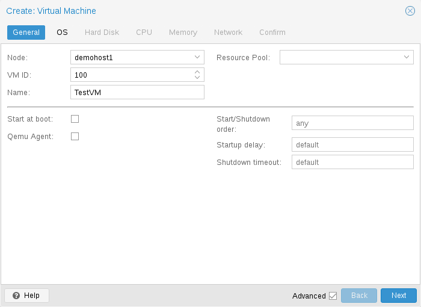](https://pve.proxmox.com/pve-docs/images/screenshot/gui-create-vm-general.png)

虚拟机的常规设置包括

- **节点**：虚拟机将运行的物理服务器
- **VM ID**：此 Proxmox VE 安装中用于标识虚拟机的唯一编号
- **名称**：可用于描述虚拟机的自由格式文本字符串
- **资源池**：虚拟机的逻辑分组

### OS Settings <a href="#qm_os_settings" id="qm_os_settings"></a>

[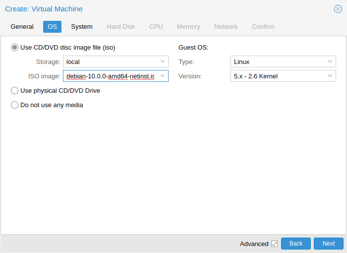](https://pve.proxmox.com/pve-docs/images/screenshot/gui-create-vm-os.png)

创建虚拟机（VM）时，设置正确的操作系统（OS）可让 Proxmox VE 优化某些底层参数。例如，Windows 操作系统期望 BIOS 时钟使用本地时间，而基于 Unix 的操作系统期望 BIOS 时钟使用 UTC 时间。

### System Settings <a href="#qm_system_settings" id="qm_system_settings"></a>

On VM creation you can change some basic system components of the new VM. You can specify which [display type](#qm_display) you want to use.

[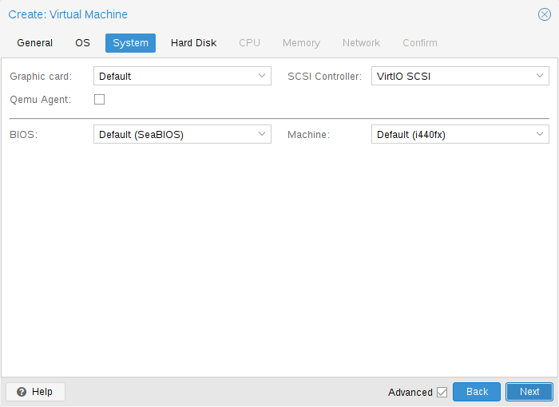](https://pve.proxmox.com/pve-docs/images/screenshot/gui-create-vm-system.png)

Additionally, the [SCSI controller](#qm_hard_disk) can be changed. If you plan to install the QEMU Guest Agent, or if your selected ISO image already ships and installs it automatically, you may want to tick the *QEMU Agent* box, which lets Proxmox VE know that it can use its features to show some more information, and complete some actions (for example, shutdown or snapshots) more intelligently.

Proxmox VE allows to boot VMs with different firmware and machine types, namely [SeaBIOS and OVMF](#qm_bios_and_uefi). In most cases you want to switch from the default SeaBIOS to OVMF only if you plan to use [PCIe passthrough](#qm_pci_passthrough). On arm64 hosts OVMF is the default and only option, as SeaBIOS is x86-only.

#### 机器类型 <a href="#qm_machine_type" id="qm_machine_type"></a>

A VM’s *Machine Type* defines the hardware layout of the VM’s virtual motherboard. You can choose between the default [Intel 440FX](https://en.wikipedia.org/wiki/Intel_440FX) or the [Q35](https://ark.intel.com/content/www/us/en/ark/products/31918/intel-82q35-graphics-and-memory-controller.html) chipset, which also provides a virtual PCIe bus, and thus may be desired if you want to pass through PCIe hardware. Additionally, you can select a [vIOMMU](#qm_pci_viommu) implementation.


Intel 440FX 和 Q35 芯片组专用于 x86 客户机。在 arm64 宿主机上，虚拟机使用`virt`机器类型，该类型模拟一种通用的、基于 UEFI 的 ARM 机器。


##### 机器版本 <a href="#_machine_version" id="_machine_version"></a>

每种机器类型在 QEMU 中都有版本，并且给定的 QEMU 二进制文件支持多种机器版本。新版本可能带来对新功能的支持、修复或一般性改进。但是，它们也会更改虚拟硬件的属性。为避免从客户机角度来看发生突然变化，并确保虚拟机状态、在线迁移和包含 RAM 的快照的兼容性，新的 QEMU 实例将继续使用相同的机器版本。

对于 Windows 客户机，机器版本会在创建时固定，因为 Windows 对虚拟硬件的更改很敏感，即使是在冷启动之间也是如此。例如，不同的机器版本可能会导致网络设备的枚举不同。Linux 等其他操作系统通常可以很好地应对此类更改。对于这些操作系统，默认使用*最新*机器版本。这意味着在全新启动后，将使用 QEMU 二进制文件支持的最新机器版本（例如，QEMU 8.1 支持的每种机器类型的最新机器版本均为 8.1 版）。

在实现会更改硬件布局的新功能或修复时，机器版本还用作确保向后兼容的保障措施。对于正在运行的虚拟机上的操作（例如在线迁移），会保存正在运行的机器版本，以确保虚拟机能够完全按原样恢复，这不仅涉及 QEMU 虚拟化层面，还涉及 Proxmox VE 创建 QEMU 虚拟机实例的方式。

**PVE 机器修订版本**

有时，Proxmox VE 需要更改硬件布局或修改选项，而不能等待新的 QEMU 版本发布。为此，Proxmox VE 以`+pveX`的形式添加了额外的下游修订版本。在这些修订版本中，每个新 QEMU 机器版本的`X`均为 0，并且在这种情况下会省略，例如机器版本`pc-q35-9.2`与机器版本`pc-q35-9.2+pve0`相同。

如果 Proxmox VE 需要更改硬件布局或默认选项，则会递增修订版本，并将其用于新创建的客户机，或在始终使用最新机器版本的虚拟机重启时使用。

##### QEMU 机器版本弃用 <a href="#_qemu_machine_version_deprecation" id="_qemu_machine_version_deprecation"></a>

从 QEMU 10.1 开始，机器版本在上游 QEMU 中保留 6 年后会被移除。Proxmox VE 大约每 2 年发布一个主要版本，因此一个 Proxmox VE 主要版本将支持来自大约前两个 Proxmox VE 主要版本的机器版本。

Before upgrading to a new major Proxmox VE release, you should update VM configurations to avoid all machine versions that will be dropped during the next major Proxmox VE release. This ensures that the guests can still be used throughout that release. See the section [Update to a Newer Machine Version](#qm_machine_update).

移除策略尚未在 Proxmox VE 8 中生效，因此受支持机器版本的基线为 2.4。为 Proxmox VE 9 发布的最后一个 QEMU 二进制版本预计将是 QEMU 11.2。此 QEMU 二进制文件将移除对低于 6.0 的机器版本的支持，因此 6.0 是 Proxmox VE 9 发布生命周期的基线。预计每次 Proxmox VE 主版本发布时，基线都会提高两个主版本，例如 Proxmox VE 10 的基线为 8.0。

##### 更新到较新的机器版本 <a href="#qm_machine_update" id="qm_machine_update"></a>

如果看到弃用警告，应将机器版本更改为较新的版本。请务必先准备好可用的备份，并做好客户机识别硬件的方式可能发生变化的准备。在某些情况下，可能需要重新安装特定驱动程序。还应检查使用这些机器版本创建的含内存快照（即 `runningmachine` 配置项）。遗憾的是，无法更改快照的机器版本，因此需要加载该快照以挽救其中的任何数据。

### Hard Disk <a href="#qm_hard_disk" id="qm_hard_disk"></a>

#### 总线/控制器 <a href="#qm_hard_disk_bus" id="qm_hard_disk_bus"></a>

QEMU 可以模拟多种存储控制器：


出于性能考虑，并且由于它们得到了更好的维护，强烈建议使用 **VirtIO SCSI** 或 **VirtIO Block** 控制器。


- **IDE** 控制器的设计可追溯至 1984 年的 PC/AT 磁盘控制器。尽管这种控制器已被较新的设计所取代，但您能想到的每一种操作系统都支持它，因此，如果要运行 2003 年之前发布的操作系统，它是一个很好的选择。此控制器最多可连接 4 个设备。
- **SATA**（Serial ATA）控制器诞生于 2003 年，采用更现代的设计，可实现更高的吞吐量并连接更多设备。此控制器最多可连接 6 个设备。
- **SCSI** 控制器设计于 1985 年，常见于服务器级硬件，最多可连接 14 个存储设备。Proxmox VE 默认模拟 LSI 53C895A 控制器。

  A SCSI controller of type *VirtIO SCSI single* and enabling the [IO Thread](#qm_hard_disk_iothread) setting for the attached disks is recommended if you aim for performance. This is the default for newly created Linux VMs since Proxmox VE 7.3. Each disk will have its own *VirtIO SCSI* controller, and QEMU will handle the disks IO in a dedicated thread. Linux distributions have support for this controller since 2012, and FreeBSD since 2014\. For Windows OSes, you need to provide an extra ISO containing the drivers during the installation.
- **VirtIO Block** 控制器通常简称为 VirtIO 或 virtio-blk，是一种较旧的半虚拟化控制器。在功能方面，它已被 VirtIO SCSI 控制器取代。

#### 镜像格式 <a href="#qm_hard_disk_formats" id="qm_hard_disk_formats"></a>

每个控制器上都连接有若干模拟硬盘，这些硬盘由所配置存储中的文件或块设备提供后端支持。存储类型的选择将决定硬盘镜像的格式。提供块设备的存储（LVM、ZFS、Ceph）需要使用 **raw disk image format**，而基于文件的存储（如 Ext4、XFS、NFS 或 CIFS）则允许选择 **raw disk image format** 或 **QEMU image format**。

- **QEMU image format** 是一种写时复制格式，支持快照和磁盘镜像的精简置备。
- **raw disk image** 是硬盘的逐位镜像，类似于在 Linux 中对块设备执行 `dd` 命令所得到的结果。此格式本身不支持精简置备或快照，这些功能需要存储层配合实现。不过，它的速度可能比 **QEMU image format** 快最多 10%。[\[2\]](#note-0cdd31f9-2)
- 只有打算将磁盘镜像导入或导出到其他虚拟机管理程序时，**VMware image format** 才有意义。

#### 缓存模式 <a href="#qm_hard_disk_cache" id="qm_hard_disk_cache"></a>

设置硬盘的 **Cache** 模式会影响宿主机系统如何向客户机系统通知块写入完成。默认的 **No cache** 表示当每个块到达物理存储写入队列时，客户机系统就会收到写入完成通知，并忽略宿主机页缓存。这在安全性和速度之间提供了良好的平衡。

如果希望 Proxmox VE 备份管理器在备份 VM 时跳过某个磁盘，可以在该磁盘上设置 **No backup** 选项。

如果希望 Proxmox VE 存储复制机制在启动复制任务时跳过某个磁盘，可以在该磁盘上设置 **Skip replication** 选项。自 Proxmox VE 5.0 起，复制要求磁盘镜像位于类型为 `zfspool` 的存储上，因此，当 VM 配置了复制时，如果将磁盘镜像添加到其他存储，则必须跳过此磁盘镜像的复制。

#### Trim/Discard <a href="#qm_hard_disk_discard" id="qm_hard_disk_discard"></a>

If your storage supports *thin provisioning* (see the storage chapter in the Proxmox VE guide), you can activate the **Discard** option on a drive. With **Discard** set and a *TRIM*-enabled guest OS [\[3\]](#note-0cdd31f9-3), when the VM’s filesystem marks blocks as unused after deleting files, the controller will relay this information to the storage, which will then shrink the disk image accordingly. For the guest to be able to issue *TRIM* commands, you must enable the **Discard** option on the drive. Some guest operating systems may also require the **SSD Emulation** flag to be set. Note that **Discard** on **VirtIO Block** drives is only supported on guests using Linux Kernel 5.0 or higher.

If you would like a drive to be presented to the guest as a solid-state drive rather than a rotational hard disk, you can set the **SSD emulation** option on that drive. There is no requirement that the underlying storage actually be backed by SSDs; this feature can be used with physical media of any type. Note that **SSD emulation** is not supported on **VirtIO Block** drives.

#### IO Thread <a href="#qm_hard_disk_iothread" id="qm_hard_disk_iothread"></a>

**IO thread** 选项只能用于采用以下总线/设备控制器之一的磁盘：

- **SCSI**，前提是模拟的 SCSI 控制器类型为 **VirtIO SCSI single**；或
- **VirtIO Block**

启用 **IO thread** 后，QEMU 会为每个存储控制器创建一个 I/O 线程，而不是在主事件循环或 vCPU 线程中处理所有 I/O。其好处之一是能够更好地分配工作并利用底层存储。另一个好处是，当宿主机工作负载的 I/O 非常密集时，可降低客户机中的延迟（卡顿），因为主线程和 vCPU 线程都不会被磁盘 I/O 阻塞。

### CPU <a href="#qm_cpu" id="qm_cpu"></a>

[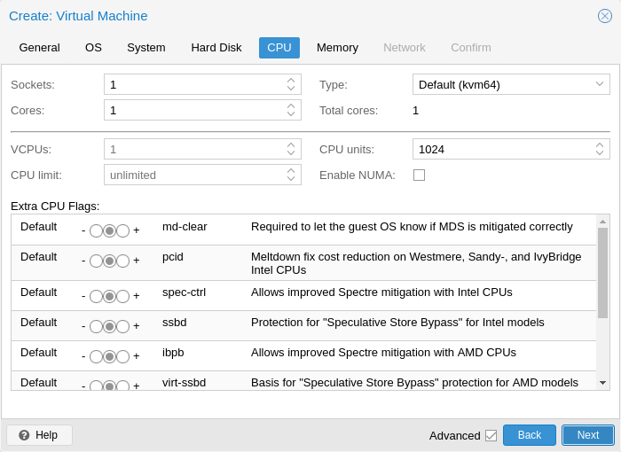](https://pve.proxmox.com/pve-docs/images/screenshot/gui-create-vm-cpu.png)

**CPU socket** 是 PC 主板上用于插入 CPU 的物理插槽。该 CPU 可以包含一个或多个 **cores**，它们是独立的处理单元。从性能角度看，使用一个 4 核 CPU 插槽还是两个双核 CPU 插槽基本没有区别。但是，某些软件许可证取决于机器拥有的插槽数量，在这种情况下，将插槽数量设置为许可证允许的数量是合理的。

增加虚拟 CPU（核心和插槽）的数量通常会提升性能，但这在很大程度上取决于 VM 的用途。多线程应用程序当然会从大量虚拟 CPU 中受益，因为每添加一个虚拟 CPU，QEMU 都会在宿主机系统上创建一个新的执行线程。如果不确定 VM 的工作负载，将 **Total cores** 的数量设置为 2 通常比较稳妥。


所有 VM 的核心*总数*大于服务器上的核心数量是完全安全的（例如，在只有 8 个核心的机器上运行 4 个各有 4 个核心的 VM，总计 16 个核心）。在这种情况下，宿主机系统会在服务器核心之间平衡 QEMU 执行线程，就像运行标准的多线程应用程序一样。但是，Proxmox VE 会阻止您启动虚拟 CPU 核心数超过物理可用核心数的 VM，因为这只会因上下文切换的开销而降低性能。


#### 资源限制 <a href="#qm_cpu_resource_limits" id="qm_cpu_resource_limits"></a>

**cpulimit**

除了虚拟核心数量外，还可以使用 **cpulimit** 选项设置 VM 可用的“宿主机 CPU 时间”总量。它是一个浮点值，以百分比表示 CPU 时间，因此 `1.0` 等于 `100%`，`2.5` 等于 `250%`，依此类推。如果单个进程完全占用一个核心，其 CPU 时间使用率将为 `100%`。如果一个四核 VM 完全利用其所有核心，理论上将使用 `400%`。实际使用率可能还会稍高一些，因为除了 vCPU 核心线程之外，QEMU 还可以为 VM 外围设备运行额外的线程。

当 VM 因并行运行某些进程而需要多个 vCPU，但又不希望整个 VM 能够同时以 100% 的利用率运行所有 vCPU 时，此设置会很有用。

例如，假设有一台虚拟机可从 8 个虚拟 CPU 中受益，但您不希望该 VM 能够让所有 8 个核心都满载运行，因为这会使服务器过载，导致其他虚拟机和容器获得的 CPU 时间过少。要解决此问题，可以将 **cpulimit** 设置为 `4.0`（\=400%）。这意味着，如果 VM 通过同时运行 8 个进程来充分利用所有 8 个虚拟 CPU，则每个 vCPU 最多能从物理核心获得 50% 的 CPU 时间。但是，如果 VM 工作负载仅充分利用 4 个虚拟 CPU，则每个虚拟 CPU 仍可从物理核心获得最多 100% 的 CPU 时间，总计为 400%。


根据配置，VM 可以使用额外的线程，例如用于网络或 I/O 操作的线程，以及用于在线迁移的线程。因此，VM 显示的 CPU 时间用量可能超过其虚拟 CPU 本身所能使用的量。要确保 VM 使用的 CPU 时间永远不会超过所分配的 vCPU 可使用的量，请将 **cpulimit** 设置为与核心总数相同的值。


**cpuunits**

通过 **cpuunits** 选项（如今通常称为 CPU 份额或 CPU 权重），可以控制 VM 与其他正在运行的 VM 相比能获得多少 CPU 时间。它是一个相对权重，默认值为 `100`（如果宿主机使用旧版 cgroup v1，则为 `1024`）。如果提高某个 VM 的此值，与权重较低的其他 VM 相比，调度器会优先调度该 VM。

例如，如果 VM 100 使用默认值 `100`，而 VM 200 被更改为 `200`，则后一个 VM 200 获得的 CPU 带宽将是前一个 VM 100 的两倍。

有关更多信息，请参阅 `man systemd.resource-control`，其中 `CPUQuota` 对应于 `cpulimit`，`CPUWeight` 对应于我们的 `cpuunits` 设置。请访问其 Notes 部分，查看参考资料和实现细节。

**affinity**

通过 **affinity** 选项，可以指定用于运行 VM vCPU 的物理 CPU 核心。I/O 等外围 VM 进程不受此设置影响。请注意，**CPU 亲和性不是一项安全功能**。

强制设置 CPU **affinity** 在某些情况下可能很有意义，但也会增加复杂性和维护工作量。例如，以后需要添加更多 VM，或将 VM 迁移到 CPU 核心数较少的节点时。如果某些 CPU 已得到充分利用，而其他 CPU 几乎处于空闲状态，还很容易造成 CPU 使用不均衡，进而导致系统性能受限。

**affinity** 通过 `taskset` CLI 工具设置。它接受宿主机 CPU 编号（参见 `lscpu`），采用 `List Format`，该格式见 `man cpuset`。这个 ASCII 十进制列表既可以包含数字，也可以包含数字范围。例如，**affinity** `0-1,8-11`（展开后为 `0, 1, 8, 9, 10, 11`）将允许 VM 仅在这六个特定的宿主机核心上运行。

#### CPU 类型 <a href="#_cpu_type" id="_cpu_type"></a>

QEMU can emulate a number different of **CPU types** from 486 to the latest Xeon processors. Each new processor generation adds new features, like hardware assisted 3d rendering, random number generation, memory protection, etc. Also, a current generation can be upgraded through microcode update with bug or security fixes.

通常，应为 VM 选择与宿主机系统 CPU 尽量接近的处理器类型，这样宿主机 CPU 功能（也称为 *CPU 标志*）将在 VM 中可用。如果需要完全匹配，可以将 CPU 类型设置为 **host**，此时 VM 将具有与宿主机系统完全相同的 CPU 标志。

不过，这有一个缺点。如果要在不同宿主机之间在线迁移 VM，VM 最终可能会运行在一个 CPU 类型或微代码版本不同的新系统上。如果传递给客户机的 CPU 标志缺失，QEMU 进程将停止。为解决这一问题，QEMU 还提供了自己的虚拟 CPU 类型，Proxmox VE 默认使用这些类型。

后端默认值为 *kvm64*，它基本上适用于所有 x86\_64 宿主机 CPU；而在 UI 中创建新 VM 时，默认值为 *x86-64-v2-AES*，后者要求 Intel 宿主机 CPU 至少为 Westmere，AMD 宿主机 CPU 至少为第四代 Opteron。


这里介绍的 *kvm64* 和 *x86-64-v\** CPU 模型仅适用于 x86。在 arm64 宿主机上，客户机使用 ARM CPU 模型：*host* 用于暴露物理 CPU（在受支持的硬件上建议使用），或使用 *max* 等通用模型，并搭配 `virt` 机器类型。


简而言之：

如果不关心在线迁移，或者集群是同构的，即所有节点都具有相同的 CPU 和相同的微代码版本，请将 CPU 类型设置为 host，因为理论上这将使客户机获得最大性能。

如果关心在线迁移和安全性，并且只有 Intel CPU 或只有 AMD CPU，请选择集群中最低代次的 CPU 模型。

如果关心在线迁移但不关心安全性，或者集群混用了 Intel/AMD CPU，请选择兼容的最低级别 QEMU 虚拟 CPU 类型。


Intel 和 AMD 宿主机 CPU 之间的在线迁移不保证能够正常工作。


See also List of AMD and Intel CPU Types as Defined in QEMU.

#### QEMU CPU 类型 <a href="#_qemu_cpu_types" id="_qemu_cpu_types"></a>

QEMU 还提供与 Intel 和 AMD 宿主机 CPU 均兼容的虚拟 CPU 类型。


To mitigate the Spectre vulnerability for virtual CPU types, you need to add the relevant CPU flags, see [Meltdown / Spectre related CPU flags](#qm_meltdown_spectre).


历史上，Proxmox VE 使用 *kvm64* CPU 模型，其启用的 CPU 标志处于 Pentium 4 水平，因此对于某些工作负载，性能并不理想。

2020 年夏，AMD、Intel、Red Hat 和 SUSE 合作在 x86-64 基线之上定义了三个 x86-64 微架构级别，并启用了现代标志。详情请参阅 [x86-64-ABI 规范](https://gitlab.com/x86-psABIs/x86-64-ABI)。


一些较新的发行版（如 CentOS 9）现在构建时将 *x86-64-v2* 标志作为最低要求。


- *kvm64 (x86-64-v1)*：兼容 Intel CPU \>\= Pentium 4、AMD CPU \>\= Phenom。
- *x86-64-v2*：兼容 Intel CPU \>\= Nehalem、AMD CPU \>\= Opteron\_G3。与 *x86-64-v1* 相比，新增的 CPU 标志：*\+cx16*、*\+lahf-lm*、*\+popcnt*、*\+pni*、*\+sse4.1*、*\+sse4.2*、*\+ssse3*。
- *x86-64-v2-AES*：兼容 Intel CPU \>\= Westmere、AMD CPU \>\= Opteron\_G4。与 *x86-64-v2* 相比，新增的 CPU 标志：*\+aes*。
- *x86-64-v3*：兼容 Intel CPU \>\= Haswell、AMD CPU \>\= EPYC。与 *x86-64-v2-AES* 相比，新增的 CPU 标志：*\+avx*、*\+avx2*、*\+bmi1*、*\+bmi2*、*\+f16c*、*\+fma*、*\+movbe*、*\+xsave*。
- *x86-64-v4*：兼容 Intel CPU \>\= Skylake、AMD CPU \>\= EPYC v4 Genoa。与 *x86-64-v3* 相比，新增的 CPU 标志：*\+avx512f*、*\+avx512bw*、*\+avx512cd*、*\+avx512dq*、*\+avx512vl*。

#### 自定义 CPU 类型 <a href="#_custom_cpu_types" id="_custom_cpu_types"></a>

可以定义自定义 CPU 类型，配置其基础模型、厂商、物理地址位数以及各标志的开关，然后像内置类型一样将其分配给 VM。在 VM 配置中，自定义类型以 `custom-<name>` 的形式引用。

在 Web UI 中的 `Datacenter -> Custom CPU Models` 下管理这些类型。模型对话框内嵌一个标志编辑器网格，支持按标志名称和描述进行自由文本搜索，提供加速器（kvm/tcg）选择器，并提供按节点选择的多选框；该多选框会突出显示每个所选集群节点当前报告为受支持的标志，有助于在确定模型之前，识别哪些标志在目标宿主机上实际可用。同一网格还用于每个 VM 的 `Processor` 编辑对话框，但在该对话框中仅限显示可为单个 VM 设置的标志；如果配置的标志不被 API 识别或不受所选加速器支持，则会在顶部显示警告。

自定义 CPU 类型仍由配置文件 `/etc/pve/virtual-guest/cpu-models.conf` 提供支持，也可以通过 CLI 维护，格式请参阅 `man cpu-models.conf`。

对自定义模型的访问通过 ACL 路径 `/mapping/cpu/<name>` 按模型分别控制。`Mapping.Audit` 允许用户在列表中查看模型，`Mapping.Modify` 控制是否可在面板中创建、更新和删除模型，`Mapping.Use` 则是将模型分配给 VM 所必需的权限。后者会在创建 VM、更新 VM 和克隆 VM 时强制执行，因此，即使用户可以克隆使用自定义模型的 VM，仍需要在该模型的 ACL 路径上拥有 `Mapping.Use` 权限。

#### 与 Meltdown / Spectre 相关的 CPU 标志 <a href="#qm_meltdown_spectre" id="qm_meltdown_spectre"></a>

有多个与 Meltdown 和 Spectre 漏洞相关的 CPU 标志 [\[4\]](#note-0cdd31f9-4)，除非为 VM 选择的 CPU 类型默认已启用这些标志，否则需要手动设置。

要使用这些 CPU 标志，必须满足以下两个要求：

- 宿主机 CPU 必须支持该功能，并将其传递给客户机的虚拟 CPU
- 客户机操作系统必须更新到能够缓解这些攻击并能够利用该 CPU 功能的版本

否则，需要设置虚拟 CPU 所需的 CPU 标志，即设置 *flags* 属性（VM 配置文件中 *cpu* 选项的属性），或者在 Web UI 中编辑 CPU 选项。

For Spectre v1,v2,v4 fixes, your CPU or system vendor also needs to provide a so-called “microcode update” for your CPU, see chapter Firmware Updates. Note that not all affected CPUs can be updated to support spec-ctrl.

要检查 Proxmox VE 宿主机是否存在漏洞，请以 root 身份执行以下命令：

```text
for f in /sys/devices/system/cpu/vulnerabilities/*; do echo "${f##*/} -" $(cat "$f"); done
```

还有一个社区脚本可用于检测宿主机是否仍存在漏洞。[\[5\]](#note-0cdd31f9-5)

#### Intel 处理器 <a href="#_intel_processors" id="_intel_processors"></a>

- *pcid*

  这可降低称为 *内核页表隔离（KPTI）* 的 Meltdown（CVE-2017-5754）缓解措施对性能的影响；KPTI 可有效地向用户空间隐藏内核内存。如果没有 PCID，KPTI 是一种开销相当大的机制 [\[6\]](#note-0cdd31f9-6)。

  要检查 Proxmox VE 宿主机是否支持 PCID，请以 root 身份执行以下命令：

  ```text
  # grep ' pcid ' /proc/cpuinfo
  ```

  如果返回结果不为空，则表示宿主机的 CPU 支持 *pcid*。
- *spec-ctrl*

  在 retpoline 不足以解决问题的情况下，需要此标志来启用 Spectre v1（CVE-2017-5753）和 Spectre v2（CVE-2017-5715）修复。默认包含在带有 -IBRS 后缀的 Intel CPU 模型中。对于不带 -IBRS 后缀的 Intel CPU 模型，必须显式启用。需要更新宿主机 CPU 微代码（intel-microcode \>\= 20180425）。
- *ssbd*

  需要此标志来启用 Spectre V4（CVE-2018-3639）修复。默认不包含在任何 Intel CPU 模型中。对于所有 Intel CPU 模型，都必须显式启用。需要更新宿主机 CPU 微代码（intel-microcode \>\= 20180703）。

#### AMD 处理器 <a href="#_amd_processors" id="_amd_processors"></a>

- *ibpb*

  在 retpoline 不足以解决问题的情况下，需要此标志来启用 Spectre v1（CVE-2017-5753）和 Spectre v2（CVE-2017-5715）修复。默认包含在带有 -IBPB 后缀的 AMD CPU 模型中。对于不带 -IBPB 后缀的 AMD CPU 模型，必须显式启用。宿主机 CPU 微代码必须先支持此功能，才能将其用于客户机 CPU。
- *virt-ssbd*

  需要此标志来启用 Spectre v4（CVE-2018-3639）修复。默认不包含在任何 AMD CPU 模型中。对于所有 AMD CPU 模型，都必须显式启用。即使也提供了 amd-ssbd，也应向客户机提供此标志，以最大限度地提高客户机兼容性。请注意，使用 "host" CPU 模型时必须显式启用此标志，因为这是一项物理 CPU 中不存在的虚拟功能。
- *amd-ssbd*

  需要此标志来启用 Spectre v4（CVE-2018-3639）修复。默认不包含在任何 AMD CPU 模型中。对于所有 AMD CPU 模型，都必须显式启用。此标志提供比 virt-ssbd 更高的性能，因此，如果可能，支持此功能的宿主机应始终将其暴露给客户机。尽管如此，仍应同时暴露 virt-ssbd，以最大限度地提高客户机兼容性，因为某些内核只识别 virt-ssbd。
- *amd-no-ssb*

  建议用于指示宿主机不受 Spectre V4（CVE-2018-3639）影响。默认不包含在任何 AMD CPU 模型中。未来的 CPU 硬件代次将不受 CVE-2018-3639 影响，因此应通过暴露 amd-no-ssb 告知客户机不要启用其缓解措施。此标志与 virt-ssbd 和 amd-ssbd 互斥。

#### 与 Windows 相关的 CPU 设置 <a href="#qm_cpu_windows_tweaks" id="qm_cpu_windows_tweaks"></a>

一些 CPU 默认设置和属性专门针对近期 Intel 硬件上的 Windows 客户机进行了调整：

- 对于 Windows 11 机器类型，默认禁用 `cet-ibt` 和 `cet-ss`（控制流强制技术：间接分支跟踪和影子栈），因为目前它们会导致启用了基于虚拟化的安全性的 Windows 客户机无法启动。对于明确依赖这些标志的工作负载，可以通过 `Processor` 标志编辑器按 VM 重新启用它们。
- The QEMU `level` CPU property is exposed so it can be set per VM (or in a custom CPU model) without resorting to custom `args`. Setting `level=30` is a known workaround for Hyper-V boot failures of Windows guests on recent Intel hosts when the CPU type is `host` or `max`. The property only applies for x86\_64 vCPUs; it is silently ignored on other architectures.

#### NUMA <a href="#_numa" id="_numa"></a>

您还可以选择在虚拟机中模拟 **NUMA** [\[7\]](#note-0cdd31f9-7) 架构。NUMA 架构的基本原理是，内存不再是可供所有核心使用的全局内存池，而是分布在靠近各个插槽的本地内存组中。这可以带来速度提升，因为内存总线不再是瓶颈。如果您的系统采用 NUMA 架构 [\[8\]](#note-0cdd31f9-8)，我们建议启用此选项，因为这将允许在宿主机系统上合理分配虚拟机资源。在虚拟机中热插拔核心或 RAM 也需要此选项。

如果使用 NUMA 选项，建议将插槽数设置为宿主机系统的节点数。

#### vCPU 热插拔 <a href="#_vcpu_hot_plug" id="_vcpu_hot_plug"></a>

Modern operating systems introduced the capability to hot-plug and, to a certain extent, hot-unplug CPUs in a running system. Virtualization allows us to avoid a lot of the (physical) problems real hardware can cause in such scenarios. Still, this is a rather new and complicated feature, so its use should be restricted to cases where its absolutely needed. Most of the functionality can be replicated with other, well tested and less complicated, features, see [Resource Limits](#qm_cpu_resource_limits).

在 Proxmox VE 中，可插入的 CPU 最大数量始终为 `cores * sockets`。若要在启动虚拟机时使用少于该总核心数的 CPU，可以使用 **vcpus** 设置，它表示虚拟机启动时应插入多少个 vCPU。

目前，此功能仅在 Linux 上受支持，需要高于 3.10 版本的内核，建议使用高于 4.7 版本的内核。

您可以使用如下 udev 规则，自动将客户机中的新 CPU 设置为在线状态：

```text
SUBSYSTEM=="cpu", ACTION=="add", TEST=="online", ATTR{online}=="0", ATTR{online}="1"
```

Save this under /etc/udev/rules.d/ as a file ending in `.rules`.

注意：CPU 热移除取决于机器类型，并且需要客户机配合。删除命令并不保证 CPU 移除会实际发生；通常，它只是通过目标相关机制（例如 x86/amd64 上的 ACPI）转发给客户机操作系统的请求。

### 内存 <a href="#qm_memory" id="qm_memory"></a>

对于每台虚拟机，您可以选择设置固定大小的内存，也可以让 Proxmox VE 根据宿主机的当前 RAM 使用情况动态分配内存。

[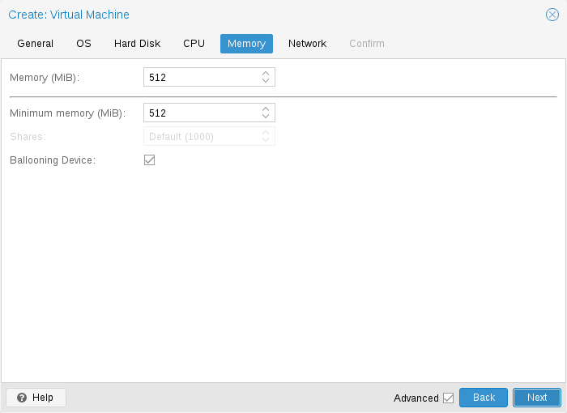](https://pve.proxmox.com/pve-docs/images/screenshot/gui-create-vm-memory.png)

**固定内存分配**

当将内存和最小内存设置为相同数值时，Proxmox VE 将直接按照您指定的数量为虚拟机分配内存。

即使使用固定内存大小，仍会为虚拟机添加气球设备，因为它能提供有用信息，例如客户机实际使用了多少内存。通常，您应保持启用 **ballooning**，但如果您想禁用它（例如出于调试目的），只需取消选中 **气球设备** 或进行如下设置

```text
balloon: 0
```

在配置中。

<a id="qm_ballooning"></a>


**自动内存分配**

When setting the minimum memory lower than memory, Proxmox VE will make sure that the minimum amount you specified is always available to the VM, and if RAM usage on the host is below a certain target percentage, will dynamically add memory to the guest up to the maximum memory specified. The target percentage defaults to 80% and can be configured in the node options.

当宿主机 RAM 不足时，虚拟机随后会将部分内存释放回宿主机，必要时换出正在运行的进程，并在万不得已时启动 oom killer。宿主机和客户机之间的内存传递通过运行在客户机内部的特殊 `balloon` 内核驱动程序完成，该驱动程序会从宿主机获取或向宿主机释放内存页。[\[9\]](#note-0cdd31f9-9)

当多台虚拟机使用自动分配功能时，可以设置 **Shares** 系数，该系数表示每台虚拟机应占用的宿主机空闲内存相对比例。例如，假设您有四台虚拟机，其中三台运行 HTTP 服务器，最后一台是数据库服务器。宿主机配置的目标 RAM 使用率为 80%。为了在数据库服务器的 RAM 中缓存更多数据库块，您希望在有闲置 RAM 时优先考虑数据库虚拟机。为此，将数据库虚拟机的 Shares 属性设置为 3000，其他虚拟机则保留 Shares 的默认设置 1000。该宿主机具有 32GB RAM，当前已使用 16GB，因此在虚拟机各自配置的最小内存量之外，还有 32 \* 80/100 \- 16 \= 9GB RAM 可分配给虚拟机。数据库虚拟机将额外获得 9 \* 3000 / (3000 \+ 1000 \+ 1000 \+ 1000\) \= 4.5 GB RAM，每台 HTTP 服务器虚拟机则可额外获得 1.5 GB。

2010 年之后发布的所有 Linux 发行版都包含气球内核驱动程序。对于 Windows 操作系统，需要手动添加气球驱动程序，这可能会导致客户机速度变慢，因此我们不建议在关键系统上使用它。

为虚拟机分配 RAM 时，一个很好的经验法则是始终为宿主机保留 1GB 可用 RAM。

### Memory Encryption <a href="#qm_memory_encryption" id="qm_memory_encryption"></a>

#### AMD SEV <a href="#qm_memory_encryption_sev" id="qm_memory_encryption_sev"></a>

SEV（安全加密虚拟化）使用 AES-128 加密和 AMD Secure Processor，为每台虚拟机启用内存加密。

SEV-ES（安全加密虚拟化 \- 加密状态）还会加密所有 CPU 寄存器内容，以防止信息泄露给虚拟机监视器。

SEV-SNP（安全加密虚拟化 \- 安全嵌套分页）还试图防止基于软件的完整性攻击。有关更多信息，请参阅 [AMD SEV SNP 白皮书](https://www.amd.com/content/dam/amd/en/documents/epyc-business-docs/white-papers/SEV-SNP-strengthening-vm-isolation-with-integrity-protection-and-more.pdf)。

**宿主机要求：**

- AMD EPYC CPU
- SEV-ES 仅在 AMD EPYC 7002 系列及更新的 EPYC CPU 上受支持
- SEV-SNP 仅在 AMD EPYC 7003 系列及更新的 EPYC CPU 上受支持
- SEV-SNP 要求宿主机内核版本为 6.11 或更高。
- 在宿主机的 BIOS 设置中配置 AMD 内存加密
- 如果默认未启用，请将 "kvm\_amd.sev\=1" 添加到内核参数
- 如果您想加密宿主机上的内存（SME），请将 "mem\_encrypt\=on" 添加到内核参数，请参阅 [https://www.kernel.org/doc/Documentation/x86/amd-memory-encryption.txt](https://www.kernel.org/doc/Documentation/x86/amd-memory-encryption.txt)
- 可能需要增加 SWIOTLB，请参阅 [https://github.com/AMDESE/AMDSEV#faq-4](https://github.com/AMDESE/AMDSEV#faq-4)

要检查宿主机上是否启用了 SEV，请在 dmesg 中搜索 `sev`，并打印 kvm\_amd 的 SEV 内核参数：

```text
# dmesg | grep -i sev
[...] ccp 0000:45:00.1: sev enabled
[...] ccp 0000:45:00.1: SEV API: <buildversion>
[...] SEV supported: <number> ASIDs
[...] SEV-ES supported: <number> ASIDs
# cat /sys/module/kvm_amd/parameters/sev
Y
```

**客户机要求：**

- edk2-OVMF
- 建议使用 Q35
- 客户机操作系统必须支持 SEV。

**限制：**

- 由于内存已加密，宿主机上显示的内存使用情况始终不准确。
- 涉及保存或恢复内存的操作（如快照和在线迁移）尚无法正常工作，或者[容易受到攻击](https://github.com/PSPReverse/amd-sev-migration-attack)。
- 不支持 PCI 直通。
- SEV-ES 和 SEV-SNP 仍处于高度实验性阶段。
- SEV-SNP 不支持 EFI 磁盘。
- 使用 SEV-SNP 时，虚拟机内的 `reboot` 命令只会让虚拟机关机。

**配置示例（SEV）：**

```text
# qm set <vmid> -amd-sev type=std,no-debug=1,no-key-sharing=1,kernel-hashes=1
```

**type** 定义加密技术（不需要 "type\="）。可用选项为 std、es 和 snp。

QEMU 的 **policy** 参数根据 **no-debug** 和 **no-key-sharing** 参数计算得出。这些参数分别对应 policy-bit 0 和 1。如果 **type** 为 **es**，则将 policy-bit 2 设置为 1，以启用 SEV-ES。policy-bit 3（nosend）始终设置为 1，以防止迁移攻击。有关如何计算 policy 的更多信息，请参阅：[AMD SEV API 规范第 3 章](https://www.amd.com/system/files/TechDocs/55766_SEV-KM_API_Specification.pdf)

为了向后兼容较旧的 OVMF 镜像以及不度量 kernel/initrd 的客户机，**kernel-hashes** 选项默认关闭。请参阅 [https://lists.gnu.org/archive/html/qemu-devel/2021-11/msg02598.html](https://lists.gnu.org/archive/html/qemu-devel/2021-11/msg02598.html)

**检查 SEV 是否在虚拟机中正常工作**

方法 1 \- dmesg：

输出应如下所示。

```text
# dmesg | grep -i sev
AMD Memory Encryption Features active: SEV
```

方法 2 \- MSR 0xc0010131（MSR\_AMD64\_SEV）：

输出应为 1。

```text
# apt install msr-tools
# modprobe msr
# rdmsr -a 0xc0010131
1
```

**配置示例（SEV-SNP）：**

```text
# qm set <vmid> -amd-sev type=snp,allow-smt=1,no-debug=1,kernel-hashes=1
```

默认会设置 `allow-smt` policy-bit。如果通过将 `allow-smt` 设置为 `0` 来禁用它，则必须在宿主机上禁用 SMT，虚拟机才能运行。

**检查 SEV-SNP 是否在虚拟机中正常工作**

```text
# dmesg | grep -i snp
Memory Encryption Features active: AMD SEV SEV-ES SEV-SNP
SEV: Using SNP CPUID table, 29 entries present.
SEV: SNP guest platform device initialized.
```

链接：

- [https://developer.amd.com/sev/](https://developer.amd.com/sev/)
- [https://github.com/AMDESE/AMDSEV](https://github.com/AMDESE/AMDSEV)
- [https://www.qemu.org/docs/master/system/i386/amd-memory-encryption.html](https://www.qemu.org/docs/master/system/i386/amd-memory-encryption.html)
- [https://www.amd.com/system/files/TechDocs/55766\_SEV-KM\_API\_Specification.pdf](https://www.amd.com/system/files/TechDocs/55766_SEV-KM_API_Specification.pdf)
- [https://documentation.suse.com/sles/15-SP1/html/SLES-amd-sev/index.html](https://documentation.suse.com/sles/15-SP1/html/SLES-amd-sev/index.html)
- [SEV 安全嵌套分页固件 ABI 规范](https://www.amd.com/content/dam/amd/en/documents/epyc-technical-docs/specifications/56860.pdf)

### Network Device <a href="#qm_network_device" id="qm_network_device"></a>

[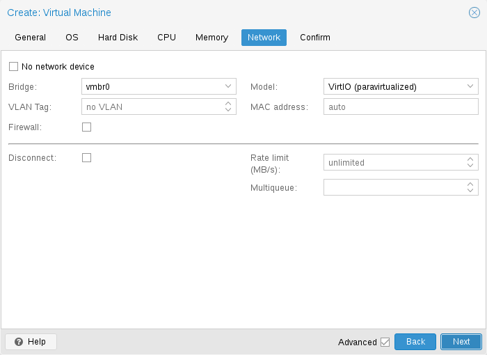](https://pve.proxmox.com/pve-docs/images/screenshot/gui-create-vm-network.png)

每台虚拟机都可以有多个 *网络接口控制器*（NIC），分为四种不同类型：

- **Intel E1000** 是默认类型，模拟 Intel 千兆网卡。
- 如果追求最高性能，应使用 **VirtIO** 半虚拟化 NIC。与所有 VirtIO 设备一样，客户机操作系统应安装适当的驱动程序。
- **Realtek 8139** 模拟较旧的 100 MB/s 网卡，只应在模拟较旧的操作系统（2002 年之前发布）时使用
- **vmxnet3** 是另一种半虚拟化设备，只应在从其他虚拟机监视器导入虚拟机时使用。

Proxmox VE 会为每个 NIC 生成一个随机 **MAC 地址**，从而使虚拟机能够在以太网网络中被寻址。

您添加到虚拟机的 NIC 可以采用以下两种不同模式之一：

- 在默认的 **桥接模式**下，每个虚拟 NIC 在宿主机上都有一个 *tap 设备* 作为后端（一种模拟以太网 NIC 的软件环回设备）。此 tap 设备会添加到一个网桥，在 Proxmox VE 中默认为 vmbr0。在此模式下，虚拟机可以直接访问宿主机所在的以太网 LAN。
- 在备选的 **NAT 模式**下，每个虚拟 NIC 只与 QEMU 用户网络协议栈通信，其中内置的路由器和 DHCP 服务器可以提供网络访问。此内置 DHCP 将在私有 10.0.2.0/24 范围内提供地址。NAT 模式比桥接模式慢得多，只应用于测试。此模式只能通过 CLI 或 API 使用，不能通过 Web UI 使用。

您还可以在创建虚拟机时选择 **无网络设备**，以跳过添加网络设备。

您可以手动覆盖每个虚拟机网络设备的 **MTU** 设置。将该字段留空或设置为 `mtu=1` 将从底层网桥继承 MTU。此选项仅适用于 **VirtIO** 网络设备。

**多队列**

如果您使用 VirtIO 驱动程序，可以选择启用 **Multiqueue** 选项。此选项允许客户机操作系统使用多个虚拟 CPU 处理网络数据包，从而提高传输的数据包总数。

在 Proxmox VE 中使用 VirtIO 驱动程序时，每个 NIC 网络队列都会传递给宿主机内核，队列将在该内核中由 vhost 驱动程序创建的内核线程处理。启用此选项后，可以为每个 NIC 将*多个*网络队列传递给宿主机内核。

使用 Multiqueue 时，建议将其设置为等于客户机 vCPU 数量的值。请记住，vCPU 数量是为虚拟机配置的插槽数乘以核心数。您还需要使用以下 ethtool 命令，设置虚拟机中每个 VirtIO NIC 的多用途通道数量：

`ethtool -L ens1 combined X`

其中 X 是虚拟机的 vCPU 数量。

要为 Windows 客户机配置 Multiqueue，请安装 [Redhat VirtIO Ethernet Adapter 驱动程序](https://pve.proxmox.com/wiki/Windows_VirtIO_Drivers)，然后按如下方式调整 NIC 的配置。打开设备管理器，右键单击“网络适配器”下的 NIC，然后选择“属性”。接着打开“高级”选项卡，并从左侧列表中选择“Receive Side Scaling”。确保其设置为“Enabled”。接下来，在列表中找到“Maximum number of RSS Queues”，并将其设置为 VM 的 vCPU 数量。确认设置正确后，单击“确定”以确认这些设置。

您应该注意，将 Multiqueue 参数设置为大于 1 的值时，随着流量增加，宿主机和客户机系统的 CPU 负载都会增加。我们建议仅在 VM 必须处理大量传入连接时才设置此选项，例如 VM 作为路由器、反向代理或执行长轮询的繁忙 HTTP 服务器运行时。

### Display <a href="#qm_display" id="qm_display"></a>

QEMU 可以虚拟化几种类型的 VGA 硬件。例如：

- **std**，默认值，模拟带有 Bochs VBE 扩展的显卡。
- **cirrus**，它曾经是默认值，模拟一种非常老旧的硬件模块，并保留了其所有问题。只有在确实必要时才应使用这种显示类型[\[10\]](#note-0cdd31f9-10)，例如在使用 Windows XP 或更早版本时。
- **vmware**，是一种兼容 VMWare SVGA-II 的适配器。
- **qxl**，是 QXL 半虚拟化显卡。选择此项还会为 VM 启用 [SPICE](https://www.spice-space.org/)（一种远程查看器协议）。
- **virtio-gl**，通常称为 VirGL，是一种供 VM 内部使用的虚拟 3D GPU，可以将工作负载卸载到宿主机 GPU，而无需专用（昂贵的）型号和驱动程序，也不需要完全独占宿主机 GPU，从而允许多个客户机和/或宿主机重复使用该 GPU。

  
  VirGL 支持需要一些额外的库，这些库由于体积相对较大，而且并非适用于所有 GPU 型号/供应商的开源版本，因此默认不会安装。对于大多数设置，您只需执行：`apt install libgl1 libegl1`
  

您可以通过设置 *memory* 选项来编辑分配给虚拟 GPU 的内存量。这可以在 VM 内启用更高的分辨率，尤其是在使用 SPICE/QXL 时。

由于内存由显示设备保留，为 SPICE 选择多显示器模式（例如 `qxl2` 表示双显示器）会产生一些影响：

- Windows 需要每台显示器对应一个设备，因此，如果您的 *ostype* 是某个 Windows 版本，Proxmox VE 会为 VM 的每台显示器额外提供一个设备。每个设备都会获得指定数量的内存。
- Linux VM 始终可以启用更多虚拟显示器，但选择多显示器模式会将分配给设备的内存乘以显示器数量。

选择 `serialX` 作为显示 *type* 会禁用 VGA 输出，并将 Web 控制台重定向到所选的串行端口。在这种情况下，配置的显示 *memory* 设置将被忽略。

**VNC 剪贴板**

您可以通过将 `clipboard` 设置为 `vnc` 来启用 VNC 剪贴板。

```text
# qm set <vmid> -vga <displaytype>,clipboard=vnc
```

要使用剪贴板功能，必须先安装 SPICE 客户机工具。在基于 Debian 的发行版上，可以通过安装 `spice-vdagent` 来实现。对于其他操作系统，请在官方软件仓库中搜索，或参阅：[https://www.spice-space.org/download.html](https://www.spice-space.org/download.html)

Once you have installed the spice guest tools, you can use the VNC clipboard function (e.g. in the noVNC console panel). However, if you’re using SPICE, virtio or virgl, you’ll need to choose which clipboard to use. This is because the default **SPICE** clipboard will be replaced by the **VNC** clipboard, if `clipboard` is set to `vnc`.


为了启用 VNC 剪贴板，QEMU 会被配置为使用 qemu-vdagent 设备。QEMU 10.1 版本增加了对该设备在线迁移的支持。运行在低于 10.1 的 QEMU 或机器版本上且已启用 VNC 剪贴板的 VM 无法在线迁移。


### USB Passthrough <a href="#qm_usb_passthrough" id="qm_usb_passthrough"></a>

USB 直通设备有两种不同的类型：

- 宿主机 USB 直通
- SPICE USB 直通

宿主机 USB 直通通过将宿主机的一个 USB 设备提供给 VM 来工作。这可以通过供应商 ID 和产品 ID 完成，也可以通过宿主机总线和端口完成。

供应商/产品 ID 的格式如下：**0123:abcd**，其中 **0123** 是供应商 ID，**abcd** 是产品 ID，这意味着同一型号 USB 设备的两个实例具有相同的 ID。

总线/端口的格式如下：**1-2.3.4**，其中 **1** 是总线，**2.3.4** 是端口路径。这表示宿主机的物理端口（取决于 USB 控制器的内部顺序）。

如果 VM 启动时其配置中存在某个设备，但该设备并不存在于宿主机上，VM 仍可正常启动。一旦该设备/端口在宿主机上可用，就会被直通给 VM。


使用这种 USB 直通意味着您无法将 VM 在线迁移到另一台宿主机，因为该硬件仅在 VM 当前所在的宿主机上可用。


第二种直通类型是 SPICE USB 直通。如果为 VM 添加一个或多个 SPICE USB 端口，就可以将 SPICE 客户端上的本地 USB 设备动态直通到 VM。这对于临时重定向输入设备或硬件加密狗非常有用。

It is also possible to map devices on a cluster level, so that they can be properly used with HA and hardware changes are detected and non root users can configure them. See [Resource Mapping](#resource_mapping) for details on that.

### BIOS and UEFI <a href="#qm_bios_and_uefi" id="qm_bios_and_uefi"></a>

为了正确模拟计算机，QEMU 需要使用固件。在普通 PC 上通常称为 BIOS 或 (U)EFI 的固件，是 VM 启动时最早执行的步骤之一。它负责执行基本硬件初始化，并为操作系统提供固件和硬件接口。默认情况下，QEMU 使用 **SeaBIOS**，这是一种开源的 x86 BIOS 实现。对于大多数标准设置，SeaBIOS 是一个不错的选择。


SeaBIOS 以及 `bios=seabios` 仅适用于 x86 客户机。在 arm64 宿主机上，虚拟机始终通过 UEFI 启动，使用 OVMF 的 ARM 构建版本（AAVMF），因此 `bios=ovmf` 是那里唯一受支持的设置。


某些操作系统（例如 Windows 11）可能要求使用兼容 UEFI 的实现。在这种情况下，必须改用 **OVMF**，它是一种开源的 UEFI 实现。[\[11\]](#note-0cdd31f9-11)

在其他一些场景中，SeaBIOS 可能不是理想的启动固件，例如当您想要进行 VGA 直通时。[\[12\]](#note-0cdd31f9-12)

如果您想使用 OVMF，需要考虑以下几点：

为了保存**启动顺序**之类的设置，需要有一个 EFI 磁盘。该磁盘将包含在备份和快照中，并且只能有一个。

您可以使用以下命令创建这样的磁盘：

```text
# qm set <vmid> -efidisk0 <storage>:1,format=<format>,efitype=4m,pre-enrolled-keys=1
```

其中 **\<storage\>** 是您希望存放该磁盘的存储，**\<format\>** 是该存储支持的格式。或者，您也可以通过 Web 界面，在 VM 的硬件部分使用 *Add* → *EFI Disk* 创建这样的磁盘。

**efitype** 选项指定应使用哪个版本的 OVMF 固件。对于新 VM，应始终使用 *4m*，因为它支持安全启动，并分配了更多空间以支持未来的开发（这是 GUI 中的默认值）。

**pre-enroll-keys** specifies if the efidisk should come pre-loaded with distribution-specific and Microsoft Standard Secure Boot keys. It also enables Secure Boot by default (though it can still be disabled in the OVMF menu within the VM). See also [Secure Boot Certificate Expiration](#qm_secure_boot_ca_expiration).


如果您想在现有 VM（仍使用 *2m* efidisk）中开始使用安全启动，则需要重新创建 efidisk。为此，请删除旧磁盘（`qm set <vmid> -delete efidisk0`），然后按上述说明添加新磁盘。这将重置您在 OVMF 菜单中所做的任何自定义配置！


将 OVMF 与虚拟显示器一起使用时（不进行 VGA 直通），您需要在 OVMF 菜单中设置客户端分辨率（启动期间按 ESC 键即可进入该菜单），或者必须选择 SPICE 作为显示类型。

When using OVMF with PXE boot, you have to add an [RNG device](#qm_virtio_rng) to the VM. For security reasons, the OVMF firmware disables PXE boot for guests without a random number generator.

#### 安全启动证书过期 <a href="#qm_secure_boot_ca_expiration" id="qm_secure_boot_ca_expiration"></a>

Windows 和常见 Linux 发行版用于安全启动的 Microsoft 2011 年原始证书集将于 2026 年 6 月过期。Microsoft 于 2023 年创建了替代证书[\[13\]](#note-0cdd31f9-13)。

固件只允许使用 EFI 磁盘上存在的证书所签名的引导加载程序。特别是，仅包含 2011 年证书的 EFI 磁盘将拒绝使用 2023 年证书签名的引导加载程序。VM 配置中 EFI 磁盘的 `ms-cert=2023k` 标记表示新证书已注册。

如果 `pve-edk2-firmware` 软件包版本至少为 `4.2025.05-1`，则新创建的 EFI 磁盘会同时包含 2011 年和 2023 年的证书，并带有 `ms-cert=2023k` 标记。对于此前创建的 EFI 磁盘，您需要注册这些证书：

对于使用 BitLocker 的 Windows，请在 PowerShell 中运行以下命令：

```text
manage-bde -protectors -disable <drive>
```

例如，`<drive>` 可以是 `C:`。在继续操作之前，每个使用 BitLocker 的驱动器都必须执行此操作。否则，下次启动时系统将提示您输入 BitLocker 恢复密钥！

在 UI 的 *Hardware* 视图中选择 EFI 磁盘，然后使用 *Disk Action \> Enroll Updated Certificates*。或者，通过 `/nodes/{node}/qemu/{vmid}/config` API 端点注册证书。注册将在 VM 下次启动时生效。该

```text
qm enroll-efi-keys <vmid>
```

CLI 命令可以实现相同的效果，但要求 VM 处于关机状态。

有关在 Windows 中更新安全启动以及使用新的 2023 年证书为引导加载程序签名的后续步骤，请参阅 Microsoft 关于[enterprise deployment guidance for CVE-2023-24932](https://support.microsoft.com/en-us/topic/enterprise-deployment-guidance-for-cve-2023-24932-88b8f034-20b7-4a45-80cb-c6049b0f9967)的支持文章，以及需要首先安装的[related security update](https://msrc.microsoft.com/update-guide/vulnerability/CVE-2023-24932)。


标记 `ms-cert=2023` 和 `ms-cert=2023w` 可能表示部分注册。VM 启动任务日志会对此发出警告。您也应对这类 EFI 磁盘执行注册过程。


### Trusted Platform Module (TPM) <a href="#qm_tpm" id="qm_tpm"></a>

**可信平台模块**是一种安全存储机密数据（例如加密密钥）的设备，并提供用于验证系统启动的防篡改功能。

某些操作系统（例如 Windows 11）要求将此类设备连接到机器（无论是物理机还是虚拟机）。

通过指定 **tpmstate** 卷来添加 TPM。其工作方式与 efidisk 类似，即创建后无法更改（只能删除）。您可以通过以下命令添加一个：

```text
# qm set <vmid> -tpmstate0 <storage>:1,version=<version>
```

其中 **\<storage\>** 是您希望存放状态的存储，**\<version\>** 可以是 *v1.2* 或 *v2.0*。您也可以通过 Web 界面，在 VM 的硬件部分选择 *Add* → *TPM State* 来添加一个。

*v2.0* TPM 规范较新且支持更好，因此除非您的特定实现需要 *v1.2* TPM，否则应优先使用它。


与物理 TPM 相比，模拟 TPM **并不**能提供任何真正的安全优势。TPM 的意义在于，除非通过 TPM 规范中规定的命令，否则其中的数据无法被轻易修改。由于模拟设备的数据存储在常规卷上，因此任何有权访问该卷的人都有可能编辑这些数据。


### Inter-VM shared memory <a href="#qm_ivshmem" id="qm_ivshmem"></a>

您可以添加虚拟机间共享内存设备（`ivshmem`），它允许在宿主机与客户机之间共享内存，也允许在多个客户机之间共享内存。

要添加此类设备，可以使用 `qm`：

```text
# qm set <vmid> -ivshmem size=32,name=foo
```

其中大小以 MiB 为单位。文件将位于 `/dev/shm/pve-shm-$name` 下（默认名称为 vmid）。


目前，一旦任何使用该设备的 VM 关机或停止，该设备就会被删除。现有连接仍会保持，但无法再与同一设备建立新连接。


此类设备的一个用例是 Looking Glass [\[14\]](#note-0cdd31f9-14) 项目，它可在宿主机与客户机之间实现高性能、低延迟的显示镜像。

### Audio Device <a href="#qm_audio_device" id="qm_audio_device"></a>

要添加音频设备，请运行以下命令：

```text
qm set <vmid> -audio0 device=<device>
```

支持的音频设备有：

- `ich9-intel-hda`：Intel HD Audio Controller，模拟 ICH9
- `intel-hda`：Intel HD Audio Controller，模拟 ICH6
- `AC97`：Audio Codec '97，适用于 Windows XP 等较旧的操作系统

有两种可用的后端：

- *spice*
- *none*

The *spice* backend can be used in combination with [SPICE](#qm_display) while the *none* backend can be useful if an audio device is needed in the VM for some software to work. To use the physical audio device of the host use device passthrough (see [PCI Passthrough](#qm_pci_passthrough) and [USB Passthrough](#qm_usb_passthrough)). Remote protocols like Microsoft’s RDP have options to play sound.

### VirtIO RNG <a href="#qm_virtio_rng" id="qm_virtio_rng"></a>

RNG（随机数生成器）是一种为系统提供熵（*随机性*）的设备。虚拟硬件 RNG 可用于将宿主机系统的这种熵提供给客户机 VM。这有助于避免客户机出现熵不足问题（即没有足够可用的熵，系统可能变慢或出现问题的情况），尤其是在客户机启动过程中。

要添加基于 VirtIO 的模拟 RNG，请运行以下命令：

```text
qm set <vmid> -rng0 source=<source>[,max_bytes=X,period=Y]
```

`source` 指定在宿主机上从何处读取熵，其值必须是以下之一：

- `/dev/urandom`：非阻塞内核熵池（首选）
- `/dev/random`：阻塞内核池（不推荐，可能导致宿主机系统出现熵不足）
- `/dev/hwrng`：用于直通连接到宿主机的硬件 RNG（如果有多个可用，将使用在 `/sys/devices/virtual/misc/hw_random/rng_current` 中选择的那个）

A limit can be specified via the `max_bytes` and `period` parameters, they are read as `max_bytes` per `period` in milliseconds. However, it does not represent a linear relationship: 1024B/1000ms would mean that up to 1 KiB of data becomes available on a 1 second timer, not that 1 KiB is streamed to the guest over the course of one second. Reducing the `period` can thus be used to inject entropy into the guest at a faster rate.

默认情况下，限制设置为每 1000 ms 1024 字节（1 KiB/s）。建议始终使用限制器，以避免客户机占用过多宿主机资源。如果需要，可将 *0* 用作 `max_bytes` 的值，以禁用所有限制。

### Virtiofs <a href="#qm_virtiofs" id="qm_virtiofs"></a>

Virtiofs 是一种为虚拟环境设计的共享文件系统。它允许通过在 VM 内挂载宿主机上可用的目录树来共享该目录树。它不使用网络协议栈，并致力于提供与源文件系统类似的性能和语义。

要使用 virtiofs，[virtiofsd](https://gitlab.com/virtio-fs/virtiofsd) 守护进程需要在后台运行。在 Proxmox VE 中，启动使用 virtiofs 挂载的 VM 时会自动完成此操作。

内核版本 \>\=5.4 的 Linux VM 默认支持 virtiofs（[virtiofs 内核模块](https://www.kernelconfig.io/CONFIG_VIRTIO_FS)），但某些功能需要更新的内核。

要使用 virtiofs，请确保 Proxmox VE 宿主机上已安装 virtiofsd：

```text
apt install virtiofsd
```

有一篇[指南](https://github.com/virtio-win/kvm-guest-drivers-windows/wiki/Virtiofs:-Shared-file-system)介绍如何在 Windows VM 中使用 virtiofs。

#### 已知限制 <a href="#_known_limitations" id="_known_limitations"></a>

- 如果 virtiofsd 崩溃，其挂载点将在 VM 中一直处于无响应状态，直到 VM 完全停止。
- virtiofsd 无响应可能会导致 VM 中的挂载卡住，类似于无法访问 NFS 的情况。
- 内存热插拔在与 virtiofs 一起使用时不起作用（也会导致访问卡住）。
- 在线迁移、快照和休眠等内存相关功能在 virtiofs 设备上不可用。
- Windows 无法理解 virtiofs 上下文中的 ACL。因此，不要向 Windows VM 暴露 ACL，否则 virtiofs 设备将在 VM 内不可见。

#### 为共享目录添加映射 <a href="#_add_mapping_for_shared_directories" id="_add_mapping_for_shared_directories"></a>

To add a mapping for a shared directory, you can use the API directly with `pvesh` as described in the [Resource Mapping](#resource_mapping) section:

```text
pvesh create /cluster/mapping/dir --id dir1 \
    --map node=node1,path=/path/to/share1 \
    --map node=node2,path=/path/to/share2 \
```

#### 将 virtiofs 添加到 VM <a href="#_add_virtiofs_to_a_vm" id="_add_virtiofs_to_a_vm"></a>

要使用 virtiofs 共享目录，请将参数 `virtiofs<N>`（N 可以是 0 到 9 之间的任意值）添加到 VM 配置中，并使用已在资源映射中配置的目录 ID（dirid）。此外，可以根据需求将 `cache` 选项设置为 `always`、`never`、`metadata` 或 `auto`（默认值：`auto`）。有关不同缓存模式行为的信息，请参阅[此处的“缓存模式”一节](https://lwn.net/Articles/774495/)。

`virtiofsd` 支持 ACL 和 xattr 直通（可通过 `expose-acl` 和 `expose-xattr` 选项启用），如果底层宿主机文件系统支持 ACL 和 xattr，则允许客户机访问它们，但它们还必须与客户机文件系统兼容（例如，大多数 Linux 文件系统支持 ACL，而 Windows 文件系统不支持）。

`expose-acl` 选项会自动隐含 `expose-xattr`，也就是说，将 `expose-xattr` 设置为 `0` 时，如果 `expose-acl` 已设置为 `1`，结果不会有所不同。

如果希望 virtiofs 遵循 `O_DIRECT` 标志，可以将 `direct-io` 参数设置为 `1`（默认值：`0`）。这会降低性能，但在应用程序自行进行缓存时很有用。

```text
qm set <vmid> -virtiofs0 dirid=<dirid>,cache=always,direct-io=1
qm set <vmid> -virtiofs1 <dirid>,cache=never,expose-xattr=1
qm set <vmid> -virtiofs2 <dirid>,expose-acl=1
```

要在使用 Linux 内核 virtiofs 驱动程序的客户机 VM 中临时挂载 virtiofs，请在客户机内运行以下命令：

```text
mount -t virtiofs <dirid> <mount point>
```

要持久挂载 virtiofs，可以创建一个 fstab 条目：

```text
<dirid> <mount point> virtiofs rw,relatime 0 0
```

与当前节点上的路径关联的 dirid 也会用作挂载标签（在客户机上挂载设备时使用的名称）。

有关可用 virtiofsd 参数的更多信息，请参阅[GitLab virtiofsd 项目页面](https://gitlab.com/virtio-fs/virtiofsd)。

### Device Boot Order <a href="#qm_bootorder" id="qm_bootorder"></a>

QEMU 可以告知客户机应从哪些设备启动以及启动顺序。可以通过配置中的 `boot` 属性指定，例如：

```text
boot: order=scsi0;net0;hostpci0
```

[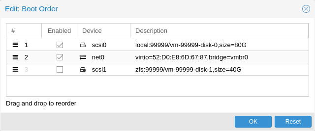](https://pve.proxmox.com/pve-docs/images/screenshot/gui-qemu-edit-bootorder.png)

这样，客户机会首先尝试从磁盘 `scsi0` 启动；如果失败，则会继续尝试从 `net0` 进行网络启动；如果仍然失败，最后会尝试从直通 PCIe 设备启动（对于 NVMe，该设备会被视为磁盘，否则会尝试从 option ROM 启动）。

在 GUI 中，您可以使用拖放编辑器指定启动顺序，并通过复选框启用或禁用某些设备的启动。


如果您的客户机使用多个磁盘来启动操作系统或加载引导加载程序，则必须将所有这些磁盘标记为*可启动*（即必须启用相应复选框，或使其出现在配置中的列表里），客户机才能启动。这是因为较新的 SeaBIOS 和 OVMF 版本只会初始化标记为*可启动*的磁盘。


无论如何，即使设备未出现在列表中或未选中其复选框，一旦客户机的操作系统启动并初始化这些设备，它们仍可供客户机使用。*可启动*标志仅影响客户机 BIOS 和引导加载程序。

### Automatic Start and Shutdown of Virtual Machines <a href="#qm_startup_and_shutdown" id="qm_startup_and_shutdown"></a>

创建 VM 后，您可能希望它们在宿主机系统启动时自动启动。为此，您需要在 Web 界面中选择 VM 的*开机启动*选项，该选项位于*选项*选项卡中，或者使用以下命令进行设置：

```text
# qm set <vmid> -onboot 1
```

[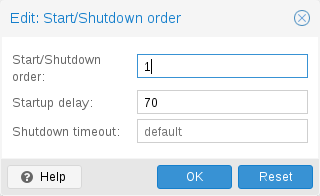](https://pve.proxmox.com/pve-docs/images/screenshot/gui-qemu-edit-start-order.png)

**启动和关闭顺序**

在某些情况下，您可能希望能够微调 VM 的启动顺序，例如，当您的某个 VM 为其他客户机系统提供防火墙或 DHCP 服务时。为此，可以使用以下参数：

- **启动/关闭顺序**：定义启动顺序优先级。例如，如果希望 VM 第一个启动，请将其设置为 1。（关闭时采用相反的启动顺序，因此启动顺序为 1 的机器将最后关闭）。如果宿主机上的多个 VM 定义了相同顺序，则还会按 *VMID* 升序排列。
- **启动延迟**：定义此 VM 启动与后续 VM 启动之间的时间间隔。例如，如果希望在启动其他 VM 之前等待 240 秒，请将其设置为 240。
- **关闭超时**：定义 Proxmox VE 在发出关闭命令后等待 VM 离线的时长（秒）。默认情况下，此值设置为 180，这意味着 Proxmox VE 会发出关闭请求，并等待 180 秒让机器离线。如果超时后机器仍在线，将被强制停止。


目前，由 HA 堆栈管理的 VM 不遵循*开机启动*和*启动顺序*选项。这些 VM 将被启动和关闭算法跳过，因为 HA 管理器本身会确保 VM 得到启动和停止。


请注意，未设置启动/关闭顺序参数的机器始终会在设置了该参数的机器之后启动。此外，该参数只能在同一宿主机上运行的虚拟机之间强制执行，无法在整个集群范围内生效。

If you require a delay between the host boot and the booting of the first VM, see the section on Proxmox VE Node Management.

### QEMU Guest Agent <a href="#qm_qemu_agent" id="qm_qemu_agent"></a>

QEMU Guest Agent 是一项在 VM 内运行的服务，它在宿主机与客户机之间提供通信通道。它用于交换信息，并允许宿主机向客户机发出命令。

例如，VM 摘要面板中的 IP 地址就是通过客户机代理获取的。

或者，在开始备份时，会通过客户机代理指示客户机通过 `guest-fsfreeze-freeze` 和 `guest-fsfreeze-thaw` 命令同步未完成的写入。

要使客户机代理正常工作，必须执行以下步骤：

- 在客户机中安装代理并确保其正在运行
- 在 Proxmox VE 中启用通过代理进行的通信

#### 安装客户机代理 <a href="#_install_guest_agent" id="_install_guest_agent"></a>

大多数 Linux 发行版都提供客户机代理。该软件包通常名为 `qemu-guest-agent`。

对于 Windows，请参阅我们的[Windows VirtIO 驱动程序](https://pve.proxmox.com/wiki/Windows_VirtIO_Drivers)文章，了解有关如何获取和安装驱动程序的更多信息。

#### 启用客户机代理通信 <a href="#qm_qga_enable" id="qm_qga_enable"></a>

可以在 VM 的**选项**面板中启用 Proxmox VE 与客户机代理之间的通信。需要重新启动 VM 才能使更改生效。

#### 使用 QGA 自动执行 TRIM <a href="#qm_qga_auto_trim" id="qm_qga_auto_trim"></a>

可以启用*运行 guest-trim*选项。启用后，Proxmox VE 会在以下可能将零写入存储的操作完成后，向客户机发出 trim 命令：

- 将磁盘移动到另一个存储
- 将使用本地存储的 VM 在线迁移到另一个节点

在精简置备存储上，这可以帮助释放未使用的空间。


Linux 上的 ext4 有一个注意事项，因为它使用内存中的优化来避免发出重复的 TRIM 请求。由于客户机不知道底层存储的变化，只有第一次客户机 TRIM 会按预期运行。此后直到下次重启，后续 TRIM 只会考虑自那以后发生变化的文件系统部分。


#### 文件系统冻结与解冻 <a href="#qm_qga_fsfreeze" id="qm_qga_fsfreeze"></a>

默认情况下，如果在客户机配置中启用了 QEMU Guest Agent，并且该代理在客户机内部可用，那么在执行某些操作时，会通过 `guest-fsfreeze-freeze` QEMU Guest Agent 命令同步虚拟机的文件系统。这样做是为了保证数据一致性。

有关更多详细信息，请参阅 [QEMU Guest Agent 协议参考](https://www.qemu.org/docs/master/interop/qemu-ga-ref.html)。

在 VM 上执行以下任何操作时，都会发出冻结指令：

- 以快照模式执行备份
- 在 VM 运行时创建其克隆
- 在 VM 运行时进行复制
- 为正在运行的 VM 创建不含 RAM 的快照
- 从正在运行的客户机导入磁盘映像会对该正在运行的客户机发出冻结指令

在 Windows 客户机上，某些应用程序可能会通过挂接到 Windows VSS（卷影复制服务）层来自行处理一致性备份，而冻结可能会干扰此过程。例如，已观察到在某些 SQL Server 上调用 `guest-fsfreeze-freeze` 会触发 VSS 以一种模式调用 SQL Writer VSS 模块，而该模式会破坏 SQL Server 差异备份的备份链。

处理这种情况有两种方法。

1. 将 QEMU Guest Agent 配置为使用不会干扰其他 VSS 用户的不同 VSS 变体。[Proxmox VE wiki](https://pve.proxmox.com/wiki/VM_Backup_Consistency) 中有更多详细信息。
2. 或者，您可以通过禁用 `freeze-fs` 客户机代理选项，将 Proxmox VE 配置为不发出冻结和解冻周期。这也可以在 GUI 中完成：打开虚拟机的 *选项* 面板，然后打开 *QEMU Guest Agent* 对话框，并禁用 *在某些操作期间冻结/解冻客户机文件系统以保持一致性* 选项。

   
   禁用此选项可能会导致备份中的文件系统不一致。因此，首选方法是调整客户机中的 QEMU Guest Agent 配置。
   

#### 故障排除 <a href="#_troubleshooting" id="_troubleshooting"></a>

**VM 无法关机**

确保已安装并正在运行客户机代理。

启用客户机代理后，Proxmox VE 将通过客户机代理发送 *shutdown* 等电源命令。如果客户机代理未运行，命令将无法正确执行，关机命令将因超时而失败。

### SPICE Enhancements <a href="#qm_spice_enhancements" id="qm_spice_enhancements"></a>

SPICE 增强功能是可选功能，可改善远程查看器的使用体验。

要通过 GUI 启用这些功能，请转到虚拟机的 **选项** 面板。运行以下命令以通过 CLI 启用它们：

```text
qm set <vmid> -spice_enhancements foldersharing=1,videostreaming=all
```


To use these features the [**Display**](#qm_display) of the virtual machine must be set to SPICE (qxl).


#### 文件夹共享 <a href="#_folder_sharing" id="_folder_sharing"></a>

与客户机共享本地文件夹。需要在客户机中安装 `spice-webdavd` 守护进程。它通过位于 [http://localhost:9843](http://localhost:9843) 的本地 WebDAV 服务器提供共享文件夹。

For Windows guests the installer for the *Spice WebDAV daemon* can be downloaded from the [official SPICE website](https://www.spice-space.org/download.html#windows-binaries).

大多数 Linux 发行版都有一个名为 `spice-webdavd` 的可安装软件包。

要在 Virt-Viewer (Remote Viewer) 中共享文件夹，请转到 *文件 → 首选项*。选择要共享的文件夹，然后勾选该复选框。


文件夹共享目前仅适用于 Linux 版本的 Virt-Viewer。



实验性功能！目前此功能无法可靠工作。


#### 视频流 <a href="#_video_streaming" id="_video_streaming"></a>

快速刷新的区域会被编码为视频流。有两个选项：

- **all**：任何快速刷新的区域都会被编码为视频流。
- **filter**：使用附加过滤器来决定是否应使用视频流（目前仅跳过小窗口区域）。

无法就是否应启用视频流以及应选择哪个选项给出一般性建议。实际效果可能因具体情况而异。

#### 故障排除 <a href="#_troubleshooting_2" id="_troubleshooting_2"></a>

**共享文件夹未显示**

确保 WebDAV 服务已在客户机中启用并正在运行。在 Windows 上，它称为 *Spice webdav proxy*。在 Linux 中，名称为 *spice-webdavd*，但可能因发行版而异。

如果服务正在运行，请在客户机内的浏览器中打开 [http://localhost:9843](http://localhost:9843) 来检查 WebDAV 服务器。

重新启动 SPICE 会话可能会有所帮助。

## 迁移 <a href="#qm_migration" id="qm_migration"></a>

[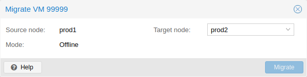](https://pve.proxmox.com/pve-docs/images/screenshot/gui-qemu-migrate.png)

如果您有集群，可以使用以下命令将 VM 迁移到另一台宿主机

```text
# qm migrate <vmid> <target>
```

通常有两种迁移机制

- 在线迁移（亦称 Live Migration）
- 离线迁移

### Online Migration <a href="#_online_migration" id="_online_migration"></a>

If your VM is running and no locally bound resources are configured (such as devices that are passed through), you can initiate a live migration with the `--online` flag in the `qm migration` command evocation. The web interface defaults to live migration when the VM is running.


仅能在采用相同 CPU 架构的宿主机之间进行在线迁移。无法在 x86 与 arm64 宿主机之间传输正在运行的客户机的 CPU 状态。


#### 工作原理 <a href="#_how_it_works" id="_how_it_works"></a>

在线迁移首先会在目标宿主机上启动一个带有 *incoming* 标志的新 QEMU 进程，该进程仅执行基本初始化，客户机 vCPU 仍处于暂停状态，然后等待源虚拟机的客户机内存和设备状态数据流。所有其他资源（如磁盘）要么是共享的，要么已在 VM 运行时状态迁移开始前发送完毕；因此，只剩下内存内容和设备状态需要传输。

建立此连接后，源端开始异步向目标端发送内存内容。如果源端上的客户机内存发生变化，这些部分会被标记为脏数据，并再次执行一轮客户机内存数据发送。此循环不断重复，直到正在运行的源 VM 与正在接收的目标 VM 之间的数据差异足够小，可以在几毫秒内发送完毕；因为此时可以完全暂停源 VM，而用户或程序不会察觉到暂停，从而将剩余数据发送到目标端，然后恢复目标 VM 的 CPU 运行，使其在远不到一秒的时间内成为新的运行中 VM。

#### 要求 <a href="#_requirements" id="_requirements"></a>

要使在线迁移正常工作，需要满足以下要求：

- VM 没有无法迁移的本地资源。例如，当前直通的 PCI 或 USB 设备会阻止在线迁移。另一方面，本地磁盘完全可以迁移，只需将其发送到目标端即可。
- 这些宿主机位于同一个 Proxmox VE 集群中。
- 这些宿主机之间具有正常（且可靠）的网络连接。
- 目标宿主机必须安装相同或更高版本的 Proxmox VE 软件包。虽然有时反过来也能正常工作，但无法保证。
- 这些宿主机的 CPU 来自同一厂商，并具有相似的功能。不同厂商的 CPU **可能**可行，具体取决于实际型号和配置的 VM CPU 类型，但无法保证——因此在生产环境部署此类配置之前，请先进行测试。

#### Conntrack 状态迁移 <a href="#_conntrack_state_migration" id="_conntrack_state_migration"></a>


Conntrack state migration is considered best-effort only and might not work, as it heavily depends on the network setup. For example, setups using source address masquerading (SNAT) on the host will most likely **not** work.


Conntrack 是 Linux 内核的一种机制，通过跟踪各个连接来启用有状态防火墙。在线迁移正在运行的 VM 时，一旦 VM 开始在目标宿主机上运行，活动的入站和/或出站连接**可能**会中断，因为新的宿主机节点没有相同的 conntrack 条目，防火墙可能会因此丢弃数据包。

Conntrack 状态迁移会将宿主机上属于被在线迁移 VM 的所有 conntrack 条目复制到目标节点，随后从源节点的 conntrack 表中清除已迁移的条目。

### Offline Migration <a href="#_offline_migration" id="_offline_migration"></a>

如果您有本地资源，只要所有磁盘都位于在两台宿主机上均有定义的存储上，仍然可以离线迁移 VM。随后，迁移会像在线迁移一样通过网络将磁盘复制到目标宿主机。请注意，任何硬件直通配置都可能需要根据目标宿主机上的设备位置进行调整。

## Copies and Clones <a href="#qm_copy_and_clone" id="qm_copy_and_clone"></a>

[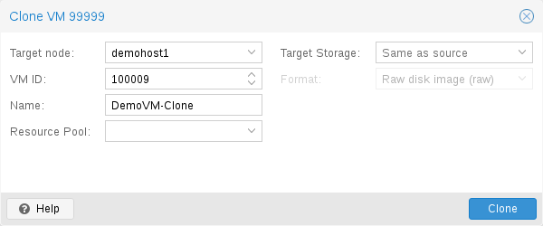](https://pve.proxmox.com/pve-docs/images/screenshot/gui-qemu-full-clone.png)

VM 安装通常使用操作系统供应商提供的安装介质 (CD-ROM) 完成。根据操作系统的不同，这可能是一项耗时的工作，人们可能希望避免。

部署许多同类型 VM 的一种简便方法是复制现有 VM。我们将此类副本称为 *克隆*，并区分 *链接* 克隆和 *完整* 克隆。

**完整克隆**

这种复制的结果是一个独立的 VM。新 VM 不与原始 VM 共享任何存储资源。

可以选择 **目标存储**，因此可以利用此功能将 VM 迁移到完全不同的存储。如果存储驱动程序支持多种格式，还可以更改磁盘映像的 **格式**。


完整克隆需要读取并复制所有 VM 映像数据。这通常比创建链接克隆慢得多。


某些存储类型允许复制特定的 **快照**，默认复制 *当前* VM 数据。这也意味着最终副本绝不会包含原始 VM 的任何其他快照。

**链接克隆**

现代存储驱动程序支持一种快速生成链接克隆的方法。此类克隆是可写副本，其初始内容与原始数据相同。创建链接克隆几乎是即时的，并且最初不会占用额外空间。

它们之所以称为 *链接*，是因为新映像仍引用原始映像。未修改的数据块从原始映像读取，而修改会写入新位置（之后也从新位置读取）。这种技术称为 *写时复制*。

This requires that the original volume is read-only. With Proxmox VE one can convert any VM into a read-only  [Template](#qm_templates)). Such templates can later be used to create linked clones efficiently.


存在链接克隆时，无法删除原始模板。


无法更改链接克隆的 **目标存储**，因为这是存储内部的功能。

**目标节点** 选项允许您在不同的节点上创建新 VM。唯一的限制是 VM 必须位于共享存储上，并且该存储在目标节点上也必须可用。

为避免资源冲突，所有网络接口的 MAC 地址都会被随机化，并且我们会为 VM BIOS (smbios1) 设置生成新的 *UUID*。

## Virtual Machine Templates <a href="#qm_templates" id="qm_templates"></a>

可以将 VM 转换为模板。此类模板是只读的，您可以使用它们创建链接克隆。


无法启动模板，因为这会修改磁盘映像。如果要更改模板，请创建一个链接克隆并对其进行修改。


## VM Generation ID <a href="#_vm_generation_id" id="_vm_generation_id"></a>

Proxmox VE 支持虚拟机的虚拟机生成 ID (*vmgenid*) [\[15\]](#note-0cdd31f9-15)。客户机操作系统可用它来检测任何导致时间偏移的事件，例如恢复备份或回滚快照。

创建新 VM 时，会自动生成 *vmgenid* 并将其保存在该 VM 的配置文件中。

要为现有的 VM 创建并添加 *vmgenid*，可以传入特殊值“1”，让 Proxmox VE 自动生成一个；也可以将 *UUID* [\[16\]](#note-0cdd31f9-16) 用作值，手动进行设置，例如：

```text
# qm set VMID -vmgenid 1
# qm set VMID -vmgenid 00000000-0000-0000-0000-000000000000
```


首次向现有 VM 添加 *vmgenid* 设备，可能会产生与快照回滚、备份恢复等操作中的变更相同的影响，因为 VM 可能会将其解释为代际变更。


在极少数不需要 *vmgenid* 机制的情况下，可以在创建 VM 时将其值设为“0”，或者使用以下命令在配置中事后删除该属性：

```text
# qm set VMID -delete vmgenid
```

*vmgenid* 最主要的用例是较新的 Microsoft Windows 操作系统，它们利用该机制避免在快照回滚、备份恢复或完整 VM 克隆操作时，时间敏感型服务或复制服务（例如数据库或域控制器 [\[17\]](#note-0cdd31f9-17)）出现问题。

## Importing Virtual Machines <a href="#qm_import_virtual_machines" id="qm_import_virtual_machines"></a>

可以通过多种方法从其他虚拟机监控程序或其他 Proxmox VE 集群导入现有虚拟机，最常见的方法有：

- 使用原生导入向导，该向导利用 *import* 内容类型，例如 ESXi 特殊存储所提供的内容类型。
- 在源端执行备份，然后在目标端恢复。从另一个 Proxmox VE 实例迁移时，这种方法效果最好。
- 使用 `qm` 命令行工具的 OVF 专用导入命令。

如果从其他虚拟机监控程序将 VM 导入 Proxmox VE，建议先熟悉 [Proxmox VE 的概念](https://pve.proxmox.com/wiki/Migrate_to_Proxmox_VE#Concepts)。

### Import Wizard <a href="#_import_wizard" id="_import_wizard"></a>

[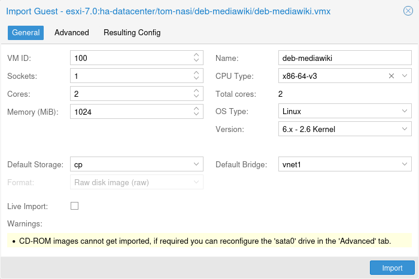](https://pve.proxmox.com/pve-docs/images/screenshot/gui-import-wizard-general.png)

Proxmox VE 提供了一个集成的 VM 导入器，它使用存储插件系统，原生集成到 API 和基于 Web 的用户界面中。你可以使用它整体导入 VM，其大部分配置会映射到 Proxmox VE 的配置模型，同时缩短停机时间。


导入向导是在 Proxmox VE 8.2 开发周期中添加的，目前处于技术预览状态。虽然它已颇具潜力并且运行稳定，但仍在积极开发中。


要使用导入向导，必须先在 Web 界面的 *数据中心 → 存储 → 添加* 下，为导入源设置一个新存储。

然后，可以在资源树中选择新存储，并使用 *虚拟客户机* 内容选项卡，查看所有可导入的客户机。

[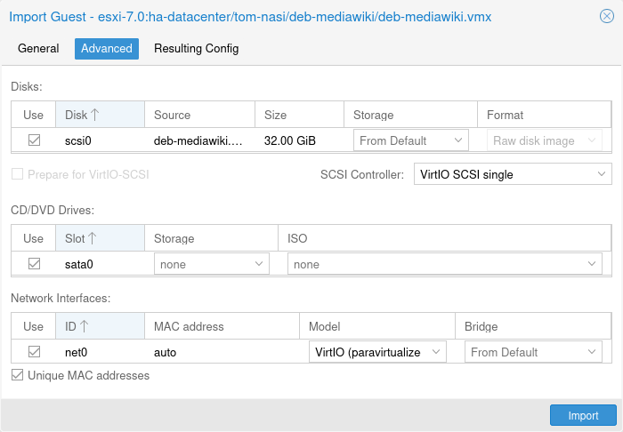](https://pve.proxmox.com/pve-docs/images/screenshot/gui-import-wizard-advanced.png)

选择一个客户机，然后使用 *导入* 按钮（或双击）打开导入向导。你可以在此处修改部分可用选项，然后开始导入。请注意，导入完成后还可以进行更高级的修改。


ESXi 导入向导已经过 ESXi 6.5 至 8.0 版本的测试。请注意，使用 vSAN 存储的客户机无法直接导入；必须首先将其磁盘移动到另一个存储。虽然可以使用 vCenter 作为导入源，但性能会显著下降（慢 5 到 10 倍）。


有关分步指南以及如何让虚拟客户机适应新虚拟机监控程序的提示，请参阅我们的 [迁移到 Proxmox VE 的 wiki 文章](https://pve.proxmox.com/wiki/Migrate_to_Proxmox_VE#Migration)。

#### OVA/OVF 导入 <a href="#_ova_ovf_import" id="_ova_ovf_import"></a>

要导入 OVA/OVF 文件，首先需要一个启用了 *import* 内容类型的基于文件的存储。该存储上会有一个 *import* 文件夹，你可以将 OVA 文件，或 OVF 文件及其对应镜像以扁平目录结构放入其中。或者，也可以使用 Web UI 直接上传或下载 OVA 文件。然后，可以在 Web UI 中选择这些文件，并使用导入向导导入客户机。

对于 OVA 文件，还需要额外的空间来临时解压镜像。这需要一个配置了 *images* 内容类型的基于文件的存储。默认情况下会选择源存储用于此目的，但你可以指定一个 *导入工作存储*，在导入到实际目标存储之前，镜像会先解压到该存储中。


由于 OVA/OVF 文件的结构和内容并不总是得到良好维护或明确定义，因此可能需要手动调整某些客户机设置。例如，OVA/OVF 文件中几乎从不定义 SCSI 控制器类型，但使用 OVMF（UEFI）时默认配置无法启动，因此在遇到这些情况时，应选择 *Virtio SCSI* 或 *VMware PVSCSI*。


### Import OVF/OVA Through CLI <a href="#_import_ovf_ova_through_cli" id="_import_ovf_ova_through_cli"></a>

从其他虚拟机监控程序导出的 VM 通常采用一个或多个磁盘镜像的形式，并带有一个描述 VM 设置（RAM、核心数量）的配置文件。  
 如果磁盘来自 VMware 或 VirtualBox，磁盘镜像可以采用 vmdk 格式；如果磁盘来自 KVM 虚拟机监控程序，则可以采用 qcow2 格式。VM 导出最常用的配置格式是 OVF 标准，但在实践中，由于许多设置并未在该标准本身中实现，而且虚拟机监控程序会通过非标准扩展导出补充信息，因此互操作性受到限制。

除了格式问题外，如果不同虚拟机监控程序之间模拟的硬件差异过大，从其他虚拟机监控程序导入磁盘镜像也可能失败。Windows VM 尤其容易受此影响，因为该操作系统对任何硬件更改都非常敏感。要解决此问题，可以在导出前安装可从互联网获取的 MergeIDE.zip 实用程序，并在启动导入的 Windows VM 之前，将硬盘类型选择为 **IDE**。

最后还有半虚拟化驱动程序的问题，这类驱动程序可提高模拟系统的速度，并且因虚拟机监控程序而异。GNU/Linux 和其他自由 Unix 操作系统默认已安装所有必要的驱动程序，你可以在导入 VM 后立即切换到半虚拟化驱动程序。对于 Windows VM，则需要自行安装 Windows 半虚拟化驱动程序。

GNU/Linux 和其他自由 Unix 通常可以顺利导入。请注意，由于上述问题，我们无法保证在所有情况下都能成功导入或导出 Windows VM。

#### Windows OVF 导入的分步示例 <a href="#_step_by_step_example_of_a_windows_ovf_import" id="_step_by_step_example_of_a_windows_ovf_import"></a>

Microsoft 提供 [虚拟机下载](https://developer.microsoft.com/en-us/windows/downloads/virtual-machines/)，以便开始 Windows 开发。我们将使用其中一个虚拟机来演示 OVF 导入功能。

##### 下载虚拟机 zip 文件 <a href="#_download_the_virtual_machine_zip" id="_download_the_virtual_machine_zip"></a>

了解用户协议后，选择适用于 VMware 平台的 *Windows 10 Enterprise (Evaluation \- Build)*，并下载 zip 文件。

##### 从 zip 文件中解压磁盘镜像 <a href="#_extract_the_disk_image_from_the_zip" id="_extract_the_disk_image_from_the_zip"></a>

使用 `unzip` 实用程序或你选择的任何归档工具解压 zip 文件，并通过 ssh/scp 将 ovf 和 vmdk 文件复制到你的 Proxmox VE 宿主机。

##### 导入虚拟机 <a href="#_import_the_virtual_machine" id="_import_the_virtual_machine"></a>

这将创建一个新的虚拟机，使用从 OVF 清单中读取的核心数、内存和 VM 名称，并将磁盘导入到 `local-lvm` 存储。你需要手动配置网络。

```text
# qm importovf 999 WinDev1709Eval.ovf local-lvm
```

现在可以启动 VM 了。

##### 向虚拟机添加外部磁盘镜像 <a href="#_adding_an_external_disk_image_to_a_virtual_machine" id="_adding_an_external_disk_image_to_a_virtual_machine"></a>

你还可以向 VM 添加现有磁盘镜像，无论它来自其他虚拟机监控程序，还是由你自己创建。

假设你使用 *vmdebootstrap* 工具创建了 Debian/Ubuntu 磁盘镜像：

```text
vmdebootstrap --verbose \
 --size 10GiB --serial-console \
 --grub --no-extlinux \
 --package openssh-server \
 --package avahi-daemon \
 --package qemu-guest-agent \
 --hostname vm600 --enable-dhcp \
 --customize=./copy_pub_ssh.sh \
 --sparse --image vm600.raw
```

现在可以创建一个新的目标 VM，将镜像导入存储 `pvedir`，并将其连接到 VM 的 SCSI 控制器：

```text
# qm create 600 --net0 virtio,bridge=vmbr0 --name vm600 --serial0 socket \
   --boot order=scsi0 --scsihw virtio-scsi-pci --ostype l26 \
   --scsi0 pvedir:0,import-from=/path/to/dir/vm600.raw
```

现在可以启动 VM 了。

## Cloud-Init Support <a href="#qm_cloud_init" id="qm_cloud_init"></a>

[Cloud-Init](https://cloudinit.readthedocs.io) 是处理虚拟机实例早期初始化的事实标准多发行版软件包。使用 Cloud-Init，可以在虚拟机监控程序端配置网络设备和 ssh 密钥。VM 首次启动时，VM 内部的 Cloud-Init 软件将应用这些设置。

许多 Linux 发行版提供开箱即用的 Cloud-Init 镜像，这些镜像主要为 *OpenStack* 设计。它们也适用于 Proxmox VE。虽然获取此类现成镜像看似方便，但我们通常建议自行准备镜像。这样做的好处是，你可以确切知道自己安装了什么，并且以后可以根据需要轻松自定义镜像。

创建此类 Cloud-Init 镜像后，我们建议将其转换为 VM 模板。利用 VM 模板可以快速创建链接克隆，因此这是一种快速部署新 VM 实例的方法。你只需在启动新 VM 之前配置网络（可能还要配置 ssh 密钥）。

我们建议使用基于 SSH 密钥的身份验证登录由 Cloud-Init 置备的 VM。也可以设置密码，但这种方式不如基于 SSH 密钥的身份验证安全，因为 Proxmox VE 需要在 Cloud-Init 数据中存储该密码的加密版本。

Proxmox VE 会生成一个 ISO 镜像，用于将 Cloud-Init 数据传递给 VM。为此，所有 Cloud-Init VM 都需要分配一个 CD-ROM 驱动器。通常还应添加串行控制台并将其用作显示设备。许多 Cloud-Init 镜像依赖于此配置，这也是 OpenStack 的要求。不过，其他镜像可能无法使用此配置。如果使用串行控制台不起作用，请切换回默认显示配置。

### Preparing Cloud-Init Templates <a href="#_preparing_cloud_init_templates" id="_preparing_cloud_init_templates"></a>

第一步是准备你的 VM。基本上，你可以使用任何 VM。只需 **在要准备的 VM 内部** 安装 Cloud-Init 软件包。在基于 Debian/Ubuntu 的系统上，操作非常简单：

```text
apt-get install cloud-init
```


此命令**不**应在 Proxmox VE 宿主机上执行，而只应在 VM 内部执行。


许多发行版已经提供开箱即用的 Cloud-Init 镜像（以 `.qcow2` 文件的形式提供），因此你也可以直接下载并导入此类镜像。在下面的示例中，我们将使用 Ubuntu 在 [https://cloud-images.ubuntu.com](https://cloud-images.ubuntu.com) 提供的云镜像。

```text
# download the image
wget https://cloud-images.ubuntu.com/bionic/current/bionic-server-cloudimg-amd64.img

# create a new VM with VirtIO SCSI controller
qm create 9000 --memory 2048 --net0 virtio,bridge=vmbr0 --scsihw virtio-scsi-pci

# import the downloaded disk to the local-lvm storage, attaching it as a SCSI drive
qm set 9000 --scsi0 local-lvm:0,import-from=/path/to/bionic-server-cloudimg-amd64.img
```


Ubuntu Cloud-Init 镜像要求 SCSI 驱动器使用 `virtio-scsi-pci` 控制器类型。


[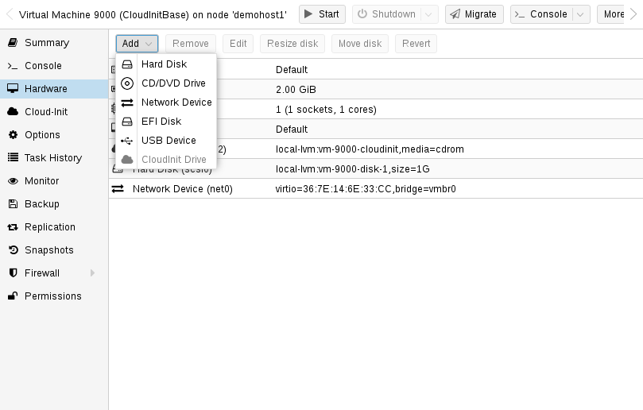](https://pve.proxmox.com/pve-docs/images/screenshot/gui-cloudinit-hardware.png)

**添加 Cloud-Init CD-ROM 驱动器**

下一步是配置一个 CD-ROM 驱动器，用于将 Cloud-Init 数据传递给 VM。

```text
qm set 9000 --ide2 local-lvm:cloudinit
```

要直接从 Cloud-Init 镜像启动，请将 `boot` 参数设置为 `order=scsi0`，以限制 BIOS 仅从此磁盘启动。这将加快启动速度，因为 VM BIOS 会跳过对可启动 CD-ROM 的检测。

```text
qm set 9000 --boot order=scsi0
```

对于许多 Cloud-Init 镜像，需要配置串行控制台并将其用作显示设备。但是，如果此配置不适用于某个镜像，请改回默认显示设备。

```text
qm set 9000 --serial0 socket --vga serial0
```

最后，建议将 VM 转换为模板。然后，你可以通过此模板快速创建链接克隆。从 VM 模板部署比创建完整克隆（复制）快得多。

```text
qm template 9000
```

### Deploying Cloud-Init Templates <a href="#_deploying_cloud_init_templates" id="_deploying_cloud_init_templates"></a>

[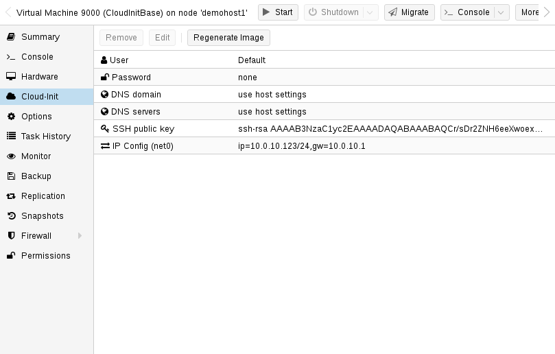](https://pve.proxmox.com/pve-docs/images/screenshot/gui-cloudinit-config.png)

你可以通过克隆轻松部署此类模板：

```text
qm clone 9000 123 --name ubuntu2
```

然后配置用于身份验证的 SSH 公钥，并配置 IP 设置：

```text
qm set 123 --sshkey ~/.ssh/id_rsa.pub
qm set 123 --ipconfig0 ip=10.0.10.123/24,gw=10.0.10.1
```

你也可以只使用一条命令来配置所有 Cloud-Init 选项。上面的示例只是为了缩短行长度，才将命令拆分开来。另外，请确保根据你的具体环境调整 IP 设置。

### Custom Cloud-Init Configuration <a href="#_custom_cloud_init_configuration" id="_custom_cloud_init_configuration"></a>

Cloud-Init 集成还允许使用自定义配置文件，而不是自动生成的配置。这可以通过命令行中的 `cicustom` 选项实现：

```text
qm set 9000 --cicustom "user=<volume>,network=<volume>,meta=<volume>"
```

自定义配置文件必须位于支持片段的存储上，并且必须在虚拟机将要迁移到的所有节点上可用。否则，虚拟机将无法启动。例如：

```text
qm set 9000 --cicustom "user=local:snippets/userconfig.yaml"
```

Cloud-Init 有三种配置。第一种是上面示例中所示的 `user` 配置。第二种是 `network` 配置，第三种是 `meta` 配置。它们可以全部一起指定，也可以根据需要任意混合搭配。对于任何未指定自定义配置文件的配置，都将使用自动生成的配置。

可以导出生成的配置，作为自定义配置的基础：

```text
qm cloudinit dump 9000 user
```

`network` 和 `meta` 也有相同的命令。

### Cloud-Init on Windows <a href="#_cloud_init_on_windows" id="_cloud_init_on_windows"></a>

Windows 上有一个名为 [cloudbase-init](https://cloudbase.it/) 的 Cloud-Init 重新实现版本。Cloudbase-Init 并不具备 Cloud-Init 的所有功能，而且某些功能与 Cloud-Init 有所不同。

Cloudbase-Init 要求将 `ostype` 设置为任意 Windows 版本，并将 `citype` 设置为 `configdrive2`，后者是任何 Windows `ostype` 的默认设置。

没有可免费使用的现成 Windows 云镜像。使用 Cloudbase-Init 需要手动安装和配置 Windows 客户机。

### Preparing Cloudbase-Init Templates <a href="#_preparing_cloudbase_init_templates" id="_preparing_cloudbase_init_templates"></a>

第一步是在虚拟机中安装 Windows。在客户机中下载并安装 Cloudbase-Init。可能有必要安装 Beta 版本。不要在安装结束时运行 Sysprep，而应首先配置 Cloudbase-Init。

一些常见的设置选项如下：

- *username*：设置管理员的用户名
- *groups*：允许将用户添加到 `Administrators` 组
- *inject\_user\_password*：将其设置为 `true`，以允许在虚拟机配置中设置密码
- *first\_logon\_behaviour*：将其设置为 `no`，以在登录时无需设置新密码
- *rename\_admin\_user*：将其设置为 `true`，以允许将默认的 `Administrator` 用户重命名为通过 `username` 指定的用户名
- *metadata\_services*：将其设置为 `cloudbaseinit.metadata.services.configdrive.ConfigDriveService`，使 Cloudbase-Init 首先检查此服务。否则，Cloudbase-Init 可能需要几分钟才能在启动后完成系统配置。

某些插件（例如 SetHostnamePlugin）需要重启，并会自动执行重启。要禁用 Cloudbase-Init 的自动重启，可以将 `allow_reboot` 设置为 `false`。

完整的配置选项集可在 [cloudbase-init 官方文档](https://cloudbase-init.readthedocs.io/en/latest/config.html) 中找到。

完成配置后创建快照是明智的，以防配置的某些部分仍需调整。配置好 Cloudbase-Init 后，即可开始创建模板。关闭 Windows 客户机，添加 Cloud-Init 磁盘，然后将其转换为模板。

```text
qm set 9000 --ide2 local-lvm:cloudinit
qm template 9000
```

将模板克隆为新的虚拟机：

```text
qm clone 9000 123 --name windows123
```

然后设置密码、网络配置和 SSH 密钥：

```text
qm set 123 --cipassword <password>
qm set 123 --ipconfig0 ip=10.0.10.123/24,gw=10.0.10.1
qm set 123 --sshkey ~/.ssh/id_rsa.pub
```

在设置密码之前，请确保 `ostype` 已设置为任意 Windows 版本。否则，密码将被加密，而 Cloudbase-Init 会将加密后的密码用作明文密码。

所有设置完成后，启动克隆的客户机。首次启动时将无法登录，并且会因主机名已更改而自动重启。重启后，新密码应已设置，登录也应可正常使用。

### Cloudbase-Init and Sysprep <a href="#_cloudbase_init_and_sysprep" id="_cloudbase_init_and_sysprep"></a>

Sysprep 是一项用于重置 Windows 配置并提供 `new` 系统的功能。它可以与 Cloudbase-Init 结合使用，以创建一个干净的模板。

使用 Sysprep 时，需要调整 2 个配置文件。第一个是常规配置文件，第二个是以 `-unattend.conf` 结尾的配置文件。

Cloudbase-Init 分 2 个步骤运行：首先使用 `-unattend.conf` 执行 Sysprep 步骤，然后使用主配置文件执行常规步骤。

对于 `Windows Server`，使用提供的 `Unattend.xml` 文件运行 Sysprep 应该可以开箱即用。但是，普通 Windows 版本需要额外的步骤：

1. 打开一个 PowerShell 实例
2. 启用 Administrator 用户：

   ```text
   net user Administrator /active:yes`
   ```
3. 使用 Administrator 用户安装 Cloudbase-Init
4. 修改 `Unattend.xml`，使其包含在执行 Sysprep 后首次启动时启用 Administrator 用户的命令：

   ```text
   <RunSynchronousCommand wcm:action="add">
     <Path>net user administrator /active:yes</Path>
     <Order>1</Order>
     <Description>Enable Administrator User</Description>
   </RunSynchronousCommand>
   ```

   确保 `<Order>` 不与其他同步命令冲突。通过将数值增大到更高的值，修改 Cloudbase-Init 命令的 `<Order>`，使其在此命令之后运行：`<Order>2</Order>`
5. （仅限 Windows 11）删除冲突的 Microsoft.OneDriveSync 软件包：

   ```text
   Get-AppxPackage -AllUsers Microsoft.OneDriveSync | Remove-AppxPackage -AllUsers
   ```
6. `cd` 到 Cloudbase-Init 配置目录中：

   ```text
   cd 'C:\Program Files\Cloudbase Solutions\Cloudbase-Init\conf'
   ```
7. （可选）在执行 Sysprep 前为虚拟机创建快照，以防配置错误
8. 运行 Sysprep：

   ```text
   C:\Windows\System32\Sysprep\sysprep.exe /generalize /oobe /unattend:Unattend.xml
   ```

完成上述步骤后，虚拟机应因 Sysprep 而处于关机状态。现在，您可以将其转换为模板、克隆它并根据需要进行配置。

### Cloud-Init specific Options <a href="#_cloud_init_specific_options" id="_cloud_init_specific_options"></a>

**`cicustom`: `[meta=<volume>] [,network=<volume>] [,user=<volume>] [,vendor=<volume>]`**

指定自定义文件，以在启动时替换自动生成的文件。

**`meta`\=`<volume>`**

指定一个自定义文件，其中包含通过 cloud-init 传递给虚拟机的所有元数据。这是特定于提供商的，也就是说 configdrive2 和 nocloud 有所不同。

**`network`\=`<volume>`**

用于通过 cloud-init 将包含所有网络数据的自定义文件传递给虚拟机。

**`user`\=`<volume>`**

用于通过 cloud-init 将包含所有用户数据的自定义文件传递给虚拟机。

**`vendor`\=`<volume>`**

用于通过 cloud-init 将包含所有供应商数据的自定义文件传递给虚拟机。

**`cipassword`: `<string>`**

分配给用户的密码。通常不建议使用此选项，请改用 SSH 密钥。另请注意，较旧版本的 cloud-init 不支持散列密码。

**`citype`: `<configdrive2 | nocloud | opennebula>`**

指定 cloud-init 配置格式。默认值取决于配置的操作系统类型（`ostype`。Linux 使用 `nocloud` 格式，Windows 使用 `configdrive2`。

**`ciupgrade`：`<boolean>`（*默认值 \=* `1`）**

首次启动后自动升级软件包。

**`ciuser`: `<string>`**

指定要更改其 SSH 密钥和密码的用户名，而非镜像中配置的默认用户。

**`ipconfig[n]`: `[gw=<GatewayIPv4>] [,gw6=<GatewayIPv6>] [,ip=<IPv4Format/CIDR>] [,ip6=<IPv6Format/CIDR>]`**

为相应接口指定 IP 地址和网关。

IP 地址使用 CIDR 表示法，网关是可选的，但需要指定相同类型的 IP 地址。

IP 地址可以使用特殊字符串 *dhcp* 来表示使用 DHCP，在这种情况下不应提供显式网关。对于 IPv6，可以使用特殊字符串 *auto* 来表示使用无状态自动配置。这需要 cloud-init 19.4 或更高版本。

如果启用了 cloud-init，且既未指定 IPv4 地址也未指定 IPv6 地址，则默认在 IPv4 上使用 dhcp。

**`gw`\=`<GatewayIPv4>`**

IPv4 流量的默认网关。


需要选项：`ip`


**`gw6`\=`<GatewayIPv6>`**

IPv6 流量的默认网关。


需要选项：`ip6`


**`ip`\=`<IPv4Format/CIDR>`（*默认值 \=* `dhcp`）**

CIDR 格式的 IPv4 地址。

**`ip6`\=`<IPv6Format/CIDR>`（*默认值 \=* `dhcp`）**

CIDR 格式的 IPv6 地址。

**`nameserver`: `<string>`**

为容器设置 DNS 服务器 IP 地址。如果既未设置 searchdomain 也未设置 nameserver，创建时将自动使用宿主机的设置。

**`searchdomain`: `<string>`**

为容器设置 DNS 搜索域。如果既未设置 searchdomain 也未设置 nameserver，创建时将自动使用宿主机的设置。

**`sshkeys`: `<string>`**

设置 SSH 公钥（每行一个密钥，OpenSSH 格式）。

## PCI(e) Passthrough <a href="#qm_pci_passthrough" id="qm_pci_passthrough"></a>

PCI(e) 直通是一种让虚拟机控制宿主机 PCI 设备的机制。与使用虚拟化硬件相比，这可能具有一些优势，例如更低的延迟、更高的性能或更多功能（例如卸载）。

但是，如果将设备直通给虚拟机，您将无法再在宿主机或任何其他虚拟机中使用该设备。

请注意，虽然 i440fx 和 q35 机器都支持 PCI 直通，但 PCIe 直通仅适用于 q35 机器。这并不意味着作为 PCI 设备直通的 PCIe 设备只能以 PCI 速度运行。以 PCIe 方式直通设备只是为客户机设置一个标志，告知它该设备是 PCIe 设备，而不是“速度非常快的传统 PCI 设备”。某些客户机应用程序会从中受益。

### General Requirements <a href="#_general_requirements" id="_general_requirements"></a>

由于直通是在真实硬件上执行的，因此需要满足一些要求。下面简要介绍这些要求；有关特定设备的更多信息，请参阅 [PCI 直通示例](https://pve.proxmox.com/wiki/PCI_Passthrough)。

#### 硬件 <a href="#_hardware" id="_hardware"></a>

您的硬件需要支持 `IOMMU`（**I**/**O** **M**emory **M**anagement **U**nit）中断重映射，其中包括 CPU 和主板。

通常，支持 VT-d 的 Intel 系统和支持 AMD-Vi 的 AMD 系统都支持此功能。在 arm64 上，等效功能是由受支持平台提供的系统内存管理单元（SMMU）。由于硬件实现不佳以及驱动程序缺失或质量不高，无法保证一切都能开箱即用。

此外，服务器级硬件通常比消费级硬件提供更好的支持，但即便如此，许多现代系统也能支持此功能。

请咨询您的硬件供应商，以确认您的特定配置在 Linux 下是否支持此功能。

#### 确定 PCI 卡地址 <a href="#_determining_pci_card_address" id="_determining_pci_card_address"></a>

最简单的方法是在虚拟机的硬件选项卡中使用 GUI 添加类型为“Host PCI”的设备。或者，您也可以使用命令行。

您可以使用以下命令定位您的卡：

```text
 lspci
```

#### 配置 <a href="#_configuration" id="_configuration"></a>

确认硬件支持直通后，您需要进行一些配置来启用 PCI(e) 直通。

**IOMMU**

您必须在 BIOS/UEFI 中启用 IOMMU 支持。通常，相应设置称为 `IOMMU` 或 `VT-d`，但您应在主板手册中查找确切的选项名称。

With AMD CPUs IOMMU is enabled by default. With recent kernels (6.8 or newer), this is also true for Intel CPUs. On older kernels, it is necessary to enable it on Intel CPUs via the kernel command line by adding:

```text
 intel_iommu=on
```


`intel_iommu=on` 参数适用于 x86 宿主机。在 arm64 上，SMMU 通过固件和 ACPI 启用，因此不需要此类内核命令行参数。


**IOMMU 直通模式**

如果您的硬件支持 IOMMU 直通模式，启用此模式可能会提高性能。这是因为虚拟机随后会绕过通常由虚拟机监控程序执行的（默认）DMA 转换，改为将 DMA 请求直接传递给硬件 IOMMU。要启用这些选项，请添加：

```text
 iommu=pt
```

to the kernel commandline.

**内核模块**

通过将以下模块添加到 `'/etc/modules-load.d/'` 下的文件中（例如 `'/etc/modules-load.d/vfio.conf'`），确保加载这些模块：


**中介设备直通**

如果直通的是中介设备（例如 vGPU），则不需要执行以下操作。在这些情况下，设备将直接由相应的宿主机驱动程序管理。


```text
 vfio
 vfio_iommu_type1
 vfio_pci
```

<a id="qm_pci_passthrough_update_initramfs"></a>


更改任何与模块相关的内容后，您需要刷新 `initramfs`。在 Proxmox VE 上，可以通过执行以下命令来完成：

```text
# update-initramfs -u -k all
```

要检查模块是否已加载，以下命令的输出

```text
# lsmod | grep vfio
```

应包含上述三个模块。

**完成配置**

最后，重启以使更改生效，并检查 IOMMU 是否确实已启用。

```text
# dmesg | grep -e DMAR -e IOMMU -e AMD-Vi
```

应显示 `IOMMU`、`Directed I/O` 或 `Interrupt Remapping` 已启用，具体消息可能因硬件和内核而异。

有关如何排除故障或验证 IOMMU 是否按预期工作的说明，请参阅我们 Wiki 中的 [验证 IOMMU 参数](https://pve.proxmox.com/wiki/PCI_Passthrough#Verifying_IOMMU_parameters) 部分。

同样重要的是，您要直通的设备必须位于 **独立的** `IOMMU` 组中。可以通过调用 Proxmox VE API 来检查这一点：

```text
# pvesh get /nodes/{nodename}/hardware/pci --pci-class-blacklist ""
```

如果设备与其功能（例如 GPU 与 HDMI 音频设备）或其根端口或 PCI(e) 网桥位于同一个 `IOMMU` 组中，则没有问题。


**PCI(e) 插槽**

某些平台处理其物理 PCI(e) 插槽的方式有所不同。如果无法获得所需的 `IOMMU` 组隔离，有时将卡插入另一个 PCI(e) 插槽可能会有所帮助。



**不安全的中断**

For some platforms, it may be necessary to allow unsafe interrupts. To do so, add the following line to a file ending in `.conf` under **/etc/modprobe.d/**:

```text
 options vfio_iommu_type1 allow_unsafe_interrupts=1
```

请注意，此选项可能会导致系统不稳定。


#### GPU 直通注意事项 <a href="#_gpu_passthrough_notes" id="_gpu_passthrough_notes"></a>

无法通过 Proxmox VE Web 界面上的 NoVNC 或 SPICE 显示 GPU 的帧缓冲区。

在直通整个 GPU 或 vGPU 且需要图形输出时，必须将显示器物理连接到显卡，或者在客户机内配置远程桌面软件（例如 VNC 或 RDP）。

如果只想将 GPU 用作硬件加速器（例如供使用 OpenCL 或 CUDA 的程序使用），则无需这样做。

### Host Device Passthrough <a href="#_host_device_passthrough" id="_host_device_passthrough"></a>

PCI(e) 直通最常用的方式是直通整张 PCI(e) 卡，例如 GPU 或网卡。

#### 宿主机配置 <a href="#_host_configuration" id="_host_configuration"></a>

Proxmox VE 会尝试自动使 PCI(e) 设备对宿主机不可用。但是，如果此方法无效，可以采取以下两种措施：

- 通过添加以下内容，将设备 ID 传递给 *vfio-pci* 模块的选项：

  ```text
   options vfio-pci ids=1234:5678,4321:8765
  ```

  添加到一个 `.conf` 文件中，该文件位于 **/etc/modprobe.d/**，其中 `1234:5678` 和 `4321:8765` 是通过以下命令获取的供应商 ID 和设备 ID：

  ```text
  # lspci -nn
  ```
- 通过添加以下内容，在宿主机上彻底将驱动程序列入黑名单，以确保设备可以改为绑定以用于直通：

  ```text
   blacklist DRIVERNAME
  ```

  添加到一个 `.conf` 文件中，该文件位于 **/etc/modprobe.d/**。

  要查找驱动程序名称，请执行

  ```text
  # lspci -k
  ```

  例如：

  ```text
  # lspci -k | grep -A 3 "VGA"
  ```

  将输出类似以下内容

  ```text
  01:00.0 VGA compatible controller: NVIDIA Corporation GP108 [GeForce GT 1030] (rev a1)
          Subsystem: Micro-Star International Co., Ltd. [MSI] GP108 [GeForce GT 1030]
          Kernel driver in use: <some-module>
          Kernel modules: <some-module>
  ```

  现在，可以将这些驱动程序写入一个 `.conf` 文件，将其列入黑名单：

  ```text
  echo "blacklist <some-module>" >> /etc/modprobe.d/blacklist.conf
  ```

For both methods you need to [update the `initramfs`](#qm_pci_passthrough_update_initramfs) and reboot after that.

如果这样仍然无效，可能需要设置软依赖，以便在加载 GPU 模块之前加载 *vfio-pci*。可以使用 *softdep* 标志来实现，更多信息另请参阅 *modprobe.d* 的手册页。

例如，如果使用的驱动程序名为 \<some-module\>：

```text
# echo "softdep <some-module> pre: vfio-pci" >> /etc/modprobe.d/<some-module>.conf
```

**验证配置**

要检查更改是否成功，可以使用

```text
# lspci -nnk
```

并检查设备条目。如果显示

```text
Kernel driver in use: vfio-pci
```

或者完全没有 *in use* 行，则该设备已可用于直通。


**中介设备**

对于中介设备，此行会有所不同，因为设备将直接由宿主机驱动程序控制，而不是由 *vfio-pci* 控制。


#### 虚拟机配置 <a href="#qm_pci_passthrough_vm_config" id="qm_pci_passthrough_vm_config"></a>

直通 GPU 时，使用 *q35* 作为机器类型、使用 *OVMF*（虚拟机的 *UEFI*）代替 SeaBIOS，并使用 PCIe 代替 PCI，可获得最佳兼容性。请注意，如果要使用 *OVMF* 进行 GPU 直通，GPU 必须具有支持 UEFI 的 ROM，否则请改用 SeaBIOS。要检查 ROM 是否支持 UEFI，请参阅 [PCI 直通示例](https://pve.proxmox.com/wiki/PCI_Passthrough#How_to_know_if_a_graphics_card_is_UEFI_.28OVMF.29_compatible) Wiki。

此外，使用 OVMF 时，有可能禁用 VGA 仲裁，从而减少启动时需要运行的旧式代码。要禁用 VGA 仲裁：

```text
 echo "options vfio-pci ids=<vendor-id>,<device-id> disable_vga=1" > /etc/modprobe.d/vfio.conf
```

将 \<vendor-id\> 和 \<device-id\> 替换为通过以下命令获取的值：

```text
# lspci -nn
```

可以在 Web 界面的虚拟机硬件部分添加 PCI 设备。也可以使用命令行；在虚拟机配置中设置 **hostpciX** 选项，例如执行：

```text
# qm set VMID -hostpci0 00:02.0
```

或者在虚拟机配置文件中添加一行：

```text
 hostpci0: 00:02.0
```

如果设备具有多个功能（例如“`00:02.0`”和“`00:02.1`”），可以使用简写语法 \`\`00:02\` *将它们全部一起直通。这相当于在 Web 界面中选中 \`\`All Functions\`* 复选框。

根据设备和客户机操作系统的不同，可能需要以下一些选项：

- **x-vga\=on\|off** 将 PCI(e) 设备标记为虚拟机的主 GPU。启用此选项后，**vga** 配置选项将被忽略。
- **pcie\=on\|off** 指示 Proxmox VE 使用 PCIe 或 PCI 端口。某些客户机与设备的组合需要 PCIe 而不是 PCI。PCIe 仅适用于 *q35* 机器类型。
- **rombar\=on\|off** 使固件 ROM 对客户机可见。默认为 on。某些 PCI(e) 设备需要禁用此选项。
- **romfile\=\<path\>** 是供设备使用的 ROM 文件的可选路径。这是 **/usr/share/kvm/** 下的相对路径。

**示例**

以下是一个 PCIe 直通示例，其中 GPU 被设置为主 GPU：

```text
# qm set VMID -hostpci0 02:00,pcie=on,x-vga=on
```

**PCI ID 覆盖**

可以覆盖客户机将看到的 PCI 供应商 ID、设备 ID 和子系统 ID。如果设备是某种变体，其 ID 无法被客户机驱动程序识别，但仍希望强制加载这些驱动程序，此功能会很有用（例如，已知设备与受支持的变体使用相同的芯片组）。

可用选项包括 `vendor-id`、`device-id`、`sub-vendor-id` 和 `sub-device-id`。可以设置其中任意一个或全部选项，以覆盖设备的默认 ID。

例如：

```text
# qm set VMID -hostpci0 02:00,device-id=0x10f6,sub-vendor-id=0x0000
```

### SR-IOV <a href="#_sr_iov" id="_sr_iov"></a>

直通 PCI(e) 设备的另一种方式是使用设备的硬件虚拟化功能（如果可用）。


**启用 SR-IOV**

要使用 SR-IOV，平台支持尤为重要。可能需要先在 BIOS/UEFI 中启用此功能，或者需要使用特定的 PCI(e) 端口才能正常工作。如有疑问，请查阅平台手册或联系其供应商。


*SR-IOV*（**S**ingle-**R**oot **I**nput/**O**utput **V**irtualization）使单个设备能够向系统提供多个 *VFs*（**V**irtual **F**unctions）。这些 *VFs* 均可用于不同的虚拟机，具有完整的硬件功能，并且与软件虚拟化设备相比，性能更好、延迟更低。

目前，最常见的用例是支持 SR-IOV 的 NIC（**N**etwork **I**nterface **C**ard），每个物理端口可以提供多个 VF。这使虚拟机内部能够使用校验和卸载等功能，从而减少（宿主机）CPU 开销。

#### 宿主机配置 <a href="#_host_configuration_2" id="_host_configuration_2"></a>

通常，在设备上启用虚拟功能有两种方法。

- 有时，驱动程序模块会提供一个选项，例如某些 Intel 驱动程序

  ```text
   max_vfs=4
  ```

  可以将其放在一个以 *.conf* 结尾的文件中，该文件位于 **/etc/modprobe.d/**。（之后不要忘记更新 initramfs）

  有关准确的参数和选项，请参阅驱动程序模块文档。
- 第二种更通用的方法是使用 `sysfs`。如果设备和驱动程序支持此方法，可以动态更改 VF 数量。例如，要在设备 0000:01:00.0 上设置 4 个 VF，请执行：

  ```text
  # echo 4 > /sys/bus/pci/devices/0000:01:00.0/sriov_numvfs
  ```

  要使此更改持久化，可以使用 ‘sysfsutils\` Debian 软件包。安装后，可以通过 **/etc/sysfs.conf** 或 \`FILE.conf’ 对其进行配置，后者位于 **/etc/sysfs.d/**。

#### 虚拟机配置 <a href="#_vm_configuration" id="_vm_configuration"></a>

After creating VFs, you should see them as separate PCI(e) devices when outputting them with `lspci`. Get their ID and pass them through like a [normal PCI(e) device](#qm_pci_passthrough_vm_config).

### Mediated Devices (vGPU, GVT-g) <a href="#_mediated_devices_vgpu_gvt_g" id="_mediated_devices_vgpu_gvt_g"></a>

中介设备是另一种将物理硬件的功能和性能复用于虚拟化硬件的方法。它们最常见于虚拟化 GPU 部署，例如 Intel 的 GVT-g，以及 NVIDIA 在其 GRID 技术中使用的 vGPU。

通过这种方式，物理卡可以创建虚拟卡，类似于 SR-IOV。不同之处在于，中介设备不会在宿主机上显示为 PCI(e) 设备，因此仅适用于虚拟机。

#### 宿主机配置 <a href="#_host_configuration_3" id="_host_configuration_3"></a>

通常，卡的驱动程序必须支持该功能，否则将无法工作。因此，有关兼容的驱动程序及其配置方法，请咨询供应商。

Intel 的 GVT-g 驱动程序已集成到内核中，应可与第 5、第 6 和第 7 代 Intel Core 处理器以及 E3 v4、E3 v5 和 E3 v6 Xeon 处理器配合使用。

To enable it for Intel Graphics, you have to make sure to load the module *kvmgt* (for example via `/etc/modules-load.d/`) and to enable it on the kernel commandline and add the following parameter:

```text
 i915.enable_gvt=1
```

After that remember to [update the `initramfs`](#qm_pci_passthrough_update_initramfs), and reboot your host.

#### 虚拟机配置 <a href="#_vm_configuration_2" id="_vm_configuration_2"></a>

要使用中介设备，只需指定 `mdev` 属性，该属性位于 `hostpciX` 虚拟机配置选项中。

可以通过 *sysfs* 获取支持的设备。例如，要列出设备 *0000:00:02.0* 支持的类型，只需执行：

```text
# ls /sys/bus/pci/devices/0000:00:02.0/mdev_supported_types
```

每个条目都是一个目录，其中包含以下重要文件：

- *available\_instances* 包含此类型仍可用的实例数量；虚拟机中每使用一个 *mdev*，该数量就会减少。
- *description* 包含有关该类型功能的简短描述
- *create* 是创建此类设备的端点——如果配置了 *hostpciX* 选项且其中带有 `mdev`，Proxmox VE 会自动为你完成此操作。

使用 `Intel GVT-g vGPU`（`Intel Skylake 6700k`）的示例配置：

```text
# qm set VMID -hostpci0 00:02.0,mdev=i915-GVTg_V5_4
```

设置后，Proxmox VE 会在虚拟机启动时自动创建此类设备，并在虚拟机停止时再次清理它。

### Usage in Clusters <a href="#_use_in_clusters" id="_use_in_clusters"></a>

It is also possible to map devices at a cluster level, so that they can be properly used with HA and hardware changes are detected and non-root users can configure them. See [Resource Mapping](#resource_mapping) for details on that.

### vIOMMU (emulated IOMMU) <a href="#qm_pci_viommu" id="qm_pci_viommu"></a>

vIOMMU 是在虚拟机内模拟硬件 IOMMU，为虚拟化 I/O 设备提供更好的内存访问控制和安全性。使用 vIOMMU 选项还可以通过[嵌套虚拟化](https://pve.proxmox.com/wiki/Nested_Virtualization)，将 PCI(e) 设备直通到第 1 级虚拟机中的第 2 级虚拟机。要将物理 PCI(e) 设备从宿主机直通到嵌套虚拟机，请遵循 PCI(e) 直通说明。

目前有两种 vIOMMU 实现：Intel 和 VirtIO。

#### Intel vIOMMU <a href="#_intel_viommu" id="_intel_viommu"></a>

Intel vIOMMU 对虚拟机的特定要求：

- 无论宿主机使用 Intel 还是 AMD CPU，都必须在虚拟机的内核参数中设置 `intel_iommu=on`。
- 要使用 Intel vIOMMU，需要将 **q35** 设置为机器类型。

如果满足所有要求，可以在需要直通 PCI 设备的虚拟机配置中，将 `viommu=intel` 添加到 machine 参数。

```text
# qm set VMID -machine q35,viommu=intel
```

[VT-d 的 QEMU 文档](https://wiki.qemu.org/Features/VT-d)

#### VirtIO vIOMMU <a href="#_virtio_viommu" id="_virtio_viommu"></a>

这种 vIOMMU 实现较新，限制不如 Intel vIOMMU 多，但目前在生产环境中使用较少，文档也较少。

使用 VirtIO vIOMMU 时，**无需**设置任何内核参数。也**不必**使用 q35 作为机器类型，但如果要使用 PCIe，建议这样做。

```text
# qm set VMID -machine q35,viommu=virtio
```

[Michael Zhao 撰写的 virtio-iommu 详解博客文章](https://web.archive.org/web/20230804075844/https://michael2012z.medium.com/virtio-iommu-789369049443)

## Hookscripts <a href="#_hookscripts" id="_hookscripts"></a>

可以通过配置属性 `hookscript` 为虚拟机添加钩子脚本。

```text
# qm set 100 --hookscript local:snippets/hookscript.pl
```

它将在客户机生命周期的各个阶段被调用。有关示例和文档，请参阅 `/usr/share/pve-docs/examples/guest-example-hookscript.pl` 下的示例脚本。

## Hibernation <a href="#qm_hibernate" id="qm_hibernate"></a>

可以使用 GUI 选项 `Hibernate` 或通过以下命令将虚拟机休眠到磁盘：

```text
# qm suspend ID --todisk
```

这意味着当前内存内容将保存到磁盘，并且虚拟机会停止。下次启动时，将加载内存内容，虚拟机可以从中断处继续运行。

<a id="qm_vmstatestorage"></a>


**状态存储选择**

如果未指定内存的目标存储，将自动选择以下第一项：

1. 虚拟机配置中的存储 `vmstatestorage`。
2. 任意虚拟机磁盘的第一个共享存储。
3. 任意虚拟机磁盘的第一个非共享存储。
4. 作为回退的存储 `local`。

## Resource Mapping <a href="#resource_mapping" id="resource_mapping"></a>

[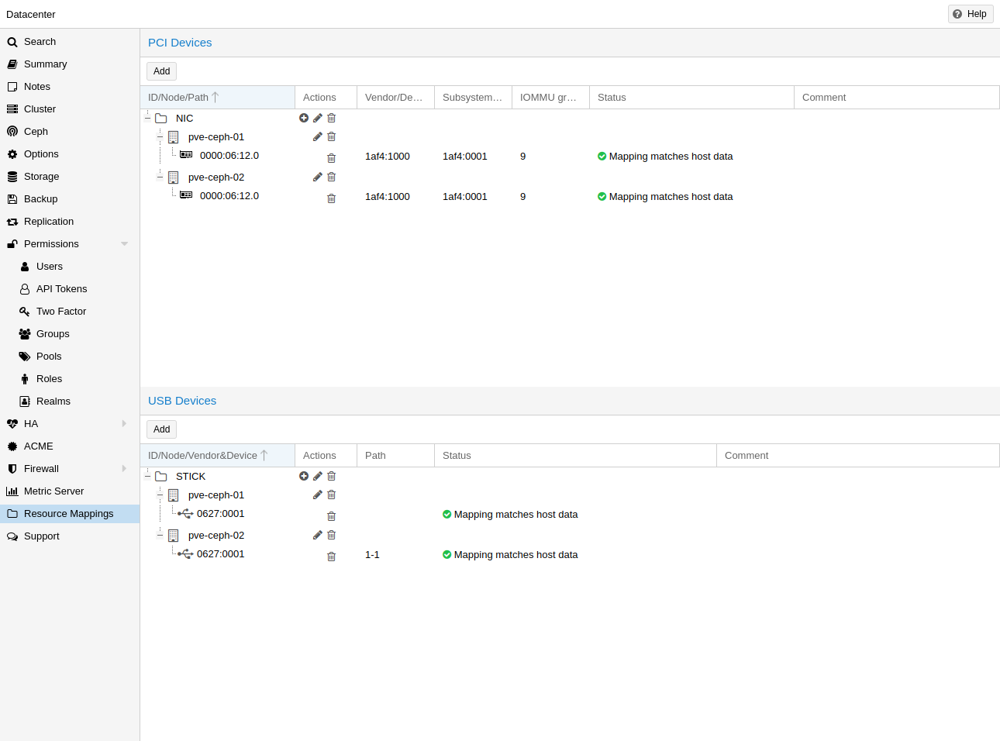](https://pve.proxmox.com/pve-docs/images/screenshot/gui-datacenter-resource-mappings.png)

使用或引用本地资源（例如 PCI 设备的地址）时，有时直接使用原始地址或 ID 会有问题，例如：

- 使用 HA 时，目标节点上可能存在具有相同 id 或路径的不同设备，如果在将此类客户机分配给 HA 组时不小心，可能会使用错误的设备，从而导致配置出错。
- 更改硬件可能会更改 id 和路径，因此必须检查所有已分配的设备，确认路径或 id 是否仍然正确。

为更好地处理此问题，可以定义集群范围的资源映射，使资源具有集群内唯一、由用户选择的标识符，该标识符可对应不同宿主机上的不同设备。这样，HA 就不会使用错误的设备启动客户机，并且可以检测到硬件更改。

在 Proxmox VE Web GUI 中，可在 `Datacenter` 下 `Resource Mappings` 类别的相关选项卡中创建此类映射，也可以在命令行中使用以下命令创建：

```text
# pvesh create /cluster/mapping/<type> <options>
```

[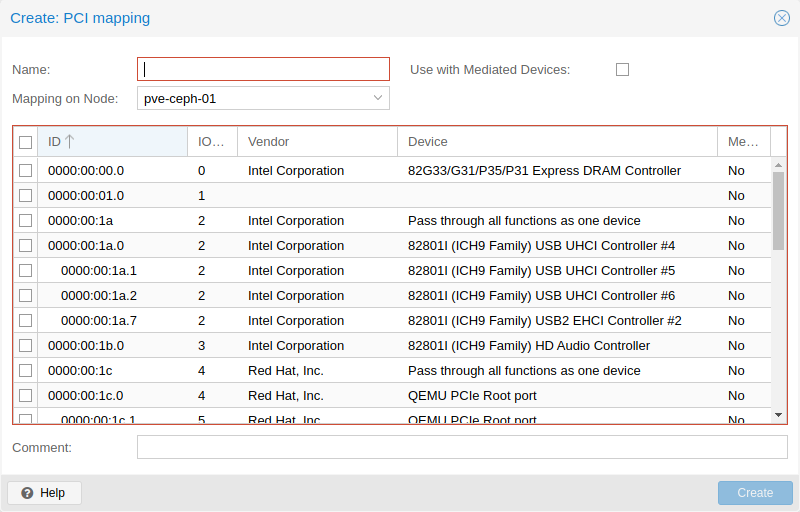](https://pve.proxmox.com/pve-docs/images/screenshot/gui-datacenter-mapping-pci-edit.png)

Where `<type>` is the hardware type (currently either `pci`, `usb` or [dir](#qm_virtiofs)) and `<options>` are the device mappings and other configuration parameters.

请注意，选项必须包含一个 map 属性，其中包含该硬件的所有标识属性，以便能够验证硬件未发生更改，并直通正确的设备。

例如，要添加一个 PCI 设备，将其命名为 `device1`，路径为 `0000:01:00.0`，设备 id 为 `0001`，供应商 id 为 `0002`，节点为 `node1`，并将 `0000:02:00.0` 添加到 `node2` 上，可以使用以下命令：

```text
# pvesh create /cluster/mapping/pci --id device1 \
 --map node=node1,path=0000:01:00.0,id=0002:0001 \
 --map node=node2,path=0000:02:00.0,id=0002:0001
```

必须为每个需要该设备映射的节点重复指定 `map` 参数（请注意，目前每个节点上的每个映射只能映射一个 USB 设备）。

使用 GUI 会让此操作容易得多，因为正确的属性会被自动获取并发送到 API。

[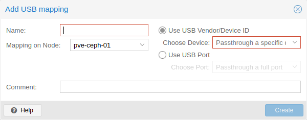](https://pve.proxmox.com/pve-docs/images/screenshot/gui-datacenter-mapping-usb-edit.png)

对于 PCI 设备，还可以通过为节点指定多个 map 属性，在每个节点上提供多个设备。如果将此类设备分配给客户机，则在客户机启动时会使用第一个空闲设备。给定路径的顺序也是尝试这些设备的顺序，因此可以实现任意的分配策略。

这对于支持 SR-IOV 的设备很有用，因为有时具体直通哪个虚拟功能并不重要。

可以通过 GUI 或使用以下命令将此类设备分配给客户机：

```text
# qm set ID -hostpci0 <name>
```

对于 PCI 设备，使用：

```text
# qm set <vmid> -usb0 <name>
```

对于 USB 设备，使用：

其中，`<vmid>` 是客户机 id，`<name>` 是为所创建映射选择的名称。所有通常用于设备直通的选项均允许使用，例如 `mdev`。

要创建映射，必须具备 `Mapping.Modify` 权限，其作用对象为 `/mapping/<type>/<name>`（其中 `<type>` 是设备类型，`<name>` 是映射名称）。

要使用这些映射，必须具备 `Mapping.Use` 权限，其作用对象为 `/mapping/<type>/<name>`（此外还需具备编辑配置的常规客户机权限）。

**其他选项**

定义集群范围的资源映射时，还有一些其他选项。目前提供以下选项：

- `mdev`（PCI）：将此 PCI 设备标记为能够提供 `mediated devices`。启用后，在客户机上配置该设备时可以选择类型。如果为映射选择了多个 PCI 设备，则会在第一个具有所选类型的可用实例的设备上创建中介设备。
- `live-migration-capable`（PCI）：将此 PCI 设备标记为能够在节点之间进行在线迁移。这需要驱动程序和硬件支持。目前仅已知配备较新内核的 NVIDIA GPU 支持此功能。请注意，在线迁移直通设备是一项实验性功能，可能无法正常工作或引发问题。

## Managing Virtual Machines with `qm` <a href="#_managing_virtual_machines_with_span_class_monospaced_qm_span" id="_managing_virtual_machines_with_span_class_monospaced_qm_span"></a>

qm 是 Proxmox VE 上用于管理 QEMU/KVM 虚拟机的工具。您可以创建和销毁虚拟机，并控制其运行（启动/停止/挂起/恢复）。此外，还可以使用 qm 在关联的配置文件中设置参数，也可以创建和删除虚拟磁盘。

### CLI 使用示例 <a href="#_cli_usage_examples" id="_cli_usage_examples"></a>

使用上传到 *local* 存储的 iso 文件，在 *local-lvm* 存储上创建一个带有 4 GB IDE 磁盘的 VM

```text
# qm create 300 -ide0 local-lvm:4 -net0 e1000 -cdrom local:iso/proxmox-mailgateway_2.1.iso
```

启动新的 VM

```text
# qm start 300
```

发送关机请求，然后等待，直到 VM 停止。

```text
# qm shutdown 300 && qm wait 300
```

与上述相同，但只等待 40 秒。

```text
# qm shutdown 300 && qm wait 300 -timeout 40
```

如果 VM 未关机，则强制停止它，并覆盖任何正在运行的关机任务。由于停止 VM 可能导致数据丢失，请谨慎使用。

```text
# qm stop 300 -overrule-shutdown 1
```

销毁 VM 始终会将其从访问控制列表中移除，并始终会移除该 VM 的防火墙配置。如果还希望将 VM 从复制作业、备份作业和 HA 资源配置中移除，则必须激活 *--purge*。


启用 purge 还会从所有引用该 HA 资源的亲和性规则中移除该资源，并移除仅剩这一个资源的规则。


```text
# qm destroy 300 --purge
```

将磁盘映像移动到另一存储。

```text
# qm move-disk 300 scsi0 other-storage
```

将磁盘映像重新分配给另一个 VM。这会从源 VM 中移除磁盘 `scsi1`，并将其作为 `scsi3` 附加到目标 VM。在后台，磁盘映像会被重命名，以使名称与新所有者匹配。

```text
# qm move-disk 300 scsi1 --target-vmid 400 --target-disk scsi3
```

## 配置 <a href="#qm_configuration" id="qm_configuration"></a>

VM 配置文件存储在 Proxmox 集群文件系统中，可通过 `/etc/pve/qemu-server/<VMID>.conf` 访问。与存储在 `/etc/pve/` 中的其他文件一样，它们会自动复制到所有其他集群节点。


VMID \< 100 保留用于内部用途，且 VMID 必须在整个集群范围内唯一。


**示例 VM 配置**

```text
boot: order=virtio0;net0
cores: 1
sockets: 1
memory: 512
name: webmail
ostype: l26
net0: e1000=EE:D2:28:5F:B6:3E,bridge=vmbr0
virtio0: local:vm-100-disk-1,size=32G
```

这些配置文件是简单的文本文件，您可以使用普通文本编辑器（`vi`、`nano`、……）进行编辑。这对于进行小幅更正有时很有用，但请记住，需要重启 VM 才能应用此类更改。

因此，通常最好使用 `qm` 命令来生成和修改这些文件，或者完全使用 GUI 完成操作。我们的工具集足够智能，可以立即将大多数更改应用到正在运行的 VM。此功能称为“热插拔”，在这种情况下无需重启 VM。

### 文件格式 <a href="#_file_format" id="_file_format"></a>

VM 配置文件使用简单的冒号分隔键/值格式。每行格式如下：

```text
# this is a comment
OPTION: value
```

这些文件中的空行会被忽略，以 `#` 字符开头的行会被视为注释，同样会被忽略。

### 快照 <a href="#qm_snapshots" id="qm_snapshots"></a>

创建快照时，`qm` 会将快照时的配置存储到同一配置文件中的独立快照小节。例如，创建名为“testsnapshot”的快照后，配置文件将如下所示：

**带快照的 VM 配置**

```text
memory: 512
swap: 512
parent: testsnaphot
...

[testsnaphot]
memory: 512
swap: 512
snaptime: 1457170803
...
```

有几个与快照相关的属性，例如 `parent` 和 `snaptime`。`parent` 属性用于存储快照之间的父/子关系。`snaptime` 是快照创建时间戳（Unix 纪元）。

You can optionally save the memory of a running VM with the option `vmstate`. For details about how the target storage gets chosen for the VM state, see [State storage selection](#qm_vmstatestorage) in the chapter [Hibernation](#qm_hibernate).

### 选项 <a href="#qm_options" id="qm_options"></a>

**`acpi`：`<boolean>`（*默认值 \=* `1`）**

启用/禁用 ACPI。

**`affinity`: `<string>`**

用于执行客户机进程的宿主机核心列表，例如：0,5,8-11

**`agent`: `[enabled=]<1|0> [,freeze-fs=<1|0>] [,fstrim_cloned_disks=<1|0>] [,type=<virtio|isa>]`**

启用/禁用与 QEMU Guest Agent 的通信及其属性。

**`enabled`\=`<boolean>`（*默认值 \=* `0`）**

启用/禁用与 VM 中运行的 QEMU Guest Agent（QGA）的通信。

**`freeze-fs`\=`<boolean>`（*默认值 \=* `1`）**

是否发出 guest-fsfreeze-freeze 和 guest-fsfreeze-thaw QEMU 客户机代理命令。当客户机配置中启用了 QEMU Guest Agent 选项且代理正在客户机内运行时，快照模式备份、克隆、不含 RAM 的快照、从正在运行的客户机导入磁盘以及复制，通常会发出 guest-fsfreeze-freeze 和相应的 thaw 命令。

已弃用的 *freeze-fs-on-backup* 设置被视为此设置的别名。

**`fstrim_cloned_disks`\=`<boolean>`（*默认值 \=* `0`）**

移动磁盘或迁移 VM 后运行 fstrim。

**`type`\=`<isa | virtio>`（*默认值 \=* `virtio`）**

选择代理类型

**`allow-ksm`：`<boolean>`（*默认值 \=* `1`）**

允许通过 KSM（内核同页合并）合并此客户机的内存页。

**`amd-sev`: `[type=]<sev-type> [,allow-smt=<1|0>] [,kernel-hashes=<1|0>] [,no-debug=<1|0>] [,no-key-sharing=<1|0>]`**

AMD CPU 的安全加密虚拟化（SEV）功能

**`allow-smt`\=`<boolean>`（*默认值 \=* `1`）**

设置策略位以允许同时多线程（SMT）（除非针对 SEV-SNP，否则会被忽略）

**`kernel-hashes`\=`<boolean>`（*默认值 \=* `0`）**

将内核哈希添加到客户机固件，以实现可度量的 Linux 内核启动

**`no-debug`\=`<boolean>`（*默认值 \=* `0`）**

设置策略位以禁止调试客户机

**`no-key-sharing`\=`<boolean>`（*默认值 \=* `0`）**

设置策略位以禁止与其他客户机共享密钥（对于 SEV-SNP 会被忽略）

**`type`\=`<sev-type>`**

使用 type\=*std* 启用标准 SEV，或使用 *es* 选项启用实验性 SEV-ES，或使用 *snp* 选项启用实验性 SEV-SNP。

**`arch`: `<aarch64 | x86_64>`**

虚拟处理器架构。默认为宿主机架构。

**`args`: `<string>`**

传递给 kvm 的任意参数，例如：

args: -no-reboot -smbios *type\=0,vendor\=FOO*


此选项仅供专家使用。


**`audio0`: `device=<ich9-intel-hda|intel-hda|AC97> [,driver=<spice|none>]`**

配置音频设备，与 QXL/Spice 结合使用时很有用。

**`device`\=`<AC97 | ich9-intel-hda | intel-hda>`**

配置音频设备。

**`driver`\=`<none | spice>`（*默认值 \=* `spice`）**

音频设备的驱动程序后端。

**`autostart`：`<boolean>`（*默认值 \=* `0`）**

崩溃后自动重启（目前被忽略）。

**`balloon`: `<integer> (0 - N)`**

VM 的目标 RAM 大小，单位为 MiB。默认启用 balloon 驱动程序，除非通过将值设置为零明确禁用它。

**`bios`：`<ovmf | seabios>`（*默认值 \=* `seabios`）**

选择 BIOS 实现。

**`boot`: `[[legacy=]<[acdn]{1,4}>] [,order=<device[;device...]>]`**

指定客户机启动顺序。请使用 *order\=* 子属性，因为不带键的用法或 *legacy\=* 已弃用。

**`legacy`\=`<[acdn]{1,4}>`（*默认值 \=* `cdn`）**

从软盘（a）、硬盘（c）、CD-ROM（d）或网络（n）启动。已弃用，请改用 *order\=*。

**`order`\=`<device[;device...]>`**

客户机将尝试按照此处列出的顺序从设备启动。

磁盘、光驱和直通的 USB 存储设备将直接用于启动，NIC 将加载 PXE，PCIe 设备则将表现得像磁盘（例如 NVMe），或者加载选项 ROM（例如 RAID 控制器、硬件 NIC）。

请注意，只有此列表中的设备才会被标记为可启动，并因此由客户机固件（BIOS/UEFI）加载。如果需要使用多个磁盘启动（例如软件 RAID），则需要在此处指定所有这些磁盘。

如果指定了此选项，将覆盖已弃用的 *legacy\=\[acdn\]\** 值。

**`bootdisk`: `(ide|sata|scsi|virtio)\d+`**

启用从指定磁盘启动。已弃用：请改用 *boot: order\=foo;bar*。

**`cdrom`: `<volume>`**

这是选项 -ide2 的别名

**`cicustom`: `[meta=<volume>] [,network=<volume>] [,user=<volume>] [,vendor=<volume>]`**

cloud-init：指定自定义文件，以在启动时替换自动生成的文件。

**`meta`\=`<volume>`**

指定一个自定义文件，其中包含通过 cloud-init 传递给虚拟机的所有元数据。这是特定于提供商的，也就是说 configdrive2 和 nocloud 有所不同。

**`network`\=`<volume>`**

用于通过 cloud-init 将包含所有网络数据的自定义文件传递给虚拟机。

**`user`\=`<volume>`**

用于通过 cloud-init 将包含所有用户数据的自定义文件传递给虚拟机。

**`vendor`\=`<volume>`**

用于通过 cloud-init 将包含所有供应商数据的自定义文件传递给虚拟机。

**`cipassword`: `<string>`**

cloud-init：分配给用户的密码。通常不建议使用此选项，请改用 ssh 密钥。另请注意，较旧版本的 cloud-init 不支持哈希密码。

**`citype`: `<configdrive2 | nocloud | opennebula>`**

指定 cloud-init 配置格式。默认值取决于配置的操作系统类型（`ostype`。Linux 使用 `nocloud` 格式，Windows 使用 `configdrive2`。

**`ciupgrade`：`<boolean>`（*默认值 \=* `1`）**

cloud-init：首次启动后自动执行软件包升级。

**`ciuser`: `<string>`**

cloud-init：指定要更改 ssh 密钥和密码的用户名，以代替映像中配置的默认用户。

**`cores`: `<integer> (1 - N)` (*默认值 \=* `1`)**

每个 CPU 插槽的核心数。

**`cpu`: `[[cputype=]<string>] [,flags=<+FLAG[;-FLAG...]>] [,guest-phys-bits=<integer>] [,hidden=<1|0>] [,hv-vendor-id=<vendor-id>] [,level=<integer>] [,phys-bits=<8-64|host>] [,reported-model=<enum>]`**

模拟的 CPU 类型。

**`cputype`\=`<string>` (*默认值 \=* `kvm64`)**

模拟的 CPU 类型。可以是默认类型或自定义名称（自定义型号名称必须以 *custom-* 为前缀）。

**`flags`\=`<+FLAG[;-FLAG...]>`**

以 *;* 分隔的附加 CPU 标志列表。使用 *\+FLAG* 启用标志，使用 *-FLAG* 禁用标志。有一个特殊的 *nested-virt* 简写，用于控制当前 CPU 的嵌套虚拟化（AMD 使用 *svm*，Intel 使用 *vmx*）。自定义 CPU 模型可以指定 QEMU/KVM 支持的任何标志；出于安全原因，VM 特定标志必须来自以下集合：aes、amd-no-ssb、amd-ssbd、hv-evmcs、hv-tlbflush、ibpb、md-clear、nested-virt、pcid、pdpe1gb、spec-ctrl、ssbd、virt-ssbd

**`guest-phys-bits`\=`<integer> (32 - 64)`**

客户机可用的物理地址位数。

**`hidden`\=`<boolean>` (*默认值 \=* `0`)**

不要标识为 KVM 虚拟机。仅影响 x86-64 架构的 vCPU。

**`hv-vendor-id`\=`<vendor-id>`**

Hyper-V 供应商 ID。Windows 客户机中的某些驱动程序或程序需要特定的 ID。

**`level`\=`<integer> (0 - 4294967295)`**

客户机可查询的基本 CPUID 叶的最大输入值——即供应商（叶 0）、系列/型号/步进及功能位（叶 1）、缓存和拓扑信息（叶 4 和 B）等。编号更高的叶将被隐藏。将此项设置为 *30*，是解决在较新的 Intel 宿主机上运行的 Windows 客户机出现 Hyper-V 启动故障的常用变通方法。仅当 vCPU 架构为 x86\_64 时适用。

**`phys-bits`\=`<8-64|host>`**

报告给客户机操作系统的物理内存地址位数。应小于或等于宿主机的位数。设置为 *host* 可使用宿主机 CPU 的值，但请注意，这样会导致无法在线迁移到该值不同的 CPU。

**`reported-model`\=`<486 | Broadwell | Broadwell-IBRS | Broadwell-noTSX | Broadwell-noTSX-IBRS | Cascadelake-Server | Cascadelake-Server-noTSX | Cascadelake-Server-v2 | Cascadelake-Server-v4 | Cascadelake-Server-v5 | ClearwaterForest | ClearwaterForest-v2 | ClearwaterForest-v3 | Conroe | Cooperlake | Cooperlake-v2 | DiamondRapids | EPYC | EPYC-Genoa | EPYC-Genoa-v2 | EPYC-IBPB | EPYC-Milan | EPYC-Milan-v2 | EPYC-Milan-v3 | EPYC-Rome | EPYC-Rome-v2 | EPYC-Rome-v3 | EPYC-Rome-v4 | EPYC-Rome-v5 | EPYC-Turin | EPYC-v3 | EPYC-v4 | EPYC-v5 | GraniteRapids | GraniteRapids-v2 | GraniteRapids-v3 | GraniteRapids-v4 | GraniteRapids-v5 | Haswell | Haswell-IBRS | Haswell-noTSX | Haswell-noTSX-IBRS | Icelake-Client | Icelake-Client-noTSX | Icelake-Server | Icelake-Server-noTSX | Icelake-Server-v3 | Icelake-Server-v4 | Icelake-Server-v5 | Icelake-Server-v6 | Icelake-Server-v7 | IvyBridge | IvyBridge-IBRS | KnightsMill | Nehalem | Nehalem-IBRS | Opteron_G1 | Opteron_G2 | Opteron_G3 | Opteron_G4 | Opteron_G5 | Penryn | SandyBridge | SandyBridge-IBRS | SapphireRapids | SapphireRapids-v2 | SapphireRapids-v3 | SapphireRapids-v4 | SapphireRapids-v5 | SapphireRapids-v6 | SierraForest | SierraForest-v2 | SierraForest-v3 | SierraForest-v4 | SierraForest-v5 | Skylake-Client | Skylake-Client-IBRS | Skylake-Client-noTSX-IBRS | Skylake-Client-v4 | Skylake-Server | Skylake-Server-IBRS | Skylake-Server-noTSX-IBRS | Skylake-Server-v4 | Skylake-Server-v5 | Westmere | Westmere-IBRS | a64fx | athlon | core2duo | coreduo | cortex-a35 | cortex-a53 | cortex-a55 | cortex-a57 | cortex-a710 | cortex-a72 | cortex-a76 | cortex-a78ae | host | kvm32 | kvm64 | max | neoverse-n1 | neoverse-n2 | neoverse-v1 | pentium | pentium2 | pentium3 | phenom | qemu32 | qemu64>` (*默认值 \=* `kvm64`)**

报告给客户机的 CPU 模型和供应商。必须是 QEMU/KVM 支持的模型。仅对自定义 CPU 模型定义有效；默认模型始终会向客户机操作系统报告其自身。

**`cpulimit`: `<number> (0 - 128)` (*默认值 \=* `0`)**

CPU 使用限制。


如果计算机有 2 个 CPU，则 CPU 时间总计为 *2*。值 *0* 表示不限制 CPU。


**`cpuunits`: `<integer> (1 - 262144)` (*默认值 \=* `cgroup v1: 1024, cgroup v2: 100`)**

虚拟机的 CPU 权重。该参数用于内核公平调度器。数值越大，此虚拟机获得的 CPU 时间就越多。该数值是相对于所有其他正在运行的虚拟机的权重而言的。

**`description`: `<string>`**

虚拟机的描述。显示在 Web 界面的虚拟机摘要中。此描述会作为注释保存在配置文件内。

**`efidisk0`: `[file=]<volume> [,efitype=<2m|4m>] [,format=<enum>] [,ms-cert=<enum>] [,pre-enrolled-keys=<1|0>] [,size=<DiskSize>]`**

配置用于存储 EFI 变量的磁盘。

**`efitype`\=`<2m | 4m>` (*默认值 \=* `2m`)**

OVMF EFI 变量的大小和类型。*4m* 较新且推荐使用，并且是安全启动所必需的。为保持向后兼容，如果未另行指定，则使用 *2m*。对于 arch\=aarch64 (ARM) 的虚拟机，此设置会被忽略。

**`file`\=`<volume>`**

驱动器的后端卷。

**`format`\=`<cloop | qcow | qcow2 | qed | raw | vmdk>`**

驱动器后端文件的数据格式。

**`ms-cert`\=`<2011 | 2023 | 2023k | 2023w>` (*默认值 \=* `2011`)**

信息性标记，指示 Proxmox VE 已注册的最新 Microsoft UEFI 证书的版本。值 *2023k* 表示包含 *Microsoft UEFI CA 2023*、*Windows UEFI CA 2023* 和 *Microsoft Corporation KEK 2K CA 2023* 证书。值 *2023* 和 *2023w* 已弃用，仅为兼容性保留。

**`pre-enrolled-keys`\=`<boolean>` (*默认值 \=* `0`)**

与 *efitype\=4m* 一起使用时，使用已注册特定发行版密钥和 Microsoft 标准密钥的 EFI 变量模板。请注意，这将默认启用安全启动，但仍可在虚拟机内将其关闭。

**`size`\=`<DiskSize>`**

磁盘大小。这仅供参考，不会产生任何影响。

**`freeze`: `<boolean>`**

启动时冻结 CPU（使用 *c* 监视器命令开始执行）。

**`hookscript`: `<string>`**

在虚拟机生命周期的各个阶段执行的脚本。

**`hostpci[n]`: `[[host=]<HOSTPCIID[;HOSTPCIID2...]>] [,device-id=<hex id>] [,driver=<vfio|keep>] [,legacy-igd=<1|0>] [,mapping=<mapping-id>] [,mdev=<string>] [,pcie=<1|0>] [,rombar=<1|0>] [,romfile=<string>] [,sub-device-id=<hex id>] [,sub-vendor-id=<hex id>] [,vendor-id=<hex id>] [,x-vga=<1|0>]`**

将宿主机 PCI 设备映射到客户机中。


此选项允许直接访问宿主机硬件。因此，此类机器将无法再迁移——请特别谨慎使用。



实验性功能！有用户报告此选项存在问题。


**`device-id`\=`<hex id>`**

覆盖对客户机可见的 PCI 设备 ID

**`driver`\=`<keep | vfio>` (*默认值 \=* `vfio`)**

如果设置为 *keep*，设备既不会重置，也不会绑定到 *vfio-pci* 驱动程序。适用于已加载正确驱动程序的设备。

**`host`\=`<HOSTPCIID[;HOSTPCIID2...]>`**

宿主机 PCI 设备直通。宿主机 PCI 设备的 PCI ID，或宿主机的 PCI 虚拟功能列表。HOSTPCIID 语法为：

*bus:dev.func*（十六进制数字）

可以使用 *lspci* 命令列出现有 PCI 设备。

必须设置此项或 *mapping* 键。

**`legacy-igd`\=`<boolean>` (*默认值 \=* `0`)**

以传统 IGD 模式直通此设备，使其成为虚拟机中的主显卡和唯一显卡。需要 *pc-i440fx* 机器类型，并将 VGA 设置为 *none*。

**`mapping`\=`<mapping-id>`**

集群范围映射的 ID。必须设置此项或默认键 *host*。

**`mdev`\=`<string>`**

要使用的中介设备类型。虚拟机启动时将创建此类型的一个实例，并在虚拟机停止时清理该实例。

**`pcie`\=`<boolean>` (*默认值 \=* `0`)**

选择 PCI-express 总线（需要 *q35* 机器型号）。

**`rombar`\=`<boolean>` (*默认值 \=* `1`)**

指定设备的 ROM 是否在客户机的内存映射中可见。

**`romfile`\=`<string>`**

自定义 PCI 设备 ROM 文件名（必须位于 /usr/share/kvm/ 中）。

**`sub-device-id`\=`<hex id>`**

覆盖对客户机可见的 PCI 子系统设备 ID

**`sub-vendor-id`\=`<hex id>`**

覆盖对客户机可见的 PCI 子系统供应商 ID

**`vendor-id`\=`<hex id>`**

覆盖对客户机可见的 PCI 供应商 ID

**`x-vga`\=`<boolean>` (*默认值 \=* `0`)**

启用 vfio-vga 设备支持。

**`hotplug`: `<string>` (*默认值 \=* `network,disk,usb`)**

选择性启用热插拔功能。这是以逗号分隔的热插拔功能列表：*network*、*disk*、*cpu*、*memory*、*usb* 和 *cloudinit*。使用 *0* 完全禁用热插拔。将 *1* 用作值是默认值 `network,disk,usb` 的别名。机器版本 \>\= 7.1 且 ostype 为 l26 或 windows \> 7 的客户机支持 USB 热插拔。

**`hugepages`: `<1024 | 2 | any>`**

启用大页内存。

设置大页的大小，单位为 MiB。如果值设置为 *any*，则尽可能使用 1 GiB 大页，否则大小将回退到 2 MiB。

**`ide[n]`: `[file=]<volume> [,aio=<native|threads|io_uring>] [,backup=<1|0>] [,bps=<bps>] [,bps_max_length=<seconds>] [,bps_rd=<bps>] [,bps_rd_max_length=<seconds>] [,bps_wr=<bps>] [,bps_wr_max_length=<seconds>] [,cache=<enum>] [,detect_zeroes=<1|0>] [,discard=<ignore|on>] [,format=<enum>] [,iops=<iops>] [,iops_max=<iops>] [,iops_max_length=<seconds>] [,iops_rd=<iops>] [,iops_rd_max=<iops>] [,iops_rd_max_length=<seconds>] [,iops_wr=<iops>] [,iops_wr_max=<iops>] [,iops_wr_max_length=<seconds>] [,mbps=<mbps>] [,mbps_max=<mbps>] [,mbps_rd=<mbps>] [,mbps_rd_max=<mbps>] [,mbps_wr=<mbps>] [,mbps_wr_max=<mbps>] [,media=<cdrom|disk>] [,model=<model>] [,replicate=<1|0>] [,rerror=<ignore|report|stop>] [,serial=<serial>] [,shared=<1|0>] [,size=<DiskSize>] [,snapshot=<1|0>] [,ssd=<1|0>] [,werror=<enum>] [,wwn=<wwn>]`**

将卷用作 IDE 硬盘或 CD-ROM（n 为 0 到 3）。

**`aio`\=`<io_uring | native | threads>`**

要使用的 AIO 类型。

**`backup`\=`<boolean>`**

备份时是否应包含该驱动器。

**`bps`\=`<bps>`**

最大读写速度，单位为字节/秒。

**`bps_max_length`\=`<seconds>`**

I/O 突发的最大持续时间，单位为秒。

**`bps_rd`\=`<bps>`**

最大读取速度，单位为字节/秒。

**`bps_rd_max_length`\=`<seconds>`**

读取 I/O 突发的最大持续时间，单位为秒。

**`bps_wr`\=`<bps>`**

最大写入速度，单位为字节/秒。

**`bps_wr_max_length`\=`<seconds>`**

写入 I/O 突发的最大持续时间，单位为秒。

**`cache`\=`<directsync | none | unsafe | writeback | writethrough>`**

驱动器的缓存模式

**`detect_zeroes`\=`<boolean>`**

控制是否检测并尝试优化零值写入。

**`discard`\=`<ignore | on>`**

控制是否将 discard/trim 请求传递给底层存储。

**`file`\=`<volume>`**

驱动器的后端卷。

**`format`\=`<cloop | qcow | qcow2 | qed | raw | vmdk>`**

驱动器后端文件的数据格式。

**`iops`\=`<iops>`**

每秒最大读写 I/O 操作数。

**`iops_max`\=`<iops>`**

最大未限速读写 I/O 池，单位为每秒操作数。

**`iops_max_length`\=`<seconds>`**

I/O 突发的最大持续时间，单位为秒。

**`iops_rd`\=`<iops>`**

每秒最大读取 I/O 操作数。

**`iops_rd_max`\=`<iops>`**

最大未限速读取 I/O 池，单位为每秒操作数。

**`iops_rd_max_length`\=`<seconds>`**

读取 I/O 突发的最大持续时间，单位为秒。

**`iops_wr`\=`<iops>`**

每秒最大写入 I/O 操作数。

**`iops_wr_max`\=`<iops>`**

最大未限速写入 I/O 池，单位为每秒操作数。

**`iops_wr_max_length`\=`<seconds>`**

写入 I/O 突发的最大持续时间，单位为秒。

**`mbps`\=`<mbps>`**

最大读写速度，单位为 MB/秒。

**`mbps_max`\=`<mbps>`**

最大未限速读写池，单位为 MB/秒。

**`mbps_rd`\=`<mbps>`**

最大读取速度，单位为 MB/秒。

**`mbps_rd_max`\=`<mbps>`**

最大未限速读取池，单位为 MB/秒。

**`mbps_wr`\=`<mbps>`**

最大写入速度，单位为 MB/秒。

**`mbps_wr_max`\=`<mbps>`**

最大未限速写入池，单位为 MB/秒。

**`media`\=`<cdrom | disk>` (*默认值 \=* `disk`)**

驱动器的介质类型。

**`model`\=`<model>`**

驱动器报告的型号名称，采用 URL 编码，最长 40 字节。

**`replicate`\=`<boolean>`（*默认 \=* `1`）**

是否应将驱动器纳入复制作业。

**`rerror`\=`<ignore | report | stop>`**

读取错误时的操作。

**`serial`\=`<serial>`**

驱动器报告的序列号，采用 URL 编码，最长 20 字节。

**`shared`\=`<boolean>`（*默认 \=* `0`）**

将此本地管理的卷标记为在所有节点上可用。


此选项不会自动共享卷，而是假定该卷已经共享！


**`size`\=`<DiskSize>`**

磁盘大小。这仅供参考，不会产生任何影响。

**`snapshot`\=`<boolean>`**

控制 qemu 的快照模式功能。激活后，对磁盘所做的更改是临时的，并将在虚拟机关机时丢弃。

**`ssd`\=`<boolean>`**

是否将此驱动器呈现为 SSD，而非旋转式硬盘。

**`werror`\=`<enospc | ignore | report | stop>`**

写入错误时的操作。

**`wwn`\=`<wwn>`**

驱动器的全球唯一名称，编码为 16 字节十六进制字符串，以 *0x* 为前缀。

**`intel-tdx`: `[type=]<tdx-type> ,attestation=<1|0> [,vsock-cid=<integer>] [,vsock-port=<integer>]`**

Intel CPU 的信任域扩展（TDX）功能

**`attestation`\=`<boolean>` (*默认值 \=* `1`)**

通过包含 quote-generation-socket 启用 TDX 证明

**`type`\=`<tdx-type>`**

启用 TDX

**`vsock-cid`\=`<integer> (2 - N)` (*默认值 \=* `2`)**

Quote Generation Service 的 vsock CID

**`vsock-port`\=`<integer> (0 - N)` (*默认值 \=* `4050`)**

Quote Generation Service 的 vsock 端口

**`ipconfig[n]`: `[gw=<GatewayIPv4>] [,gw6=<GatewayIPv6>] [,ip=<IPv4Format/CIDR>] [,ip6=<IPv6Format/CIDR>]`**

cloud-init：为相应接口指定 IP 地址和网关。

IP 地址使用 CIDR 表示法，网关是可选的，但需要指定相同类型的 IP 地址。

IP 地址可以使用特殊字符串 *dhcp* 来表示使用 DHCP，在这种情况下不应提供显式网关。对于 IPv6，可以使用特殊字符串 *auto* 来表示使用无状态自动配置。这需要 cloud-init 19.4 或更高版本。

如果启用了 cloud-init，且既未指定 IPv4 地址也未指定 IPv6 地址，则默认在 IPv4 上使用 dhcp。

**`gw`\=`<GatewayIPv4>`**

IPv4 流量的默认网关。


需要选项：`ip`


**`gw6`\=`<GatewayIPv6>`**

IPv6 流量的默认网关。


需要选项：`ip6`


**`ip`\=`<IPv4Format/CIDR>`（*默认值 \=* `dhcp`）**

CIDR 格式的 IPv4 地址。

**`ip6`\=`<IPv6Format/CIDR>`（*默认值 \=* `dhcp`）**

CIDR 格式的 IPv6 地址。

**`ivshmem`: `size=<integer> [,name=<string>]`**

虚拟机间共享内存。适用于虚拟机之间的直接通信，或与宿主机的直接通信。

**`name`\=`<string>`**

文件名。将以 *pve-shm-* 为前缀。默认为 VMID。该文件将在虚拟机停止时删除。

**`size`\=`<integer> (1 - N)`**

文件大小，单位为 MB。

**`keephugepages`: `<boolean>` (*default \=* `0`)**

Use together with hugepages. If enabled, hugepages will not not be deleted after VM shutdown and can be used for subsequent starts.

**`keyboard`: `<da | de | de-ch | en-gb | en-us | es | fi | fr | fr-be | fr-ca | fr-ch | hu | is | it | ja | lt | mk | nl | no | pl | pt | pt-br | sl | sv | tr>`**

Keyboard layout for VNC server. This option is generally not required and is often better handled from within the guest OS.

**`kvm`: `<boolean>` (*default \=* `1`)**

Enable/disable KVM hardware virtualization.

**`localtime`: `<boolean>`**

Set the real time clock (RTC) to local time. This is enabled by default if the `ostype` indicates a Microsoft Windows OS.

**`lock`: `<backup | clone | create | migrate | rollback | snapshot | snapshot-delete | suspended | suspending>`**

Lock/unlock the VM.

**`machine`: `[[type=]<machine type>] [,aw-bits=<number>] [,enable-s3=<1|0>] [,enable-s4=<1|0>] [,viommu=<intel|virtio>]`**

Specify the QEMU machine.

**`aw-bits`\=`<number> (32 - 64)`**

Specifies the vIOMMU address space bit width.

Intel vIOMMU supports a bit width of either 39 or 48 bits and VirtIO vIOMMU supports any bit width between 32 and 64 bits.

**`enable-s3`\=`<boolean>`**

Enables S3 power state. Defaults to false beginning with machine types 9.2\+pve1, true before.

**`enable-s4`\=`<boolean>`**

Enables S4 power state. Defaults to false beginning with machine types 9.2\+pve1, true before.

**`type`\=`<machine type>`**

Specifies the QEMU machine type.

**`viommu`\=`<intel | virtio>`**

Enable and set guest vIOMMU variant (Intel vIOMMU needs q35 to be set as machine type).

**`memory`: `[current=]<integer>`**

Memory properties.

**`current`\=`<integer> (16 - N)` (*default \=* `512`)**

Current amount of online RAM for the VM in MiB. This is the maximum available memory when you use the balloon device.

**`migrate_downtime`: `<number> (0 - N)` (*default \=* `0.1`)**

Set maximum tolerated downtime (in seconds) for migrations. Should the migration not be able to converge in the very end, because too much newly dirtied RAM needs to be transferred, the limit will be increased automatically step-by-step until migration can converge. Will be capped to 2000 seconds (maximum in QEMU).

**`migrate_speed`: `<integer> (0 - N)` (*default \=* `0`)**

Set maximum speed (in MB/s) for migrations. Value 0 is no limit.

**`name`: `<string>`**

Set a name for the VM. Only used on the configuration web interface.

**`nameserver`: `<string>`**

cloud-init: Sets DNS server IP address for a container. Create will automatically use the setting from the host if neither searchdomain nor nameserver are set.

**`net[n]`: `[model=]<enum> [,bridge=<bridge>] [,firewall=<1|0>] [,host-tunnel=<1|0>] [,link_down=<1|0>] [,macaddr=<XX:XX:XX:XX:XX:XX>] [,mtu=<integer>] [,queues=<integer>] [,rate=<number>] [,tag=<integer>] [,trunks=<vlanid[;vlanid...]>] [,<model>=<macaddr>]`**

Specify network devices.

**`bridge`\=`<bridge>`**

Bridge to attach the network device to. The Proxmox VE standard bridge is called *vmbr0*.

If you do not specify a bridge, we create a kvm user (NATed) network device, which provides DHCP and DNS services. The following addresses are used:

```text
10.0.2.2   Gateway
10.0.2.3   DNS Server
10.0.2.4   SMB Server
```

The DHCP server assign addresses to the guest starting from 10.0.2.15.

**`firewall`\=`<boolean>`**

Whether this interface should be protected by the firewall.

**`host-tunnel`\=`<boolean>`**

Enable host GSO over UDP tunnel offload (VirtIO only). Requires QEMU \> 10.2 and guest and host kernel support. Disabled by default starting with machine version 11.0\+pve1 to work around an issue with the virtio-net driver in guest kernels. With machine versions 10.2 and 11.0, this is enabled by default.

**`link_down`\=`<boolean>`**

是否应断开此接口的连接（类似拔掉插头）。

**`macaddr`\=`<XX:XX:XX:XX:XX:XX>`**

I/G（Individual/Group，个体/组）位未设置的常见 MAC 地址。

**`model`\=`<e1000 | e1000-82540em | e1000-82544gc | e1000-82545em | e1000e | i82551 | i82557b | i82559er | ne2k_isa | ne2k_pci | pcnet | rtl8139 | virtio | vmxnet3>`**

Network Card Model. The *virtio* model provides the best performance with very low CPU overhead. If your guest does not support this driver, it is usually best to use *e1000*.

**`mtu`\=`<integer> (1 - 65520)`**

Force MTU of network device (VirtIO only). Setting to *1* or empty will use the bridge MTU

**`queues`\=`<integer> (0 - 64)`**

Number of packet queues to be used on the device.

**`rate`\=`<number> (0 - N)`**

Rate limit in mbps (megabytes per second) as floating point number.

**`tag`\=`<integer> (1 - 4094)`**

VLAN tag to apply to packets on this interface.

**`trunks`\=`<vlanid[;vlanid...]>`**

VLAN trunks to pass through this interface.

**`numa`: `<boolean>` (*default \=* `0`)**

Enable/disable NUMA.

**`numa[n]`: `cpus=<id[-id];...> [,hostnodes=<id[-id];...>] [,memory=<number>] [,policy=<preferred|bind|interleave>]`**

NUMA topology.

**`cpus`\=`<id[-id];...>`**

CPUs accessing this NUMA node.

**`hostnodes`\=`<id[-id];...>`**

Host NUMA nodes to use.

**`memory`\=`<number>`**

Amount of memory this NUMA node provides.

**`policy`\=`<bind | interleave | preferred>`**

NUMA allocation policy.

**`onboot`: `<boolean>` (*默认 \=* `0`)**

Specifies whether a VM will be started during system bootup.

**`ostype`: `<l24 | l26 | other | solaris | w2k | w2k3 | w2k8 | win10 | win11 | win7 | win8 | wvista | wxp>` (*default \=* `other`)**

Specify guest operating system. This is used to enable special optimization/features for specific operating systems:

<table>
<tr>
<td>other <br/></td>
<td>
<p>unspecified OS</p>
</td>
</tr>
<tr>
<td>wxp <br/></td>
<td>
<p>Microsoft Windows XP</p>
</td>
</tr>
<tr>
<td>
w2k
<br/>
</td>
<td>
<p>Microsoft Windows 2000</p>
</td>
</tr>
<tr>
<td>
w2k3
<br/>
</td>
<td>
<p>Microsoft Windows 2003</p>
</td>
</tr>
<tr>
<td>
w2k8
<br/>
</td>
<td>
<p>Microsoft Windows 2008</p>
</td>
</tr>
<tr>
<td>wvista <br/></td>
<td>
<p>Microsoft Windows Vista</p>
</td>
</tr>
<tr>
<td>win7 <br/></td>
<td>
<p>Microsoft Windows 7</p>
</td>
</tr>
<tr>
<td>win8 <br/></td>
<td>
<p>Microsoft Windows 8/2012/2012r2</p>
</td>
</tr>
<tr>
<td>win10 <br/></td>
<td>
<p>Microsoft Windows 10/2016/2019</p>
</td>
</tr>
<tr>
<td>win11 <br/></td>
<td>
<p>Microsoft Windows 11/2022/2025</p>
</td>
</tr>
<tr>
<td>
l24
<br/>
</td>
<td>
<p>Linux 2.4 Kernel</p>
</td>
</tr>
<tr>
<td>
l26
<br/>
</td>
<td>
<p>Linux 2.6 - 7.X Kernel</p>
</td>
</tr>
<tr>
<td>solaris <br/></td>
<td>
<p>Solaris/OpenSolaris/OpenIndiania kernel</p>
</td>
</tr>
</table>

**`parallel[n]`: `/dev/parport\d+|/dev/usb/lp\d+`**

Map host parallel devices (n is 0 to 2).


This option allows direct access to host hardware. So it is no longer possible to migrate such machines \- use with special care.



实验性功能！有用户报告此选项存在问题。


**`protection`: `<boolean>` (*默认 \=* `0`)**

Sets the protection flag of the VM. This will disable the remove VM and remove disk operations.

**`reboot`: `<boolean>` (*default \=* `1`)**

Allow reboot. If set to *0* the VM exit on reboot.

**`rng0`: `[source=]</dev/urandom|/dev/random|/dev/hwrng> [,max_bytes=<integer>] [,period=<integer>]`**

Configure a VirtIO-based Random Number Generator.

**`max_bytes`\=`<integer>` (*default \=* `1024`)**

Maximum bytes of entropy allowed to get injected into the guest every *period* milliseconds. Use `0` to disable limiting (potentially dangerous!).

**`period`\=`<integer>` (*default \=* `1000`)**

Every *period* milliseconds the entropy-injection quota is reset, allowing the guest to retrieve another *max\_bytes* of entropy.

**`source`\=`</dev/hwrng | /dev/random | /dev/urandom>`**

The file on the host to gather entropy from. Using urandom does **not** decrease security in any meaningful way, as it’s still seeded from real entropy, and the bytes provided will most likely be mixed with real entropy on the guest as well. */dev/hwrng* can be used to pass through a hardware RNG from the host.

**`sata[n]`: `[file=]<volume> [,aio=<native|threads|io_uring>] [,backup=<1|0>] [,bps=<bps>] [,bps_max_length=<seconds>] [,bps_rd=<bps>] [,bps_rd_max_length=<seconds>] [,bps_wr=<bps>] [,bps_wr_max_length=<seconds>] [,cache=<enum>] [,detect_zeroes=<1|0>] [,discard=<ignore|on>] [,format=<enum>] [,iops=<iops>] [,iops_max=<iops>] [,iops_max_length=<seconds>] [,iops_rd=<iops>] [,iops_rd_max=<iops>] [,iops_rd_max_length=<seconds>] [,iops_wr=<iops>] [,iops_wr_max=<iops>] [,iops_wr_max_length=<seconds>] [,mbps=<mbps>] [,mbps_max=<mbps>] [,mbps_rd=<mbps>] [,mbps_rd_max=<mbps>] [,mbps_wr=<mbps>] [,mbps_wr_max=<mbps>] [,media=<cdrom|disk>] [,replicate=<1|0>] [,rerror=<ignore|report|stop>] [,serial=<serial>] [,shared=<1|0>] [,size=<DiskSize>] [,snapshot=<1|0>] [,ssd=<1|0>] [,werror=<enum>] [,wwn=<wwn>]`**

Use volume as SATA hard disk or CD-ROM (n is 0 to 5).

**`aio`\=`<io_uring | native | threads>`**

要使用的 AIO 类型。

**`backup`\=`<boolean>`**

备份时是否应包含该驱动器。

**`bps`\=`<bps>`**

最大读写速度，单位为字节/秒。

**`bps_max_length`\=`<seconds>`**

I/O 突发的最大持续时间，单位为秒。

**`bps_rd`\=`<bps>`**

最大读取速度，单位为字节/秒。

**`bps_rd_max_length`\=`<seconds>`**

读取 I/O 突发的最大持续时间，单位为秒。

**`bps_wr`\=`<bps>`**

最大写入速度，单位为字节/秒。

**`bps_wr_max_length`\=`<seconds>`**

写入 I/O 突发的最大持续时间，单位为秒。

**`cache`\=`<directsync | none | unsafe | writeback | writethrough>`**

驱动器的缓存模式

**`detect_zeroes`\=`<boolean>`**

控制是否检测并尝试优化零值写入。

**`discard`\=`<ignore | on>`**

控制是否将 discard/trim 请求传递给底层存储。

**`file`\=`<volume>`**

驱动器的后端卷。

**`format`\=`<cloop | qcow | qcow2 | qed | raw | vmdk>`**

驱动器后端文件的数据格式。

**`iops`\=`<iops>`**

每秒最大读写 I/O 操作数。

**`iops_max`\=`<iops>`**

最大未限速读写 I/O 池，单位为每秒操作数。

**`iops_max_length`\=`<seconds>`**

I/O 突发的最大持续时间，单位为秒。

**`iops_rd`\=`<iops>`**

每秒最大读取 I/O 操作数。

**`iops_rd_max`\=`<iops>`**

最大未限速读取 I/O 池，单位为每秒操作数。

**`iops_rd_max_length`\=`<seconds>`**

读取 I/O 突发的最大持续时间，单位为秒。

**`iops_wr`\=`<iops>`**

每秒最大写入 I/O 操作数。

**`iops_wr_max`\=`<iops>`**

最大未限速写入 I/O 池，单位为每秒操作数。

**`iops_wr_max_length`\=`<seconds>`**

写入 I/O 突发的最大持续时间，单位为秒。

**`mbps`\=`<mbps>`**

最大读写速度，单位为 MB/秒。

**`mbps_max`\=`<mbps>`**

最大未限速读写池，单位为 MB/秒。

**`mbps_rd`\=`<mbps>`**

最大读取速度，单位为 MB/秒。

**`mbps_rd_max`\=`<mbps>`**

最大未限速读取池，单位为 MB/秒。

**`mbps_wr`\=`<mbps>`**

最大写入速度，单位为 MB/秒。

**`mbps_wr_max`\=`<mbps>`**

最大未限速写入池，单位为 MB/秒。

**`media`\=`<cdrom | disk>` (*默认值 \=* `disk`)**

驱动器的介质类型。

**`replicate`\=`<boolean>`（*默认 \=* `1`）**

是否应将驱动器纳入复制作业。

**`rerror`\=`<ignore | report | stop>`**

读取错误时的操作。

**`serial`\=`<serial>`**

驱动器报告的序列号，采用 URL 编码，最长 20 字节。

**`shared`\=`<boolean>`（*默认 \=* `0`）**

将此本地管理的卷标记为在所有节点上可用。


此选项不会自动共享卷，而是假定该卷已经共享！


**`size`\=`<DiskSize>`**

磁盘大小。这仅供参考，不会产生任何影响。

**`snapshot`\=`<boolean>`**

控制 qemu 的快照模式功能。激活后，对磁盘所做的更改是临时的，并将在虚拟机关机时丢弃。

**`ssd`\=`<boolean>`**

是否将此驱动器呈现为 SSD，而非旋转式硬盘。

**`werror`\=`<enospc | ignore | report | stop>`**

写入错误时的操作。

**`wwn`\=`<wwn>`**

驱动器的全球唯一名称，编码为 16 字节十六进制字符串，以 *0x* 为前缀。

**`scsi[n]`: `[file=]<volume> [,aio=<native|threads|io_uring>] [,backup=<1|0>] [,bps=<bps>] [,bps_max_length=<seconds>] [,bps_rd=<bps>] [,bps_rd_max_length=<seconds>] [,bps_wr=<bps>] [,bps_wr_max_length=<seconds>] [,cache=<enum>] [,detect_zeroes=<1|0>] [,discard=<ignore|on>] [,format=<enum>] [,iops=<iops>] [,iops_max=<iops>] [,iops_max_length=<seconds>] [,iops_rd=<iops>] [,iops_rd_max=<iops>] [,iops_rd_max_length=<seconds>] [,iops_wr=<iops>] [,iops_wr_max=<iops>] [,iops_wr_max_length=<seconds>] [,iothread=<1|0>] [,mbps=<mbps>] [,mbps_max=<mbps>] [,mbps_rd=<mbps>] [,mbps_rd_max=<mbps>] [,mbps_wr=<mbps>] [,mbps_wr_max=<mbps>] [,media=<cdrom|disk>] [,product=<product>] [,queues=<integer>] [,replicate=<1|0>] [,rerror=<ignore|report|stop>] [,ro=<1|0>] [,scsiblock=<1|0>] [,serial=<serial>] [,shared=<1|0>] [,size=<DiskSize>] [,snapshot=<1|0>] [,ssd=<1|0>] [,vendor=<vendor>] [,werror=<enum>] [,wwn=<wwn>]`**

Use volume as SCSI hard disk or CD-ROM (n is 0 to 30).

**`aio`\=`<io_uring | native | threads>`**

要使用的 AIO 类型。

**`backup`\=`<boolean>`**

备份时是否应包含该驱动器。

**`bps`\=`<bps>`**

最大读写速度，单位为字节/秒。

**`bps_max_length`\=`<seconds>`**

I/O 突发的最大持续时间，单位为秒。

**`bps_rd`\=`<bps>`**

最大读取速度，单位为字节/秒。

**`bps_rd_max_length`\=`<seconds>`**

读取 I/O 突发的最大持续时间，单位为秒。

**`bps_wr`\=`<bps>`**

最大写入速度，单位为字节/秒。

**`bps_wr_max_length`\=`<seconds>`**

写入 I/O 突发的最大持续时间，单位为秒。

**`cache`\=`<directsync | none | unsafe | writeback | writethrough>`**

驱动器的缓存模式

**`detect_zeroes`\=`<boolean>`**

控制是否检测并尝试优化零值写入。

**`discard`\=`<ignore | on>`**

控制是否将 discard/trim 请求传递给底层存储。

**`file`\=`<volume>`**

驱动器的后端卷。

**`format`\=`<cloop | qcow | qcow2 | qed | raw | vmdk>`**

驱动器后端文件的数据格式。

**`iops`\=`<iops>`**

每秒最大读写 I/O 操作数。

**`iops_max`\=`<iops>`**

最大未限速读写 I/O 池，单位为每秒操作数。

**`iops_max_length`\=`<seconds>`**

I/O 突发的最大持续时间，单位为秒。

**`iops_rd`\=`<iops>`**

每秒最大读取 I/O 操作数。

**`iops_rd_max`\=`<iops>`**

最大未限速读取 I/O 池，单位为每秒操作数。

**`iops_rd_max_length`\=`<seconds>`**

读取 I/O 突发的最大持续时间，单位为秒。

**`iops_wr`\=`<iops>`**

每秒最大写入 I/O 操作数。

**`iops_wr_max`\=`<iops>`**

最大未限速写入 I/O 池，单位为每秒操作数。

**`iops_wr_max_length`\=`<seconds>`**

写入 I/O 突发的最大持续时间，单位为秒。

**`iothread`\=`<boolean>`**

Whether to use iothreads for this drive

**`mbps`\=`<mbps>`**

最大读写速度，单位为 MB/秒。

**`mbps_max`\=`<mbps>`**

最大未限速读写池，单位为 MB/秒。

**`mbps_rd`\=`<mbps>`**

最大读取速度，单位为 MB/秒。

**`mbps_rd_max`\=`<mbps>`**

最大未限速读取池，单位为 MB/秒。

**`mbps_wr`\=`<mbps>`**

最大写入速度，单位为 MB/秒。

**`mbps_wr_max`\=`<mbps>`**

最大未限速写入池，单位为 MB/秒。

**`media`\=`<cdrom | disk>` (*默认值 \=* `disk`)**

驱动器的介质类型。

**`product`\=`<product>`**

The drive’s product name, up to 16 bytes long.

**`queues`\=`<integer> (2 - N)`**

Number of queues.

**`replicate`\=`<boolean>`（*默认 \=* `1`）**

是否应将驱动器纳入复制作业。

**`rerror`\=`<ignore | report | stop>`**

读取错误时的操作。

**`ro`\=`<boolean>`**

Whether the drive is read-only.

**`scsiblock`\=`<boolean>` (*default \=* `0`)**

whether to use scsi-block for full passthrough of host block device


can lead to I/O errors in combination with low memory or high memory fragmentation on host


**`serial`\=`<serial>`**

驱动器报告的序列号，采用 URL 编码，最长 20 字节。

**`shared`\=`<boolean>`（*默认 \=* `0`）**

将此本地管理的卷标记为在所有节点上可用。


此选项不会自动共享卷，而是假定该卷已经共享！


**`size`\=`<DiskSize>`**

磁盘大小。这仅供参考，不会产生任何影响。

**`snapshot`\=`<boolean>`**

控制 qemu 的快照模式功能。激活后，对磁盘所做的更改是临时的，并将在虚拟机关机时丢弃。

**`ssd`\=`<boolean>`**

是否将此驱动器呈现为 SSD，而非旋转式硬盘。

**`vendor`\=`<vendor>`**

The drive’s vendor name, up to 8 bytes long.

**`werror`\=`<enospc | ignore | report | stop>`**

写入错误时的操作。

**`wwn`\=`<wwn>`**

驱动器的全球唯一名称，编码为 16 字节十六进制字符串，以 *0x* 为前缀。

**`scsihw`: `<lsi | lsi53c810 | megasas | pvscsi | virtio-scsi-pci | virtio-scsi-single>` (*default \=* `lsi`)**

SCSI controller model

**`searchdomain`: `<string>`**

cloud-init: Sets DNS search domains for a container. Create will automatically use the setting from the host if neither searchdomain nor nameserver are set.

**`serial[n]`: `(/dev/[^,]+|socket)`**

Create a serial device inside the VM (n is 0 to 3), and pass through a host serial device (i.e. /dev/ttyS0), or create a unix socket on the host side (use *qm terminal* to open a terminal connection).


If you pass through a host serial device, it is no longer possible to migrate such machines \- use with special care.



实验性功能！有用户报告此选项存在问题。


**`shares`: `<integer> (0 - 50000)` (*default \=* `1000`)**

Amount of memory shares for auto-ballooning. The larger the number is, the more memory this VM gets. Number is relative to weights of all other running VMs. Using zero disables auto-ballooning. Auto-ballooning is done by pvestatd.

**`smbios1`: `[base64=<1|0>] [,family=<Base64 encoded string>] [,manufacturer=<Base64 encoded string>] [,product=<Base64 encoded string>] [,serial=<Base64 encoded string>] [,sku=<Base64 encoded string>] [,uuid=<UUID>] [,version=<Base64 encoded string>]`**

Specify SMBIOS type 1 fields.

**`base64`\=`<boolean>`**

Flag to indicate that the SMBIOS values are base64 encoded

**`family`\=`<Base64 encoded string>`**

Set SMBIOS1 family string.

**`manufacturer`\=`<Base64 encoded string>`**

Set SMBIOS1 manufacturer.

**`product`\=`<Base64 encoded string>`**

Set SMBIOS1 product ID.

**`serial`\=`<Base64 encoded string>`**

Set SMBIOS1 serial number.

**`sku`\=`<Base64 encoded string>`**

Set SMBIOS1 SKU string.

**`uuid`\=`<UUID>`**

Set SMBIOS1 UUID.

**`version`\=`<Base64 encoded string>`**

Set SMBIOS1 version.

**`smp`: `<integer> (1 - N)` (*default \=* `1`)**

The number of CPUs. Please use option -sockets instead.

**`sockets`: `<integer> (1 - N)` (*default \=* `1`)**

The number of CPU sockets.

**`spice_enhancements`: `[foldersharing=<1|0>] [,videostreaming=<off|all|filter>]`**

Configure additional enhancements for SPICE.

**`foldersharing`\=`<boolean>` (*default \=* `0`)**

Enable folder sharing via SPICE. Needs Spice-WebDAV daemon installed in the VM.

**`videostreaming`\=`<all | filter | off>` (*default \=* `off`)**

Enable video streaming. Uses compression for detected video streams.

**`sshkeys`: `<string>`**

cloud-init: Setup public SSH keys (one key per line, OpenSSH format).

**`startdate`: `(now | YYYY-MM-DD | YYYY-MM-DDTHH:MM:SS)` (*default \=* `now`)**

Set the initial date of the real time clock. Valid format for date are:'now' or *2006-06-17T16:01:21* or *2006-06-17*.

**`startup`: \`\[\[order\=\]\\d\+\] \[,up\=\\d\+\] \[,down\=\\d\+\] \`**

启动和关闭行为。Order 是一个非负数，用于定义总体启动顺序。关闭时按相反顺序执行。此外，还可以设置以秒为单位的 *up* 或 *down* 延迟，指定在启动或停止下一个 VM 之前等待的延迟时间。

**`tablet`: `<boolean>` (*default \=* `1`)**

Enable/disable the USB tablet device. This device is usually needed to allow absolute mouse positioning with VNC. Else the mouse runs out of sync with normal VNC clients. If you’re running lots of console-only guests on one host, you may consider disabling this to save some context switches. This is turned off by default if you use spice (`qm set <vmid> --vga qxl`).

**`tags`: `<string>`**

Tags of the VM. This is only meta information.

**`tdf`: `<boolean>` (*default \=* `0`)**

Enable/disable time drift fix.

**`template`: `<boolean>` (*默认 \=* `0`)**

启用/禁用模板。

**`tpmstate0`: `[file=]<volume> [,format=<raw|qcow2|vmdk>] [,size=<DiskSize>] [,version=<v1.2|v2.0>]`**

Configure a Disk for storing TPM state. The format is fixed to *raw*.

**`file`\=`<volume>`**

驱动器的后端卷。

**`format`\=`<qcow2 | raw | vmdk>`**

Format of the image.

**`size`\=`<DiskSize>`**

磁盘大小。这仅供参考，不会产生任何影响。

**`version`\=`<v1.2 | v2.0>` (*default \=* `v1.2`)**

The TPM interface version. v2.0 is newer and should be preferred. Note that this cannot be changed later on.

**`unused[n]`: `[file=]<volume>`**

对未使用卷的引用。这供内部使用，不应手动修改。

**`file`\=`<volume>`**

驱动器的后端卷。

**`usb[n]`: `[[host=]<HOSTUSBDEVICE|spice>] [,mapping=<mapping-id>] [,usb3=<1|0>]`**

Configure an USB device (n is 0 to 4, for machine version \>\= 7.1 and ostype l26 or windows \> 7, n can be up to 14).

**`host`\=`<HOSTUSBDEVICE|spice>`**

The Host USB device or port or the value *spice*. HOSTUSBDEVICE syntax is:

```text
'bus-port(.port)*' (decimal numbers) or
'vendor_id:product_id' (hexadecimal numbers) or
'spice'
```

You can use the *lsusb -t* command to list existing usb devices.


This option allows direct access to host hardware. So it is no longer possible to migrate such machines \- use with special care.


The value *spice* can be used to add a usb redirection devices for spice.

必须设置此项或 *mapping* 键。

**`mapping`\=`<mapping-id>`**

集群范围映射的 ID。必须设置此项或默认键 *host*。

**`usb3`\=`<boolean>` (*default \=* `0`)**

Specifies whether if given host option is a USB3 device or port. For modern guests (machine version \>\= 7.1 and ostype l26 and windows \> 7), this flag is irrelevant (all devices are plugged into a xhci controller).

**`vcpus`: `<integer> (1 - N)` (*default \=* `0`)**

Number of hotplugged vcpus.

**`vga`: `[[type=]<enum>] [,clipboard=<vnc>] [,memory=<integer>]`**

Configure the VGA Hardware. If you want to use high resolution modes (\>\= 1280x1024x16) you may need to increase the vga memory option. Since QEMU 2.9 the default VGA display type is *std* for all OS types besides some Windows versions (XP and older) which use *cirrus*. The *qxl* option enables the SPICE display server. For win\* OS you can select how many independent displays you want, Linux guests can add displays them self. You can also run without any graphic card, using a serial device as terminal.

**`clipboard`\=`<vnc>`**

Enable a specific clipboard. If not set, depending on the display type the SPICE one will be added. Live migration with a VNC clipboard is not possible with QEMU machine version \< 10.1.

**`memory`\=`<integer> (4 - 512)`**

Sets the VGA memory (in MiB). Has no effect with serial display.

**`type`\=`<cirrus | none | qxl | qxl2 | qxl3 | qxl4 | serial0 | serial1 | serial2 | serial3 | std | virtio | virtio-gl | vmware>` (*default \=* `std`)**

Select the VGA type. Using type *cirrus* is not recommended.

**`virtio[n]`: `[file=]<volume> [,aio=<native|threads|io_uring>] [,backup=<1|0>] [,bps=<bps>] [,bps_max_length=<seconds>] [,bps_rd=<bps>] [,bps_rd_max_length=<seconds>] [,bps_wr=<bps>] [,bps_wr_max_length=<seconds>] [,cache=<enum>] [,detect_zeroes=<1|0>] [,discard=<ignore|on>] [,format=<enum>] [,iops=<iops>] [,iops_max=<iops>] [,iops_max_length=<seconds>] [,iops_rd=<iops>] [,iops_rd_max=<iops>] [,iops_rd_max_length=<seconds>] [,iops_wr=<iops>] [,iops_wr_max=<iops>] [,iops_wr_max_length=<seconds>] [,iothread=<1|0>] [,mbps=<mbps>] [,mbps_max=<mbps>] [,mbps_rd=<mbps>] [,mbps_rd_max=<mbps>] [,mbps_wr=<mbps>] [,mbps_wr_max=<mbps>] [,media=<cdrom|disk>] [,replicate=<1|0>] [,rerror=<ignore|report|stop>] [,ro=<1|0>] [,serial=<serial>] [,shared=<1|0>] [,size=<DiskSize>] [,snapshot=<1|0>] [,werror=<enum>]`**

Use volume as VIRTIO hard disk (n is 0 to 15).

**`aio`\=`<io_uring | native | threads>`**

要使用的 AIO 类型。

**`backup`\=`<boolean>`**

备份时是否应包含该驱动器。

**`bps`\=`<bps>`**

最大读写速度，单位为字节/秒。

**`bps_max_length`\=`<seconds>`**

I/O 突发的最大持续时间，单位为秒。

**`bps_rd`\=`<bps>`**

最大读取速度，单位为字节/秒。

**`bps_rd_max_length`\=`<seconds>`**

读取 I/O 突发的最大持续时间，单位为秒。

**`bps_wr`\=`<bps>`**

最大写入速度，单位为字节/秒。

**`bps_wr_max_length`\=`<seconds>`**

写入 I/O 突发的最大持续时间，单位为秒。

**`cache`\=`<directsync | none | unsafe | writeback | writethrough>`**

驱动器的缓存模式

**`detect_zeroes`\=`<boolean>`**

控制是否检测并尝试优化零值写入。

**`discard`\=`<ignore | on>`**

控制是否将 discard/trim 请求传递给底层存储。

**`file`\=`<volume>`**

驱动器的后端卷。

**`format`\=`<cloop | qcow | qcow2 | qed | raw | vmdk>`**

驱动器后端文件的数据格式。

**`iops`\=`<iops>`**

每秒最大读写 I/O 操作数。

**`iops_max`\=`<iops>`**

最大未限速读写 I/O 池，单位为每秒操作数。

**`iops_max_length`\=`<seconds>`**

I/O 突发的最大持续时间，单位为秒。

**`iops_rd`\=`<iops>`**

每秒最大读取 I/O 操作数。

**`iops_rd_max`\=`<iops>`**

最大未限速读取 I/O 池，单位为每秒操作数。

**`iops_rd_max_length`\=`<seconds>`**

读取 I/O 突发的最大持续时间，单位为秒。

**`iops_wr`\=`<iops>`**

每秒最大写入 I/O 操作数。

**`iops_wr_max`\=`<iops>`**

最大未限速写入 I/O 池，单位为每秒操作数。

**`iops_wr_max_length`\=`<seconds>`**

写入 I/O 突发的最大持续时间，单位为秒。

**`iothread`\=`<boolean>`**

Whether to use iothreads for this drive

**`mbps`\=`<mbps>`**

最大读写速度，单位为 MB/秒。

**`mbps_max`\=`<mbps>`**

最大未限速读写池，单位为 MB/秒。

**`mbps_rd`\=`<mbps>`**

最大读取速度，单位为 MB/秒。

**`mbps_rd_max`\=`<mbps>`**

最大未限速读取池，单位为 MB/秒。

**`mbps_wr`\=`<mbps>`**

最大写入速度，单位为 MB/秒。

**`mbps_wr_max`\=`<mbps>`**

最大未限速写入池，单位为 MB/秒。

**`media`\=`<cdrom | disk>` (*默认值 \=* `disk`)**

驱动器的介质类型。

**`replicate`\=`<boolean>`（*默认 \=* `1`）**

是否应将驱动器纳入复制作业。

**`rerror`\=`<ignore | report | stop>`**

读取错误时的操作。

**`ro`\=`<boolean>`**

Whether the drive is read-only.

**`serial`\=`<serial>`**

驱动器报告的序列号，采用 URL 编码，最长 20 字节。

**`shared`\=`<boolean>`（*默认 \=* `0`）**

将此本地管理的卷标记为在所有节点上可用。


此选项不会自动共享卷，而是假定该卷已经共享！


**`size`\=`<DiskSize>`**

磁盘大小。这仅供参考，不会产生任何影响。

**`snapshot`\=`<boolean>`**

控制 qemu 的快照模式功能。激活后，对磁盘所做的更改是临时的，并将在虚拟机关机时丢弃。

**`werror`\=`<enospc | ignore | report | stop>`**

写入错误时的操作。

**`virtiofs[n]`: `[dirid=]<mapping-id> [,cache=<enum>] [,direct-io=<1|0>] [,expose-acl=<1|0>] [,expose-xattr=<1|0>]`**

Configuration for sharing a directory between host and guest using Virtio-fs.

**`cache`\=`<always | auto | metadata | never>` (*default \=* `auto`)**

The caching policy the file system should use (auto, always, metadata, never).

**`direct-io`\=`<boolean>` (*default \=* `0`)**

Honor the O\_DIRECT flag passed down by guest applications.

**`dirid`\=`<mapping-id>`**

Mapping identifier of the directory mapping to be shared with the guest. Also used as a mount tag inside the VM.

**`expose-acl`\=`<boolean>` (*default \=* `0`)**

Enable support for POSIX ACLs (enabled ACL implies xattr) for this mount.

**`expose-xattr`\=`<boolean>` (*default \=* `0`)**

Enable support for extended attributes for this mount.

**`vmgenid`: `<UUID>` (*default \=* `1 (autogenerated)`)**

The VM generation ID (vmgenid) device exposes a 128-bit integer value identifier to the guest OS. This allows to notify the guest operating system when the virtual machine is executed with a different configuration (e.g. snapshot execution or creation from a template). The guest operating system notices the change, and is then able to react as appropriate by marking its copies of distributed databases as dirty, re-initializing its random number generator, etc. Note that auto-creation only works when done through API/CLI create or update methods, but not when manually editing the config file.

**`vmstatestorage`: `<storage ID>`**

Default storage for VM state volumes/files.

**`watchdog`: `[[model=]<i6300esb|ib700>] [,action=<enum>]`**

Create a virtual hardware watchdog device. Once enabled (by a guest action), the watchdog must be periodically polled by an agent inside the guest or else the watchdog will reset the guest (or execute the respective action specified)

**`action`\=`<debug | none | pause | poweroff | reset | shutdown>`**

The action to perform if after activation the guest fails to poll the watchdog in time.

**`model`\=`<i6300esb | ib700>` (*default \=* `i6300esb`)**

Watchdog type to emulate.

## 锁 <a href="#_locks" id="_locks"></a>

Online migrations, snapshots and backups (`vzdump`) set a lock to prevent incompatible concurrent actions on the affected VMs. Sometimes you need to remove such a lock manually (for example after a power failure).

```text
# qm unlock <vmid>
```


Only do that if you are sure the action which set the lock is no longer running.


## 文件 <a href="#_files" id="_files"></a>

**`/etc/pve/qemu-server/<VMID>.conf`**

Configuration file for the VM *\<VMID\>*.

## 版权与免责声明 <a href="#_copyright_and_disclaimer" id="_copyright_and_disclaimer"></a>

版权所有 © 2007-2022 Proxmox Server Solutions GmbH

本程序是自由软件：您可以根据自由软件基金会发布的 GNU Affero General Public License 的条款重新分发和/或修改本程序，许可证版本可以是第 3 版，或（由您选择）任何更高版本。

本程序的分发是希望它能有用，但不提供任何担保；甚至没有适销性或特定用途适用性的默示担保。有关更多详情，请参阅 GNU Affero General Public License。

您应该已随本程序收到一份 GNU Affero General Public License 的副本。如果没有，请参阅 [https://www.gnu.org/licenses/](https://www.gnu.org/licenses/)

<a id="footnotes"></a>


---

## 注释

### 注释 1 <a href="#note-0cdd31f9-1" id="note-0cdd31f9-1"></a>

请参阅 KVM wiki 上的此基准测试 [https://www.linux-kvm.org/page/Using\_VirtIO\_NIC](https://www.linux-kvm.org/page/Using_VirtIO_NIC)

### 注释 2 <a href="#note-0cdd31f9-2" id="note-0cdd31f9-2"></a>

详情请参见此基准测试 [https://events.static.linuxfound.org/sites/events/files/slides/CloudOpen2013\_Khoa\_Huynh\_v3.pdf](https://events.static.linuxfound.org/sites/events/files/slides/CloudOpen2013_Khoa_Huynh_v3.pdf)

### 注释 3 <a href="#note-0cdd31f9-3" id="note-0cdd31f9-3"></a>

TRIM, UNMAP, and discard [https://en.wikipedia.org/wiki/Trim\_%28computing%29](https://en.wikipedia.org/wiki/Trim_%28computing%29)

### 注释 4 <a href="#note-0cdd31f9-4" id="note-0cdd31f9-4"></a>

Meltdown 攻击 [https://meltdownattack.com/](https://meltdownattack.com/)

### 注释 5 <a href="#note-0cdd31f9-5" id="note-0cdd31f9-5"></a>

spectre-meltdown-checker [https://meltdown.ovh/](https://meltdown.ovh/)

### 注释 6 <a href="#note-0cdd31f9-6" id="note-0cdd31f9-6"></a>

PCID 现已成为 x86 上一项关键的性能/安全功能 [https://groups.google.com/forum/m/#!topic/mechanical-sympathy/L9mHTbeQLNU](https://groups.google.com/forum/m/#!topic/mechanical-sympathy/L9mHTbeQLNU)

### 注释 7 <a href="#note-0cdd31f9-7" id="note-0cdd31f9-7"></a>

[https://en.wikipedia.org/wiki/Non-uniform\_memory\_access](https://en.wikipedia.org/wiki/Non-uniform_memory_access)

### 注释 8 <a href="#note-0cdd31f9-8" id="note-0cdd31f9-8"></a>

如果命令 `numactl --hardware | grep available` 返回多个节点，则说明您的宿主机系统采用 NUMA 架构

### 注释 9 <a href="#note-0cdd31f9-9" id="note-0cdd31f9-9"></a>

可以在此处找到对气球驱动程序内部工作原理的详细说明 [https://rwmj.wordpress.com/2010/07/17/virtio-balloon/](https://rwmj.wordpress.com/2010/07/17/virtio-balloon/)

### 注释 10 <a href="#note-0cdd31f9-10" id="note-0cdd31f9-10"></a>

[https://www.kraxel.org/blog/2014/10/qemu-using-cirrus-considered-harmful/](https://www.kraxel.org/blog/2014/10/qemu-using-cirrus-considered-harmful/) qemu: using cirrus considered harmful

### 注释 11 <a href="#note-0cdd31f9-11" id="note-0cdd31f9-11"></a>

See the OVMF Project [https://github.com/tianocore/tianocore.github.io/wiki/OVMF](https://github.com/tianocore/tianocore.github.io/wiki/OVMF)

### 注释 12 <a href="#note-0cdd31f9-12" id="note-0cdd31f9-12"></a>

Alex Williamson has a good blog entry about this [https://vfio.blogspot.co.at/2014/08/primary-graphics-assignment-without-vga.html](https://vfio.blogspot.co.at/2014/08/primary-graphics-assignment-without-vga.html)

### 注释 13 <a href="#note-0cdd31f9-13" id="note-0cdd31f9-13"></a>

Microsoft support article about the issue [https://support.microsoft.com/en-us/topic/windows-secure-boot-certificate-expiration-and-ca-updates-7ff40d33-95dc-4c3c-8725-a9b95457578e](https://support.microsoft.com/en-us/topic/windows-secure-boot-certificate-expiration-and-ca-updates-7ff40d33-95dc-4c3c-8725-a9b95457578e)

### 注释 14 <a href="#note-0cdd31f9-14" id="note-0cdd31f9-14"></a>

Looking Glass: [https://looking-glass.io/](https://looking-glass.io/)

### 注释 15 <a href="#note-0cdd31f9-15" id="note-0cdd31f9-15"></a>

官方 *vmgenid* 规范 [https://docs.microsoft.com/en-us/windows/desktop/hyperv\_v2/virtual-machine-generation-identifier](https://docs.microsoft.com/en-us/windows/desktop/hyperv_v2/virtual-machine-generation-identifier)

### 注释 16 <a href="#note-0cdd31f9-16" id="note-0cdd31f9-16"></a>

在线 GUID 生成器 [http://guid.one/](http://guid.one/)

### 注释 17 <a href="#note-0cdd31f9-17" id="note-0cdd31f9-17"></a>

[https://docs.microsoft.com/en-us/windows-server/identity/ad-ds/get-started/virtual-dc/virtualized-domain-controller-architecture](https://docs.microsoft.com/en-us/windows-server/identity/ad-ds/get-started/virtual-dc/virtualized-domain-controller-architecture)

---

来源：[Proxmox VE 官方文档](https://pve.proxmox.com/pve-docs/qm.1.html) · 版本 9.2.13 · 非官方中文翻译。
