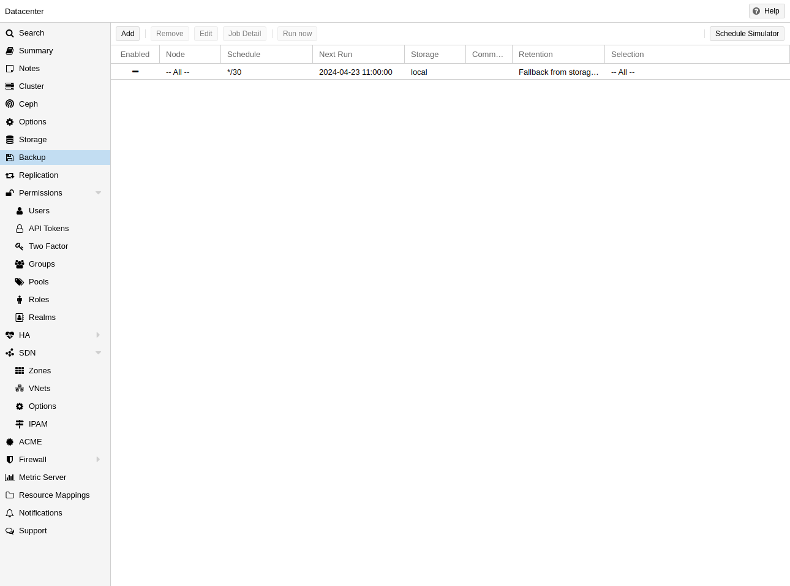
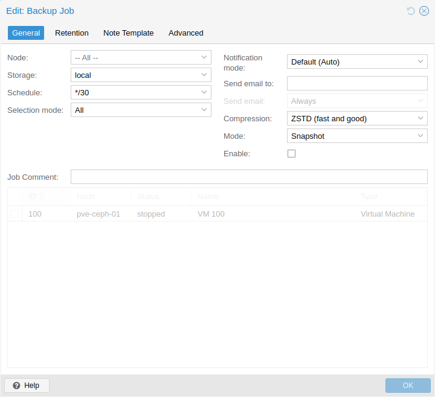
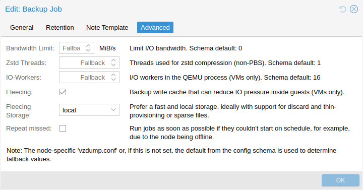
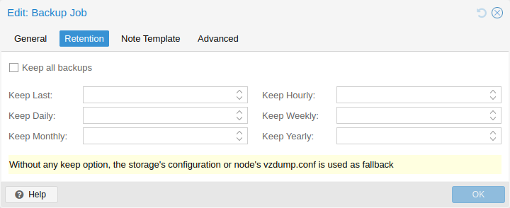
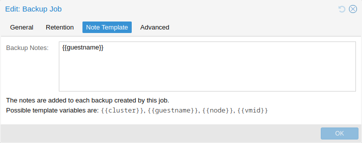

# vzdump(1)

## 名称 <a href="#chapter_vzdump" id="chapter_vzdump"></a>

vzdump \- 虚拟机和容器备份工具

## 概要 <a href="#synopsis" id="synopsis"></a>

### **vzdump** `help` <a href="#cli_vzdump_help" id="cli_vzdump_help"></a>

### **vzdump** `{<vmid>}` `[OPTIONS]` <a href="#cli_vzdump" id="cli_vzdump"></a>

创建备份。

**`<vmid>`: `<string>`**

要备份的客户机系统 ID。

**`--all` `<boolean>` （*默认值 \=* `0`）**

备份此宿主机上所有已知的客户机系统。

**`--bwlimit` `<integer> (0 - N)` （*默认值 \=* `0`）**

限制 I/O 带宽（KiB/s）。

**`--compress` `<0 | 1 | gzip | lzo | zstd>` （*默认值 \=* `0`）**

压缩转储文件。

**`--dumpdir` `<string>`**

将生成的文件存储到指定目录。

**`--exclude` `<string>`**

排除指定客户机系统（假定为 --all）

**`--exclude-path` `<array>`**

排除某些文件/目录（shell 通配模式）。以 */* 开头的路径以容器根目录为锚点，其他路径相对于每个子目录匹配。

**`--fleecing` `[[enabled=]<1|0>] [,storage=<storage ID>]`**

备份 fleecing 的选项（仅限虚拟机）。

**`--ionice` `<integer> (0 - 8)` （*默认值 \=* `7`）**

使用 BFQ 调度器时设置 IO 优先级。对于虚拟机的 snapshot 和 suspend 模式备份，这仅影响压缩程序。值为 8 表示使用空闲优先级，否则使用尽力而为优先级及指定值。

**`--job-id` `\S+`**

备份任务的 ID。如果设置，备份通知的 *backup-job* 元数据字段将设置为此值。只有 [root@pam](mailto:root@pam) 可以设置此参数。

**`--lockwait` `<integer> (0 - N)` （*默认值 \=* `180`）**

等待全局锁的最长时间（分钟）。

**`--mailnotification` `<always | failure>` （*默认值 \=* `always`）**

已弃用：请改用通知目标/匹配器。指定何时发送通知邮件

**`--mailto` `<string>`**

已弃用：请改用通知目标/匹配器。应接收电子邮件通知的电子邮件地址或用户的逗号分隔列表。

**`--mode` `<snapshot | stop | suspend>` （*默认值 \=* `snapshot`）**

备份模式。

**`--node` `<string>`**

仅在此节点上执行时运行。

**`--notes-template` `<string>`**

用于生成备份备注的模板字符串。可包含变量，这些变量会被替换为其值。目前支持 {\\{\\cluster}}、{\\{\\guestname}}、{\\{\\node}} 和 {\\{\\vmid}}，未来可能添加更多。必须为单行，换行和反斜杠分别需要转义为 *\\n* 和 *\\\\*。


需要选项：`storage`


**`--notification-mode` `<auto | legacy-sendmail | notification-system>` （*默认值 \=* `auto`）**

确定要使用的通知系统。如果设为 *legacy-sendmail*，vzdump 会考虑 mailto/mailnotification 参数，并通过 *sendmail* 命令向指定地址发送电子邮件。如果设为 *notification-system*，则通过 PVE 通知系统发送通知，并忽略 mailto 和 mailnotification。如果设为 *auto*（默认设置），在设置了 mailto 时会发送电子邮件，否则使用通知系统。

**`--pbs-change-detection-mode` `<data | legacy | metadata>`**

用于检测文件更改并切换容器备份编码格式的 PBS 模式。

**`--performance` `[max-workers=<integer>] [,pbs-entries-max=<integer>]`**

其他性能相关设置。

**`--pigz` `<integer>` （*默认值 \=* `0`）**

N\>0 时使用 pigz 代替 gzip。N\=1 使用一半核心，N\>1 使用 N 作为线程数。

**`--pool` `<string>`**

备份指定池中包含的所有已知客户机系统。

**`--protected` `<boolean>`**

如果为 true，将备份标记为受保护。


需要选项：`storage`


**`--prune-backups` `[keep-all=<1|0>] [,keep-daily=<N>] [,keep-hourly=<N>] [,keep-last=<N>] [,keep-monthly=<N>] [,keep-weekly=<N>] [,keep-yearly=<N>]` （*默认值 \=* `keep-all=1`）**

使用这些保留选项，替代存储配置中的保留选项。

**`--quiet` `<boolean>` （*默认值 \=* `0`）**

静默运行。

**`--remove` `<boolean>` （*默认值 \=* `1`）**

根据 *prune-backups* 清理较旧的备份。

**`--script` `<string>`**

使用指定的钩子脚本。

**`--stdexcludes` `<boolean>` （*默认值 \=* `1`）**

排除临时文件和日志。

**`--stdout` `<boolean>`**

将 tar 写入 stdout，而不是文件。

**`--stop` `<boolean>` （*默认值 \=* `0`）**

停止此宿主机上正在运行的备份任务。

**`--stopwait` `<integer> (0 - N)` （*默认值 \=* `10`）**

等待客户机系统停止的最长时间（分钟）。

**`--storage` `<storage ID>`**

将生成的文件保存到此存储。

**`--tmpdir` `<string>`**

将临时文件保存到指定目录。

**`--zstd` `<integer>` （*默认值 \=* `1`）**

Zstd 线程数。N\=0 使用可用核心的一半；如果 N 设置为大于 0 的值，则使用 N 作为线程数。

## 描述 <a href="#description" id="description"></a>

任何合理的 IT 部署都需要备份，Proxmox VE 利用各存储和各客户机系统类型的能力，提供完全集成的解决方案。这允许系统管理员通过 `mode` 选项在备份一致性与客户机系统停机时间之间进行微调。

Proxmox VE 备份始终是完整备份，包含虚拟机/容器配置和全部数据。可通过 GUI 或 `vzdump` 命令行工具启动备份。

**备份存储**

运行备份之前，必须定义备份存储。如何添加存储，请参阅[存储文档](pvesm-1.md#chapter_storage)。它可以是 Proxmox Backup Server 存储，备份以去重数据块和元数据的形式保存；也可以是文件级存储，备份以普通文件形式保存。由于 Proxmox Backup Server 具有高级功能，建议在专用宿主机上使用它。使用 NFS 服务器也是很好的替代方案。无论哪种情况，您可能都希望稍后将这些备份保存到磁带机，以进行异地归档。

**计划备份**

可以为选定的节点和客户机系统安排备份任务，使其在指定日期和时间自动执行。更多内容请参阅[备份任务](#vzdump_jobs)章节。

## 备份模式 <a href="#backup_modes" id="backup_modes"></a>

根据客户机类型，有多种方式提供一致性（选项 `mode`）。

**虚拟机的备份模式：**

**`stop` 模式**

此模式以虚拟机短暂停机为代价，提供最高的备份一致性。其工作方式是先有序关闭虚拟机，然后运行后台 QEMU 进程备份虚拟机数据。备份开始后，如果虚拟机此前正在运行，将恢复全面运行模式。一致性通过在线备份功能保证。

**`suspend` 模式**

此模式出于兼容性原因提供，在调用 `snapshot` 模式之前暂停虚拟机。由于暂停虚拟机会造成更长的停机时间，并且不一定提高数据一致性，建议改用 `snapshot` 模式。

**`snapshot` 模式**

此模式以少量不一致风险为代价，提供最短的运行停机时间。其工作方式是执行 Proxmox VE 在线备份，在虚拟机运行时复制数据块。如果启用客户机代理（`agent: 1`）且其正在运行，会调用 `guest-fsfreeze-freeze` 和 `guest-fsfreeze-thaw` 以提高一致性。


如果在 Windows 客户机内使用其他备份软件，则必须配置客户机代理。详情请参阅客户机代理章节中的[冻结与解冻](qm-1.md#qm_qga_fsfreeze)。


有关用于 QemuServer 的 Proxmox VE 在线备份的技术概述，可在线查阅 [此处](https://git.proxmox.com/?p=pve-qemu.git;a=blob_plain;f=backup.txt)。


Proxmox VE 在线备份在任意存储类型上提供类似快照的语义，不要求底层存储支持快照。另请注意，由于备份通过后台 QEMU 进程完成，因此当 QEMU 读取虚拟机磁盘时，已停止的虚拟机会短暂显示为正在运行。不过，虚拟机本身并未启动，只是读取其磁盘。


**容器的备份模式：**

**`stop` 模式**

在整个备份期间停止容器。这可能导致非常长的停机时间。

**`suspend` 模式**

此模式使用 rsync 将容器数据复制到临时位置（参见选项 `--tmpdir`）。然后暂停容器，再执行一次 rsync 复制已更改的文件。之后，再次启动（恢复）容器。这可使停机时间最短，但需要额外空间来保存容器副本。

当容器位于本地文件系统，而备份目标存储是 NFS/CIFS 服务器时，还应将 `--tmpdir` 设为位于本地文件系统，这会使性能提高数倍。如果备份存储为 NFS 服务器，并且要在 suspend 模式下备份使用 ACL 的本地容器，也必须使用本地 `tmpdir`。

**`snapshot` 模式**

此模式使用底层存储的快照功能。首先暂停容器，以确保数据一致性。随后为容器卷创建临时快照，并将快照内容归档到 tar 文件中。最后再次删除临时快照。


`snapshot` 模式要求所有备份的卷都位于支持快照的存储上。使用 `backup=no` 挂载点选项，可以将单独的卷排除在备份之外（因而也不受此要求限制）。



默认情况下，除根磁盘挂载点外，其他挂载点不包含在备份中。对于卷挂载点，可以设置 **备份** 选项，将挂载点包含在备份中。设备挂载和绑定挂载从不备份，因为其内容由 Proxmox VE 存储库之外管理。


### 虚拟机备份 Fleecing <a href="#vm_backup_fleecing" id="vm_backup_fleecing"></a>

启动虚拟机备份时，QEMU 会在其块层安装“写前复制”过滤器。此过滤器确保当客户机发生新写入时，会先将备份仍需要的旧数据发送到备份目标。客户机写入会阻塞到此操作完成，因此客户机对尚未备份扇区的 IO 会受备份目标速度限制。

使用备份 fleecing 时，这些旧数据会缓存在 fleecing 镜像中，而非直接发送到备份目标。这有助于提高客户机 IO 性能，甚至可在某些场景中避免挂起，代价是需要更多存储空间。

要手动启动虚拟机 `123` 的备份，并在存储 `local-lvm` 上创建 fleecing 镜像，请运行

```text
vzdump 123 --fleecing enabled=1,storage=local-lvm
```

与往常一样，可以为特定备份任务设置此选项，也可以通过[配置选项](#vzdump_configuration)将其设为节点范围的回退值。在界面中，编辑备份任务时可在*高级*选项卡配置 fleecing。

fleecing 存储应是快速本地存储，支持精简置备和 discard。例如 LVM-thin、RBD、在存储配置中设置了 `sparse 1` 的 ZFS，以及许多基于文件的存储。理想情况下，fleecing 存储应为专用存储，这样即使空间耗尽，也不会影响其他客户机，只会使备份失败。fleecing 镜像中已完成备份的部分会被丢弃，以尽量保持较低的空间用量。

对于不支持 discard 的基于文件的存储（例如 4.2 之前版本的 NFS），应在存储配置中设置 `preallocation off`。与 `qcow2`（存储支持时，自动用作 fleecing 镜像格式）结合使用时，其优点是镜像中已分配的部分以后可以复用，仍可节省相当多的空间。


在未使用精简置备的存储上，例如 LVM 或没有 `sparse` 选项的 ZFS，需要提前为 fleecing 镜像预留原始磁盘的全部大小。在精简置备存储上，只有当备份正在处理另一块磁盘、而客户机重写了整块磁盘时，fleecing 镜像才可能增长到与原始镜像相同的大小。


### 容器更改检测模式 <a href="#ct_change_detection_mode" id="ct_change_detection_mode"></a>

设置变更检测模式会定义 pxar 归档的编码格式，以及以 Proxmox Backup Server 为目标备份容器时，如何处理已更改和未更改的文件。

编辑任务时，可以在*高级*选项卡中为单个备份任务配置更改检测模式选项。此外，还可以通过[配置选项](#vzdump_configuration)将此选项设为节点范围的回退值。

有 3 种可用的变更检测模式：

<table>


<thead>
<tr>
<th>模式</th>
<th>描述</th>
</tr>
</thead>
<tbody>
<tr>
<td><p>Default</p></td>
<td><p>读取所有文件并编码到单个归档中，使用 pxar 格式版本 1。</p></td>
</tr>
<tr>
<td><p>Data</p></td>
<td><p>读取并编码所有文件，但将数据和元数据拆分为独立流，使用 pxar 格式版本 2。</p></td>
</tr>
<tr>
<td><p>Metadata</p></td>
<td><p>像 <code>Data</code> 一样拆分流并使用归档格式版本 2，但使用上一个快照的元数据归档（如果存在）检测未更改的文件，并尽可能复用其数据块，而无需从磁盘读取文件内容。</p></td>
</tr>
</tbody>
</table>

要使用变更检测模式 `metadata` 执行备份，可以运行

```text
vzdump 123 --storage pbs-storage --pbs-change-detection-mode metadata
```


虚拟机备份或备份到 Proxmox Backup Server 以外的存储后端不受此设置影响。


## 备份文件名 <a href="#backup_file_names" id="backup_file_names"></a>

较新版本的 vzdump 将客户机类型和备份时间编码到文件名中，例如

```text
vzdump-lxc-105-2009_10_09-11_04_43.tar
```

这样就可以在同一目录中保存多个备份。可以通过各种保留选项限制保留的备份数量，请参阅下方的[备份保留](#vzdump_retention)章节。

## 备份文件压缩 <a href="#backup_file_compression" id="backup_file_compression"></a>

备份文件可以使用以下算法之一压缩：`lzo` [\[1\]](#note-6c818b60-1)、`gzip` [\[2\]](#note-6c818b60-2) 或 `zstd` [\[3\]](#note-6c818b60-3)。

目前，Zstandard（zstd）是这三种算法中最快的。多线程是 zstd 相对于 lzo 和 gzip 的另一个优势。Lzo 和 gzip 使用更广泛，并且通常默认安装。

可以安装 pigz [\[4\]](#note-6c818b60-4)，直接替代 gzip，通过多线程提供更好的性能。对于 pigz 和 zstd，可以调整线程/核心数量。请参阅下方的[配置选项](#vzdump_configuration)。

通常可以通过备份文件名的扩展名确定创建备份时使用了哪种压缩算法。

<table>


<tbody>
<tr>
<td><p>.zst</p></td>
<td><p>Zstandard（zstd）压缩</p></td>
</tr>
<tr>
<td><p>.gz 或 .tgz</p></td>
<td><p>gzip 压缩</p></td>
</tr>
<tr>
<td><p>.lzo</p></td>
<td><p>lzo 压缩</p></td>
</tr>
</tbody>
</table>

如果备份文件名不是以上任何文件扩展名结尾，则未由 vzdump 压缩。

## 备份加密 <a href="#backup_encryption" id="backup_encryption"></a>

对于 Proxmox Backup Server 存储，可以选择设置备份的客户端加密，参见[相应章节。](pvesm-1.md#storage_pbs_encryption)

## 备份任务 <a href="#vzdump_jobs" id="vzdump_jobs"></a>

[](https://pve.proxmox.com/pve-docs/images/screenshot/gui-cluster-backup-overview.png)

除手动触发备份外，还可以设置定期作业，将全部或选定的虚拟客户机备份到存储。可以在 UI 的 *数据中心* → *备份* 下管理作业，或通过 `/cluster/backup` API 端点管理。两者都会在 `/etc/pve/jobs.cfg` 中生成作业条目，由 `pvescheduler` 守护进程解析并执行。

[](https://pve.proxmox.com/pve-docs/images/screenshot/gui-cluster-backup-edit-01-general.png)

任务可以配置为针对所有集群节点或某个特定节点，并按给定计划执行。计划格式与 `systemd` 日历事件非常相似，详情请参阅日历事件章节。界面中的*计划*字段可以自由编辑，其下拉列表包含多个可作为起点的示例。

可以配置任务特定的[保留选项](#vzdump_retention)，覆盖存储或节点配置中的选项；也可以配置[备注模板](#vzdump_notes)，将额外信息随备份一起保存。

当宿主机在计划时间离线或 pvescheduler 被禁用时，计划备份会错过执行，因此可以配置补执行行为。启用 `Repeat missed` 选项（位于 UI 的 *高级* 选项卡，配置中为 `repeat-missed`），即可告知调度器应尽快运行错过的作业。

[](https://pve.proxmox.com/pve-docs/images/screenshot/gui-cluster-backup-edit-04-advanced.png)

有一些设置可以调优备份性能（其中部分位于界面的*高级*选项卡中）。最值得注意的是用于限制 I/O 带宽的 `bwlimit`。压缩器使用的线程数可以分别通过 `pigz`（替代 `gzip`）和 `zstd` 设置控制。此外，还有 `ionice`（使用 BFQ 调度器时），以及作为 `performance` 设置一部分的 `max-workers`（仅影响虚拟机备份）和 `pbs-entries-max`（仅影响容器备份）。详情请参阅[配置选项](#vzdump_configuration)。

## 备份保留 <a href="#vzdump_retention" id="vzdump_retention"></a>

通过 `prune-backups` 选项，可以灵活指定要保留哪些备份。

[](https://pve.proxmox.com/pve-docs/images/screenshot/gui-cluster-backup-edit-02-retention.png)

可用的保留选项如下：

**`keep-all <boolean>`**

保留所有备份。如果此项为 `true`，则不能设置其他选项。

**`keep-last <N>`**

保留最后 `<N>` 个备份。

**`keep-hourly <N>`**

保留最近 `<N>` 小时的备份。如果同一小时有多个备份，只保留最新的。

**`keep-daily <N>`**

保留最近 `<N>` 天的备份。如果同一天有多个备份，只保留最新的。

**`keep-weekly <N>`**

保留最近 `<N>` 周的备份。如果同一周有多个备份，只保留最新的。


一周从星期一开始，到星期日结束。软件使用 `ISO week date` 系统，并正确处理年末的周数。


**`keep-monthly <N>`**

保留最近 `<N>` 个月的备份。如果同一个月有多个备份，只保留最新的。

**`keep-yearly <N>`**

保留最近 `<N>` 年的备份。如果同一年有多个备份，只保留最新的。

保留选项按上述顺序处理。每个选项仅涵盖其时间段内的备份。下一个选项不处理已涵盖的备份，只考虑更早的备份。

以逗号分隔的列表指定要使用的保留选项，例如：

```text
# vzdump 777 --prune-backups keep-last=3,keep-daily=13,keep-yearly=9
```

虽然可以将 `prune-backups` 直接传递给 `vzdump`，但通常在存储级别配置此设置更合理，可通过 Web 界面完成。

### 清理模拟器 <a href="#prune_simulator" id="prune_simulator"></a>

可以使用 [Proxmox Backup Server 文档中的清理模拟器](https://pbs.proxmox.com/docs/prune-simulator)，探索不同保留选项对各种备份计划的影响。

### 保留设置示例 <a href="#retention_settings_example" id="retention_settings_example"></a>

备份频率和旧备份的保留可能取决于特定工作负载中数据更改的频繁程度，以及较早状态的重要程度。当备份充当公司的文档归档时，还可能存在关于备份保存期限的法律要求。

在此示例中，假设您每天进行备份，保留期为 10 年，且保存的备份之间的间隔逐渐增长。

`keep-last=3` \- 即使只进行每日备份，管理员也可能希望在重大升级之前或之后创建额外备份。设置 keep-last 可确保这一点。

未设置 `keep-hourly` \- 对于每日备份，这无关紧要。keep-last 已涵盖额外的手动备份。

`keep-daily=13` \- 与至少涵盖一天的 keep-last 一起使用，确保至少拥有两周的备份。

`keep-weekly=8` \- 确保至少拥有两个完整月的每周备份。

`keep-monthly=11` \- 与前面的保留设置一起使用，确保至少拥有一年的每月备份。

`keep-yearly=9` \- 用于长期归档。由于前面的选项已涵盖当前年份，应将此项设为九以保留其余年份，从而总共至少覆盖 10 年。

建议使用长于环境最低要求的保留期；如果发现不必要地过长，可以随时缩短，但一旦备份被移除，就无法重新创建。

## 备份保护 <a href="#vzdump_protection" id="vzdump_protection"></a>

可以将备份标记为 `protected`，以防止将其移除。尝试通过 Proxmox VE 的 UI、CLI 或 API 移除受保护备份会失败。不过，此保护由 Proxmox VE 而非文件系统强制实施，这意味着任何对底层备份存储具有写入权限的人仍可手动移除备份文件本身。


受保护备份会被清理操作忽略，也不计入保留设置。


对于基于文件系统的存储，通过哨兵文件 `<backup-name>.protected` 实现保护。对于 Proxmox Backup Server，由服务器端处理（自 Proxmox Backup Server 2.1 版本起提供）。

使用存储选项 `max-protected-backups` 控制存储上每个客户机允许的受保护备份数量。使用 `-1` 表示无限制。具有 `Datastore.Allocate` 权限的用户默认无限制，其他用户默认为 `5`。

## 备份备注 <a href="#vzdump_notes" id="vzdump_notes"></a>

可以使用 UI 中的 *编辑备注* 按钮，或通过存储内容 API 为备份添加备注。

[](https://pve.proxmox.com/pve-docs/images/screenshot/gui-cluster-backup-edit-03-template.png)

还可以指定模板，为备份作业和手动备份动态生成备注。模板字符串可包含由两个花括号包围的变量，在执行备份时会替换为相应值。

目前支持：

- `{{cluster}}` 集群名称（如果存在）
- `{{guestname}}` 虚拟客户机分配的名称
- `{{node}}` 创建备份所在节点的主机名
- `{{vmid}}` 客户机的数字 VMID

通过 API 或 CLI 指定时，必须为单行，其中换行和反斜杠分别需要转义为字面值 `\n` 和 `\\`。

## 恢复 <a href="#vzdump_restore" id="vzdump_restore"></a>

可以通过 Proxmox VE Web GUI 或以下 CLI 工具恢复备份归档：

**`pct restore`**

容器恢复实用程序

**`qmrestore`**

虚拟机恢复实用程序

详情参见相应手册页。

### 带宽限制 <a href="#bandwidth_limit" id="bandwidth_limit"></a>

恢复一个或多个大型备份可能需要大量资源，尤其是从备份存储读取和向目标存储写入所需的存储带宽。这可能对其他虚拟客户机产生负面影响，因为存储访问可能拥塞。

为避免这种情况，可以为备份作业设置带宽限制。Proxmox VE 为归档恢复实现两种限制：

- 单次恢复限制：表示读取备份归档的最大带宽
- 单个存储写入限制：表示写入特定存储所用的最大带宽

读取限制会间接影响写入限制，因为写入量不能超过读取量。较小的单作业限制会覆盖较大的单存储限制。较大的单作业限制只有在您对受影响存储具有“Data.Allocate”权限时才会覆盖单存储限制。

可以使用“--bwlimit \<integer\>\` option from the restore CLI commands to set up a restore job specific bandwidth limit. KiB/s is used as unit for the limit, this means passing \`10240”将备份读取速度限制为 10 MiB/s，确保其余可用存储带宽留给已经运行的虚拟客户机，从而使备份不影响其运行。


可以将“0”用于 `bwlimit` 参数，以禁用特定恢复作业的所有限制。如果需要尽快恢复非常重要的虚拟客户机，这可能很有帮助。（需要存储上的“Data.Allocate”权限）


通常，存储的总体可用带宽随时间保持不变，因此我们实现了为每个已配置存储设置默认带宽限制的功能，可通过以下方式完成：

```text
# pvesm set STORAGEID --bwlimit restore=KIBs
```

### 在线恢复 <a href="#live_restore" id="live_restore"></a>

恢复大型备份可能需要很长时间，在此期间客户机仍不可用。对于存储在 Proxmox Backup Server 上的虚拟机备份，可以使用在线恢复选项缩短此等待时间。

通过 GUI 中的复选框或 `--live-restore` 参数（属于 `qmrestore`）启用在线恢复后，虚拟机会在恢复开始时立即启动。数据在后台复制，优先处理虚拟机正在访问的数据块。

请注意，这有两点需要留意：

- 在线恢复期间，虚拟机的磁盘读取速度会受限，因为必须从备份服务器加载数据（不过一旦加载，数据就会立即在目标存储上可用，因此访问同一数据两次时，只有第一次会产生额外开销）。写入速度基本不受影响。
- 如果在线恢复因任何原因失败，虚拟机将处于未定义状态，也就是说，可能并非所有数据都已从备份复制，而且 *很可能* 无法保留失败的恢复操作期间写入的任何数据。

这种运行模式特别适合大型虚拟机，其初始运行只需要少量数据，例如 Web 服务器：操作系统和必要服务启动后，虚拟机即可运行，而后台任务继续复制很少使用的数据。

### 单文件恢复 <a href="#single_file_restore" id="single_file_restore"></a>

*文件恢复* 按钮位于存储 GUI 的 *备份* 选项卡中，可用于直接针对备份中包含的数据打开文件浏览器。此功能仅适用于 Proxmox Backup Server 上的备份。

对于容器，文件树的第一层显示所有包含的 *pxar* 归档，可自由打开和浏览。对于虚拟机，第一层显示包含的驱动器镜像，打开后会显示驱动器上发现的受支持存储技术列表。在最基本的情况下，会有一个名为 *part* 的条目，表示分区表，其中包含驱动器上发现的每个分区的条目。请注意，对于虚拟机，可能并非所有数据都可访问（不支持的客户机文件系统、存储技术等）。

可以使用 *下载* 按钮下载文件和目录，目录会即时压缩为 zip 归档。

为安全访问可能包含不受信任数据的虚拟机镜像，会启动一台临时虚拟机（不会显示为客户机）。这并不意味着从此类归档下载的数据本身是安全的，但可避免虚拟化管理程序系统面临危险。该虚拟机会在超时后自行停止。从用户角度看，整个过程是透明的。


为便于故障排查，每个临时虚拟机实例都会在 `/var/log/proxmox-backup/file-restore/` 中生成日志文件。如果尝试恢复单个文件或访问备份归档中的文件系统失败，日志文件可能包含更多信息。


## 配置 <a href="#vzdump_configuration" id="vzdump_configuration"></a>

全局配置存储在 `/etc/vzdump.conf` 中。此文件使用简单的冒号分隔键/值格式。每行格式如下：

```text
OPTION: value
```

文件中的空行被忽略，以 `#` 字符开头的行视为注释，也被忽略。此文件中的值用作默认值，可在命令行中覆盖。

目前支持以下选项：

**`bwlimit`：`<integer> (0 - N)`（*默认值 \=* `0`）**

限制 I/O 带宽（KiB/s）。

**`compress`：`<0 | 1 | gzip | lzo | zstd>`（*默认值 \=* `0`）**

压缩转储文件。

**`dumpdir`: `<string>`**

将生成的文件存储到指定目录。

**`exclude-path`: `<array>`**

排除某些文件/目录（shell 通配模式）。以 */* 开头的路径以容器根目录为锚点，其他路径相对于每个子目录匹配。

**`fleecing`: `[[enabled=]<1|0>] [,storage=<storage ID>]`**

备份 fleecing 的选项（仅限虚拟机）。

**`enabled`\=`<boolean>`（*默认值 \=* `0`）**

启用备份 fleecing。当客户机发生新的块写入时，将这些块的备份数据缓存在指定存储上，而非直接复制到备份目标。这有助于提高客户机 IO 性能，甚至避免挂起，代价是需要更多存储空间。

**`storage`\=`<storage ID>`**

使用此存储保存 fleecing 镜像。为高效利用空间，最好使用支持 discard 且支持精简置备或稀疏文件的本地存储。

**`ionice`：`<integer> (0 - 8)`（*默认值 \=* `7`）**

使用 BFQ 调度器时设置 IO 优先级。对于虚拟机的 snapshot 和 suspend 模式备份，这仅影响压缩程序。值为 8 表示使用空闲优先级，否则使用尽力而为优先级及指定值。

**`lockwait`：`<integer> (0 - N)`（*默认值 \=* `180`）**

等待全局锁的最长时间（分钟）。

**`mailnotification`：`<always | failure>`（*默认值 \=* `always`）**

已弃用：请改用通知目标/匹配器。指定何时发送通知邮件

**`mailto`: `<string>`**

已弃用：请改用通知目标/匹配器。应接收电子邮件通知的电子邮件地址或用户的逗号分隔列表。

**`mode`：`<snapshot | stop | suspend>`（*默认值 \=* `snapshot`）**

备份模式。

**`notes-template`: `<string>`**

用于生成备份备注的模板字符串。可包含变量，这些变量会被替换为其值。目前支持 {\\{\\cluster}}、{\\{\\guestname}}、{\\{\\node}} 和 {\\{\\vmid}}，未来可能添加更多。必须为单行，换行和反斜杠分别需要转义为 *\\n* 和 *\\\\*。


需要选项：`storage`


**`notification-mode`：`<auto | legacy-sendmail | notification-system>`（*默认值 \=* `auto`）**

确定要使用的通知系统。如果设为 *legacy-sendmail*，vzdump 会考虑 mailto/mailnotification 参数，并通过 *sendmail* 命令向指定地址发送电子邮件。如果设为 *notification-system*，则通过 PVE 通知系统发送通知，并忽略 mailto 和 mailnotification。如果设为 *auto*（默认设置），在设置了 mailto 时会发送电子邮件，否则使用通知系统。

**`pbs-change-detection-mode`: `<data | legacy | metadata>`**

用于检测文件更改并切换容器备份编码格式的 PBS 模式。

**`performance`: `[max-workers=<integer>] [,pbs-entries-max=<integer>]`**

其他性能相关设置。

**`max-workers`\=`<integer> (1 - 256)`（*默认值 \=* `16`）**

适用于虚拟机。允许同时最多运行此数量的 IO 工作线程。

**`pbs-entries-max`\=`<integer> (1 - N)`（*默认值 \=* `1048576`）**

适用于发送到 PBS 的容器备份。限制任一时刻内存中允许的条目数量，以避免意外的 OOM 情况。增大此值可备份包含大量文件的容器。

**`pigz`：`<integer>`（*默认值 \=* `0`）**

N\>0 时使用 pigz 代替 gzip。N\=1 使用一半核心，N\>1 使用 N 作为线程数。

**`pool`: `<string>`**

备份指定池中包含的所有已知客户机系统。

**`protected`: `<boolean>`**

如果为 true，将备份标记为受保护。


需要选项：`storage`


**`prune-backups`：`[keep-all=<1|0>] [,keep-daily=<N>] [,keep-hourly=<N>] [,keep-last=<N>] [,keep-monthly=<N>] [,keep-weekly=<N>] [,keep-yearly=<N>]`（*默认值 \=* `keep-all=1`）**

使用这些保留选项，替代存储配置中的保留选项。

**`keep-all`\=`<boolean>`**

保留所有备份。为 true 时与其他选项冲突。

**`keep-daily`\=`<N>`**

保留最近 \<N\> 个不同日期的备份。如果同一天有多个备份，只保留最新的。

**`keep-hourly`\=`<N>`**

保留最近 \<N\> 个不同小时的备份。如果同一小时有多个备份，只保留最新的。

**`keep-last`\=`<N>`**

保留最后 \<N\> 个备份。

**`keep-monthly`\=`<N>`**

保留最近 \<N\> 个不同月份的备份。如果同一个月有多个备份，只保留最新的。

**`keep-weekly`\=`<N>`**

保留最近 \<N\> 个不同周的备份。如果同一周有多个备份，则只保留最新的备份。

**`keep-yearly`\=`<N>`**

保留最近 \<N\> 个不同年份的备份。如果同一年有多个备份，则只保留最新的备份。

**`remove`：`<boolean>`（*默认值 \=* `1`）**

根据 *prune-backups* 清理较旧的备份。

**`script`: `<string>`**

使用指定的钩子脚本。

**`stdexcludes`：`<boolean>`（*默认值 \=* `1`）**

排除临时文件和日志。

**`stopwait`：`<integer> (0 - N)`（*默认值 \=* `10`）**

等待客户机系统停止的最长时间（分钟）。

**`storage`: `<storage ID>`**

将生成的文件保存到此存储。

**`tmpdir`: `<string>`**

将临时文件保存到指定目录。

**`zstd`：`<integer>`（*默认值 \=* `1`）**

Zstd 线程数。N\=0 使用可用核心的一半；如果 N 设置为大于 0 的值，则使用 N 作为线程数。

**`vzdump.conf` 配置示例**

```text
tmpdir: /mnt/fast_local_disk
storage: my_backup_storage
mode: snapshot
bwlimit: 10000
```

## 钩子脚本 <a href="#hook_scripts" id="hook_scripts"></a>

可以使用选项 `--script` 指定钩子脚本。此脚本会在备份过程的各个阶段被调用，并设置相应参数。文档目录（`vzdump-hook-script.pl`）中提供了一个示例。

## 文件排除 <a href="#file_exclusions" id="file_exclusions"></a>


此选项仅适用于容器备份。


`vzdump` 默认跳过以下文件（使用选项 `--stdexcludes 0` 禁用）

```text
/tmp/?*
/var/tmp/?*
/var/run/?*pid
```

也可以手动指定（额外的）排除路径，例如：

```text
# vzdump 777 --exclude-path /tmp/ --exclude-path '/var/foo*'
```

排除目录 `/tmp/` 以及名为 `/var/foo`、`/var/foobar` 等的任何文件或目录。


对于备份到 Proxmox Backup Server（PBS）的备份和 `suspend` 模式备份，以斜杠结尾的模式会匹配目录，但不匹配文件。另一方面，对于非 PBS 的 `snapshot` 模式和 `stop` 模式备份，以斜杠结尾的模式目前完全不会匹配，因为 `tar` 命令不支持这种模式。


不以 `/` 开头的路径不会锚定到容器的根目录，而是相对于任意子目录进行匹配。例如：

```text
# vzdump 777 --exclude-path bar
```

排除名为 `/bar`、`/var/bar`、`/var/foo/bar` 等的任何文件或目录，但不排除 `/bar2`。

配置文件也保存在备份归档中（位于 `./etc/vzdump/`），并会得到正确恢复。

## 示例 <a href="#examples" id="examples"></a>

仅转储客户机 777：不创建快照，只将客户机的私有区域和配置文件归档到默认转储目录（通常为 `/var/lib/vz/dump/`）。

```text
# vzdump 777
```

使用 rsync 和挂起/恢复创建快照（停机时间最短）。

```text
# vzdump 777 --mode suspend
```

备份所有客户机系统，并向 root 和 admin 发送通知邮件。由于设置了 `mailto`，且 `notification-mode` 默认设置为 `auto`，通知邮件通过系统的 `sendmail` 命令发送，而不是通过通知系统发送。

```text
# vzdump --all --mode suspend --mailto root --mailto admin
```

使用快照模式（无需停机）和非默认的转储目录。

```text
# vzdump 777 --dumpdir /mnt/backup --mode snapshot
```

备份多个客户机（选择性备份）

```text
# vzdump 101 102 103 --mailto root
```

备份除 101 和 102 以外的所有客户机

```text
# vzdump --mode suspend --exclude 101,102
```

将容器恢复为新的 CT 600

```text
# pct restore 600 /mnt/backup/vzdump-lxc-777.tar
```

将 QemuServer 虚拟机恢复为 VM 601

```text
# qmrestore /mnt/backup/vzdump-qemu-888.vma 601
```

使用管道将现有容器 101 克隆为具有 4GB 根文件系统的新容器 300

```text
# vzdump 101 --stdout | pct restore --rootfs 4 300 -
```

## 版权与免责声明 <a href="#copyright_and_disclaimer" id="copyright_and_disclaimer"></a>

版权所有 © 2007-2022 Proxmox Server Solutions GmbH

本程序是自由软件：您可以根据自由软件基金会发布的 GNU Affero General Public License 的条款重新分发和/或修改本程序，许可证版本可以是第 3 版，或（由您选择）任何更高版本。

本程序的分发是希望它能有用，但不提供任何担保；甚至没有适销性或特定用途适用性的默示担保。有关更多详情，请参阅 GNU Affero General Public License。

您应该已随本程序收到一份 GNU Affero General Public License 的副本。如果没有，请参阅 [https://www.gnu.org/licenses/](https://www.gnu.org/licenses/)

<a id="footnotes"></a>


---

## 注释

### 注释 1 <a href="#note-6c818b60-1" id="note-6c818b60-1"></a>

Lempel–Ziv–Oberhumer，无损数据压缩算法 [https://en.wikipedia.org/wiki/Lempel-Ziv-Oberhumer](https://en.wikipedia.org/wiki/Lempel-Ziv-Oberhumer)

### 注释 2 <a href="#note-6c818b60-2" id="note-6c818b60-2"></a>

gzip \- 基于 DEFLATE 算法 [https://en.wikipedia.org/wiki/Gzip](https://en.wikipedia.org/wiki/Gzip)

### 注释 3 <a href="#note-6c818b60-3" id="note-6c818b60-3"></a>

Zstandard，无损数据压缩算法 [https://en.wikipedia.org/wiki/Zstandard](https://en.wikipedia.org/wiki/Zstandard)

### 注释 4 <a href="#note-6c818b60-4" id="note-6c818b60-4"></a>

pigz \- gzip 的并行实现 [https://zlib.net/pigz/](https://zlib.net/pigz/)

---

来源：[Proxmox VE 官方文档](https://pve.proxmox.com/pve-docs/vzdump.1.html) · 版本 9.2.13 · 非官方中文翻译。
